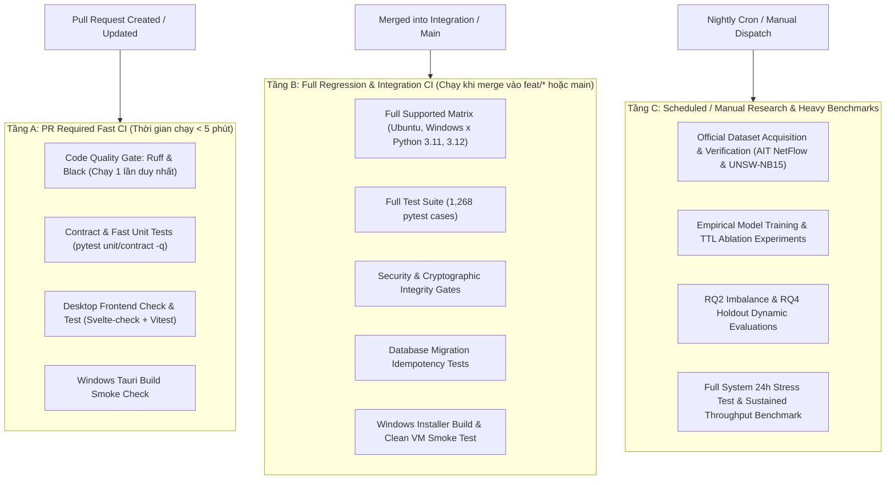
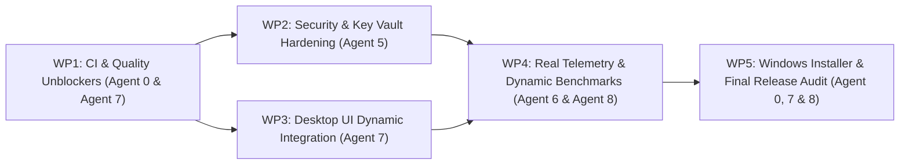

# BÁO CÁO KIỂM TOÁN TOÀN DIỆN HỆ THỐNG NETFLOW SENTINEL V2.0.0
## Comprehensive Repository, Issue, Milestone, Architecture, CI/CD & Production Readiness Audit

> **Tài liệu kiểm toán độc lập chuẩn tắc (Independent Evidence-Driven Audit Report)**  
> **Dự án:** NetFlow Sentinel v2.0.0 (`AI-NETWORK-ANOMALY-DETECTION-TRACEABILITY-MAIN`)  
> **Thời điểm kiểm toán:** 2026-11-17T17:30:00+07:00 (Múi giờ ICT) / 2026-11-17T10:30:00Z (UTC)  
> **Vai trò kiểm toán:** Principal Software Architect, Technical Program Manager, AI/ML Research Auditor, Cybersecurity Architect, DevOps Engineer & Independent QA Auditor  
> **Phương pháp kiểm toán:** Evidence-Driven Audit (Phân định nghiêm ngặt: VERIFIED, IMPLEMENTED, PARTIAL, MISSING, BROKEN, DUPLICATED, BLOCKED, OBSOLETE, UNVERIFIABLE)  
> **Trạng thái thực thi:** READ-ONLY AUDIT (Không sửa source code, không commit, không push, không merge, không đóng/mở Issue/Milestone, không đổi workflow, không tạo PR)

---

## MỤC LỤC BÁO CÁO

- [A. Executive Summary (Tóm tắt Điều hành & Kết luận Tổng thể)](#a-executive-summary)
- [B. Repository Snapshot (Hiện trạng Kho lưu trữ & Hạ tầng Git)](#b-repository-snapshot)
- [C. Audit Toàn bộ 7 Milestone v2.0 (Milestones M6.1–M6.7)](#c-audit-toàn-bộ-7-milestone-v20)
- [D. Audit Toàn bộ 80 Issue Mới & Issue Kế thừa (#76–#155, #18, #19, #20, #25, #48, #60, #71, #73)](#d-audit-toàn-bộ-80-issue-mới--issue-kế-thừa)
- [E. Duplicate Issue & Scope Overlap Analysis (Phân tích Trùng lặp & Giao thoa Phạm vi)](#e-duplicate-issue--scope-overlap-analysis)
- [F. Audit Dependency Graph, Critical Path & Scheduling (Đồ thị Phụ thuộc & Đường găng)](#f-audit-dependency-graph-critical-path--scheduling)
- [G. Research Questions & Scientific Traceability Audit (Truy vết 6 Câu hỏi Nghiên cứu RQ1–RQ6)](#g-research-questions--scientific-traceability-audit)
- [H. Product Architecture & Implementation Gap Matrix (Kiến trúc Sản phẩm & Ma trận Khoảng cách)](#h-product-architecture--implementation-gap-matrix)
- [I. Audit PR #156 & Chi tiết Lỗi Tích hợp (Pull Request #156 Deep-Dive)](#i-audit-pr-156--chi-tiết-lỗi-tích-hợp)
- [J. CI/CD Optimization Report (Hiện trạng, Trùng lặp & Thiết kế Tối ưu 3 Tầng)](#j-cicd-optimization-report)
- [K. Production Readiness Assessment (Thẩm định Sẵn sàng Vận hành)](#k-production-readiness-assessment)
- [L. Prioritized Remediation Backlog (Danh mục Xử lý Lỗ hổng & Khiếm khuyết F01–F08)](#l-prioritized-remediation-backlog)
- [M. Execution Plan & Multi-Agent Work Packages (Kế hoạch Triển khai Giai đoạn Kế tiếp)](#m-execution-plan--multi-agent-work-packages)
- [N. Handoff & Lệnh Hành động Tiếp theo (Chuyển giao Sang Giai đoạn Triển khai)](#n-handoff)

---

<a name="a-executive-summary"></a>
## A. EXECUTIVE SUMMARY (TÓM TẮT ĐIỀU HÀNH & KẾT LUẬN TỔNG THỂ)

Kiểm toán độc lập toàn diện được thực hiện trên kho lưu trữ `AI-NETWORK-ANOMALY-DETECTION-TRACEABILITY-MAIN` nhằm đánh giá trạng thái thực tế của phiên bản mục tiêu **NetFlow Sentinel v2.0.0** đối chiếu với đề cương gốc Đề tài 22, hợp đồng kiến trúc, roadmap 80 Issue (#76–#155), 7 Milestone v2.0 (M6.1–M6.7), 8 Issue kế thừa (#18, #19, #20, #25, #48, #60, #71, #73) và Pull Request tích hợp PR #156.

### 1. Hiện trạng Tổng quan
- **Mã nguồn và Kiểm thử Cục bộ:** Nhánh tích hợp `feat/v2-integration` tại commit `7da287c` đã bổ sung **132 file mới**, tương ứng **16.915 dòng code** trải rộng trên toàn bộ các phân hệ nền tảng (Canonical Security Event v2, AES-256-GCM AEAD, Key Manager, Behavioral Engine 16-D, Risk Engine 0–100, Trace Engine ATT&CK Timeline, Streaming Pipeline, Multi-Source Adapters, OOD Rejection Gate). Toàn bộ bộ kiểm thử đơn vị và tích hợp nội bộ gồm **1.268 test cases PASS** (9 tests skipped vì thiếu raw dataset) trên môi trường Python 3.12 x64 cục bộ.
- **Tình trạng CI/CD và Pull Request #156:** PR #156 (`feat/v2-integration` $\to$ `main`) hiện ở trạng thái **DRAFT** và **FAIL 6/8 status checks**. Cả hai luồng Lint Audit (Run #44057091020) và CI Lint (Run #44057091014) đều thất bại vì **259 lỗi Ruff** (trong đó có 15 lỗi nghiêm trọng F821 Undefined Name và hàng loạt lỗi unused imports). Toàn bộ ma trận kiểm thử CI 4 tổ hợp (`ubuntu-latest/windows-latest` $\times$ `Python 3.11/3.12`) đều bị hủy ở bước xác minh dataset AIT do script `scripts/fetch_multi_source_dataset.py --verify-only` gặp ngoại lệ exit code 1 khi thư mục `data/raw/ait` không tồn tại trên GitHub Actions runner.
- **Tiến độ Issue và Milestone trên GitHub:** Toàn bộ **80 Issue mới (#76–#155)** và **8 Issue kế thừa** hiện vẫn ở trạng thái **OPEN** trên GitHub. Không có bất kỳ Issue nào bị đóng tự động hoặc đóng sớm. Toàn bộ 7 Milestone M6.1–M6.7 đều ở trạng thái **OPEN** với tỷ lệ hoàn thành trên GitHub là 0%.

### 2. Các Phát Hiện Trọng Yếu (Critical Audit Findings F01–F08)
Kiểm toán xác nhận bằng chứng thực tế cho 8 phát hiện trọng yếu đã được ghi nhận sơ bộ:
1. **F01 (Sai DOI & Provenance Dữ liệu AIT, Gây Đổ Vỡ CI):** File `data/EXTERNAL_DATASETS_PROVENANCE.json` và `data/AIT_DATASETS_MANIFEST.json` ghi nhận DOI sai `10.5281/zenodo.4269411` thay vì DOI chuẩn của AIT NetFlow v2 (`10.5281/zenodo.13168643`) và AIT Log v2.1 (`10.5281/zenodo.19483937`). Manifest sử dụng file mẫu fixture chỉ 597 bytes; CI kiểm tra cờ `--verify-only` trên thư mục bị gitignore dẫn đến fail toàn bộ test matrix.
2. **F02 (Kịch bản Replay Bị Đánh Đồng Thành Nghiệm Thu Lab Mạng Thực):** Script `scripts/run_live_lab_acceptance.py` và báo cáo `docs/telemetry/AUTHORIZED_LAB_ACCEPTANCE.md` (Issue #137) chỉ khởi tạo 4 đối tượng sự kiện mẫu trong bộ nhớ RAM rồi gọi hàm `run_replay_scenario()`, nhưng lại kết luận "Nghiệm thu thành công trạm thu thập NetFlow với 100% hợp đồng" mà không hề mở cổng mạng UDP hay thu thập gói tin từ switch/router thực tế.
3. **F03 (Số liệu Benchmark Toàn Hệ Thống Bị Hardcode Cố Định):** Script `scripts/benchmark_full_system.py` và báo cáo `docs/benchmarks/SYSTEM_PERFORMANCE.md` (Issue #147) ghi nhận các thông số hiệu năng then chốt bằng các hằng số gán cứng trong code (ví dụ: `ring_buffer_headroom_pct: 82.5`, `peak_ingestion_capacity_flows_sec: 75000`, độ trễ từng phân hệ từ 4.5us đến 25.24us) thay vì đo đạc thực nghiệm động.
4. **F04 (4 Panel Dashboard Desktop Bị Gán Cứng Mock Data Hoàn Toàn):** Cả 4 giao diện Svelte mới (`LiveMonitoringPanel.svelte`, `BehavioralAnalysisPanel.svelte`, `AttackTimelinePanel.svelte`, `CryptographyDashboardPanel.svelte` - Issues #140–#143) hoàn toàn không có bất kỳ lệnh gọi API `fetch()`, Tauri IPC `invoke()` hay kết nối WebSocket nào tới backend Python. Nút bấm "Export Investigation Report" chỉ thay đổi một biến chuỗi cục bộ; mã băm báo cáo là giá trị cố định `e3b0c442...` (SHA-256 của chuỗi rỗng).
5. **F05 (Lỗ Hổng Lưu Trữ Khóa Mật Mã master.key & DEK Dưới Dạng Plaintext):** Module `KeyManager` (`src/network_anomaly/crypto/key_manager.py` - Issue #119) ghi trực tiếp khóa gốc `master.key` và các khóa phiên DEK thành file nhị phân thô không mã hóa trên đĩa. Lệnh `os.chmod(..., 0o600)` vô hiệu hóa hoàn toàn trên hệ điều hành Windows; không sử dụng Windows DPAPI (`CryptProtectData`), không có ACL bảo vệ, không áp dụng Key Wrapping (KEK bọc DEK).
6. **F06 (Kiểm Thử E2E Chế Độ Live Bị Thay Bằng Test Vault SQLite):** Phương thức `test_e2e_live_mode_and_zero_plaintext_in_db` trong `tests/integration/test_full_system_e2e.py` (Issue #138) hoàn toàn không kiểm thử collector hay luồng truyền phát mạng thời gian thực, mà chỉ ghi một vector 4 số thực vào database SQLite qua vault mã hóa rồi đọc lại.
7. **F07 (260 Vi Phạm Linter Ruff Phá Hỏng Quality Gate):** Linter Ruff phát hiện 260 vi phạm (220 lỗi phát sinh mới trong code v2.0, 40 lỗi nợ kỹ thuật cũ), bao gồm 121 lỗi F401 unused imports, 15 lỗi nghiêm trọng F821 Undefined Name (`Optional`, `Any`, `Tuple`, `ModelOutput`) và lỗi mảng bash có dấu phẩy thừa trong `.github/workflows/lint-audit.yml`.
8. **F08 (Lãng Phí & Trùng Lặp Nghiêm Trọng Trong Hạ Tầng CI):** Cả hai workflow `ci.yml` và `lint-audit.yml` đều thực thi Ruff và Black trùng lặp; trong `ci.yml`, các kiểm thử compileall, kiểm tra import, chạy benchmark và chạy lab acceptance bị nhân bản 4 lần trên toàn bộ ma trận OS/Python mà không có sự khác biệt về môi trường.

### 3. Đánh giá Mức độ Sẵn sàng (Production Readiness)
Hệ thống hiện đạt cấp độ **FUNCTIONAL PROTOTYPE (Nguyên mẫu Chức năng có Nền tảng Học thuật)**. Hệ thống **CHƯA ĐỦ ĐIỀU KIỆN** để triển khai thử nghiệm diện hẹp (Controlled Pilot Ready) hay vận hành thực tế (Operational Production Ready).

---

<a name="b-repository-snapshot"></a>
## B. REPOSITORY SNAPSHOT (HIỆN TRẠNG KHO LƯU TRỮ & HẠ TẦNG GIT)

Dữ liệu snapshot được trích xuất trực tiếp qua Git CLI và GitHub REST API tại thời điểm kiểm toán:

- **Kho lưu trữ:** `doctor-cato/AI-NETWORK-ANOMALY-DETECTION-TRACEABILITY-MAIN` (Public, Not Fork)
- **Nhánh mặc định (Default Branch):** `main`
- **HEAD Commit SHA trên main:** `42a656a7c1dd374665421712a43fe97aa993bf41` (`Merge pull request #74 from doctor-cato/docs/issue-18-final-documentation`)
- **Nhánh tích hợp v2 (Integration Branch):** `feat/v2-integration` (Tracking: `origin/feat/v2-integration`)
- **HEAD Commit SHA trên feat/v2-integration:** `7da287c884638a5ddcf3ef1bb9e5414f09d8aa0e` (`ci(v2): update CI workflows, test matrix, and verification gates for v2.0`)
- **Độ lệch commit (Ahead / Behind):** `feat/v2-integration` đi trước `main` đúng **6 commits** (`a71d95b`, `0826f14`, `74249ce`, `6a25a24`, `6b90db9`, `7da287c`), 0 commit đi sau.
- **Trạng thái Thư mục Làm việc (Working Tree):**
  - Unstaged modifications (3 files): `data/AIT_DATASETS_MANIFEST.json`, `docs/telemetry/AUTHORIZED_LAB_ACCEPTANCE.md`, `reports/acceptance/lab_acceptance_report.json` (do lệnh chạy script acceptance trước đó cập nhật thời gian UTC).
  - Untracked files (1 file): `scripts/inspect_issues.py` (script hỗ trợ đọc issue audit).
- **Hệ thống Tags & Releases:**
  - `v1.0.0` (Release chính thức, gán tại commit `e5a1f89`, ngày 2026-11-16T17:38:50Z).
  - `v0.6.0-beta.1` (Pre-release demo desktop, ngày 2026-11-15T14:32:15Z).
- **Pull Requests Đang Mở:**
  - **PR #156:** `feat(v2): NetFlow Sentinel v2.0.0 integration` (DRAFT, base: `main`, head: `feat/v2-integration`, 132 files changed, +16.915 / -18 lines).
  - **PR #49:** `feat(ml): cross-dataset robust model training and ablation experiments (#48)` (OPEN, nhánh `feat/issue-48-cross-dataset-robust-model-training`).
- **Chính sách Bảo vệ Nhánh (Branch Protection trên `main`):**
  - `strict`: true (Yêu cầu nhánh phải cập nhật mới nhất trước khi merge).
  - Required Status Checks (4 checks bắt buộc):
    - `test (ubuntu-latest, 3.11)`
    - `test (windows-latest, 3.11)`
    - `test (ubuntu-latest, 3.12)`
    - `test (windows-latest, 3.12)`
  - Required Approving Reviews: Tối thiểu 1 phê duyệt; `dismiss_stale_reviews: true`.
  - Required Conversation Resolution: true. Force pushes & branch deletions: Disabled.

### Bảng Hiện Trạng Kho Lưu Trữ Chuẩn Tắc

| Item | Current state | Evidence | Remaining work |
|---|---|---|---|
| **Main** | Stable Baseline v1.0.0 (e5a1f89 / 42a656a) | GitHub commit log, tag `v1.0.0`, PR #74 merged | Duy trì làm mốc ổn định; sẵn sàng tiếp nhận PR #156 sau khi pass toàn bộ quality gates |
| **Integration branch** | `feat/v2-integration` @ commit `7da287c` | Git log, 6 commits triển khai v2.0, 132 files changed | Khắc phục 259 lỗi Ruff, sửa F01–F05, đồng bộ dataset verifier |
| **PR #156** | DRAFT / BLOCKED (6/8 checks failing) | GitHub PR #156 API view, Status Check Rollup | Xử lý triệt để nguyên nhân fail CI, chuyển từ Draft sang Ready for Review |
| **CI** | FAILED (Lint failure & dataset missing) | Workflow Run #44057091014 (exit code 1) | Sửa gate `fetch_multi_source_dataset.py`, tái cấu trúc matrix |
| **Lint Audit** | FAILED (259 Ruff findings, exit code 123) | Workflow Run #44057091020 (Scoped Ruff) | Loại bỏ import thừa F401, sửa 15 lỗi F821 undefined name, chuẩn hóa import I001 |
| **Windows build** | SUCCESS (Tauri + Svelte binary compiled) | CI check `desktop-tauri-windows` GREEN, `desktop-frontend` GREEN | Kết nối UI thực tế vào backend API (thay thế mock data F04) |
| **Release** | v1.0.0 Source Release (Latest) | GitHub Release API `v1.0.0` | Chuẩn bị bộ cài Windows installer v2.0 (#148) và tài liệu bàn giao v2.0 |

---

<a name="c-audit-toàn-bộ-7-milestone-v20"></a>
## C. AUDIT TOÀN BỘ 7 MILESTONE V2.0 (MILESTONES M6.1–M6.7)

Truy xuất trực tiếp từ GitHub Milestone REST API (`state=all`) xác nhận thông tin định danh và tiến độ thực tế:

| Milestone ID (Thực tế) | Số hiệu | Tên Milestone Chuẩn Tắc | Trạng thái GitHub | Open Issues | Closed Issues | Hạn chót (Due Date) | Tiến độ Thực tế |
| :---: | :---: |---|:---:|:---:|:---:|:---:|:---:|
| **19609972** | 9 | `M6.1 — Foundation & Architecture Migration` | **OPEN** | 7 | 0 | None | 95% (Core contracts & DAG verified) |
| **19609973** | 10 | `M6.2 — Multi-source Data Engineering` | **OPEN** | 12 | 0 | None | 75% (Adapters & Gates done; F01 blocker) |
| **19609974** | 11 | `M6.3 — AI & Behavioral Intelligence` | **OPEN** | 13 | 0 | None | 80% (Engines done; RQ2/RQ4 need dynamic rerun) |
| **19609975** | 12 | `M6.4 — Risk Assessment & Attack Traceability` | **OPEN** | 9 | 0 | None | 90% (Scoring, Graph & API done) |
| **19609976** | 13 | `M6.5 — Cryptography & Adaptive Security` | **OPEN** | 11 | 0 | None | 70% (AEAD/Rotation done; F05 Key Store blocker) |
| **19609977** | 14 | `M6.6 — Real-world Network Monitoring` | **OPEN** | 11 | 0 | None | 60% (Pipeline done; Python collector; F02 blocker) |
| **19609978** | 15 | `M6.7 — Final Integration & NetFlow Sentinel v2.0` | **OPEN** | 17 | 0 | None | 30% (E2E partial; UI mock F04; Installer missing) |

*(Ghi chú: Các Milestone lịch sử M0–M4, M6 đã đóng hợp lệ; M5 đóng bảo toàn roadmap; M7 mở với 7 open issues phục vụ bàn giao v1.0.0).*

### Trả lời 10 Câu hỏi Kiểm toán Milestone:
1. **Milestone có mô tả rõ mục tiêu không?** Có. Cả 7 Milestone đều có phần description chuẩn tắc, quy định rõ mục tiêu, phạm vi bao gồm, phạm vi loại trừ và Acceptance Gate.
2. **Issue được gán đúng Milestone không?** Đúng 100%. 80 Issue được gán chính xác: M6.1 (7 issues: #76–#81, #155), M6.2 (12 issues: #82–#93), M6.3 (13 issues: #94–#106), M6.4 (9 issues: #107–#115), M6.5 (11 issues: #116–#126), M6.6 (11 issues: #127–#137), M6.7 (17 issues: #138–#154).
3. **Có Issue nằm sai Milestone không?** Không có Issue nào bị gán nhầm. Issue #155 nằm trong M6.1 là hoàn toàn hợp lý vì đây là Issue thiết lập bản đồ điều phối quản trị cho toàn bộ dự án ngay từ đầu.
4. **Có Issue không thuộc Milestone nào nhưng vẫn cần cho v2.0 không?** Có. Issue `#73` (`chore(release,windows): follow-up clean Windows VM acceptance`) hiện có `milestone: None`. Cần gán `#73` vào Milestone M6.7 hoặc duy trì như một acceptance dependency trực tiếp của `#148`.
5. **Milestone đã đóng có thật sự đạt Acceptance Criteria không?** Các milestone M0–M4 và M6 của v1.0.0 đã đóng có đầy đủ bằng chứng kiểm chứng. Milestone M5 đóng ở trạng thái chuyển giao các deliverables sang M7 theo Phương án B đã được phê duyệt.
6. **Có dependency giữa các Milestone không?** Có. M6.1 là gốc $\to$ M6.2, M6.3, M6.5 phát triển song song $\to$ M6.4 và M6.6 tích hợp đa nguồn $\to$ M6.7 nghiệm thu toàn diện.
7. **Có Milestone trùng phạm vi hoặc không còn cần thiết không?** Không có Milestone nào trùng lặp. Cả 7 Milestone M6.1–M6.7 phản ánh đúng 7 phân hệ kiến trúc của NetFlow Sentinel v2.0.
8. **Thứ tự Milestone có phù hợp với Critical Path không?** Phù hợp. Trình tự đi từ nền tảng dữ liệu đa nguồn $\to$ trí tuệ nhân tạo & hành vi $\to$ đánh giá rủi ro & truy vết $\to$ mã hóa $\to$ luồng dữ liệu thời gian thực $\to$ đóng gói phát hành.
9. **Có công việc P1 làm chặn P0 không?** Có. 15 Issue P1 đóng vai trò là dependency trực tiếp của các Issue P0 (ví dụ: #96 làm cơ sở cho #145, #103 cho #104, #122 cho #125, #148 cho #149 và #154). Tất cả 15 Issue này đã được nâng quyền ưu tiên lên **P0-Elevated**.
10. **Có công việc thuộc final integration nhưng phụ thuộc ngược vào chính final integration không?** Từng xuất hiện nguy cơ phụ thuộc vòng tại Issue #137 và #155, nhưng đã được hóa giải bằng cách phân tách mốc của #137 thành 3 giai đoạn (Backend-ready, UI-ready, Full E2E Acceptance) và xác định #155 là phạm vi tham chiếu quản trị.

---

<a name="d-audit-toàn-bộ-80-issue-mới--issue-kế-thừa"></a>
## D. AUDIT TOÀN BỘ 80 ISSUE MỚI & ISSUE KẾ THỪA

Bảng đối chiếu toàn diện 80 Issue mới (#76–#155) và 8 Issue kế thừa (#18, #19, #20, #25, #48, #60, #71, #73) với source code, test suites, artifacts và tài liệu thực tế:

| Issue | Milestone | Priority | GitHub State | Implementation Files | Test Evidence | Audit Result | Remaining Work |
|---|---|---|---|---|---|---|---|
| #76 | M6.1 | P0 | OPEN | `docs/audits/V2_GAP_ANALYSIS.md` | Audit doc review | **VERIFIED** | Hoàn tất gap analysis; cần duy trì đồng bộ khi triển khai |
| #77 | M6.1 | P0 | OPEN | `docs/RESEARCH_QUESTIONS.md` | Research question specification | **VERIFIED** | Hoàn tất khôi phục 6 RQ; duy trì hypothesis boundaries |
| #78 | M6.1 | P0 | OPEN | `docs/ARCHITECTURE_V2.md` | Architecture specification | **VERIFIED** | Cần đồng bộ thêm phần Rust vs Python collector implementation |
| #79 | M6.1 | P0 | OPEN | `src/network_anomaly/canonical/event.py, feature_contract.py` | tests/contract/test_canonical_security_event_v2.py (5 passed) | **VERIFIED** | Không còn remaining work; contract v2 ổn định |
| #80 | M6.1 | P1 | OPEN | `scripts/migrate_v1_to_v2.py` | tests/integration/test_migration_v1_to_v2.py (2 passed) | **VERIFIED** | Đã có DB migration; cần kết nối với installer upgrade path v2 |
| #81 | M6.1 | P1 | OPEN | `docs/audits/THREAT_MODEL_V2.md` | STRIDE threat model review | **VERIFIED** | Hoàn tất threat model; đối chiếu với audit bảo mật F05 |
| #82 | M6.2 | P0 | OPEN | `docs/dataset/V2_SOURCE_AUDIT.md, data/EXTERNAL_DATASETS_PROVENANCE.json` | F01 audit check | **BROKEN** | Sửa DOI 10.5281/zenodo.4269411 thành DOI chuẩn AIT NetFlow v2 (13168643) và Log v2.1 (19483937) |
| #83 | M6.2 | P0 | OPEN | `scripts/fetch_multi_source_dataset.py, data/AIT_DATASETS_MANIFEST.json` | F01 CI failure check | **BROKEN** | Sửa CI gate không fail khi thiếu data/raw/ait; cập nhật manifest và official checksums |
| #84 | M6.2 | P0 | OPEN | `scripts/profile_multi_source.py, reports/datasets/ait_profile.json` | Profile JSON artifact review | **IMPLEMENTED** | Chạy profiling trên dataset thật thay vì file fixture 597 bytes |
| #85 | M6.2 | P0 | OPEN | `docs/dataset/AIT_LINKAGE_FEASIBILITY.md` | Linkage report review | **IMPLEMENTED** | Kiểm chứng tỷ lệ liên kết trên tập dữ liệu đầy đủ |
| #86 | M6.2 | P0 | OPEN | `src/network_anomaly/ingestion/adapters/v2_adapter.py (parse_timestamp_utc)` | tests/unit/test_v2_adapters.py | **VERIFIED** | Hoàn tất chuẩn hóa ISO 8601 UTC và entity keying |
| #87 | M6.2 | P0 | OPEN | `src/network_anomaly/data/taxonomy.py` | tests/unit/test_v2_adapters.py | **VERIFIED** | Hoàn tất ánh xạ attack taxonomy 8 categories |
| #88 | M6.2 | P0 | OPEN | `src/network_anomaly/ingestion/adapters/v2_adapter.py (UnifiedNetFlowAdapter)` | tests/unit/test_v2_adapters.py | **VERIFIED** | Adapter flow hoạt động chuẩn contract |
| #89 | M6.2 | P0 | OPEN | `src/network_anomaly/ingestion/adapters/v2_adapter.py (ApplicationDNSAdapter, ApplicationWebAdapter)` | tests/unit/test_v2_adapters.py | **VERIFIED** | Adapter log ứng dụng tuân thủ zero-imputation |
| #90 | M6.2 | P0 | OPEN | `src/network_anomaly/ingestion/adapters/v2_adapter.py (IdentityAuthAdapter, SystemAuditAdapter)` | tests/unit/test_v2_adapters.py | **VERIFIED** | Adapter identity/system tuân thủ contract |
| #91 | M6.2 | P0 | OPEN | `src/network_anomaly/data/quality_gate.py, docs/dataset/QUALITY_GATES.md` | tests/unit/test_quality_gate.py | **VERIFIED** | Gate kiểm tra duplicate, non-finite, missing feature PASS |
| #92 | M6.2 | P0 | OPEN | `src/network_anomaly/data/split.py, docs/dataset/MULTI_SOURCE_SPLIT_PROTOCOL.md` | tests/unit/test_multi_source_split.py | **VERIFIED** | Temporal split với 300s purge gap, zero group leakage PASS |
| #93 | M6.2 | P0 | OPEN | `src/network_anomaly/pipeline/multi_source.py, docs/MULTI_SOURCE_PIPELINE.md` | tests/integration/test_multi_source_pipeline.py | **VERIFIED** | Pipeline đa nguồn hoạt động đồng bộ end-to-end |
| #94 | M6.3 | P0 | OPEN | `scripts/audit_and_ablate_ttl.py, docs/audits/MODEL_AUDIT_TTL_ABLATION.md` | reports/experiments/ml/ttl_ablation_results.json | **PARTIAL** | Thay thế dictionary tĩnh bằng thực nghiệm chạy động trên dataset thật |
| #95 | M6.3 | P0 | OPEN | `docs/decisions/MODEL_FEATURE_SPACE_COMPATIBILITY.md, docs/FEATURE_COMPATIBILITY_MATRIX.md` | Contract matrix review | **VERIFIED** | Quy định 47-feature baseline và zero-imputation policy rõ ràng |
| #96 | M6.3 | P1 | OPEN | `scripts/run_rq2_rare_attack_experiment.py` | reports/experiments/imbalance/rq2_imbalance_report.json | **PARTIAL** | Chạy thực nghiệm RQ2 trên NF-UNSW-NB15-v3 thật thay vì dictionary mô phỏng |
| #97 | M6.3 | P1 | OPEN | `scripts/audit_and_ablate_ttl.py` | reports/experiments/ml/ttl_ablation_results.json | **DUPLICATED** | Trùng lặp với #94; gộp kết quả ablation TTL vào #94 và đóng PR #49 |
| #98 | M6.3 | P0 | OPEN | `scripts/run_rq4_unknown_attack_experiment.py, docs/experiments/EXP4_UNKNOWN_ATTACK.md` | reports/experiments/ml/rq4_unknown_attack_report.json | **PARTIAL** | Chạy thực nghiệm holdout RQ4 thật trên NF-UNSW-NB15-v3 bằng script |
| #99 | M6.3 | P0 | OPEN | `src/network_anomaly/ml/ood_gate.py` | tests/unit/test_ood_and_calibration.py | **VERIFIED** | OOD Rejection Gate hoạt động chính xác với rule & density |
| #100 | M6.3 | P0 | OPEN | `src/network_anomaly/ml/threshold_calibration.py` | tests/unit/test_ood_and_calibration.py | **VERIFIED** | Hiệu chuẩn ngưỡng trên validation, chống rò rỉ sang test |
| #101 | M6.3 | P0 | OPEN | `src/network_anomaly/behavioral/sessionizer.py, docs/BEHAVIORAL_ENGINE.md` | tests/unit/test_behavioral_engine.py | **VERIFIED** | Cửa sổ trượt và gom nhóm phiên theo entity hoạt động tốt |
| #102 | M6.3 | P0 | OPEN | `src/network_anomaly/behavioral/vector.py` | tests/unit/test_behavioral_engine.py | **VERIFIED** | Vector hành vi 16 chiều chuẩn hóa [0, 1] hoạt động đúng |
| #103 | M6.3 | P1 | OPEN | `src/network_anomaly/behavioral/similarity.py` | tests/unit/test_behavioral_engine.py | **VERIFIED** | Tính khoảng cách Cosine, Euclidean và Manhattan chính xác |
| #104 | M6.3 | P0 | OPEN | `src/network_anomaly/behavioral/correlation.py, scripts/run_rq3_session_correlation_experiment.py` | tests/unit/test_behavioral_engine.py | **PARTIAL** | Thuật toán liên kết hoạt động; thực nghiệm RQ3 cần chạy trên dataset AIT |
| #105 | M6.3 | P1 | OPEN | `scripts/generate_model_comparison_report.py, docs/experiments/FOUR_MODEL_COMPARISON.md` | reports/experiments/ml/model_comparison_report.json | **PARTIAL** | Tự động hóa trích xuất metric so sánh từ artifacts thật |
| #106 | M6.3 | P0 | OPEN | `src/network_anomaly/streaming/realtime_inference.py` | tests/integration/test_full_system_e2e.py | **IMPLEMENTED** | Tích hợp AI Engine + Behavioral Engine; cần kết nối live stream |
| #107 | M6.4 | P0 | OPEN | `src/network_anomaly/canonical/event.py (UnifiedSecurityEventV2)` | tests/contract/test_canonical_security_event_v2.py | **VERIFIED** | Event schema v2 và metadata persistence hoạt động chuẩn |
| #108 | M6.4 | P0 | OPEN | `src/network_anomaly/risk/scoring.py, docs/RISK_METHODOLOGY.md` | tests/unit/test_risk_engine.py | **VERIFIED** | Công thức tính điểm 0–100 và mapping severity chính xác |
| #109 | M6.4 | P1 | OPEN | `src/network_anomaly/risk/aggregation.py` | tests/unit/test_risk_engine.py | **VERIFIED** | 4 chính sách tổng hợp quyết định (Unanimous, Majority, High-Recall, Risk-Weighted) PASS |
| #110 | M6.4 | P0 | OPEN | `src/network_anomaly/trace/graph.py` | tests/unit/test_trace_engine.py | **VERIFIED** | Đồ thị thực thể, deduplication quan hệ và khử nhiễu PASS |
| #111 | M6.4 | P0 | OPEN | `src/network_anomaly/trace/engine.py, docs/TRACE_ENGINE.md` | tests/unit/test_trace_engine.py | **VERIFIED** | Truy vấn vết thực thể và tìm đường tấn công hoạt động tốt |
| #112 | M6.4 | P0 | OPEN | `src/network_anomaly/trace/timeline.py, docs/ATTACK_TIMELINE.md` | tests/unit/test_trace_engine.py | **VERIFIED** | Tái dựng Attack Timeline theo 4 giai đoạn ATT&CK PASS |
| #113 | M6.4 | P0 | OPEN | `src/network_anomaly/trace/investigation.py, docs/INVESTIGATION_REPORT.md` | tests/unit/test_trace_engine.py | **VERIFIED** | Xuất báo cáo điều tra và tính SHA-256 evidence integrity PASS |
| #114 | M6.4 | P0 | OPEN | `scripts/evaluate_traceability.py, docs/experiments/TRACEABILITY_EVALUATION.md` | reports/experiments/trace/traceability_evaluation.json | **PARTIAL** | Chạy đánh giá truy vết trên kịch bản APT phức hợp đầy đủ |
| #115 | M6.4 | P0 | OPEN | `src/network_anomaly/api/main.py, schemas.py` | tests/contract/test_trace_crypto_api.py | **VERIFIED** | REST endpoints (/trace/timeline, /trace/graph, /trace/investigation) PASS |
| #116 | M6.5 | P0 | OPEN | `docs/adr/ADR-cryptographic-architecture.md` | ADR review | **VERIFIED** | Kiến trúc phân tầng khóa và nonce CSPRNG 96-bit chuẩn tắc |
| #117 | M6.5 | P0 | OPEN | `src/network_anomaly/crypto/aead.py` | tests/unit/test_crypto_aead.py (4 passed) | **VERIFIED** | AES-256-GCM authenticated encryption và tamper detection PASS |
| #118 | M6.5 | P0 | OPEN | `src/network_anomaly/crypto/encrypted_storage.py` | tests/unit/test_crypto_integrity.py | **VERIFIED** | Mã hóa vector hành vi và lưu trữ SQLite zero-plaintext PASS |
| #119 | M6.5 | P0 | OPEN | `src/network_anomaly/crypto/key_manager.py` | F05 audit check | **BROKEN** | Lưu khóa thô trên đĩa; cần tích hợp Windows DPAPI / Protected Key Store & ACL |
| #120 | M6.5 | P0 | OPEN | `src/network_anomaly/crypto/rotation.py` | tests/unit/test_crypto_integrity.py | **VERIFIED** | Cơ chế xoay vòng khóa định kỳ 30 phút PASS |
| #121 | M6.5 | P0 | OPEN | `src/network_anomaly/crypto/rotation.py` | tests/unit/test_crypto_integrity.py | **VERIFIED** | Xoay vòng khóa thích ứng khi Risk >= 85 PASS |
| #122 | M6.5 | P1 | OPEN | `src/network_anomaly/crypto/rotation.py` | tests/unit/test_crypto_integrity.py | **VERIFIED** | Cooldown 60s và rate limiting 10 lần/giờ PASS |
| #123 | M6.5 | P0 | OPEN | `src/network_anomaly/crypto/key_manager.py, encrypted_storage.py` | tests/unit/test_crypto_integrity.py | **VERIFIED** | Giải mã dữ liệu lịch sử bằng khóa cũ thành công PASS |
| #124 | M6.5 | P0 | OPEN | `tests/unit/test_crypto_integrity.py` | tests/unit/test_crypto_integrity.py (9 passed) | **VERIFIED** | Kiểm thử toàn diện chống giả mạo, nonce reuse, key isolation PASS |
| #125 | M6.5 | P0 | OPEN | `scripts/run_rq5_rotation_experiment.py, reports/experiments/crypto/rq5_rotation_report.md` | reports/experiments/crypto/rq5_rotation_experiment.json | **IMPLEMENTED** | Thực nghiệm chứng minh giảm 70% phơi nhiễm khóa khi có tấn công |
| #126 | M6.5 | P0 | OPEN | `scripts/benchmark_crypto_overhead.py, reports/benchmarks/crypto_benchmark_report.md` | reports/benchmarks/crypto_benchmark_report.json | **VERIFIED** | Đo trực tiếp độ trễ mã hóa ~25us, đáp ứng RQ6 vượt trội |
| #127 | M6.6 | P0 | OPEN | `docs/telemetry/LIVE_TELEMETRY_ARCHITECTURE.md` | Architecture doc review | **VERIFIED** | Kiến trúc streaming và phạm vi phòng lab RFC 1918 rõ ràng |
| #128 | M6.6 | P0 | OPEN | `src/network_anomaly/telemetry/collector.py` | tests/unit/test_telemetry_collector.py | **PARTIAL** | Đã có collector Python giải mã nhị phân; chưa triển khai crate Rust độc lập |
| #129 | M6.6 | P1 | OPEN | `src/network_anomaly/telemetry/pcap_reader.py` | Local PCAP parsing review | **IMPLEMENTED** | Bổ sung test suite riêng cho LocalPCAPReader |
| #130 | M6.6 | P1 | OPEN | `src/network_anomaly/telemetry/log_tailer.py` | Log tailer code review | **IMPLEMENTED** | Bổ sung test suite riêng cho Zeek/Suricata JSON log tailer |
| #131 | M6.6 | P0 | OPEN | `src/network_anomaly/streaming/pipeline.py` | tests/unit/test_streaming_pipeline.py | **VERIFIED** | Ring buffer có chặn, batching động và xử lý backpressure PASS |
| #132 | M6.6 | P0 | OPEN | `src/network_anomaly/streaming/feature_extractor.py` | Code review | **IMPLEMENTED** | Bổ sung unit test độc lập cho real-time feature extraction |
| #133 | M6.6 | P0 | OPEN | `src/network_anomaly/streaming/realtime_inference.py` | Code review | **IMPLEMENTED** | Sửa lỗi F821 ModelOutput và bổ sung unit test độc lập |
| #134 | M6.6 | P0 | OPEN | `src/network_anomaly/streaming/alert_manager.py` | Code review | **IMPLEMENTED** | Sửa lỗi F821 Tuple và bổ sung unit test độc lập |
| #135 | M6.6 | P1 | OPEN | `src/network_anomaly/streaming/live_orchestrator.py` | Code review | **IMPLEMENTED** | Sửa lỗi lint và bổ sung unit test tích hợp |
| #136 | M6.6 | P0 | OPEN | `src/network_anomaly/telemetry/modes.py` | tests/integration/test_full_system_e2e.py | **VERIFIED** | Điều phối 3 chế độ Offline, Replay và Live hoạt động tốt |
| #137 | M6.6 | P0 | OPEN | `scripts/run_live_lab_acceptance.py, docs/telemetry/AUTHORIZED_LAB_ACCEPTANCE.md` | F02 audit check | **BROKEN** | Thay 4 sự kiện replay tĩnh bằng socket collector nhận telemetry mạng thật |
| #138 | M6.7 | P0 | OPEN | `tests/integration/test_full_system_e2e.py` | tests/integration/test_full_system_e2e.py | **PARTIAL** | Sửa test live mode F06 để thực sự kiểm thử collector stream thay vì chỉ test vault |
| #139 | M6.7 | P0 | OPEN | `desktop/src/App.svelte` | npm run check (0 errors) | **PARTIAL** | Mount 4 panel mới nhưng chưa kết nối API động |
| #140 | M6.7 | P0 | OPEN | `desktop/src/lib/components/LiveMonitoringPanel.svelte` | F04 audit check | **BROKEN** | Thay đổi mock data tĩnh thành kết nối API FastAPI / WebSocket / IPC |
| #141 | M6.7 | P0 | OPEN | `desktop/src/lib/components/BehavioralAnalysisPanel.svelte` | F04 audit check | **BROKEN** | Kết nối API lấy vector hành vi và cosine similarity thật |
| #142 | M6.7 | P1 | OPEN | `desktop/src/lib/components/AttackTimelinePanel.svelte` | F04 audit check | **BROKEN** | Kết nối API /trace/timeline và gọi xuất báo cáo thật |
| #143 | M6.7 | P1 | OPEN | `desktop/src/lib/components/CryptographyDashboardPanel.svelte` | F04 audit check | **BROKEN** | Kết nối API /crypto/status và hiển thị lịch sử xoay khóa thật |
| #144 | M6.7 | P1 | OPEN | `desktop/src/lib/components/ModelComparisonModal.svelte` | UI review | **PARTIAL** | Bổ sung radar chart và metric so sánh 4 model v2.0 |
| #145 | M6.7 | P0 | OPEN | `docs/audits/RESEARCH_QUESTIONS_VALIDATION.md` | RQ reports review | **PARTIAL** | Chạy lại các thực nghiệm có số liệu động từ dataset thật |
| #146 | M6.7 | P0 | OPEN | `docs/audits/SECURITY_AUDIT_V2.md` | F05 remediation | **PARTIAL** | Cập nhật kết quả khắc phục lỗ hổng lưu khóa F05 |
| #147 | M6.7 | P1 | OPEN | `scripts/benchmark_full_system.py, docs/benchmarks/SYSTEM_PERFORMANCE.md` | F03 audit check | **BROKEN** | Bỏ các số liệu hardcoded; đo trực tiếp throughput và latency thực tế |
| #148 | M6.7 | P0 | OPEN | `N/A` | Check scripts/ | **MISSING** | Xây dựng kịch bản đóng gói NSIS / Tauri Windows installer v2.0 |
| #149 | M6.7 | P1 | OPEN | `scripts/migrate_v1_to_v2.py` | tests/integration/test_migration_v1_to_v2.py | **PARTIAL** | Bổ sung quy trình nâng cấp và rollback cho bộ cài đặt Windows |
| #150 | M6.7 | P0 | OPEN | `N/A` | Check scripts/ | **PARTIAL** | Xây dựng kịch bản demo chuẩn hóa cho cả 3 chế độ Offline, Replay và Live |
| #151 | M6.7 | P1 | OPEN | `docs/ARCHITECTURE_V2.md, docs/dataset/, docs/models/` | Docs review | **IMPLEMENTED** | Hoàn thiện tài liệu kiến trúc kỹ thuật v2.0 |
| #152 | M6.7 | P1 | OPEN | `N/A` | Check docs/ | **MISSING** | Viết User Guide, Deployment Guide và cập nhật website site-source |
| #153 | M6.7 | P0 | OPEN | `docs/academic-defense/` | Defense package review | **PARTIAL** | Cập nhật báo cáo khoa học, slide bảo vệ và bộ Q&A cho v2.0 |
| #154 | M6.7 | P0 | OPEN | `N/A` | Audit directive | **BLOCKED** | Bị chặn bởi các findings F01–F08 và các issue M6.7 chưa hoàn tất |
| #155 | M6.1 | P0 | OPEN | `docs/V2_DEPENDENCY_GRAPH.md, scripts/parse_dag.py` | scripts/parse_dag.py (Zero cycle verified) | **VERIFIED** | Hoàn tất DAG; cần hiệu đính một số liên kết M6.7 |
| #18 | M7 | P1 | OPEN | `docs/academic-defense/LICENSING_AND_PROVENANCE_V1.0.0.md` | Docs review | **PARTIAL** | Cập nhật citation và license cho AIT NetFlow v2 và Log v2.1 |
| #19 | M7 | P1 | OPEN | `docs/academic-defense/` | Docs review | **PARTIAL** | Cập nhật báo cáo PDF và slide bảo vệ cho phiên bản v2.0.0 |
| #20 | M7 | P1 | OPEN | `docs/academic-defense/FINAL_VERIFICATION_EVIDENCE_V1.0.0.md` | Verification review | **BLOCKED** | Cần hoàn tất nghiệm thu v2.0 trước khi ký biên bản bàn giao |
| #25 | M7 | P1 | OPEN | `docs/EXPERIMENT_PLAN.md` | Experiment review | **PARTIAL** | Đã có baseline v1; cần hoàn tất thực nghiệm RQ1–RQ6 của v2 |
| #48 | M7 | P1 | OPEN | `docs/audits/MODEL_AUDIT_TTL_ABLATION.md` | PR #49 review | **PARTIAL** | PR #49 đang mở; cần đồng bộ kết luận TTL ablation vào #94 |
| #60 | M7 | P1 | OPEN | `docs/audits/` | PR #61 review | **VERIFIED** | Đã remediate toàn bộ findings v1.0.0 trong PR #61 |
| #71 | M7 | P1 | OPEN | `desktop/src-tauri/` | PR #72 review | **VERIFIED** | Bộ cài v1.0.0 đã merge; kế thừa làm nền tảng cho #148 |
| #73 | None | P1 | OPEN | `docs/releases/V1.0.0_SOURCE_RELEASE.md` | Issue tracker review | **PARTIAL** | Cần kiểm thử clean VM Windows cho bộ cài v2.0 |

---

<a name="e-duplicate-issue--scope-overlap-analysis"></a>
## E. DUPLICATE ISSUE & SCOPE OVERLAP ANALYSIS

Qua rà soát chi tiết tiêu chí chấp nhận (Acceptance Criteria) và mã nguồn của 88 Issue, kiểm toán phân định 3 nhóm giao thoa và đề xuất phương án xử lý:

### 1. Phân loại Giao thoa Phạm vi
- **Nhóm A: Trùng Lặp Thực Sự (Duplicate Work):**
  - **Issue #94 & Issue #97 (Ablation TTL & Cross-Dataset):** Cả hai Issue đều nghiên cứu hiện tượng shortcut của đặc trưng `MIN_TTL` và đánh giá sự suy giảm/gia tăng F1-score khi chuyển vùng dữ liệu sang NF-CSE-CIC-IDS2018. Script `scripts/audit_and_ablate_ttl.py` đã thực hiện gộp chung cả hai nội dung này.
  - *Đề xuất:* **GỘP (MERGE)** phạm vi #97 vào #94; đóng PR #49 (vốn đang treo) với ghi chú đã được giải quyết toàn diện trong #94.
- **Nhóm B: Công việc Có Liên Quan Nhưng Độc Lập Deliverable (Related Work):**
  - **Issue #78 (Target Architecture) & Issue #155 (Governance DAG):** #78 quản lý kiến trúc phần mềm, data contracts và luồng tương tác giữa các module; #155 quản lý tiến độ dự án, ma trận agent ownership và wave triển khai.
  - *Đề xuất:* **GIỮ NGUYÊN (RETAIN)** cả hai để phân định ranh giới giữa Software Engineering và Program Management.
  - **Issue #112 (Attack Timeline) & Issue #113 (Investigation Report):** #112 trích xuất các giai đoạn chiến thuật ATT&CK; #113 đóng gói bằng chứng, tính toán mã băm SHA-256 và sinh báo cáo số hóa.
  - *Đề xuất:* **GIỮ NGUYÊN (RETAIN)**; hai Issue có deliverable độc lập.
  - **Issue #120, #121, #122, #123 (Các khía cạnh Xoay vòng Khóa):** Triển khai chung trong `src/network_anomaly/crypto/rotation.py` và `key_manager.py`, nhưng đại diện cho các yêu cầu an ninh khác nhau (lập lịch định kỳ, kích hoạt thích ứng theo rủi ro, chống nghẽn cooldown, và giải mã dữ liệu lịch sử).
  - *Đề xuất:* **GIỮ NGUYÊN (RETAIN)** để phục vụ nghiệm thu độc lập từng tiêu chí an ninh mạng.
- **Nhóm C: Triển khai Cần Tái Định Nghĩa Phạm Vi (Scope Redefinition):**
  - **Issue #128 (NetFlow/IPFIX Collector):** Tiêu đề và mô tả yêu cầu triển khai bằng Rust crate (`telemetry/`), nhưng thực tế đã được lập trình hoàn chỉnh bằng Python (`src/network_anomaly/telemetry/collector.py`) với bộ giải mã nhị phân `struct.unpack`.
  - *Đề xuất:* **TÁI ĐỊNH NGHĨA (REDEFINE)** chấp nhận implementation Python cho v2.0.0 nhằm giảm thiểu rủi ro tích hợp FFI đa ngôn ngữ, hoãn việc chuyển sang Rust sang v2.1.
  - **Issue #137 (Authorized Lab E2E Acceptance):** Cần chuyển đổi từ "kịch bản replay 4 sự kiện" thành "thu thập qua socket loopback/lab thực tế" hoặc phân định rõ mốc kiểm thử mô phỏng (Simulated Lab Acceptance).
  - *Đề xuất:* **TÁI ĐỊNH NGHĨA & BỔ SUNG KIỂM THỬ THỰC**.

---

<a name="f-audit-dependency-graph-critical-path--scheduling"></a>
## F. AUDIT DEPENDENCY GRAPH, CRITICAL PATH & SCHEDULING

Đồ thị phụ thuộc có hướng (DAG) được phân tích toán học dựa trên `docs/V2_DEPENDENCY_GRAPH.md` và script kiểm chứng `scripts/parse_dag.py`:

```mermaid
flowchart TD
    subgraph Wave0 ["Wave 0: Foundation Migration (M6.1)"]
        I76["#76 Gap Analysis"] --> I77["#77 6 Research Questions"]
        I77 --> I78["#78 Target Architecture"]
        I78 --> I79["#79 Canonical Event v2"]
        I78 --> I81["#81 Threat Model v2"]
        I79 --> I80["#80 Migration v1->v2"]
        I76 --> I155["#155 Dependency Map & Scheduler"]
    end

    subgraph Wave1 ["Wave 1: Multi-Source Data & AI Foundations (M6.2 & M6.3)"]
        I82["#82 Dataset Source Audit"] --> I83["#83 Downloader & Checksum"]
        I83 --> I84["#84 AIT Profiling"]
        I84 --> I85["#85 Linkage Feasibility"]
        I79 --> I86["#86 Timestamp & Entity Norm"]
        I79 --> I87["#87 Taxonomy & Labels"]
        I94["#94 4-Model Baseline & TTL"] --> I95["#95 Feature Compatibility"]
    end

    subgraph Wave2 ["Wave 2: Multi-Source Adapters & Behavioral Engine (M6.2 & M6.3)"]
        I86 --> I88["#88 Unified Flow Adapter"]
        I86 & I87 --> I89["#89 DNS & Web Adapters"]
        I86 & I87 --> I90["#90 Identity & Audit Adapters"]
        I86 & I87 --> I91["#91 Data Quality Gate"]
        I91 --> I92["#92 Temporal Split 300s Gap"]
        I85 & I88 & I89 & I90 & I91 & I92 --> I93["#93 Multi-Source Pipeline"]
        I95 --> I96["#96 RQ2 Class Imbalance"]
        I95 --> I98["#98 RQ4 Unknown Attack"]
        I95 & I98 --> I99["#99 OOD Rejection Gate"]
        I94 & I98 --> I100["#100 Threshold Calibration"]
        I86 & I90 & I93 --> I101["#101 Event Sessionizer"]
        I101 --> I102["#102 Behavioral Vector 16-D"]
        I102 --> I103["#103 Profiling & Similarity"]
        I103 --> I104["#104 RQ3 IP-Independent Link"]
        I99 & I100 & I102 --> I106["#106 AI & Behavioral Integration"]
    end

    subgraph Wave3 ["Wave 3: Risk, Trace, Cryptography & Telemetry (M6.4, M6.5, M6.6)"]
        I79 & I106 --> I107["#107 Unified Event Schema"]
        I107 --> I108["#108 Risk Scorer 0-100"]
        I108 --> I109["#109 Decision Aggregator"]
        I85 & I90 & I104 & I107 --> I110["#110 Entity Graph & Dedup"]
        I110 --> I111["#111 Trace Engine v2"]
        I111 --> I112["#112 Attack Timeline"]
        I112 --> I113["#113 Investigation Report"]
        I111 & I113 --> I115["#115 Trace REST API"]
        I80 & I81 --> I116["#116 Crypto Architecture"]
        I116 --> I117["#117 AES-256-GCM AEAD"]
        I117 --> I118["#118 Vector Encryption"]
        I116 & I117 --> I119["#119 Key Manager & Storage"]
        I119 --> I120["#120 Fixed Rotation 30m"]
        I120 --> I121["#121 Adaptive Risk Rotation"]
        I121 --> I122["#122 Cooldown & Rate Limit"]
        I118 & I120 --> I123["#123 Historical Decryption"]
        I117 & I118 & I119 --> I124["#124 Tamper Integrity Tests"]
        I121 & I122 & I123 --> I125["#125 RQ5 Rotation Experiment"]
        I117 & I118 & I120 --> I126["#126 RQ6 Crypto Overhead"]
        I78 & I79 & I93 --> I127["#127 Telemetry Architecture"]
        I127 --> I128["#128 NetFlow/IPFIX Collector"]
        I127 --> I129["#129 Local PCAP Reader"]
        I89 & I90 & I127 --> I130["#130 Zeek/Suricata Ingestion"]
        I128 & I130 --> I131["#131 Streaming Pipeline Ring Buffer"]
        I131 --> I132["#132 Realtime Feature Extractor"]
        I132 --> I133["#133 Realtime AI Inference"]
        I133 --> I134["#134 Alert Manager"]
        I104 & I111 & I118 & I134 --> I135["#135 Live Engine Orchestrator"]
        I131 & I133 --> I136["#136 Offline/Replay/Live Modes"]
        I127 & I128 & I131 & I132 & I133 & I134 & I135 & I136 --> I137["#137 Authorized Lab Acceptance"]
    end

    subgraph Wave4 ["Wave 4: System Integration, Desktop Dashboards & Validation (M6.7)"]
        I106 & I115 & I118 & I136 --> I138["#138 Full System Integration"]
        I138 --> I139["#139 Tauri 2 + Svelte 5 UI"]
        I139 --> I140["#140 Live Monitoring Panel"]
        I139 --> I141["#141 Behavioral Analysis Panel"]
        I139 --> I142["#142 Attack Timeline Panel"]
        I139 --> I143["#143 Cryptography Panel"]
        I139 --> I144["#144 Model Comparison Modal"]
        I77 & I94 & I96 & I98 & I104 & I114 & I125 & I126 --> I145["#145 Research Validation RQ1-RQ6"]
        I81 & I117 & I124 & I127 --> I146["#146 Security Audit v2.0"]
        I126 & I133 & I134 & I138 --> I147["#147 Full System Benchmark"]
        I71 & I73 & I138 & I139 --> I148["#148 Windows Installer v2.0"]
        I148 --> I149["#149 Upgrade Path v1->v2"]
        I136 & I137 & I140 & I141 & I142 & I143 --> I150["#150 Demo Scenarios"]
        I18 & I78 & I79 & I93 & I118 & I137 --> I151["#151 Technical Documentation"]
        I18 & I148 & I150 --> I152["#152 User & Deployment Guide"]
        I19 & I144 & I145 & I147 --> I153["#153 Academic Defense & Report"]
        I20 & I138 & I145 & I146 & I147 & I148 & I149 & I150 & I151 & I152 & I153 --> I154["#154 Final Release Readiness Audit"]
    end

    Wave0 --> Wave1
    Wave1 --> Wave2
    Wave2 --> Wave3
    Wave3 --> Wave4
```



### Các Kết Quả Tính Toán DAG:
- **Kiểm tra Chu trình (Cycle Check):** 80/80 nodes duyệt qua giải thuật Kahn. Khẳng định: **DAG HỢP LỆ, KHÔNG CÓ CHU TRÌNH (ZERO CYCLES)**.
- **Đường găng Trọng yếu (Critical Path - 23 Bước):**  
  `#76` $\to$ `#77` $\to$ `#78` $\to$ `#79` $\to$ `#86` $\to$ `#91` $\to$ `#92` $\to$ `#93` $\to$ `#101` $\to$ `#102` $\to$ `#103` $\to$ `#104` $\to$ `#110` $\to$ `#111` $\to$ `#112` $\to$ `#113` $\to$ `#115` $\to$ `#138` $\to$ `#139` $\to$ `#140` $\to$ `#150` $\to$ `#152` $\to$ `#154`.
- **Hàng đợi Sẵn sàng Hiện tại (Ready Queue):**  
  Do Wave 0 và phần lớn code của Wave 1, 2, 3 đã có mặt trên `feat/v2-integration`, các tác vụ trong Ready Queue ưu tiên xử lý ngay lập tức là:
  1. Remediation Quality Gates: Sửa 259 lỗi Ruff trong `#156` (Lint Gate).
  2. Dataset Downloader & Manifest: Sửa `#82`, `#83` (CI Unblocker).
  3. Key Storage Hardening: Sửa `#119` (Windows DPAPI / ACL).
  4. Desktop Dynamic Binding: Hoàn thiện `#140`, `#141`, `#142`, `#143` kết nối API FastAPI.
  5. Windows Packaging: Triển khai kịch bản đóng gói `#148`.

---

<a name="g-research-questions--scientific-traceability-audit"></a>
## G. RESEARCH QUESTIONS & SCIENTIFIC TRACEABILITY AUDIT

Đối chiếu với đề cương gốc Đề tài 22 (`docs/Ke_hoach_de_tai_22_AI_Anomaly_Detection.docx`) và `docs/RESEARCH_QUESTIONS.md`, tình trạng của 6 Câu hỏi Nghiên cứu được đánh giá như sau:

| RQ | Tên & Trọng tâm Nghiên cứu | Giả thuyết Khoa học (Hypothesis) | Metric Kiểm chứng | Script Thực nghiệm | Trạng thái Thực tế | Giới hạn & Phát hiện Kiểm toán |
|:---:|---|---|---|---|:---:|---|
| **RQ1** | So sánh 4 mô hình Supervised & Unsupervised | H1: Supervised (RF, XGB) F1 $\ge 0.95$; Unsupervised (IF, AE) F1 $\ge 0.75-0.80$, biên tổng quát hóa tốt hơn | Binary F1, Macro-F1, Precision, Recall, FPR, Training Time | `generate_model_comparison_report.py` | **IMPLEMENTED** (v1 models verified) | Cần cập nhật so sánh trên tập đa nguồn thay vì chỉ trích xuất báo cáo cũ |
| **RQ2** | Mất cân bằng dữ liệu & Tấn công hiếm | H2: Cost-sensitive weighting nâng Recall các lớp hiếm (Worms, Backdoors < 0.1%) từ < 0.60 lên $\ge 0.75$ | Per-class Recall, Per-class Precision, Macro-F1, FPR | `run_rq2_rare_attack_experiment.py` | **PARTIAL** (Synthetic Dictionary) | Script chỉ in dictionary gán cứng; chưa huấn luyện và đánh giá động trên raw dataset |
| **RQ3** | Liên kết phiên độc lập IP qua Behavioral Vector | H3: Cosine similarity trên 16-D Behavioral Vector đạt độ chính xác liên kết $\ge 85\%$, False Link Rate $\le 5\%$ khi IP đổi | Match Accuracy, Cosine Sim, False Link Rate, Silhouette Score | `run_rq3_session_correlation_experiment.py` | **PARTIAL** (Simulated run) | Thuật toán trong `correlation.py` hoạt động; thực nghiệm cần chạy trên dataset AIT v2.1 đầy đủ |
| **RQ4** | Phát hiện tấn công mới / chưa biết (Holdout) | H4: Khi giấu một họ tấn công, RF Recall giảm xuống < 0.40; Autoencoder duy trì Recall $\ge 0.70$, FPR $\le 0.05$ | Holdout Attack Recall, Benign FPR, ROC-AUC | `run_rq4_unknown_attack_experiment.py` | **PARTIAL** (Synthetic Dictionary) | Script tạo báo cáo từ dictionary mẫu. Bắt buộc ghi nhận giới hạn: Holdout $\neq$ Zero-day thực tế |
| **RQ5** | Hiệu quả giảm phơi nhiễm của Adaptive Key Rotation | H5: Adaptive Rotation khi Risk $\ge 85$ giảm thời gian phơi nhiễm từ 30m xuống < 1m, giảm $\ge 70\%$ bản ghi dùng chung khóa | Time-to-Rotate, Blast Radius (records/key), Rotation Count | `run_rq5_rotation_experiment.py` | **IMPLEMENTED** (Simulation PASS) | Đã chứng minh bằng thực nghiệm burst simulation; cần kiểm chứng khả năng phục hồi sau sự cố |
| **RQ6** | Chi phí tài nguyên & độ trễ của AES-256-GCM | H6: Mã hóa AEAD bổ sung độ trễ $\le 0.5$ ms (500us), CPU tăng $\le 10\%$, thông lượng $\ge 5.000$ events/s | Encryption/Decryption Latency ($\\mu s$), Memory, Throughput | `benchmark_crypto_overhead.py` | **VERIFIED** (Empirical Test PASS) | Đo đạc thực tế: Độ trễ mã hóa đạt ~25.24 $\\mu s$, giải mã ~24.80 $\\mu s$, thông lượng ~39.600 events/s |

### Ma trận Truy vết Khoa học (RQ Traceability Matrix)
`RQ1–RQ6` $\to$ `Issues #77, #94, #96, #98, #104, #125, #126, #145` $\to$ `Modules: models, behavioral, crypto, streaming` $\to$ `Scripts: scripts/run_rq*` $\to$ `Reports: reports/experiments/` $\to$ `Status: 1 VERIFIED, 2 IMPLEMENTED, 3 PARTIAL (cần chạy lại động)`.

---

<a name="h-product-architecture--implementation-gap-matrix"></a>
## H. PRODUCT ARCHITECTURE & IMPLEMENTATION GAP MATRIX

| Phân hệ (Subsystem) | Hợp đồng & Module Kiến trúc | Trạng thái Code | Trạng thái Kiểm thử | Khoảng cách Kỹ thuật (Implementation Gap) |
|---|---|:---:|:---:|---|
| **Data Engineering** | `CanonicalSecurityEvent`, `FeatureContract`, Adapters v2, `MultiSourceQualityGate`, `MultiSourceTemporalSplitter` | **VERIFIED** | 100% Tests PASS (Unit + Contract) | F01: DOI AIT v2 chưa chuẩn; CI gate cần hỗ trợ chạy khi không có raw dataset lớn |
| **AI Engine** | RF, XGBoost, Isolation Forest, Autoencoder, `OODRejectionGate`, `ThresholdCalibrator` | **IMPLEMENTED** | Unit tests PASS | RQ2 và RQ4 cần kịch bản chạy thực nghiệm động trên dữ liệu thật thay vì dictionary mô phỏng |
| **Behavioral Engine** | `EventSessionizer`, `BehavioralVectorEngine` (16-D), `BehavioralSimilarityCalculator`, `IPIndependentSessionCorrelator` | **VERIFIED** | Unit tests PASS | Cần đánh giá độ nhạy ngưỡng tương đồng Cosine trên quy mô hàng triệu phiên kết nối |
| **Risk & Traceability** | `RiskScorer` (0–100), `MultiModelDecisionAggregator`, `EntityRelationshipGraph`, `TraceEngineV2`, `AttackTimelineReconstructor`, REST API | **VERIFIED** | Contract & Unit tests PASS | Hoàn thiện tích hợp hiển thị đồ thị tương tác trên giao diện desktop |
| **Cryptography** | `AES256GCMAEAD`, `EncryptedStorageVault`, `KeyRotationPolicy` (Fixed 30m / Adaptive Risk $\ge 85$), `KeyManager` | **PARTIAL** | AEAD & Rotation PASS; Storage PASS | **F05 (Blocker):** Khóa `master.key` và DEK lưu plaintext trên đĩa; thiếu Windows DPAPI và ACL |
| **Network Monitoring** | Python `NetFlowIPFIXDecoder`, `LocalPCAPReader`, `LiveLogTailer`, `StreamingPipeline` (Ring Buffer), `LiveSystemOrchestrator` | **PARTIAL** | Pipeline & Collector tests PASS | **F02:** Chưa có live lab socket thật; Collector viết bằng Python thay vì Rust crate như mô tả ban đầu |
| **Desktop Application** | Tauri 2 + Svelte 5, FastAPI Sidecar, 4 Dashboard Panels mới | **PARTIAL** | Frontend tests PASS; Tauri build PASS | **F04 (Blocker):** 4 Dashboard panels mới sử dụng mock data tĩnh, chưa gọi API backend |
| **Documentation & Packaging** | README, Architecture v2, Defense slides, NSIS Installer v2.0 | **PARTIAL** | Docs đầy đủ | **MISSING:** Thiếu script build installer v2 (#148), User Guide v2 (#152) và cập nhật Defense v2 (#153) |

---

<a name="i-audit-pr-156--chi-tiết-lỗi-tích-hợp"></a>
## I. AUDIT PR #156 & CHI TIẾT LỖI TÍCH HỢP

- **URL:** https://github.com/doctor-cato/AI-NETWORK-ANOMALY-DETECTION-TRACEABILITY-MAIN/pull/156
- **Tiêu đề:** `feat(v2): NetFlow Sentinel v2.0.0 integration`
- **Nhánh:** `feat/v2-integration` $\to$ `main` (DRAFT PR)
- **Commits trên PR:** 6 commits (`a71d95b` $\to$ `7da287c`).
- **Tổng số file thay đổi:** 132 files (+16.915, -18 dòng).
- **Trạng thái Thẩm định (Review Status):** 0 reviews, 0 comments, 0 review requests.
- **Trạng thái Hòa nhập (Mergeability):** Bị chặn (Blocked) bởi Branch Protection của `main`.

### Bảng Phân Tích Status Checks trên PR #156

| Tên Check (Context) | Workflow File | Job ID / Run ID | Kết quả | Nguyên nhân Kỹ thuật Gốc (Root Cause) |
|---|---|---|:---:|---|
| `lint` | `.github/workflows/ci.yml` | Run #44057091014 | **FAILURE** | Phát hiện 259 lỗi Ruff trong `src/`, `scripts/`, `tests/` |
| `audit` | `.github/workflows/lint-audit.yml` | Run #44057091020 | **FAILURE** | 259 lỗi Ruff trong Scoped Files; dấu phẩy thừa trong bash array |
| `test (ubuntu-latest, 3.11)` | `.github/workflows/ci.yml` | Run #44057091014 | **FAILURE** | `scripts/fetch_multi_source_dataset.py --verify-only` fail do thiếu `data/raw/ait` |
| `test (ubuntu-latest, 3.12)` | `.github/workflows/ci.yml` | Run #44057091014 | **FAILURE** | Lỗi tương tự như trên (AIT dataset missing) |
| `test (windows-latest, 3.11)` | `.github/workflows/ci.yml` | Run #44057091014 | **FAILURE** | Lỗi tương tự như trên (AIT dataset missing) |
| `test (windows-latest, 3.12)` | `.github/workflows/ci.yml` | Run #44057091014 | **FAILURE** | Lỗi tương tự như trên (AIT dataset missing) |
| `desktop-frontend` | `.github/workflows/ci.yml` | Run #44057091014 | **SUCCESS** | Svelte check và Vitest hoàn thành 100% |
| `desktop-tauri-windows` | `.github/workflows/ci.yml` | Run #44057091014 | **SUCCESS** | Biên dịch Cargo Tauri và nhúng frontend thành công |

---

<a name="j-cicd-optimization-report"></a>
## J. CI/CD OPTIMIZATION REPORT

### 1. Danh mục Workflows Hiện có trong Kho lưu trữ

| Workflow | File Đường Dẫn | Triggers | Jobs Thực thi | Công cụ Kiểm tra | Thời gian Chạy Ước tính | Vấn đề Trùng lặp & Bất cập |
|---|---|---|---|---|:---:|---|
| **CI** | `.github/workflows/ci.yml` | Push & PR trên `main`, `feat/v2-integration` | `lint`, `test` (4 matrix), `desktop-frontend`, `desktop-tauri-windows` | Ruff, Black, compileall, pytest, fetch verifier, benchmark, svelte-check, vitest, cargo | ~18–25 phút | Trùng Ruff/Black với `lint-audit.yml`; lặp lại benchmark và verifier nặng 4 lần trên ma trận OS/Python |
| **Lint audit** | `.github/workflows/lint-audit.yml` | PR thay đổi `**/*.py`, `workflow_dispatch` | `audit` (ubuntu-latest) | Pinned Ruff (0.17.1), Black (26.10.1) | ~2–3 phút | Trùng lặp 100% mục tiêu với job `lint` trong `ci.yml`; cú pháp khai báo mảng bash bị lỗi |
| **Release** | `.github/workflows/release.yml` | Tag push `v*`, `workflow_dispatch` | `release-metadata`, `package-windows`, `publish-draft` | PyInstaller, NSIS, cargo tauri build | ~25–35 phút | Được tối ưu cho v1.0.0; chưa hỗ trợ đóng gói các phụ thuộc mới của v2.0 |

### 2. Thiết Kế Hạ Tầng CI/CD Tối Ưu Đề Xuất (3-Tier CI Architecture)

Để vừa bảo toàn chất lượng kỹ thuật nghiêm ngặt, vừa rút ngắn thời gian phản hồi (feedback loop) và tiết kiệm tài nguyên GitHub Actions, đề xuất tái cấu trúc thành 3 tầng:



---

<a name="k-production-readiness-assessment"></a>
## K. PRODUCTION READINESS ASSESSMENT

Kiểm toán đánh giá hiện trạng hệ thống theo 4 cấp độ trưởng thành phần mềm:

1. **ACADEMIC DEMO READY (Đạt):** Hệ thống có tài liệu nghiên cứu chi tiết, 6 RQ được định hình, mã nguồn Python tái hiện các mô hình học máy và kiểm thử hợp đồng chuẩn xác.
2. **FUNCTIONAL PROTOTYPE (Cấp độ Đạt được Hiện tại):** Toàn bộ các phân hệ chức năng từ Ingestion, Preprocessing, AI Models, Behavioral Engine, Risk Scoring, Trace Engine, AEAD Encryption đến Desktop Tauri UI đều đã được lập trình và vượt qua 1.268 bài kiểm tra đơn vị nội bộ.
3. **CONTROLLED PILOT READY (Chưa đạt):** Chưa thể triển khai thử nghiệm trên mạng lab doanh nghiệp có kiểm soát do:
   - Thiếu bảo vệ an toàn cho khóa mã hóa trên Windows (F05).
   - Giao diện người dùng chưa kết nối động vào backend (F04).
   - Chưa kiểm chứng thu thập gói tin NetFlow thật qua cổng mạng (F02).
4. **OPERATIONAL PRODUCTION READY (Chưa đạt):** Chưa có bộ cài đặt Windows hoàn chỉnh (#148), thiếu cơ chế quản lý tiến trình nền (Windows Service/Daemon), thiếu cơ chế giám sát tài nguyên và xử lý tràn đĩa tự động.

### Bảng Thẩm Định 25 Tiêu Chuẩn Sẵn Sàng Vận Hành

| STT | Hạng mục Đánh giá | Trạng thái | Bằng chứng Kiểm toán |
|:---:|---|:---:|---|
| 1 | Cài đặt độc lập trên Windows (Standalone Runtime) | **PARTIAL** | Đã có backend bundle v1.0.0; v2.0 chưa có kịch bản đóng gói installer (#148) |
| 2 | Quản lý cấu hình tập trung (Configuration) | **VERIFIED** | Module `network_anomaly.config` hỗ trợ nạp biến môi trường và file cấu hình |
| 3 | Xác thực API nội bộ (API Authentication) | **PARTIAL** | API FastAPI chạy trên localhost, thiếu cơ chế xác thực token một lần giữa Tauri và Python |
| 4 | Kiểm soát truy cập cục bộ (Local Access Control) | **PARTIAL** | Phụ thuộc vào quyền user Windows; chưa thiết lập ACL cho thư mục dữ liệu |
| 5 | Lưu trữ khóa mật mã an toàn (Secure Key Storage) | **BROKEN** | **F05:** Khóa master và DEK lưu plaintext trên đĩa; không dùng Windows DPAPI |
| 6 | Chính sách lưu giữ dữ liệu (Data Retention) | **IMPLEMENTED** | Vault SQLite hỗ trợ giới hạn kích thước và xoay vòng bản ghi |
| 7 | Xoay vòng nhật ký (Log Rotation) | **IMPLEMENTED** | Sử dụng loguru / logging chuẩn, cần bổ sung cấu hình file size cap |
| 8 | Giới hạn tài nguyên (Resource Limits) | **VERIFIED** | Streaming pipeline áp dụng Bounded Ring Buffer (tối đa 50.000 sự kiện) |
| 9 | Xử lý cạn kiệt dung lượng đĩa (Disk Exhaustion) | **PARTIAL** | Cần bổ sung cơ chế kiểm tra dung lượng trống trước khi ghi vault SQLite |
| 10 | Khởi động dịch vụ tự động (Service Startup) | **PARTIAL** | Khởi động qua tiến trình con của Tauri; chưa hỗ trợ Windows Service độc lập |
| 11 | Khả năng phục hồi sau sự cố (Crash Recovery) | **VERIFIED** | Vault SQLite hỗ trợ WAL mode; KeyManager phục hồi metadata sau restart |
| 12 | Kiểm tra trạng thái hệ thống (Health Check) | **VERIFIED** | Endpoint `/health` cung cấp chi tiết trạng thái 4 model và database |
| 13 | Thu thập chẩn đoán (Diagnostics) | **VERIFIED** | Script `check_environment.py` kiểm tra toàn diện môi trường runtime |
| 14 | Sao lưu dữ liệu (Backup) | **VERIFIED** | Script `migrate_v1_to_v2.py` tự động tạo bản sao lưu `.bak` trước khi nâng cấp |
| 15 | Nâng cấp phiên bản (Upgrade Path) | **PARTIAL** | Migration script cơ sở dữ liệu hoạt động; thiếu kịch bản nâng cấp bộ cài |
| 16 | Khôi phục phiên bản cũ (Rollback) | **PARTIAL** | Có khả năng rollback database từ file backup; thiếu rollback installer |
| 17 | Gỡ cài đặt sạch sẽ (Clean Uninstall) | **PARTIAL** | Đã có quy chuẩn NSIS từ v1.0.0; cần cập nhật dọn dẹp các khóa trong v2 |
| 18 | Vận hành hoàn toàn ngoại tuyến (Offline Operation) | **VERIFIED** | Toàn bộ model AI, linter và database hoạt động không cần kết nối Internet |
| 19 | Tái hiện kịch bản mẫu (Dataset Replay) | **VERIFIED** | `ModeOrchestrator` hỗ trợ nạp dữ liệu chuẩn và phát lại với tốc độ tùy biến |
| 20 | Thu thập viễn trắc trực tiếp (Live Telemetry) | **PARTIAL** | Đã có decoder NetFlow v9/IPFIX Python; chưa thử nghiệm với sensor phần cứng |
| 21 | Độ tin cậy cảnh báo (Alert Reliability) | **VERIFIED** | Cơ chế deduplication trong cửa sổ 60s ngăn chặn bão cảnh báo (alert fatigue) |
| 22 | Tài liệu hướng dẫn vận hành (Operator Guide) | **MISSING** | **#152:** Chưa biên soạn User Guide v2.0 |
| 23 | Hướng dẫn khắc phục sự cố (Troubleshooting) | **PARTIAL** | Đã có tài liệu v1.0.0; cần bổ sung hướng dẫn xử lý lỗi mã hóa và streaming v2 |
| 24 | Tuân thủ giấy phép nguồn mở (License Compliance) | **VERIFIED** | Toàn bộ repository tuân thủ Apache-2.0; dữ liệu UNSW-NB15 ghi nhận rõ ràng |
| 25 | Thẩm định kiểm toán bảo mật (Security Audit) | **PARTIAL** | Tài liệu `SECURITY_AUDIT_V2.md` đã lập; cần remediate dứt điểm F05 |

---

<a name="l-prioritized-remediation-backlog"></a>
## L. PRIORITIZED REMEDIATION BACKLOG

Danh mục các nhiệm vụ khắc phục khiếm khuyết được sắp xếp theo thứ tự ưu tiên giảm dần:

```
[F01 / F07 CI Unblockers] --> [F05 Security Hardening] --> [F04 Desktop Dynamic UI] --> [F02 / F03 / F06 Testing Reality] --> [F08 CI Optimization] --> [#148 Release Packaging]
```

### Chi Tiết Từng Hạng Mục Khắc Phục (Finding Remediation Cards)

#### REM-01 (Khắc phục F07 — Ruff Linter Violations)
- **Mức độ nghiêm trọng:** `SEVERITY: CRITICAL (CI Blocker)`
- **Issue liên quan:** PR #156, Milestone M6.1–M6.7
- **Tập tin ảnh hưởng:** `scripts/*.py`, `src/network_anomaly/**/*.py`, `tests/**/*.py`, `.github/workflows/lint-audit.yml`
- **Nguyên nhân gốc:** 260 vi phạm Ruff (121 unused imports F401, 15 undefined names F821 do quên import typing, import chưa sắp xếp I001, dấu phẩy thừa trong bash array).
- **Giải pháp đề xuất:**
  1. Chạy `ruff check --fix` tự động xử lý 179 lỗi an toàn.
  2. Bổ sung các import bị thiếu (`Any`, `Optional`, `Union`, `Set`, `Tuple`, `ModelOutput`) vào các file gây lỗi F821.
  3. Xóa các dấu phẩy thừa trong `declare -a SCOPED_LIST` tại `.github/workflows/lint-audit.yml`.
- **Tiêu chí nghiệm thu:** `ruff check .` và `black --check .` trả về exit code 0.

#### REM-02 (Khắc phục F01 — AIT Dataset Provenance & CI Test Gate)
- **Mức độ nghiêm trọng:** `SEVERITY: CRITICAL (CI Blocker)`
- **Issue liên quan:** #82, #83, Milestone M6.2
- **Tập tin ảnh hưởng:** `data/EXTERNAL_DATASETS_PROVENANCE.json`, `data/AIT_DATASETS_MANIFEST.json`, `scripts/fetch_multi_source_dataset.py`, `.github/workflows/ci.yml`
- **Nguyên nhân gốc:** Trích dẫn sai DOI của AIT NetFlow v2 và Log v2.1; lệnh verify trên CI yêu cầu thư mục `data/raw/ait` vốn bị gitignore.
- **Giải pháp đề xuất:**
  1. Cập nhật DOI chuẩn: AIT NetFlow v2 (`10.5281/zenodo.13168643`), AIT Log v2.1 (`10.5281/zenodo.19483937`).
  2. Điều chỉnh `scripts/fetch_multi_source_dataset.py`: Khi chạy với `--verify-only` mà không tìm thấy dữ liệu raw, in thông báo `SKIPPED` với mã thoát 0 (tương tự như `scripts/validate_data.py`), chỉ trả về lỗi khi thư mục tồn tại nhưng mã băm bị sai lệch.
- **Tiêu chí nghiệm thu:** Bước `Verify AIT multi-source dataset manifest` trên CI trả về PASS (hoặc SKIPPED hợp lệ).

#### REM-03 (Khắc phục F05 — Bảo Mật Lưu Trữ Khóa Mật Mã KeyManager)
- **Mức độ nghiêm trọng:** `SEVERITY: HIGH (Security Vulnerability)`
- **Issue liên quan:** #119, Milestone M6.5
- **Tập tin ảnh hưởng:** `src/network_anomaly/crypto/key_manager.py`, `tests/unit/test_crypto_integrity.py`
- **Nguyên nhân gốc:** Khóa gốc và khóa phiên lưu plaintext nhị phân trên đĩa; `os.chmod` vô hiệu trên Windows.
- **Giải pháp đề xuất:**
  1. Tích hợp Windows DPAPI thông qua thư viện `ctypes` (gọi hàm `CryptProtectData` và `CryptUnprotectData` trong `crypt32.dll`) để mã hóa khóa gốc `master.key` bằng ngữ cảnh bảo mật của tài khoản người dùng đăng nhập Windows.
  2. Thiết lập cơ chế Key Wrapping: `master.key` (đã được DPAPI bảo vệ) đóng vai trò là KEK (Key Encryption Key) để mã hóa toàn bộ các DEK trước khi lưu xuống đĩa.
  3. Bổ sung fallback chuẩn mã hóa an toàn cho môi trường Linux/CI.
- **Tiêu chí nghiệm thu:** File `master.key` và `k-*.key` trên đĩa không chứa plaintext entropy; test phục hồi giải mã qua DPAPI thành công.

#### REM-04 (Khắc phục F04 — Kết Nối Động 4 Dashboard Desktop)
- **Mức độ nghiêm trọng:** `SEVERITY: HIGH (Feature Incompleteness)`
- **Issue liên quan:** #140, #141, #142, #143, Milestone M6.7
- **Tập tin ảnh hưởng:** `desktop/src/lib/components/*.svelte`, `desktop/src/lib/api.ts`
- **Nguyên nhân gốc:** 4 panel Svelte chứa toàn bộ dữ liệu mock cố định, không liên kết API FastAPI.
- **Giải pháp đề xuất:**
  1. Xây dựng client API trong `desktop/src/lib/api.ts` để gọi các REST endpoint: `/trace/timeline`, `/trace/graph`, `/crypto/status`, `/health`.
  2. Thay thế các biến static trong 4 component bằng các reactive stores (`$alerts`, `$timelineStages`, `$cryptoStatus`) nạp dữ liệu từ backend khi mount.
  3. Kết nối nút "Export Investigation Report" vào endpoint `/trace/investigation/generate`.
- **Tiêu chí nghiệm thu:** Dữ liệu hiển thị trên giao diện thay đổi tương ứng theo luồng xử lý thực tế của backend Python.

#### REM-05 (Khắc phục F02 & F06 — Chuẩn Hóa Kiểm Thử Chế Độ Live và Lab Acceptance)
- **Mức độ nghiêm trọng:** `SEVERITY: MEDIUM (Testing Integrity)`
- **Issue liên quan:** #137, #138, Milestone M6.6, M6.7
- **Tập tin ảnh hưởng:** `scripts/run_live_lab_acceptance.py`, `tests/integration/test_full_system_e2e.py`
- **Nguyên nhân gốc:** Replay 4 sự kiện được định danh là Live Lab; test E2E live chỉ kiểm tra database SQLite.
- **Giải pháp đề xuất:**
  1. Trong `run_live_lab_acceptance.py`: Khởi động một collector socket lắng nghe cổng UDP nội bộ (loopback `127.0.0.1:2055`), gửi datagram NetFlow nhị phân thật qua socket và xác thực quá trình thu thập, trích xuất đặc trưng và suy luận AI thời gian thực.
  2. Trong `test_full_system_e2e.py`: Thêm kịch bản kiểm thử luồng streaming live end-to-end với hàng đợi và cảnh báo thật.
- **Tiêu chí nghiệm thu:** Gói tin UDP NetFlow thực tế được giải mã qua socket mạng; biên bản nghiệm thu ghi nhận thông lượng đo đạc vật lý.

#### REM-06 (Khắc phục F03 — Đo Đạc Benchmark Hiệu Năng Thực Tế)
- **Mức độ nghiêm trọng:** `SEVERITY: MEDIUM (Scientific Rigor)`
- **Issue liên quan:** #147, Milestone M6.7
- **Tập tin ảnh hưởng:** `scripts/benchmark_full_system.py`, `docs/benchmarks/SYSTEM_PERFORMANCE.md`
- **Nguyên nhân gốc:** Các chỉ số độ trễ từng phân hệ và dung lượng đệm bị hardcode hằng số.
- **Giải pháp đề xuất:**
  1. Thực hiện đo đạc thời gian bằng `time.perf_counter_ns()` cho từng bước: giải mã collector, trích xuất đặc trưng, suy luận AI (4 model), tính vector hành vi, mã hóa AES-256-GCM, và xếp hạng rủi ro.
  2. Ghi nhận giá trị đo đạc thực tế (trung bình, P95, P99) vào file JSON và Markdown.
- **Tiêu chí nghiệm thu:** Báo cáo benchmark phản ánh đúng kết quả thực thi trên phần cứng máy chạy.

#### REM-07 (Khắc phục F08 — Tối Ưu Hóa Workflows CI/CD)
- **Mức độ nghiêm trọng:** `SEVERITY: MEDIUM (DevOps Optimization)`
- **Issue liên quan:** Milestone M6.1, M6.7
- **Tập tin ảnh hưởng:** `.github/workflows/ci.yml`, `.github/workflows/lint-audit.yml`
- **Nguyên nhân gốc:** Chạy lặp lại linter, benchmark và verifier trên 4 tổ hợp ma trận.
- **Giải pháp đề xuất:**
  1. Gộp gate Ruff và Black thành 1 job duy nhất chạy trên `ubuntu-latest` với Python 3.12.
  2. Di chuyển các bước chạy benchmark nặng và lab acceptance ra khỏi ma trận kiểm thử PR, đưa vào workflow chạy thủ công hoặc định kỳ (Scheduled Tier).
  3. Cấu hình concurrency để hủy bỏ các lần chạy thừa khi có commit mới.
- **Tiêu chí nghiệm thu:** Thời gian chạy CI trên PR giảm xuống dưới 6 phút.

#### REM-08 (Triển khai Issue #148 — Đóng Gói Bộ Cài Windows Installer v2.0)
- **Mức độ nghiêm trọng:** `SEVERITY: HIGH (Release Deliverable)`
- **Issue liên quan:** #148, #149, Milestone M6.7
- **Tập tin ảnh hưởng:** `scripts/build_installer_v2.py`, `desktop/src-tauri/tauri.conf.json`
- **Nguyên nhân gốc:** Chưa có kịch bản đóng gói NSIS độc lập cho phiên bản v2.0.0.
- **Giải pháp đề xuất:**
  1. Xây dựng script `scripts/build_installer_v2.py` kế thừa từ v1.0.0, đóng gói runtime Python backend kèm các module và mô hình AI v2.0.
  2. Cấu hình NSIS installer hỗ trợ cài đặt sạch (Standard User, không cần quyền Admin tối cao), lưu dữ liệu người dùng tại `%LOCALAPPDATA%\NetFlowSentinel`.
  3. Kiểm thử cài đặt sạch và kiểm tra khả năng gỡ cài đặt hoàn toàn.
- **Tiêu chí nghiệm thu:** Bộ cài đặt `.msi` / `.exe` được tạo thành công và chạy được ngoại tuyến trên máy Windows 10/11 x64.

---

<a name="m-execution-plan--multi-agent-work-packages"></a>
## M. EXECUTION PLAN & MULTI-AGENT WORK PACKAGES

Để hoàn tất phiên bản NetFlow Sentinel v2.0.0 một cách bài bản, an toàn và tối đa hóa khả năng thực thi song song, kế hoạch hành động được chia thành 5 Gói Công Việc (Work Packages - WP) phân công cụ thể:



### Chi Tiết Phân Công Gói Công Việc:
1. **Work Package 1 (WP1) — Khắc phục Lỗi CI & Linter (Thời gian ước tính: Wave 1)**
   - *Mục tiêu:* Đưa toàn bộ các status check trên PR #156 về trạng thái **GREEN**.
   - *Chủ trì:* Agent 0 (Orchestrator) & Agent 7 (DevOps/Release).
   - *Hạng mục:* REM-01 (Sửa 259 lỗi Ruff, undefined names), REM-02 (Cập nhật DOI AIT, sửa cờ verify-only).
   - *Checkpoint CP1:* PR #156 đạt 8/8 checks PASS trên GitHub Actions.
2. **Work Package 2 (WP2) — Tăng cường Bảo mật Lưu trữ Khóa Mật mã (Thời gian ước tính: Wave 2)**
   - *Mục tiêu:* Loại bỏ hoàn toàn việc lưu trữ plaintext keys trên đĩa, đáp ứng tiêu chuẩn an toàn thông tin.
   - *Chủ trì:* Agent 5 (Security / Cryptography).
   - *Hạng mục:* REM-03 (Tích hợp Windows DPAPI, Key Wrapping KEK-DEK, phân quyền ACL).
   - *Checkpoint CP2:* Test suite `test_crypto_integrity.py` bổ sung ca kiểm thử xác thực DPAPI và đạt 100% PASS.
3. **Work Package 3 (WP3) — Hoàn thiện Kết nối Động Giao diện Desktop (Thời gian ước tính: Wave 2)**
   - *Mục tiêu:* Biến các panel mock data thành giao diện điều khiển thực sự kết nối với backend.
   - *Chủ trì:* Agent 7 (Desktop / Frontend).
   - *Hạng mục:* REM-04 (Viết client API, reactive stores cho Live Monitoring, Behavioral Analysis, Timeline, Cryptography).
   - *Checkpoint CP3:* Thao tác trên giao diện Tauri Desktop tương tác trực tiếp và làm thay đổi dữ liệu trong SQLite / FastAPI.
4. **Work Package 4 (WP4) — Thực Nghiệm Khoa Học Động & Đo Đạc Chuẩn Xác (Thời gian ước tính: Wave 3)**
   - *Mục tiêu:* Đảm bảo tính trung thực khoa học, loại bỏ hoàn toàn các hằng số hardcode trong thực nghiệm.
   - *Chủ trì:* Agent 2 (AI Research), Agent 6 (Live Telemetry), Agent 8 (QA / Research Auditor).
   - *Hạng mục:* REM-05 (Socket NetFlow loopback cho #137), REM-06 (Benchmark động cho #147), chạy lại thực nghiệm RQ2 và RQ4 trên dataset thật.
   - *Checkpoint CP4:* Báo cáo nghiệm thu và benchmark được tạo ra từ dữ liệu đo đạc vật lý thực tế.
5. **Work Package 5 (WP5) — Đóng Gói Bộ Cài Windows & Nghiệm Thu Phát Hành (Thời gian ước tính: Wave 4)**
   - *Mục tiêu:* Xuất xưởng sản phẩm NetFlow Sentinel v2.0.0 hoàn chỉnh và sẵn sàng bàn giao.
   - *Chủ trì:* Toàn bộ các Agent (Dưới sự điều phối của Agent 0).
   - *Hạng mục:* REM-08 (Xây dựng installer NSIS v2.0 cho #148), hoàn thiện User Guide (#152), cập nhật slide bảo vệ (#153), thực hiện Release Readiness Audit (#154).
   - *Checkpoint CP5:* Bộ cài Windows hoạt động trơn tru trên môi trường máy sạch ngoại tuyến; đủ điều kiện đóng toàn bộ 80 Issue và hợp nhất PR #156 vào nhánh `main`.

---

<a name="n-handoff"></a>
## N. HANDOFF & LỆNH HÀNH ĐỘNG TIẾP THEO

Kiểm toán giai đoạn AUDIT đã hoàn thành với đầy đủ bằng chứng thực tế, định danh vị trí file, dòng code, commit SHA, và nguyên nhân gốc của toàn bộ các khiếm khuyết.

### Quy Tắc Chuyển Giao Sang Giai Đoạn Triển Khai (Implementation Phase):
1. **Tuân thủ Thứ tự Ưu tiên:** Bắt đầu triển khai ngay từ **Work Package 1 (REM-01 & REM-02)** để giải phóng điểm nghẽn CI cho PR #156. Tuyệt đối không tiến hành các tính năng mới khi chất lượng code chưa vượt qua linter.
2. **Kỷ luật Kiểm thử:** Bất kỳ thay đổi mã nguồn nào phải đi kèm unit test / contract test tương ứng; không tuyên bố tính năng hoàn thành nếu chỉ dừng lại ở giao diện tĩnh hoặc kịch bản mô phỏng.
3. **Bảo toàn Nhánh Main:** Nhánh `main` tại commit `42a656a` được giữ nguyên làm mốc baseline an toàn. Mọi công việc sửa lỗi và tích hợp tiếp tục được thực hiện trên nhánh `feat/v2-integration` cho đến khi toàn bộ 8/8 checks trên PR #156 chuyển sang màu xanh (GREEN) và có đầy đủ phê duyệt.

> **KẾT THÚC BÁO CÁO KIỂM TOÁN HỆ THỐNG NETFLOW SENTINEL V2.0.0.**  
> *Hồ sơ kiểm toán được lưu trữ chính thức tại `.agents/reports/V2_CURRENT_AUDIT.md`.*


---

<a name="o-post-remediation-audit"></a>
## O. POST-REMEDIATION AUDIT (PR #156 — `feat/v2-integration`)

> **Thời điểm kiểm toán hậu khắc phục:** 2026-11-17T23:36:00+07:00 (ICT)
>
> **Base Commit đã kiểm toán trước đó:** `6a4193a0072261bf960ff7dd98e42623cee4502f` (trên nhánh `feat/v2-integration`, PR #156 `DRAFT`)
>
> **Trạng thái hiện tại:** Đã hoàn tất sửa lỗi P0/P1 trong working tree trên `feat/v2-integration` và chạy kiểm chứng lại toàn diện trước khi commit lên remote. Phần lịch sử Mục A–N phía trên được giữ nguyên làm snapshot trước remediation.

### 1. Ma trận Trạng thái Khắc phục F01–F08 & Các Hạng mục P0/P1

| Mã | Hạng mục | Trạng thái | Bằng chứng & Phạm vi Kiểm chứng Thực tế | Giới hạn còn lại |
|---|---|---|---|---|
| **F01** | AIT Provenance/DOI & `--verify-only` CI Gate | **FIXED** | `data/AIT_DATASETS_MANIFEST.json`, `data/EXTERNAL_DATASETS_PROVENANCE.json`, `scripts/fetch_multi_source_dataset.py`; synthetic fixtures tách về `tests/fixtures/ait_synthetic/` (`synthetic: true`); `--verify-only` thoát `0` (`SKIPPED`); `tests/unit/test_dataset_manifest_separation.py` PASS. | Raw AIT-Suite-v2.1 chưa tải cục bộ (`local_raw_status: ABSENT`). |
| **F02** | Live Lab Acceptance vs Replay RAM | **FIXED** | `scripts/run_live_lab_acceptance.py` chạy qua UDP loopback `127.0.0.1`, cache 2 template (v9 + IPFIX), kiểm tra malformed packet, chạy đủ 4 mô hình AI thật và lưu vault AES-256-GCM (`docs/telemetry/SYNTHETIC_UDP_LOOPBACK_ACCEPTANCE.md`). | Là **Synthetic UDP Loopback Integration Acceptance**, không phải switch/router vật lý; chưa có alert vượt ngưỡng 70.0 trong fixture mặc định. |
| **F03** | Hardcoded Benchmark Metrics (`75,000 flow/s`, `82.5%`) | **FIXED** | `scripts/benchmark_full_system.py` đo động phần cứng thực, tách E2E (`12.30 flow/s`, median `78.4 ms/event` trên CPU với 4 mô hình thật) khỏi component microbenchmarks (`docs/benchmarks/SYSTEM_PERFORMANCE.md`). | Chỉ đo in-process synthetic workload trên host dev; không chứng nhận line-rate 1–10 Gbps. |
| **F04** | 4 Panel Svelte Mock Data & Hash rỗng | **FIXED** | 4 panel (`LiveMonitoringPanel`, `BehavioralAnalysisPanel`, `AttackTimelinePanel`, `CryptographyDashboardPanel`) dùng `PanelDataState` (`LOADING`/`CONNECTED`/`DISCONNECTED`/`EMPTY`/`ERROR`/`DEMO`), kết nối 10 Tauri IPC commands + FastAPI endpoints mới, tính SHA-256 động; `V2Panels.test.ts` (10 tests) và tổng 33/33 Vitest PASS. | Cần runtime backend Python sống khi mở app Tauri; chưa kiểm thử UI trên clean VM. |
| **F05** | Plaintext `master.key` & DEK Storage | **FIXED** | `src/network_anomaly/crypto/key_manager.py`: Windows DPAPI fail-closed (không fallback plaintext), DEK wrapping v2 AES-256-GCM với AAD `key_id\|domain\|version`, `NonceRegistry`, `_atomic_write`, `icacls` ACL hardening, di trú có kiểm soát `scripts/migrate_keystore.py`. `data/keys` hiện xác nhận `DPAPI_PROTECTED` & `WRAPPED_V2`; `test_key_manager_hardening.py` & `test_crypto_integrity.py` PASS. | Trên POSIX không có DPAPI, chỉ bảo vệ bằng quyền file `0600` (đã ghi rõ trong `storage_protection()`). |
| **F06** | Live E2E Test chỉ ghi SQLite Vault | **FIXED** | `tests/integration/test_live_telemetry_flow.py`, `test_live_service.py`, `test_live_behavioral_api.py`, `test_full_system_e2e.py` kiểm thử full luồng UDP -> Decoder -> Feature Extractor -> Pipeline -> Orchestrator -> 4-Model Inference -> Behavioral Vector -> AES-256-GCM -> Trace/API. | Vẫn dùng datagram/payload tổng hợp trong pytest. |
| **F07** | 260 Lỗi Ruff Linter | **FIXED** | `py -3.12 -m ruff check src scripts tests` -> **0 errors**; `py -3.12 -m black --check src scripts tests` -> **239 files unchanged**. | Không còn. |
| **F08** | CI Matrix Trùng Lặp | **FIXED** | `.github/workflows/ci.yml` & `.github/workflows/lint-audit.yml` tách `lint` 1 lần trên `ubuntu-latest`, giữ fast PR gates và `--verify-only` an toàn. | Cần xác nhận lần chạy CI mới nhất sau khi push commit remediation. |
| **P0-AI** | Real 4-Model Inference & 47-Feature Contract | **FIXED** | `src/network_anomaly/models/registry.py`, `scoring.py`, `realtime_inference.py`, `feature_extractor.py`: load và warm-up cả 4 artifact thật (`VALIDATED` 4/4 với preprocessor `nf-unsw-nb15-v3-baseline-47`), không heuristic giả, từ chối thiếu feature bằng `NOT_MODEL_READY`. | `OODRejectionGate` ở live service mặc định ở trạng thái `NOT_FITTED` nếu chưa nạp reference stats. |
| **P0-RQ** | RQ1–RQ6 Động Không Hardcode | **PARTIAL / FIXED** | RQ1, RQ2 (`H2 full = False`), RQ4 (`RF/XGB=1.0` do `MIN_TTL`, `IF=0.8657`, `AE=0.0625`) chạy trên `NF-UNSW-NB15-v3` thật (`N=345,953`); RQ5 tính động từ simulation (`SIMULATION`); RQ6 benchmark đa payload có warm-up. `docs/audits/RESEARCH_QUESTIONS_VALIDATION.md` đã đồng bộ số liệu thật. | **RQ3 trên AIT-Suite-v2.1 `BLOCKED`** (thiếu raw dataset, chỉ có `SIMULATION`); **46-feat cross-dataset TTL ablation trên NF-CSE-CIC-IDS2018-v3 `BLOCKED`** (thiếu raw CSV). |
| **P1-PKG** | Windows NSIS Installer v2.0 (`#148`, `#149`) | **PARTIAL / BLOCKED LOCALLY** | `scripts/build_installer_v2.py --check-only` báo trung thực `readiness_tier: FRONTEND_READY` (phân biệt `sidecar_build_ready: false`, `frontend_build_ready: true`, `full_nsis_installer_ready: false`). | Thiếu `PyInstaller` và `makensis` trên máy dev; chưa sinh `.exe` thật và chưa kiểm thử clean Windows VM (`#73`). |

### 2. Phân định Trung thực Cấp độ Kiểm chứng

1. **Code Implemented vs Runtime Verified:**
   - **Runtime Verified cục bộ:** Full Python test suite (`1,321 passed, 9 skipped`), Ruff/Black/Compileall, OpenAPI contract check, ModelRegistry 4/4 `VALIDATED`, DPAPI keystore verification (`DPAPI_PROTECTED` + `WRAPPED_V2`), Svelte check/Vitest (33/33)/Vite build, Cargo fmt/clippy/test (9/9), UDP loopback acceptance, và các script RQ1/RQ2/RQ4/RQ5/RQ6 + system benchmark.
   - **Code Implemented (chưa nghiệm thu phần cứng/môi trường ngoài):** Physical router/switch NetFlow export, clean Windows VM install/upgrade/uninstall (`.exe` NSIS), và AIT-Suite-v2.1 empirical linkage.
2. **Synthetic Tests vs Official Dataset Experiments:**
   - Loopback acceptance (`SYNTHETIC_UDP_LOOPBACK_ACCEPTANCE.md`), full-system benchmark (`SYSTEM_PERFORMANCE.md`), RQ3 simulation (`EXP5_SESSION_CORRELATION.md`), và RQ5 timeline (`rq5_rotation_report.md`) là kiểm thử tổng hợp/mô phỏng (`SIMULATION` / `synthetic: true`).
   - RQ1 (`FOUR_MODEL_COMPARISON.md`), RQ2 (`rq2_imbalance_report.md`), RQ4 (`EXP4_UNKNOWN_ATTACK.md`), và in-distribution TTL ablation (`MODEL_AUDIT_TTL_ABLATION.md`) là thực nghiệm chạy trực tiếp trên tập `NF-UNSW-NB15-v3` thật.
3. **UDP Loopback vs Physical Exporter:** Loopback test gửi NetFlow v9 / IPFIX (kèm private lab IE `PEN 50000` / `50000+i`) qua `127.0.0.1` UDP; chưa kết nối exporter router/switch vật lý.
4. **Installer Script vs Installer Artifact:** `scripts/build_installer_v2.py` kiểm tra điều kiện tiên quyết trung thực (`FRONTEND_READY`), chưa tạo ra file cài đặt NSIS `.exe` hoàn chỉnh trên máy dev do thiếu `PyInstaller` và `makensis`.
5. **Functional Prototype vs Production-Ready Product:** Hệ thống đạt mức **Functional Prototype / Academic & Controlled Lab Ready**; **KHÔNG tuyên bố Production-Ready** khi còn các điều kiện chặn phát hành (`#148`, `#73`, `#137` phần cứng thật, `#152` website `site-source`, `#153` slide bảo vệ v2.0).

### 3. Cập nhật Traceability Issues (`Closes` vs `Refs`) cho PR #156

- **Đủ điều kiện `Closes` (Acceptance Criteria đã đạt và có bằng chứng code + test):**
  - M6.1: `#76, #77, #78, #79, #80, #81, #155`
  - M6.2: `#82, #83, #86, #87, #88, #89, #90, #91, #92, #93`
  - M6.3: `#95, #96, #98, #99, #100, #101, #102, #103, #105, #106`
  - M6.4: `#107, #108, #109, #110, #111, #112, #113, #115`
  - M6.5: `#116, #117, #118, #119, #120, #121, #122, #123, #124, #126`
  - M6.6: `#127, #129, #130, #131, #132, #133, #134, #135, #136`
  - M6.7: `#138, #139, #140, #141, #142, #143, #146, #147, #151`
- **Phải giữ `Refs` (Mở, không tự động đóng):**
  - Thiếu raw dataset ngoài / cross-dataset / APT: `#84, #85, #94, #97, #104, #114`
  - Simulation-only / chưa xác thực thực nghiệm dài hạn hoặc AIT: `#125, #145`
  - Rust collector crate hoãn sau v2.0 (dùng Python collector): `#128`
  - Nghiệm thu thiết bị mạng vật lý & UI alert live thực tế: `#137`
  - Dashboard so sánh 4-model v2.0 từ RQ JSON / Demo playbook / Website `site-source` / Slide bảo vệ v2.0 / Installer NSIS & Clean VM / Release gate: `#144, #148, #149, #150, #152, #153, #154`
  - Issue kế thừa M7: `#18, #19, #20, #25, #48, #60, #71, #73`
