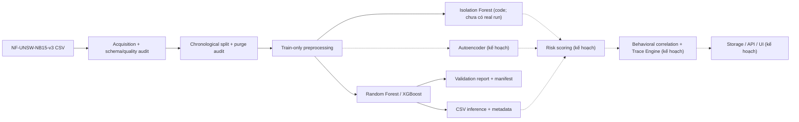

# AI-Based Network Anomaly Detection and Traceability System

**Nghiên cứu phát hiện lưu lượng mạng bất thường từ NetFlow, với bằng chứng dữ liệu và thí nghiệm có thể truy vết.**

Đồ án nghiên cứu cấp đại học · Prototype Python · Trọng tâm hiện tại: phân loại nhị phân `Benign`/`Attack` trên **NF-UNSW-NB15-v3**.

[](https://github.com/doctor-cato/AI-NETWORK-ANOMALY-DETECTION-TRACEABILITY-MAIN/actions/workflows/ci.yml)
[](pyproject.toml)
[](LICENSE)

> **Trạng thái tại `main` (10/11/2026):** Đã có acquisition, kiểm định chất lượng, EDA, split, preprocessing và hai baseline Random Forest/XGBoost với kết quả **Validation** trên dữ liệu thật. Chưa có báo cáo hiệu năng **held-out Test** cho hai baseline, chưa có model binary trong Git, và chưa có hệ thống Risk/Trace/API/UI hoàn chỉnh. Các điểm này là ranh giới của kết quả trình bày bên dưới.

**Đọc nhanh:** [Tổng quan](#tổng-quan-dự-án) · [Dữ liệu](#bộ-dữ-liệu) · [Mô hình](#các-mô-hình-ai) · [Kết quả](#thực-nghiệm-và-kết-quả) · [Tái lập](#cài-đặt-và-tái-lập) · [Hạn chế](#hạn-chế) · [Tài liệu](docs/REPRODUCIBILITY.md)

## Tổng quan dự án

Một Network Intrusion Detection System (NIDS) cần phân biệt hoạt động bình thường với lưu lượng đáng nghi, đồng thời cho người phân tích biết dự đoán xuất phát từ dữ liệu và mô hình nào. Dự án xây dựng nền tảng nghiên cứu cho mục tiêu đó trên **network flow**: kiểm tra nguồn dữ liệu, tạo phân vùng có kiểm soát, huấn luyện mô hình và lưu bằng chứng cấu hình, checksum, metric. Người đọc có thể kiểm tra từng bước qua [traceability matrix](docs/TRACEABILITY_MATRIX.md) và các báo cáo trong `reports/`.

**Đã đạt được:** hai baseline supervised được huấn luyện trên 1.655.797 flow Train và chấm trên 345.371 flow Validation; pipeline inference CSV có kiểm tra hợp đồng đặc trưng và artifact; unit/integration tests cho các đường đi chính. **Mục tiêu tiếp theo:** đánh giá Test và khả năng tổng quát hóa, hoàn thiện unsupervised models, Behavioral Vector, Risk/Trace Engine, storage, API và dashboard. Đây là prototype nghiên cứu, chưa phải NIDS triển khai trên mạng thật.

## Bài toán nghiên cứu

Lưu lượng lớn và biến đổi khiến quy tắc nhận diện tĩnh khó bao phủ mọi mẫu tấn công. Học máy có thể học quan hệ giữa các thống kê flow (gói, byte, thời lượng, TCP flags, TTL, inter-arrival time) và nhãn, nhưng một flow không chứa toàn bộ packet payload hay ngữ cảnh phiên ứng dụng. Bài toán hiện được thực hiện là **binary supervised classification** (`Label=0` Benign, `Label=1` Attack); phát hiện bất thường chưa biết là mục tiêu nghiên cứu khác, chưa được chứng minh bằng hai baseline này.

False positive (FP) làm tăng công điều tra, false negative (FN) bỏ lọt tấn công. Vì lớp Attack chỉ khoảng 5,4% dữ liệu, Accuracy một mình dễ che giấu lỗi; dự án báo Precision, Recall, F1, FPR và confusion matrix. Kết quả còn cần kiểm tra khả năng tổng quát hóa: đặc trưng của testbed, vector trùng lặp và sự thay đổi giữa các mạng có thể khiến điểm Validation rất cao nhưng hiệu năng ngoài dataset giảm. Truy vết provenance, feature contract và artifact là điều kiện để giải thích *mô hình đã được đánh giá như thế nào*, không đồng nghĩa với giải thích nhân quả cho từng cảnh báo.

## Mục tiêu đề tài

**Mục tiêu chính:** xây dựng prototype có thể kiểm chứng để phân tích network flow, so sánh mô hình phát hiện và tiến tới liên kết cảnh báo thành bằng chứng điều tra.

| Nhóm mục tiêu | Trạng thái trên `main` |
|---|---|
Provenance, schema, data quality, EDA, split và preprocessing có kiểm soát | **IMPLEMENTED / TESTED**; có báo cáo trên CSV chính thức |
Random Forest baseline và XGBoost theo giao thức binary chung | **EXPERIMENTALLY VALIDATED trên Validation**; Test chưa có kết quả |
CSV inference từ artifact có manifest | **IMPLEMENTED / TESTED** bằng fixture; chạy thật cần artifact cục bộ |
Isolation Forest, Autoencoder và unknown-attack protocol | Isolation Forest **IMPLEMENTED / TESTED** bằng fixture, chạy dữ liệu thật bị chặn; Autoencoder **PLANNED** trên `main` |
Behavioral correlation, Risk/Trace Engine, mã hóa, storage, FastAPI, Streamlit | **PLANNED** theo [roadmap](docs/ROADMAP_FULL_SYSTEM.md); PR chưa merge không được tính là chức năng của `main` |

## Kiến trúc hệ thống

Đường liền là thành phần đã có code trong `main`; đường nét đứt là quan hệ kiến trúc dự kiến. `Inference metadata` hiện ghi quan hệ input–prediction–artifact, chưa phải incident timeline hay Trace Engine.



Nguồn hiện tại là NetFlow CSV; nó **không** chứa log API, authentication hay application session. [Kiến trúc đầy đủ](docs/ARCHITECTURE.md) và [roadmap](docs/ROADMAP_FULL_SYSTEM.md) mô tả đích nghiên cứu, không phải sơ đồ deployment đã vận hành.

## Công nghệ sử dụng

| Lớp | Công nghệ có trong source/dependencies | Vai trò thực tế |
|---|---|---|
Ngôn ngữ | Python `>=3.11` (CI: 3.11, 3.12) | Script acquisition, pipeline và package `src/network_anomaly/` |
Dữ liệu | pandas, NumPy, SQLite trong validator | CSV streaming/chunking, mảng số và kiểm toán duplicate trên đĩa |
ML | scikit-learn, XGBoost, joblib | Random Forest/Isolation Forest, XGBClassifier, lưu và kiểm tra artifact |
Phân tích | matplotlib, seaborn | Tạo hình EDA cục bộ; hình lớn không nằm trong Git |
Chất lượng | pytest; GitHub Actions | Unit/integration tests, import/syntax và kiểm tra không có raw data trong CI |

`FastAPI`, `Streamlit`, `PostgreSQL` và `AES-GCM` có trong roadmap, **chưa** là stack chạy được trên `main`. [Dependency khai báo](pyproject.toml) dùng phiên bản tối thiểu, chưa phải lockfile.

## Bộ dữ liệu

**NF-UNSW-NB15-v3** là bản NetFlow v3 của UNSW-NB15 do **The University of Queensland** công bố; DOI [10.48610/6E0EDA1](https://doi.org/10.48610/6E0EDA1). [Trang dataset của UQ](https://staff.itee.uq.edu.au/marius/NIDS_datasets/) mô tả 53 NetFlow fields, trong đó có 10 temporal features bổ sung cho v3. Dataset là benchmark flow của testbed, không phải luồng mạng vận hành độc lập.

| Thuộc tính của CSV đã kiểm tra | Giá trị |
|---|---:|
Flow / dòng dữ liệu | **2.365.424** |
Cột nguồn | **55** = 53 NetFlow fields + `Label` + `Attack` |
Đặc trưng đi vào baseline | **47**; 6 trường trace metadata bị loại khỏi `X` |
Benign (`Label=0`) | **2.237.731** (94,60%) |
Attack (`Label=1`) | **127.693** (5,40%) |

Sáu trường metadata là hai timestamp, hai IPv4 address và hai L4 port. `Attack` ghi chín họ tấn công: Analysis (1.226), Backdoor (4.659), DoS (5.980), Exploits (42.748), Fuzzers (33.816), Generic (19.651), Reconnaissance (17.074), Shellcode (2.381), Worms (158). Đây là phân bố **CSV đã tải và băm**, không phải kết quả suy từ landing page. Trang UQ ghi 127.639 Attack và hoán đổi count của Analysis/Backdoor/Shellcode; [provenance report](docs/dataset/NF_UNSW_NB15_V3_PROVENANCE.md) lưu sai khác, còn [manifest](data/NF_UNSW_NB15_V3_MANIFEST.json) và [quality report](reports/data_quality/nf_unsw_nb15_v3_validation.json) theo bytes của CSV. SHA-256 CSV được dự án tính là `4ebb97bd74412d566137d95a6fc3ffd8f374f1cf8cfe204d007848e7a668f9b5`, không phải checksum do nhà xuất bản công bố.

Dataset có điều kiện **“Permitted Re-Use with Commercial Use Restriction”**: phải trích dẫn đầy đủ và chỉ dùng cho mục đích phi thương mại theo [điều khoản UQ](https://guides.library.uq.edu.au/research-and-teaching-staff/data-deposit-checklist/license-reuse-noncommercial). Apache-2.0 của source code không cấp lại quyền sử dụng dataset. Xem [schema](docs/dataset/NF_UNSW_NB15_V3_SCHEMA.md), [EDA](docs/dataset/NF_UNSW_NB15_V3_EDA.md) và [provenance](docs/dataset/NF_UNSW_NB15_V3_PROVENANCE.md).

## Tiền xử lý dữ liệu

1. `fetch_nf_unsw_nb15_v3.py` lấy package từ UQ RDM API, xác minh kích thước/checksum và giải nén an toàn. `dataset_manifest.py verify` kiểm tra bytes, schema và manifest. Raw CSV 577.360.958 bytes không được commit.
2. `validate_data.py` kiểm tra nhãn, cột, token thiếu/vô hạn, duplicate; EDA mô tả phân bố. Báo cáo raw ghi **122.493** flow có token numeric thiếu hoặc `+Inf`, **14.815** dòng trùng hệt và **1.134.553** dòng lặp theo vector 47 đặc trưng (số lần lặp sau lần xuất hiện đầu). Không xóa ngầm những flow này.
3. `split_and_audit_nf_unsw_nb15_v3.py` chia theo `FLOW_START_MILLISECONDS` và giữ purge gap 5 phút ở hai ranh giới: Train **1.655.797**, Validation **345.371**, Test **345.953**, purged **18.303**. Dataset v3 là một CSV, **không** dùng official train/test partition của UNSW-NB15 bản cũ. Audit ghi 0 full-row/source-feature/canonical-flow-group overlap theo định nghĩa đã chọn, nhưng vẫn có vector ML trùng nhau giữa các tập.
4. `preprocess_nf_unsw_nb15_v3.py` chọn đúng 47 cột: loại `Label`, `Attack` và 6 metadata trước khi fit. Preprocessor fit **chỉ trên Train**, dùng median cho numeric, mode cho categorical coded, xử lý token không finite theo policy rồi áp dụng tham số đã đóng băng cho Validation/Test. Cấu hình baseline **không scale**, không thêm missing indicator, giữ flow zero-duration. Artifact `.joblib` có companion manifest và checksum.

Đọc [split protocol](docs/NF_UNSW_NB15_V3_SPLIT_PROTOCOL.md), [preprocessing policy](docs/NF_UNSW_NB15_V3_PREPROCESSING_POLICY.md), [split manifest](reports/splits/nf_unsw_nb15_v3_split_manifest.json) và [smoke report](reports/preprocessing/REAL_DATA_SMOKE_REPORT.md). Trạng thái `ML_READY: BLOCKED` trong *raw quality report* và một số tài liệu trước Issue #8 là snapshot trước khi split/preprocessing được thực thi; không nên hiểu là hiện chưa có pipeline.

## Các mô hình AI

### Random Forest

Ensemble các decision tree huấn luyện trên mẫu bootstrap và tập con đặc trưng, làm baseline supervised cho `Label`. Code, training entrypoint và test tồn tại; run đã ghi **200 cây**, `max_depth=16`, seed 42, 47 features. [Run manifest](reports/models/random_forest_manifest.json), [training report](reports/models/rf_baseline_training_report.md) và [validation diagnostic audit](reports/models/rf_baseline_validation_audit.json) hỗ trợ trạng thái **EXPERIMENTALLY VALIDATED trên Validation**. Audit ghi huấn luyện lại cùng môi trường cho checksum model trùng; binary model không nằm trong Git. Chưa có kết quả Test.

### XGBoost

Gradient boosting xây tuần tự các cây để giảm loss; baseline dùng `XGBClassifier`, `binary:logistic`, 200 cây, `max_depth=6`, learning rate 0,1, seed 42. [Run manifest](reports/models/xgboost_manifest.json) và [training report](reports/models/xgboost_training_report.md) ghi train/Validation thật, reload verification và confusion matrix. Trạng thái **EXPERIMENTALLY VALIDATED trên Validation**, chưa có Test. So sánh với RF là **cùng dataset definition/protocol**, nhưng không chứng minh hai lần chạy dùng index artifact giống từng byte; xem [membership parity audit](reports/splits/split_membership_audit_report.md).

### Isolation Forest

Mô hình unsupervised cô lập điểm khác thường bằng đường đi ngắn trong các cây phân tách ngẫu nhiên; score chỉ thành nhãn sau khi chốt threshold hợp lệ trên Validation. Có [model component](src/network_anomaly/models/isolation_forest.py), [training/evaluation script](scripts/train_isolation_forest.py) và unit tests. [Run được lưu](reports/experiments/isolation_forest/blocked_status.json) chỉ là prerequisite check **BLOCKED vì thiếu CSV tại máy chạy**; không có metric benchmark hay artifact model trong Git. Trạng thái **IMPLEMENTED / TESTED bằng fixture**, **chưa EXPERIMENTALLY VALIDATED**.

### Autoencoder

Hướng nghiên cứu là học tái tạo flow và dùng reconstruction error làm anomaly score; cần ngưỡng chọn trên Validation và đánh giá riêng cho unknown-attack holdout. Trên `main` chưa có module, artifact hay báo cáo thực nghiệm Autoencoder. [Issue #29](https://github.com/doctor-cato/AI-NETWORK-ANOMALY-DETECTION-TRACEABILITY-MAIN/issues/29) và PR đang review là công việc **PLANNED / IN PROGRESS ngoài `main`**.

| Model | Cách tiếp cận / vai trò | Implementation trên `main` | Validation thật | Held-out Test |
|---|---|---|---|---|
Random Forest | Supervised baseline | Code + tests + run manifest | Có, 345.371 flow | Chưa có báo cáo |
XGBoost | Supervised comparison | Code + tests + run manifest | Có, 345.371 flow | Chưa có báo cáo |
Isolation Forest | Unsupervised anomaly score | Code + tests; real run bị chặn | Chưa có | Chưa có |
Autoencoder | Reconstruction error | Chưa merge | Chưa có | Chưa có |

## Thực nghiệm và kết quả

Hai run supervised dùng `Label=1` là Attack, 47 đặc trưng và split thời gian có purge gap. Train có 1.655.797 dòng; Validation có 314.871 Benign và 30.500 Attack. Các số sau lấy từ hai [model manifests](reports/models/) và báo cáo tương ứng, **không phải held-out Test**. Accuracy tính từ confusion matrix; FPR = FP/(FP+TN).

| Chỉ số trên **Validation** | Random Forest | XGBoost |
|---|---:|---:|
Accuracy | 0,999977 | 0,999997 |
Precision (Attack) | 0,999836 | 0,999967 |
Recall (Attack) | 0,999902 | 1,000000 |
F1 (Attack) | 0,999869 | 0,999984 |
Macro-F1 | 0,999928 | 0,999991 |
FPR | 0,00001588 | 0,00000318 |
Confusion matrix `[[TN, FP], [FN, TP]]` | `[[314866, 5], [3, 30497]]` | `[[314870, 1], [0, 30500]]` |
Held-out Test | **NOT VERIFIED** | **NOT VERIFIED** |

Precision cho biết tỷ lệ cảnh báo Attack là đúng; Recall cho biết tỷ lệ Attack được phát hiện; F1 cân bằng hai chỉ số; FPR đo tỷ lệ Benign bị báo nhầm. Trong Validation này XGBoost ghi ít hơn 4 FP và 3 FN so với RF, nhưng khác biệt nhỏ trên cùng một benchmark không đủ kết luận ưu thế tổng quát. [Báo cáo RF](reports/models/rf_baseline_training_report.md) và [XGBoost](reports/models/xgboost_training_report.md) ghi cấu hình, môi trường và phân rã theo `Attack`.

**Cảnh báo diễn giải:** [split audit](reports/splits/nf_unsw_nb15_v3_split_manifest.json) ghi **172.621/345.371 flow Validation (49,98%)** chia sẻ nguyên vector 47 đặc trưng với Train, dù không có full-row/flow-group overlap theo contract. [RF diagnostic audit](reports/models/rf_baseline_validation_audit.json) còn cho thấy cây chỉ dùng `MIN_TTL` đạt Accuracy Validation **0,999849**. Điều này phù hợp với khả năng mô hình học đặc điểm cố định của testbed; không chứng minh phát hiện tấn công trên mạng khác, zero-day hay production readiness. [Membership parity audit](reports/splits/split_membership_audit_report.md) cũng đánh dấu **`MEMBERSHIP_EQUIVALENCE: NOT_VERIFIED`** giữa index nén của run RF cũ và run XGBoost mới vì index gốc không được lưu trong Git. [Issue #55](https://github.com/doctor-cato/AI-NETWORK-ANOMALY-DETECTION-TRACEABILITY-MAIN/issues/55) theo dõi thêm việc đối chiếu chuỗi hash provenance.

## Kết quả đạt được

Nhóm đã tạo manifest nguồn và kiểm định CSV thật, EDA có bằng chứng chạy lặp, split và kiểm toán leakage, train-only preprocessor, hai baseline supervised đã chạy trên Train/Validation, model manifests và báo cáo metric, cùng CLI inference CSV và unit/integration tests. `reports/` chứa metadata và báo cáo nhỏ; `data/raw/`, `data/processed/` và `artifacts/` chỉ có marker trong Git. Vì vậy người kiểm tra có thể đọc bằng chứng đã ghi, nhưng để **chạy lại** cần tải dataset chính thức và tái tạo artifact cục bộ.

Chưa có kết quả held-out Test cho hai baseline, đánh giá độc lập trên dataset ngoài, Isolation Forest real run, Autoencoder trên `main`, Risk/Trace Engine, storage/API/UI hay deployment. [Implementation checkpoints](docs/IMPLEMENTATION_CHECKPOINTS.md) và [traceability matrix](docs/TRACEABILITY_MATRIX.md) cung cấp lịch sử yêu cầu → code → test → bằng chứng; trạng thái cũ trong tài liệu phải đối chiếu với HEAD và báo cáo mới hơn.

## Cài đặt và tái lập

Yêu cầu: Python **3.11 hoặc 3.12** (theo CI), Git, kết nối mạng để tải dữ liệu từ UQ; dùng shell PowerShell ở Windows. `pyproject.toml` cho phép `>=3.11`, nhưng CI hiện chỉ chạy 3.11/3.12. Dataset CSV khoảng **577 MB**, archive khoảng **111 MB**; xử lý 2,36 triệu flow và fit 200 cây cần nhiều GB RAM/disk. Run manifest cũ ghi khoảng 3,9–4,4 GB peak memory khi train; máy khác có thể khác. Dependency được khai báo bằng minimum versions, nên byte-for-byte artifact đa nền tảng chưa được bảo đảm.

```powershell
git clone https://github.com/doctor-cato/AI-NETWORK-ANOMALY-DETECTION-TRACEABILITY-MAIN.git
cd AI-NETWORK-ANOMALY-DETECTION-TRACEABILITY-MAIN
python -m venv .venv
.venv\Scripts\Activate.ps1
python -m pip install -e .
python scripts/check_environment.py
python scripts/fetch_nf_unsw_nb15_v3.py
python scripts/dataset_manifest.py verify
python scripts/validate_data.py
python scripts/eda_nf_unsw_nb15_v3.py
python scripts/split_and_audit_nf_unsw_nb15_v3.py
python scripts/preprocess_nf_unsw_nb15_v3.py
python scripts/train_random_forest.py
python scripts/train_xgboost.py
python -m pytest tests -q
```

Chạy các lệnh từ root theo thứ tự. `validate_data.py` có thể trả exit **1** dù source integrity PASS, vì báo cáo raw `ML_READY: BLOCKED` trước policy fit; đọc JSON thay vì coi exit 1 là lỗi tải dữ liệu. Nếu thiếu raw CSV, một số bước audit báo **SKIPPED** với exit 0; training/verification thiếu dataset hoặc artifact sẽ dừng. Không dùng Test để chọn model, feature, threshold hay hyperparameter. Tái tạo split có thể sinh index nén với SHA khác run lịch sử; đối chiếu [parity audit](reports/splits/split_membership_audit_report.md) trước khi gọi hai run là byte-identical.

Sau khi có artifact hợp lệ, có thể kiểm tra prerequisite mà không train bằng `python scripts/train_random_forest.py --verify-only`, `python scripts/train_xgboost.py --verify-only`, `python scripts/preprocess_nf_unsw_nb15_v3.py --verify-only`; `python scripts/train_isolation_forest.py --check-prereqs-only` chỉ kiểm tra điều kiện đầu vào. Để thử inference, cung cấp CSV đúng [47-feature contract](docs/INFERENCE_PIPELINE.md) và **đường dẫn artifact tường minh**:

```powershell
python scripts/predict.py --input data/new_flows.csv --output results/predictions.csv --model-artifact artifacts/models/random_forest/random_forest_baseline.joblib --model-manifest reports/models/random_forest_manifest.json --preprocessor-artifact artifacts/preprocessing/nf_unsw_nb15_v3_preprocessor.joblib --preprocessor-manifest reports/preprocessing/nf_unsw_nb15_v3_preprocessing_manifest.json
```

Lệnh inference cần `data/new_flows.csv` do người dùng cung cấp, không có sẵn trong Git. Mặc định đường dẫn preprocessor của CLI hiện có thể chứa đường dẫn checkout tại môi trường build, nên ví dụ dùng flag tường minh. Xem [hướng dẫn tái lập](docs/REPRODUCIBILITY.md) và [testing](docs/TESTING.md). Đánh giá held-out Test hiện **chưa có lệnh/báo cáo đã được xác minh trên `main`**; không suy ra Test score từ Validation.

## Cấu trúc thư mục

```text
.
├── src/network_anomaly/   # data, EDA, preprocessing, models, evaluation, inference
├── scripts/               # acquisition, audit, split, training và CLI
├── tests/                 # unit và integration
├── docs/                  # methodology, protocol, roadmap và traceability
├── data/                  # manifest; raw/interim/processed được Git bỏ qua
├── reports/               # quality, split, preprocessing, EDA và model evidence
├── artifacts/             # marker; model/preprocessor binary được Git bỏ qua
└── .github/workflows/     # ci.yml
```

## Kiểm thử và bảo đảm chất lượng

CI [`ci.yml`](.github/workflows/ci.yml) chạy trên Ubuntu/Windows với Python 3.11/3.12: environment, compile/import, `pytest tests`, rồi các bước data/EDA/preprocessing. Trên runner không có raw CSV, bước phụ thuộc dữ liệu có thể **SKIPPED**; badge CI chỉ nói workflow chạy theo cấu hình, **không** xác minh benchmark thật. Unit/integration tests dùng fixture để kiểm tra schema, split, fit boundary, model protocol và inference behavior; không thay thế thí nghiệm trên dataset.

```powershell
python scripts/check_environment.py
python -m pytest tests -q
python -m ruff check .
python -m black --check .
git diff --check
```

`ruff` và `black` là dev dependencies tùy chọn (`python -m pip install -e ".[dev]"` nếu muốn chạy). Không tuyên bố CI hoặc toàn bộ lint đã PASS nếu chưa kiểm tra run tương ứng. Artifact verification đối chiếu checksum/contract nhưng nhiều binary nằm ngoài Git; [Issue #55](https://github.com/doctor-cato/AI-NETWORK-ANOMALY-DETECTION-TRACEABILITY-MAIN/issues/55) ghi phần provenance còn cần hòa giải.

## Tiến độ dự án

| Hạng mục | Trạng thái dựa trên `main` và bằng chứng |
|---|---|
Acquisition, quality audit, EDA | **EXPERIMENTALLY VALIDATED** trên CSV chính thức; [quality](reports/data_quality/nf_unsw_nb15_v3_validation.json), [EDA](reports/eda/nf_unsw_nb15_v3_eda_summary.json) |
Split, leakage audit, preprocessing | **IMPLEMENTED / TESTED** trên dữ liệu thật; [split](reports/splits/nf_unsw_nb15_v3_split_manifest.json), [preprocessing](reports/preprocessing/REAL_DATA_SMOKE_REPORT.md) |
Random Forest, XGBoost | **EXPERIMENTALLY VALIDATED trên Validation**; Test **NOT VERIFIED** |
Isolation Forest | **IMPLEMENTED / TESTED** bằng fixture; real run **BLOCKED** |
Autoencoder | **PLANNED** trên `main`; PR phát triển chưa merge |
CSV inference và metadata | **IMPLEMENTED / TESTED**; binary artifacts không phân phối trong Git |
Risk scoring, Behavioral Vector, Trace Engine | **PLANNED** |
Backend, storage, frontend, deployment | **PLANNED** trên `main` |
Tài liệu và CI | **IMPLEMENTED**, đang tiếp tục đối chiếu provenance/đánh giá cuối |

## Hạn chế

- **Dataset bias và shortcut learning:** NetFlow v3 phản ánh testbed, không đại diện cho mọi mạng. `MIN_TTL` đơn lẻ gần như phân tách lớp trên Validation; model có thể học topology/traffic generator thay vì hành vi tấn công bền vững.
- **Trùng vector và ranh giới nhóm:** 49,98% flow Validation trùng vector ML với Train. Zero overlap theo full-row, source-feature và canonical group chỉ đúng dưới fingerprint/group contract đã định; session dài hoặc quan hệ ứng dụng khác chưa được loại trừ.
- **Đánh giá còn thiếu:** Test được giữ riêng trong run supervised nhưng chưa có final Test report trên `main`; chưa có cross-dataset hoặc traffic vận hành để đo drift, false alarm và robustness. So sánh RF–XGBoost thiếu chứng minh identity từng dòng của index artifact lịch sử.
- **Khả năng tái lập có điều kiện:** Raw CSV, index nén và `.joblib` không nằm trong Git. Manifest/hash lưu bằng chứng run, nhưng thiếu binary gốc cho mọi reviewer; phiên bản dependency chỉ có ngưỡng tối thiểu. Provenance hash-chain đang được rà soát.
- **Hệ thống chưa tích hợp:** Risk/Trace, storage, API/UI và bảo vệ dữ liệu trong roadmap chưa thành hệ thống chạy được trên `main`. CSV inference là chức năng hẹp, không phải giám sát thời gian thực hoặc phản ứng bảo mật tự động.

## Hướng phát triển

Ưu tiên đối chiếu provenance và split membership, sau đó khóa protocol để chạy held-out Test một lần; bổ sung đánh giá external dataset, ablation `MIN_TTL`/feature groups, kiểm tra duplicate và drift. Tiếp theo hoàn thiện Isolation Forest, Autoencoder và unknown-attack holdout với threshold chọn trên Validation. Khi có bằng chứng mô hình đáng tin cậy, triển khai Behavioral Vector, correlation confidence, Risk/Trace Engine, storage, FastAPI và Streamlit theo [roadmap C0–C11](docs/ROADMAP_FULL_SYSTEM.md); mọi phản ứng chỉ ở chế độ lab/dry-run. Không gọi unknown-attack benchmark là chứng minh zero-day.

## Thông tin học thuật và nhóm

| Trường | Thông tin đã xác minh |
|---|---|
Tên đề tài | AI-Based Network Anomaly Detection and Traceability System |
Bối cảnh | Đề cương đồ án/học phần đại học; [project charter](docs/PROJECT_CHARTER.md) và [đề cương](docs/Ke_hoach_de_tai_22_AI_Anomaly_Detection.docx) |
Trường, học phần, giảng viên, niên khóa | **Chưa xác nhận trong repository** |
Nhóm và thành viên | [Năm vai trò dự kiến](docs/TEAM_TASKS.md); tên và phân công cá nhân chưa xác nhận |

## Tài liệu tham khảo

1. The University of Queensland. *NF-UNSW-NB15-v3*, UQ Research Data Manager, DOI: [10.48610/6E0EDA1](https://doi.org/10.48610/6E0EDA1). [Dataset collection](https://staff.itee.uq.edu.au/marius/NIDS_datasets/).
2. Luay, M., Layeghy, S., Hosseininoorbin, S., Sarhan, M., Moustafa, N., & Portmann, M. (2025). *Temporal Analysis of NetFlow Datasets for Network Intrusion Detection Systems*. [arXiv:2503.04404](https://arxiv.org/abs/2503.04404).
3. Breiman, L. (2001). “Random Forests.” *Machine Learning*, 45, 5–32. [DOI: 10.1023/A:1010933404324](https://doi.org/10.1023/A:1010933404324).
4. Chen, T., & Guestrin, C. (2016). “XGBoost: A Scalable Tree Boosting System.” *Proceedings of KDD ’16*, 785–794. [DOI: 10.1145/2939672.2939785](https://doi.org/10.1145/2939672.2939785).
5. Liu, F. T., Ting, K. M., & Zhou, Z.-H. (2008). “Isolation Forest.” *Proceedings of ICDM 2008*, 413–422. [DOI: 10.1109/ICDM.2008.17](https://doi.org/10.1109/ICDM.2008.17).

## Giấy phép và ghi nhận

Mã nguồn trong repository có [Apache License 2.0](LICENSE); trường copyright trong file hiện vẫn là placeholder của nhóm. **NF-UNSW-NB15-v3 có giấy phép riêng**, yêu cầu full citation và giới hạn sử dụng phi thương mại theo [UQ](https://guides.library.uq.edu.au/research-and-teaching-staff/data-deposit-checklist/license-reuse-noncommercial). Dependency và tài liệu nghiên cứu giữ giấy phép/quyền tác giả của bên phát hành; việc dùng mã nguồn Apache-2.0 không thay đổi các điều kiện đó. Cảm ơn The University of Queensland và nhóm tác giả NetFlow v3 đã công bố dataset cùng tài liệu tham chiếu.
