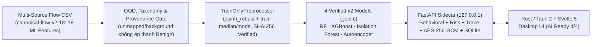

# NetFlow Sentinel v2 — AI-Based Multi-Source Network Anomaly Detection & Traceability System

**Phát hiện lưu lượng mạng bất thường đa nguồn với hợp đồng 18 đặc trưng chuẩn hóa (`canonical-flow-v2-18`), tiền xử lý chống rò rỉ train-only và truy vết SHA-256.**

**Rust / Tauri 2 + Svelte 5** Desktop ↔ **Python FastAPI / PyInstaller Sidecar + SQLite** ↔ **4 Mô hình AI v2** huấn luyện lại từ đầu trên **AIT NetFlow Data Set v2 (AIT-NDS-v2)** và đánh giá chéo trên lưu lượng thu thập thực tế **CTU-SME-11**.

[](https://github.com/doctor-cato/AI-NETWORK-ANOMALY-DETECTION-TRACEABILITY-MAIN/actions/workflows/ci.yml)
[](pyproject.toml)
[](LICENSE)

> [!IMPORTANT]
> **Hard Cutover sang NetFlow Sentinel v2 (nhánh `feat/v2-integration` / Draft PR #156):**
> - **Loại bỏ hoàn toàn `NF-UNSW-NB15-v3`** và hợp đồng 47 đặc trưng cũ khỏi active pipeline, preprocessor, model registry, API, desktop UI và CI. Toàn bộ artifact/tài liệu v1 được lưu trữ chỉ đọc tại [`data/historical/nf_unsw_nb15_v3/`](data/historical/nf_unsw_nb15_v3/), [`docs/historical/nf_unsw_nb15_v3/`](docs/historical/nf_unsw_nb15_v3/), [`scripts/historical/nf_unsw_nb15_v3/`](scripts/historical/nf_unsw_nb15_v3/), và [`reports/historical/nf_unsw_nb15_v3/`](reports/historical/nf_unsw_nb15_v3/).
> - **Không fallback về v1:** `ModelRegistry`, `InferencePipeline` và `desktop_csv` kiểm tra fail-closed `feature_contract_version == "canonical-flow-v2-18"`, `dataset_sha256`, `split_manifest_sha256` và `preprocessor_sha256`.
> - **Phân định trạng thái nguồn dữ liệu:** `AIT-NDS-v2` (CC BY 4.0) và `CTU-SME-11` (CC BY 4.0) đã tải, kiểm tra checksum và đánh giá thực tế; **`UGR'16` ở trạng thái `BLOCKED`** (cổng chính thức NESG trả `HTTP 403` / *"Portal en Mantenimiento"*) và không dùng dữ liệu thay thế giả lập.

**Điều hướng nhanh:**
- **Dữ liệu & Kiến trúc v2:** [Dataset Strategy (`docs/DATASET.md`)](docs/DATASET.md) · [Feature Contract v2 (`docs/CANONICAL_SECURITY_EVENT_V2.md`)](docs/CANONICAL_SECURITY_EVENT_V2.md) · [Kiến trúc Hệ thống (`docs/ARCHITECTURE.md`)](docs/ARCHITECTURE.md) · [Kiến trúc v2 (`docs/ARCHITECTURE_V2.md`)](docs/ARCHITECTURE_V2.md)
- **Thực nghiệm & Đánh giá:** [So sánh 4 Model (`docs/experiments/FOUR_MODEL_COMPARISON.md`)](docs/experiments/FOUR_MODEL_COMPARISON.md) · [Cross-Source CTU-SME-11 (`docs/experiments/CTU_CROSS_SOURCE_EVAL.md`)](docs/experiments/CTU_CROSS_SOURCE_EVAL.md) · [6 Câu hỏi Nghiên cứu (`docs/RESEARCH_QUESTIONS.md`)](docs/RESEARCH_QUESTIONS.md)
- **Cài đặt, Vận hành & Kiểm thử:** [Cài đặt Windows (`docs/WINDOWS_INSTALLATION.md`)](docs/WINDOWS_INSTALLATION.md) · [Reproducibility (`docs/REPRODUCIBILITY.md`)](docs/REPRODUCIBILITY.md) · [Testing (`docs/TESTING.md`)](docs/TESTING.md) · [API Contract (`reports/api/API_CONTRACT.md`)](reports/api/API_CONTRACT.md)

---

## 1. Tổng quan & Chiến lược Dữ liệu v2

NetFlow Sentinel là nền tảng nghiên cứu phát hiện bất thường mạng có khả năng kiểm toán, kết hợp **mô hình ML trên NetFlow**, **Behavioral Vector 16-D**, **Risk Engine**, **Trace Engine / Attack Timeline**, và **kho chứng cứ mã hóa AES-256-GCM với Adaptive Key Rotation**.

### Nguồn dữ liệu v2

| Nguồn | DOI / URL | Vai trò trong NetFlow Sentinel v2 | Giấy phép & Trạng thái |
|---|---|---|---|
| **AIT NetFlow Data Set v2 (`AIT-NDS-v2`)** | `10.5281/zenodo.13168643` (dẫn xuất từ PCAP `AIT-LDS-v2.0`) | Dataset huấn luyện ML chính (`3,465,342` flows trước lọc; `3,231,215` flows có nhãn chuẩn hóa + `942` unmapped loại riêng) | **CC BY 4.0 — VERIFIED** |
| **AIT Log Data Set v2.1 (`AIT-LDS-v2.1`)** | `10.5281/zenodo.19483937` | Application/system/auth/DNS/VPN/audit logs cho Behavioral Vector, Session Correlation, Trace Engine | **CC BY 4.0 — VERIFIED** (tách version với `AIT-NDS-v2`; chưa gán join trực tiếp nếu thiếu khóa đồng bộ) |
| **AIT Alert Data Set (`AIT-ADS`)** | `10.5281/zenodo.8263181` | Alert aggregation & multi-step alert correlation tạo từ `AIT-LDS-v2.0`; **không** dùng làm benchmark ML độc lập | **CC BY 4.0 — VERIFIED** |
| **CTU-SME-11** | `10.5281/zenodo.7958258` (record `7958259`) | Lưu lượng thu thập thực tế trên thiết bị SME thật (`Honeypot-Assistant-Amazon-Echo1stGen-1`: `76,073` flows; `Experiment-VM-Microsoft-Windows7AD-1`: `175,146` flows có nhãn + `9,394` unmapped) | **CC BY 4.0 — VERIFIED** |
| **UGR'16** | `https://nesg.ugr.es/nesg-ugr16/` | Real ISP traffic external validation & domain-shift | **`BLOCKED`** (HTTP 403 / Portal en Mantenimiento; không tải được, không thay thế) |

**Ranh giới khoa học:** Đây là **đồ án nghiên cứu học thuật**, không phải enterprise SOC production hay IPS chặn tường lửa tự động. Security Dry-Run luôn chạy với `executed = false`; đánh giá zero-shot từ synthetic `AIT-NDS-v2` sang thực tế `CTU-SME-11` cho thấy suy giảm mạnh ở mô hình cây có giám sát (chi tiết bên dưới).

---

## 2. Hợp đồng Đặc trưng (`canonical-flow-v2-18`), Split & Tiền xử lý



- **18 đặc trưng ML (`canonical-flow-v2-18`):** `duration_ms`, `bytes_in`, `bytes_out`, `pkts_in`, `pkts_out`, `protocol_num`, `total_bytes`, `total_pkts`, `bytes_in_ratio`, `pkts_in_ratio`, `bytes_per_pkt_in`, `bytes_per_pkt_out`, `bytes_per_sec_in`, `bytes_per_sec_out`, `pkts_per_sec`, `has_response`, `is_tcp`, `is_udp`. Tách biệt tuyệt đối khỏi 5 cột trace metadata (`timestamp_ms`, `source_ip`, `dest_ip`, `source_port`, `dest_port`), 5 cột provenance (`source_dataset`, `scenario_or_device`, `flow_id`, `raw_protocol_str`, `probe_source`) và 4 cột target/label (`label_binary`, `attack_category`, `raw_label`, `label_status`).
- **Scenario-Disjoint Split (`v2-scenario-group-purged-v1`):**
  - **Train (`1,930,219` flows):** `fox`, `harrison`, `santos`, `wardbeck`, `wilson` (`1,658,795` Benign / `271,424` Attack).
  - **Validation (`377,704` flows):** `russellmitchell` (`206,676` Benign / `171,028` Attack).
  - **Held-out Test (`923,292` flows):** `shaw`, `wheeler` (`747,610` Benign / `175,682` Attack).
  - **Leakage audit:** `0` scenario overlap, `0` `(scenario, 5-tuple, ts_bucket)` overlap.
- **Tiền xử lý (`asinh_robust`):** Fit duy nhất trên `1,930,219` dòng Train (`d33dfe09630687f825d7e4cfa604001c3e091560538059da2eb397b49f44bc32`), biến đổi `arcsinh` + `RobustScaler` cho 17 biến định lượng, giữ nguyên `protocol_num` dạng số nguyên rời rạc, giữ dòng `duration_ms == 0.0`.

---

## 3. Kết quả Thực nghiệm v2 Đã Kiểm chứng

| Mô hình | Nguồn ngưỡng & Giao thức | AIT-Test (`923,292` flows) | CTU-Echo Real (`76,073` flows) | CTU-Win7AD Real (`175,146` flows) |
|---|---|---|---|---|
| **Random Forest** | Supervised (`th = 0.50`) | `F1 = 0.8997`, `P = 0.9988`, `R = 0.8185`, `FPR = 0.000227`, `ROC-AUC = 0.9996` | `F1 = 0.0000`, `R = 0.0000`, `FPR = 0.000836`, `ROC-AUC = 0.7996` | `F1 = 0.0000`, `R = 0.0000`, `FPR = 0.013148`, `ROC-AUC = 0.6888` |
| **XGBoost** | Supervised (`th = 0.50`) | `F1 = 0.8910`, `P = 0.9988`, `R = 0.8042`, `FPR = 0.000225`, `ROC-AUC = 0.9786` | `F1 = 0.0000`, `R = 0.0000`, `FPR = 0.046763`, `ROC-AUC = 0.0373` | `F1 = 0.0007`, `R = 0.0005`, `FPR = 0.003934`, `ROC-AUC = 0.1599` |
| **Isolation Forest** | Benign-only (`th = 0.002736`, Val `target_fpr = 0.05`) | `F1 = 0.5766`, `P = 0.7461`, `R = 0.4698`, `FPR = 0.037569`, `ROC-AUC = 0.7753` | `F1 = 0.8527`, `P = 0.8017`, `R = 0.9108`, `FPR = 0.208649`, `ROC-AUC = 0.7845` | `F1 = 0.0002`, `R = 0.0034`, `FPR = 0.433417`, `ROC-AUC = 0.3067` |
| **Autoencoder** | Benign-only (`th = 0.000228`, Val `target_fpr = 0.05`) | `F1 = 0.5788`, `P = 0.7581`, `R = 0.4681`, `FPR = 0.035104`, `ROC-AUC = 0.7886` | `F1 = 0.7000`, `P = 0.5658`, `R = 0.9176`, `FPR = 0.652024`, `ROC-AUC = 0.7588` | `F1 = 0.0246`, `R = 0.9146`, `FPR = 0.854472`, `ROC-AUC = 0.7813` |

**Phát hiện quan trọng từ đánh giá thực tế `CTU-SME-11` (`reports/experiments/ml/ctu_cross_source_eval.json`):**
- Mô hình cây giám sát (`RF`, `XGBoost`) đạt `F1 ~ 0.89–0.90` trên kịch bản testbed mới của `AIT-NDS-v2`, nhưng **sụp đổ về ~0.00 recall khi chuyển zero-shot sang thiết bị thu thập thực tế CTU-SME-11** do chênh lệch phân phối `duration_ms`, `bytes_in`, `bytes_out` giữa testbed mô phỏng và SME thật.
- Khi bổ sung thích nghi miền trên thiết bị khác (`AIT-Train + CTU-Echo` → unseen `CTU-Win7AD`), `RF` và `XGB` đạt `ROC-AUC` lần lượt `0.7880` và `0.8305` (recall `0.5074` / `0.5039`, FPR `0.1700` / `0.1938`); khi huấn luyện theo trục thời gian ngay trong `CTU-Echo` (`2023-02-20..24` → `2023-02-25..26`), `RF` đạt `F1 = 0.9600` (`FPR = 0.0020`).

---

## 4. Hướng dẫn Lập trình viên (Developer Guide)

Yêu cầu: Python `>=3.11` (CI: `3.11`, `3.12`; runtime khớp `requirements-runtime.txt`), Node.js `22+`, Rust stable (`cargo`, `rustfmt`, `clippy`). Raw dataset lớn và `.joblib` model binaries nằm ngoài Git.

```powershell
# 1. Thiết lập môi trường Python
git clone https://github.com/doctor-cato/AI-NETWORK-ANOMALY-DETECTION-TRACEABILITY-MAIN.git
cd AI-NETWORK-ANOMALY-DETECTION-TRACEABILITY-MAIN
python -m venv .venv
.venv\Scripts\python.exe -m pip install -e ".[dev]"

# 2. Kiểm tra nền tảng, dữ liệu v2, artifact, OpenAPI và test suite
.venv\Scripts\python.exe scripts/check_environment.py
.venv\Scripts\python.exe scripts/fetch_multi_source_dataset.py --verify-only
.venv\Scripts\python.exe scripts/verify_companion_artifacts.py
.venv\Scripts\python.exe scripts/export_openapi_spec.py --check
.venv\Scripts\python.exe scripts/check_desktop_version.py --check
.venv\Scripts\python.exe -m pytest tests -q
.venv\Scripts\python.exe -m ruff check src scripts tests
.venv\Scripts\python.exe -m black --check src scripts tests
git diff --check
```

Để tái lập pipeline dữ liệu, tiền xử lý, huấn luyện 4 model v2 và sinh toàn bộ báo cáo thực nghiệm, xem [docs/REPRODUCIBILITY.md](docs/REPRODUCIBILITY.md) và [docs/TESTING.md](docs/TESTING.md).

---

## 5. Cấu trúc thư mục

```text
.
├── desktop/               # Rust Tauri 2 (src-tauri) + Svelte 5 UI
├── src/network_anomaly/   # data (v2_schema, taxonomy, split), preprocessing, models, behavioral, risk, trace, crypto, streaming, ingestion, inference, api
├── scripts/               # fetch_multi_source_dataset, profile_multi_source, build_v2_dataset_and_split, train_*, run_ctu_cross_source_eval, verify_companion_artifacts
├── tests/                 # unit, contract, integration + historical/nf_unsw_nb15_v3/
├── docs/                  # v2 documentation + docs/historical/nf_unsw_nb15_v3/
├── data/                  # EXTERNAL_DATASETS_PROVENANCE.json, demo/, historical/nf_unsw_nb15_v3/; raw & processed bị gitignore
├── reports/               # schema, quality, splits, preprocessing, models, experiments, benchmarks, api, governance + historical/
├── artifacts/             # .gitkeep; preprocessor & 4 model .joblib bị gitignore
└── .github/workflows/     # ci.yml, lint-audit.yml, release.yml
```

---

## 6. Giấy phép & Ghi nhận nguồn

- **Mã nguồn:** [Apache License 2.0](LICENSE) (giữ nguyên không thay đổi).
- **Datasets v2:** `AIT-NDS-v2` (`10.5281/zenodo.13168643`), `AIT-LDS-v2.1` (`10.5281/zenodo.19483937`), `AIT-ADS` (`10.5281/zenodo.8263181`) và `CTU-SME-11` (`10.5281/zenodo.7958258`) phát hành theo **CC BY 4.0**. `UGR'16` ở trạng thái `BLOCKED`.
- **Kiểm kê giấy phép & Lịch sử:** Xem [`NOTICE`](NOTICE), [`THIRD_PARTY_NOTICES.md`](THIRD_PARTY_NOTICES.md), [`reports/governance/DISTRIBUTION_AUTHORIZATION.json`](reports/governance/DISTRIBUTION_AUTHORIZATION.json), và lưu trữ v1 tại [`docs/historical/nf_unsw_nb15_v3/`](docs/historical/nf_unsw_nb15_v3/).
