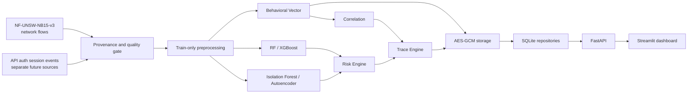

# AI-Based Network Anomaly Detection and Traceability System

Research prototype for network-flow anomaly detection, behavioral correlation, risk scoring and
traceability with secure behavioral-vector storage and adaptive key-rotation research.

## Research boundary and current status

The official network-flow dataset is **NF-UNSW-NB15-v3**, released by the University of
Queensland in 2025. It replaces the original UNSW-NB15 train/test CSVs as the only default input
for future ML work. The 2015 artifacts remain under `historical/` only for provenance and
migration review.

Current verified scope:

| Area | Status | Evidence |
|---|---|---|
| Official-source research, version and license | VERIFIED | `docs/dataset/` decision/provenance records |
| Reproducible download, cache, checksum, rollback and locking | IMPLEMENTED / TESTED | `scripts/fetch_nf_unsw_nb15_v3.py` and acquisition tests |
| Package manifest and 55-column schema | VERIFIED on real bytes | `data/NF_UNSW_NB15_V3_MANIFEST.json` |
| Streaming quality audit | source PASS; raw findings recorded; ML readiness BLOCKED | `reports/data_quality/nf_unsw_nb15_v3_validation.json` |
| 47-feature baseline exclusion and split leakage guards | IMPLEMENTED / TESTED on synthetic fixtures | `src/network_anomaly/data/nf_unsw_nb15_v3.py` |
| Real train/validation/test split | PLANNED / NOT VERIFIED | blocked on an approved missing/non-finite and duplicate policy |
| Model training, benchmark and deployment | PLANNED / NOT VERIFIED | no real experiment result is claimed |

The real-data audit confirms 2,365,424 rows and the expected label/category distribution, but it
also finds missing/positive-infinity values, exact duplicates and substantial 47-feature/
behavioral-v1 equivalence. Source integrity passes; raw findings are recorded; ML readiness remains
blocked.

## Architecture



NF-UNSW-NB15-v3 supplies NetFlow features and trace metadata only. It does not contain API,
authentication or application-session logs; those remain separate future inputs.

## Dataset provenance

- Dataset: `NF-UNSW-NB15-v3` (53 NetFlow features + `Label` + `Attack`).
- Publisher: The University of Queensland.
- Stable record: DOI `10.48610/6E0EDA1`, UQRDM UUID
  `abd2f5d8-e268-4ff0-84fb-f2f7b3ca3e8f`.
- Related work: *Temporal Analysis of NetFlow Datasets for Network Intrusion Detection Systems*,
  arXiv `2503.04404`.
- License record: `Permitted Re-Use with Commercial Use Restriction`; full citation is required
  and use is restricted to non-commercial endeavours. The repository's Apache-2.0 license does
  not relicense the dataset.
- The SHA-256 values in the project manifest were computed from official UQRDM bytes. They are
  reproducibility pins, not author-published SHA-256 values. The publisher's BagIt SHA-1 values
  are retained separately.

The UQ landing-page aggregate differs from the downloaded CSV for total attacks and three attack
category counts. The executable contract follows the verified file bytes and records the
discrepancy instead of silently reconciling it.

## Download and validation

Requirements: Python 3.11 or 3.12. Raw data and large artifacts are ignored by Git.

```text
python scripts/check_environment.py
python scripts/fetch_nf_unsw_nb15_v3.py
python scripts/dataset_manifest.py verify
python scripts/validate_data.py
```

The fetcher resolves a signed URL from the official UQRDM API, streams into staging with a pinned
size limit, rejects HTML/corrupt/unsafe archives, verifies archive and member checksums, then
publishes atomically where supported. A destination lock, transaction marker, backup and recovery
path protect an existing cache.

`validate_data.py` checks the real CSV in constant-memory streaming mode and uses a temporary
SQLite database for duplicate fingerprints. It reports `SOURCE_INTEGRITY: PASS`,
`RAW_QUALITY: FINDINGS_RECORDED`, `ML_READY: BLOCKED`; exit `1` is expected while the ML gate is
blocked. Integrity/corruption errors use exit `2`. If raw bytes are absent, default validation is
`SOURCE_INTEGRITY: SKIPPED` with exit `0`; this is not a PASS.

## Split and leakage safeguards

NF-UNSW-NB15-v3 is one CSV; it does not inherit the original UNSW-NB15 split. The approved design
is temporal and group-aware:

- keep `Label` and `Attack` out of `X`;
- use one baseline contract: 47 ordered ML features; keep absolute timestamps, IP identifiers and
  both L4 ports as six Trace Engine/grouping metadata fields outside `X`;
- compute and audit exact/source-feature/ML-feature/behavioral/group keys before partition
  assignment; do not automatically remove behavioral-equivalent rows;
- assign complete bidirectional 5-tuple/time-bucket groups in chronological order;
- fit imputer, finite-value policy, encoder, scaler, selector and resampling on train only;
- use validation for thresholds/hyperparameters and keep test sealed for final reporting;
- record dataset hash, split identifier, boundaries, groups, class distribution and exclusions.

See `docs/NF_UNSW_NB15_V3_SPLIT_PROTOCOL.md`. No real split is claimed yet.
Including the two ports would create a separate 49-feature experimental configuration; that
comparison is planned, not implemented or evaluated in this migration.
Missing/non-finite and zero-duration handling is specified in
`docs/NF_UNSW_NB15_V3_PREPROCESSING_POLICY.md`; the policy is not yet fitted on a real train split.

## Models and experiment scope

- Random Forest is the required supervised baseline; XGBoost is a planned supervised comparison.
- Isolation Forest and Autoencoder require their own anomaly-score/threshold protocols.
- Behavioral Vector, Risk Engine and Trace Engine consume different contracts and must not treat
  dataset IPs as real-world identity attribution.
- Model training, FastAPI, Streamlit, AES-GCM and Adaptive Key Rotation are not implemented by
  this dataset migration.

Run planned-step status explicitly:

```text
python scripts/run_experiments.py --step check-data
python scripts/run_experiments.py --step baseline
```

Unimplemented experiment steps exit `3`; they are not successful runs.

## Tests and verification

```text
python -m pytest tests -q
python -m ruff check .
python -m black --check .
git diff --check
```

Synthetic fixtures verify code behavior only. They never substitute for a real-data audit or an
experiment result. Every claim follows:

`Issue → Requirements → Implementation → Tests → Verification Evidence → Experiment Results`.

## Documentation map

- Dataset use and commands: `docs/DATASET.md`
- Decision, provenance, schema and impact: `docs/dataset/`
- Migration component map: `docs/NF_UNSW_NB15_V3_MIGRATION_ARCHITECTURE.md`
- Split/leakage protocol: `docs/NF_UNSW_NB15_V3_SPLIT_PROTOCOL.md`
- Methodology and evaluation: `docs/METHODOLOGY.md`, `docs/EVALUATION.md`
- Reproduction: `docs/REPRODUCIBILITY.md`
- Architecture and traceability: `docs/ARCHITECTURE.md`, `docs/TRACEABILITY_MATRIX.md`

## Limitations

- The verified v3 package was released in 2025, but its observed timestamps cover January-February
  2015; it does not prove performance on contemporary traffic.
- Missing/non-finite values and duplicates block direct model use.
- The real duplicate audit found no binary-label conflicts, but found 1,270 fingerprints spanning
  multiple malicious categories; a real cross-split audit is still NOT VERIFIED.
- The schema has no trusted session ID; group-aware splitting remains heuristic.
- No benchmark, zero-day claim, production safety claim or real identity attribution is supported.
- The UQRDM license is more restrictive than this repository's source-code license.

## Historical migration record

The original UNSW-NB15 manifest, downloader, validator and real-data report are preserved under
`data/historical/`, `scripts/historical/` and `reports/data_quality/historical/`. They are not
called by the default pipeline or CI.

## License and references

Source code is licensed under [Apache License 2.0](LICENSE). Dataset use remains subject to the
publisher's separate terms.

- University of Queensland NIDS datasets: <https://staff.itee.uq.edu.au/marius/NIDS_datasets/>
- UQRDM record: <https://doi.org/10.48610/6E0EDA1>
- Related paper: <https://arxiv.org/abs/2503.04404>
