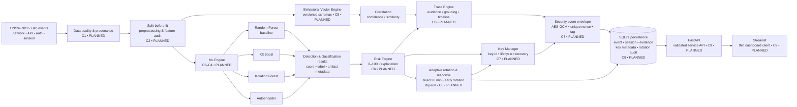

# AI-Based Network Anomaly Detection and Traceability System with Secure Behavioral Vectorization and Adaptive Key Rotation

Hệ thống nghiên cứu về phát hiện bất thường mạng, phân tích rủi ro và truy vết hành vi trong phạm vi hạ tầng được phép giám sát. Đề tài kết hợp **UNSW-NB15**, các mô hình supervised/unsupervised, **Behavioral Vector**, **Risk/Trace Engine**, mã hóa **AES-GCM** và **Adaptive Key Rotation**.

> **Trạng thái hiện tại:** C0 — Governance & Documentation đã được triển khai trong nhánh công việc hiện tại. C1–C11 vẫn chủ yếu `PLANNED`; chưa có kết quả ML end-to-end hoặc benchmark được công bố trong repository. Trạng thái và bằng chứng chuyển tiếp được ghi trong [`docs/IMPLEMENTATION_CHECKPOINTS.md`](docs/IMPLEMENTATION_CHECKPOINTS.md).

## Tổng quan

### Vấn đề nghiên cứu

Network flow, API log, authentication event và session event có thể chứa các mẫu hành vi bình thường hoặc bất thường. Một hệ thống có giá trị nghiên cứu cần đồng thời:

- phát hiện và phân loại hành vi bất thường với protocol đánh giá có thể tái lập;
- biểu diễn hành vi bằng vector có versioned schema, thay vì phụ thuộc vào một định danh đơn lẻ;
- kết hợp anomaly score, classification và evidence thành Risk Score có giải thích;
- liên kết các event/session/request thành incident timeline với confidence rõ ràng;
- bảo vệ vector và evidence bằng cryptography chuẩn, có key lifecycle và rotation;
- phân biệt rõ bằng chứng đã triển khai, đã kiểm thử và mới chỉ nằm trong kế hoạch.

### Mục tiêu

Phương án B hướng tới một pipeline lab gồm:

1. kiểm tra provenance, schema, chất lượng và leakage của UNSW-NB15;
2. preprocessing có fit boundary đúng và các mô hình RF/XGBoost, Isolation Forest/Autoencoder;
3. Network/API/Session Behavioral Vector và correlation confidence;
4. Risk Engine (0–100) và Trace Engine (evidence, grouping, timeline);
5. AES-GCM, metadata versioning, historical decryption và fixed/adaptive key rotation;
6. FastAPI, SQLite và Streamlit cho tích hợp, lưu trữ và trình diễn trong lab;
7. bảy experiments có protocol, artifact, result và limitation được ghi nhận.

Hệ thống không nhằm xác định danh tính thật của attacker, chứng minh zero-day, hay tự động tác động lên hệ thống production.

## Thành phần và tính năng

| Thành phần | Định hướng | Trạng thái trong repository hiện tại |
| --- | --- | --- |
| Data quality & preprocessing | UNSW-NB15, schema, missing/duplicate, split trước mọi fit, leakage audit | C1–C2 `PLANNED`; validator cơ bản hiện có |
| Supervised ML | Random Forest là baseline; XGBoost dùng cùng protocol | RF constructor có trong code; training/evaluation và XGBoost `PLANNED` |
| Unsupervised ML | Isolation Forest và Autoencoder reconstruction error; threshold trên validation | Isolation Forest constructor có trong code; Autoencoder và protocol `PLANNED` |
| Behavioral Vector | Network/API/Session vector, normalization, similarity, missing-feature policy | `PLANNED` (C5) |
| Risk/Trace Engine | Risk Score 0–100, explanation, incident grouping, evidence và timeline | `PLANNED` (C6) |
| Security layer | AES-GCM, key identifier, unique nonce, recovery và rotation 30 phút/adaptive | `PLANNED` (C7) |
| Response | Risk-triggered early rotation, cooldown, rate limit, idempotency, dry-run | `PLANNED` (C8); chỉ lab/dry-run |
| API, storage, dashboard | FastAPI, SQLite mặc định, Streamlit thin client | `PLANNED` (C9) |

Các constructor hoặc test import hiện có không chứng minh mô hình đã fit/predict, pipeline đã chạy, hay hệ thống đã sẵn sàng production.

## System Architecture

Sơ đồ dưới đây mô tả **kiến trúc mục tiêu của Phương án B**. Các khối có nhãn `PLANNED` chưa được xem là tính năng hoạt động trên `main`.



## Technology Stack

| Đã có trong repository | Dự kiến theo Phương án B |
| --- | --- |
| Python 3.11+, pandas, NumPy, scikit-learn, joblib, matplotlib, seaborn, pytest | XGBoost và Autoencoder |
| `network_anomaly` package, config, metrics, model constructors và data validator cơ bản | Behavioral Vector Engine cho network/API/session |
| Unit/integration tests và GitHub Actions workflow | Risk/Trace Engine, correlation confidence và incident timeline |
| `scripts/check_environment.py`, `scripts/validate_data.py`, `scripts/run_experiments.py --step check-data` | AES-GCM, Key Manager, key lifecycle và adaptive rotation |
| — | FastAPI, SQLite persistence, PostgreSQL adapter tùy chọn và Streamlit thin client |

Các mục ở cột “Dự kiến” chỉ trở thành `IMPLEMENTED` khi có code, test và evidence tương ứng. Dependency hiện được khai báo dạng lower bound trong `pyproject.toml`; repository chưa có lockfile.

## Dataset UNSW-NB15

UNSW-NB15 là dataset nghiên cứu chính của đề tài. Raw CSV không được commit vào Git và phải được đặt ngoài phạm vi version control. Nguồn tham khảo chính thức: [UNSW-NB15 Dataset](https://research.unsw.edu.au/projects/unsw-nb15-dataset).

- Hướng dẫn provenance và chuẩn bị dữ liệu: [`docs/DATASET.md`](docs/DATASET.md).
- Validator hiện có: `scripts/validate_data.py`; khi chưa có raw data, script trả `SKIPPED`, không phải validation `PASS`.
- Fixture trong `tests/` là dữ liệu tổng hợp cho kiểm thử, không phải UNSW-NB15.
- PR [#22](https://github.com/doctor-cato/AI-NETWORK-ANOMALY-DETECTION-TRACEABILITY-MAIN/pull/22) là workstream acquisition/validation cho Issue #4/#5, tách khỏi trạng thái implementation của `main`. Đọc [`docs/IMPLEMENTATION_CHECKPOINTS.md`](docs/IMPLEMENTATION_CHECKPOINTS.md) để biết evidence và điều kiện chuyển tiếp; không suy diễn trạng thái code từ PR sang `main`.
- Workstream đó bổ sung `scripts/fetch_unsw_nb15.py` (tải mirror revision-pinned, cache, lock, rollback), manifest ở `data/UNSW_NB15_MANIFEST.json` và báo cáo tổng hợp ở `reports/data_quality/unsw_nb15_validation.json`.
- Các SHA-256 trong workstream đó là **project-computed local hashes**, không phải checksum chính thức do UNSW công bố.

Không ghi nhận metric, row count, checksum hoặc kết quả thực nghiệm như kết quả hiện hành nếu chưa có bằng chứng tương ứng trong checkout/PR được nêu rõ.

## Installation & Quick Start

Yêu cầu Python `>=3.11`.

```powershell
python -m venv .venv
.\.venv\Scripts\Activate.ps1
python -m pip install -e .
python scripts/check_environment.py
```

Trên macOS/Linux:

```bash
python3 -m venv .venv
source .venv/bin/activate
python -m pip install -e .
python scripts/check_environment.py
```

Các lệnh hiện có và có thể chạy trên checkout này:

```bash
python scripts/check_environment.py
python scripts/validate_data.py
python scripts/run_experiments.py --step check-data
python -m pytest tests/unit/test_basic.py tests/integration/test_pipeline.py -q
```

Sau khi workstream acquisition của PR #22 có trong checkout, vòng lặp dữ liệu đầy đủ là:

```bash
python scripts/fetch_unsw_nb15.py
python scripts/dataset_manifest.py verify
python scripts/validate_data.py --manifest data/UNSW_NB15_MANIFEST.json --report reports/data_quality/unsw_nb15_validation.json
```

`run_experiments.py` chỉ triển khai bước `check-data`; các bước `baseline`, `evaluate` và `inference` hiện trả exit code `3` với trạng thái `NOT IMPLEMENTED`. Không sử dụng chúng như bằng chứng mô hình đã được huấn luyện hoặc đánh giá.

## Testing & Reproducibility

CI và kiểm tra cục bộ được mô tả trong [`.github/workflows/ci.yml`](.github/workflows/ci.yml) và [`docs/REPRODUCIBILITY.md`](docs/REPRODUCIBILITY.md). Lệnh kiểm tra nền:

```bash
python scripts/check_environment.py
python -m pytest tests/unit/test_basic.py tests/integration/test_pipeline.py -q
git diff --check
```

Seed cấu hình hiện tại là `42`. Khi các experiment được triển khai, mỗi kết quả cần ghi dataset/split identifier, seed, preprocessing boundary, dependency versions, config, metrics, artifact và reproduction command. Fixture tổng hợp chỉ kiểm tra hành vi code; không nâng trạng thái thành `EXPERIMENTALLY VALIDATED` trên UNSW-NB15.

## Implementation Status (C0–C11)

| Checkpoint | Phạm vi | Trạng thái hiện tại |
| --- | --- | --- |
| C0 | Governance, scope, architecture, traceability, backlog | `IMPLEMENTED`; evidence và phần còn lại xem checkpoint log |
| C1 | Data quality, EDA, leakage audit | `PLANNED`; #4/#5 `TESTED` trên PR #22, chưa đồng nhất với `main`; #6/#7 `PLANNED` |
| C2 | Leakage-safe preprocessing và artifacts | `PLANNED` |
| C3 | Random Forest và XGBoost supervised protocol | `PLANNED`; RF mới có constructor |
| C4 | Isolation Forest, Autoencoder, unknown-attack holdout | `PLANNED`; Isolation Forest mới có constructor |
| C5 | Versioned Behavioral Vector và correlation confidence | `PLANNED` |
| C6 | Risk Engine và Trace Engine | `PLANNED` |
| C7 | AES-GCM và key lifecycle | `PLANNED` |
| C8 | Adaptive response, cooldown, rate limit, idempotency | `PLANNED`; lab/dry-run |
| C9 | FastAPI, SQLite, Streamlit, integration/E2E | `PLANNED` |
| C10 | Bảy research experiments | `PLANNED` |
| C11 | Report, slides, demo, audit và handoff | `PLANNED` |

Bảng truy vết đầy đủ: [`docs/TRACEABILITY_MATRIX.md`](docs/TRACEABILITY_MATRIX.md). Checkpoint log: [`docs/IMPLEMENTATION_CHECKPOINTS.md`](docs/IMPLEMENTATION_CHECKPOINTS.md).

## Research Experiments

Kế hoạch nghiên cứu gồm bảy so sánh, chưa được trình bày như kết quả đã chạy:

1. Random Forest so với XGBoost.
2. Isolation Forest so với Autoencoder.
3. Raw imbalance so với class weighting/oversampling trên training set.
4. Known-attack detection so với unknown-attack holdout.
5. Correlation dựa trên IP/API identity so với Behavioral Vector.
6. Fixed 30-minute key rotation so với Adaptive Key Rotation.
7. Có mã hóa so với không mã hóa để đo latency, throughput, CPU và RAM.

Protocol, metric và điều kiện chấp nhận nằm trong [`docs/EXPERIMENT_PLAN.md`](docs/EXPERIMENT_PLAN.md) và [`docs/ROADMAP_FULL_SYSTEM.md`](docs/ROADMAP_FULL_SYSTEM.md). Không chọn threshold, feature, hyperparameter hoặc calibration bằng test set.

## Documentation

- [Problem statement](docs/PROBLEM_STATEMENT.md) và [project charter](docs/PROJECT_CHARTER.md)
- [Requirements](docs/REQUIREMENTS.md) và [traceability matrix](docs/TRACEABILITY_MATRIX.md)
- [System architecture](docs/ARCHITECTURE.md) và [full roadmap](docs/ROADMAP_FULL_SYSTEM.md)
- [Dataset protocol](docs/DATASET.md) và [reproducibility](docs/REPRODUCIBILITY.md)
- [Evaluation](docs/EVALUATION.md) và [methodology](docs/METHODOLOGY.md)
- [Ethics & privacy](docs/ETHICS_AND_PRIVACY.md)
- [Team tasks](docs/TEAM_TASKS.md), [report outline](docs/REPORT_OUTLINE.md) và [presentation outline](docs/PRESENTATION_OUTLINE.md)

## Team & Contributions

Repository định nghĩa năm nhóm trách nhiệm trong [`docs/TEAM_TASKS.md`](docs/TEAM_TASKS.md): Data & Preprocessing; Supervised ML & Evaluation; Unsupervised ML & Behavioral; Security Risk & Trace; Backend Integration & Delivery. Tên thành viên chưa được điền khi chưa có xác nhận của nhóm.

Đóng góp nên mô tả rõ phạm vi, tài liệu/issue liên quan, lệnh kiểm chứng, trạng thái `PLANNED`/`IMPLEMENTED`/`TESTED`/`EXPERIMENTALLY VALIDATED` và giới hạn còn lại.

## Limitations & Security

- Chưa có bằng chứng trong repository hiện tại cho training/evaluation/inference end-to-end, metric trên UNSW-NB15, hoặc benchmark encryption.
- Raw dataset, model artifact lớn, secret và key material không được commit.
- Behavioral Vector chỉ hỗ trợ biểu diễn và tương quan hành vi; Trace Engine không kết luận danh tính thật.
- Security response chỉ `dry-run` trong lab; không block, cô lập hoặc rate-limit người dùng/hệ thống thật.
- Unknown-attack holdout không đồng nghĩa với bằng chứng phát hiện zero-day.
- AES-GCM được dùng như cryptography chuẩn; đề tài không tự thiết kế thuật toán mã hóa.
- Người dùng phải tự xác nhận điều kiện sử dụng của UNSW-NB15 và không dùng prototype như một security control chưa được xác minh.

## License & References

Mã nguồn được phân phối theo [Apache License 2.0](LICENSE). Dataset UNSW-NB15 giữ nguyên điều kiện sử dụng của nguồn; license của repository không thay đổi điều kiện đó.

```bibtex
@software{network_anomaly_2026,
  author = {{Project Team}},
  title = {AI-Based Network Anomaly Detection and Traceability System with Secure Behavioral Vectorization and Adaptive Key Rotation},
  url = {https://github.com/doctor-cato/AI-NETWORK-ANOMALY-DETECTION-TRACEABILITY-MAIN},
  version = {0.1.0},
  date = {2026},
  license = {Apache-2.0}
}
```

Tham chiếu chính: [UNSW-NB15](https://research.unsw.edu.au/projects/unsw-nb15-dataset), [roadmap hệ thống](docs/ROADMAP_FULL_SYSTEM.md), [kiến trúc](docs/ARCHITECTURE.md) và [ma trận truy vết](docs/TRACEABILITY_MATRIX.md).
