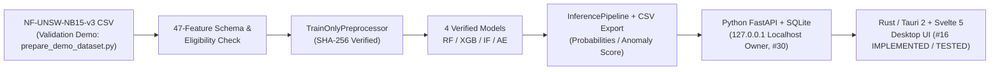

# AI-Based Network Anomaly Detection and Traceability System

**Nghiên cứu phát hiện lưu lượng mạng bất thường từ NetFlow, với bằng chứng dữ liệu và thí nghiệm có thể truy vết.**

Đồ án nghiên cứu & ứng dụng cuối kỳ · Python ML + FastAPI/SQLite + Desktop UI mục tiêu **Rust / Tauri 2 + Svelte 5** · Trọng tâm: phân loại & phát hiện bất thường trên **NF-UNSW-NB15-v3**.

[](https://github.com/doctor-cato/AI-NETWORK-ANOMALY-DETECTION-TRACEABILITY-MAIN/actions/workflows/ci.yml)
[](pyproject.toml)
[](LICENSE)

> **Cập nhật Củng cố Sản phẩm Cuối kỳ (Consolidation MVP → v1.0.0 Standalone):**
> - Trên `main`: Đã hợp nhất Random Forest Held-out Test (`rf-heldout-ea330b9`, PR #50), **Autoencoder** (#29, PR #51), **FastAPI + SQLite persistence** (#30, PR #61), **Desktop App `v0.6.0-beta.1`** (#16, PR #67/#68), **Issue #27 Adaptive Security Response Dry-Run** (PR #69, `ab018da`) và **PR #70 (`v0.6.0` Stable — 4-model Demo & Held-out XGBoost/Autoencoder)**.
> - Trên PR #47 (`f999930`, 6/6 CI PASS) & PR #49 (`7344994`): Ingestion Gate (#46/#58) và Cross-Dataset M7 (#48/#57) được giữ rõ phạm vi ngoài release chính thức nếu chưa hợp nhất.
> - Trên nhánh **Issue #71 (`v1.0.0` Stable — Standalone Windows Installer)**: Chuyển kiến trúc sang **Fully Embedded Windows x64 NSIS Installer** (`Tauri 2 + Svelte 5 + PyInstaller Sidecar + 4 Verified ML Models + Preprocessor + Configs + Demo CSV + WebView2 Offline`), loại bỏ hoàn toàn yêu cầu Python hoặc Companion Bundle ở máy người dùng cuối. Model binaries lớn không commit vào Git mà được kiểm tra SHA-256 & quyền phân phối (`NOTICE`, `THIRD_PARTY_NOTICES.md`, UQ License `454104`) tại **giai đoạn build** trước khi nhúng vào bộ cài.

**Đọc nhanh:** [Tổng quan](#tổng-quan-dự-án) · [Dữ liệu](#bộ-dữ-liệu) · [Mô hình](#các-mô-hình-ai) · [Kết quả](#thực-nghiệm-và-kết-quả) · [Demo & Tái lập](#cài-đặt-và-tái-lập) · [Hạn chế](#hạn-chế) · [Tài liệu](docs/REPRODUCIBILITY.md)

## Tổng quan dự án

Một Network Intrusion Detection System (NIDS) cần phân biệt hoạt động bình thường với lưu lượng đáng nghi, đồng thời cho người phân tích biết dự đoán xuất phát từ dữ liệu và mô hình nào. Dự án xây dựng nền tảng nghiên cứu và ứng dụng desktop offline trên **network flow**: kiểm tra nguồn dữ liệu, tạo phân vùng không rò rỉ, huấn luyện mô hình, lưu bằng chứng cấu hình/checksum/metric và cung cấp API FastAPI cho ứng dụng desktop **Rust / Tauri 2 + Svelte 5**. Người đọc có thể kiểm tra từng bước qua [traceability matrix](docs/TRACEABILITY_MATRIX.md) và các báo cáo trong `reports/`.

**Đã đạt được:** Cả 4 mô hình đều đã có bằng chứng thực nghiệm trên `NF-UNSW-NB15-v3` (Train `1.655.797` flow, Validation `345.371` flow, Held-out Test `345.953` flow) gồm Random Forest (`rf-heldout-ea330b9`), XGBoost (`xgb-baseline-1794755807`), Isolation Forest (`if-c4-20261115T055359Z`) và Autoencoder (`reports/evaluation/autoencoder/`). Python FastAPI (`127.0.0.1`) + SQLite persistence, pipeline tạo dữ liệu demo CSV từ Validation (`scripts/prepare_demo_dataset.py`), **Issue #27 Security Response Dry-Run** (PR #69 đã merge vào `main`), **PR #70 (4-model comparison & E2E)** đã hợp nhất, và **Issue #71 (`NetFlow Sentinel v1.0.0 Stable`)** hoàn thiện bộ cài đặt Windows x64 standalone tích hợp PyInstaller sidecar cùng 4 mô hình. Đây là đồ án prototype lab, không phải hệ thống enterprise SOC production.

## Bài toán nghiên cứu

Lưu lượng lớn và biến đổi khiến quy tắc nhận diện tĩnh khó bao phủ mọi mẫu tấn công. Học máy có thể học quan hệ giữa các thống kê flow (gói, byte, thời lượng, TCP flags, TTL, inter-arrival time) và nhãn, nhưng một flow không chứa toàn bộ packet payload hay ngữ cảnh phiên ứng dụng. Trọng tâm kiểm chứng hiện tại là **binary supervised classification** (`Label=0` Benign, `Label=1` Attack) cùng hướng mở rộng unsupervised (**Isolation Forest**, **Autoencoder**); phát hiện bất thường chưa biết trên thực tế cần đánh giá unknown-attack holdout độc lập trên dữ liệu thật.

False positive (FP) làm tăng công điều tra, false negative (FN) bỏ lọt tấn công. Vì lớp Attack chỉ khoảng 5,4% dữ liệu, Accuracy một mình dễ che giấu lỗi; dự án báo Precision, Recall, F1, FPR và confusion matrix. Kết quả còn cần kiểm tra khả năng tổng quát hóa: đặc trưng của testbed, vector trùng lặp và sự thay đổi giữa các mạng có thể khiến điểm in-domain rất cao nhưng hiệu năng ngoài dataset giảm (xem [Issue #48](docs/ARCHITECTURE.md)). Truy vết provenance, feature contract và artifact là điều kiện để giải thích *mô hình đã được đánh giá như thế nào*, không đồng nghĩa với giải thích nhân quả cho từng cảnh báo.

## Mục tiêu đề tài

**Mục tiêu chính:** đóng gói ứng dụng desktop Windows cục bộ phân tích NetFlow CSV bằng mô hình AI đã kiểm chứng, bảo toàn tính liêm chính khoa học và provenance.

| Nhóm mục tiêu | Trạng thái hiện tại (Consolidation MVP) |
|---|---|
| Provenance, schema, data quality, EDA, split và preprocessing có kiểm soát | **COMPLETED / REAL-DATA VERIFIED** |
| Random Forest baseline (#10, #12, #13) | **EXPERIMENTALLY VALIDATED** cả Validation (`345.371`) và Held-out Test `rf-heldout-ea330b9` (`345.953`) |
| XGBoost theo giao thức binary chung (#31) | **EXPERIMENTALLY VALIDATED** trên Validation (`F1=0.999984`) và Held-out Test (`xgb-baseline-1794755807`: `F1=0.999984`, `TN=315356, FP=1, FN=0, TP=30596`) |
| Isolation Forest (#11) | **EXPERIMENTALLY VALIDATED & REPRODUCED** trên Validation & Held-out Test (`if-c4-20261115T055359Z`, `F1=0.5064`, `Recall=0.8997`, `ROC-AUC=0.893730`) |
| Autoencoder (#29) | **EXPERIMENTALLY VALIDATED** (`ae_fpr_constrained_20261115T163000Z`: Val `FPR=0.049998 <= 0.05`, threshold `17234985.792476`, Held-out Test `F1=0.1361`, `Recall=0.1093`, `ROC-AUC=0.6303`, Unknown `R=0.0625`; run cũ `benign_quantile` lưu riêng tại `runs/ae_benign_quantile_20261115T151859Z/`; `BLOCKED / NOT READY` nếu thiếu binary) |
| FastAPI (`127.0.0.1`), SQLite persistence, 4-model inference & Validation Demo CSV Prep | **IMPLEMENTED / TESTED** (#30, #15, `prepare_demo_dataset.py` đã test với 200 dòng Validation) |
| Desktop UI **Rust / Tauri 2 + Svelte 5** (#16, #71) | **IMPLEMENTED / TESTED** (bộ cài ứng viên `v1.0.0` nhúng PyInstaller sidecar, 4 model và hướng dẫn 4 bước). Nghiệm thu Windows sạch và phát hành Stable đang chờ. |
| Behavioral Vector (#28), Risk Ranking (#32), Trace Timeline (#24), Adaptive Response Dry-Run (#27), Bảo mật cục bộ (#26) | **IMPLEMENTED / TESTED (Scoped M6/M7)** — thống kê NetFlow, risk/timeline tất định, mô phỏng phản ứng dry-run (`executed=false`); live firewall/OS commands & AES-256-GCM keyring **DEFERRED** |

## Kiến trúc hệ thống

Đường liền là thành phần đã có code/test (#16, #30); đường nét đứt là thành phần thu gọn/hoãn (`REDUCED / DEFERRED`).



Nguồn dữ liệu chính là NetFlow CSV (`NF-UNSW-NB15-v3`), **không** chứa log API, authentication hay application session. [Kiến trúc đầy đủ](docs/ARCHITECTURE.md) và [roadmap](docs/ROADMAP_FULL_SYSTEM.md) nêu rõ ranh giới giữa phần MVP đã đóng băng và các hạng mục thu gọn/hoãn.

## Công nghệ sử dụng

| Lớp | Công nghệ | Vai trò & Trạng thái |
|---|---|---|
| Ngôn ngữ ML/Backend | Python `>=3.11` (CI: 3.11, 3.12) | Pipeline dữ liệu, training, inference và `src/network_anomaly/` |
| Dữ liệu & Lưu trữ | pandas, NumPy, SQLite | Streaming CSV, mảng số, persistence đơn chủ ghi trong FastAPI |
| ML & Deep Learning | scikit-learn, XGBoost, joblib, PyTorch (`Autoencoder`) | Random Forest, XGBClassifier, Isolation Forest, Autoencoder và verified loading |
| Backend API | FastAPI, Uvicorn | Dịch vụ REST local-only `127.0.0.1:8000` (`scripts/run_api.py`), OpenAPI contract |
| Desktop UI (M6) | **Rust / Tauri 2 + Svelte 5** | **IMPLEMENTED / TESTED (#16, #71, `v1.0.0`)** — Native file picker, PyInstaller sidecar lifecycle, bảng/biểu đồ/Confusion Matrix offline |
| Chất lượng & Kiểm thử | pytest, Ruff, Black, GitHub Actions | Unit/integration/API tests, lint/format check và raw-data CI guard |

`Streamlit` đã bị loại khỏi kiến trúc chính. PostgreSQL cluster, real-time packet capture và AES-256-GCM keyring rotation đầy đủ không nằm trong phạm vi Demo MVP M6. [Dependency khai báo](pyproject.toml) dùng phiên bản tối thiểu, chưa phải lockfile.

## Bộ dữ liệu

**NF-UNSW-NB15-v3** là bản NetFlow v3 của UNSW-NB15 do **The University of Queensland** công bố; DOI [10.48610/6E0EDA1](https://doi.org/10.48610/6E0EDA1). [Trang dataset của UQ](https://staff.itee.uq.edu.au/marius/NIDS_datasets/) mô tả 53 NetFlow fields, trong đó có 10 temporal features bổ sung cho v3. Dataset là benchmark flow của testbed, không phải luồng mạng vận hành độc lập.

| Thuộc tính của CSV đã kiểm tra | Giá trị |
|---|---:|
Flow / dòng dữ liệu | **2.365.424** |
Cột nguồn | **55** = 53 NetFlow fields + `Label` + `Attack` |
Đặc trưng đi vào baseline | **47**; 6 trường trace metadata bị loại khỏi `X` |
Benign (`Label=0`) | **2.237.731** (94,60%) |
Attack (`Label=1`) | **127.693** (5,40%) |

Sáu trường metadata là hai timestamp, hai IPv4 address và hai L4 port. `Attack` ghi chín họ tấn công: Analysis (1.226), Backdoor (4.659), DoS (5.980), Exploits (42.748), Fuzzers (33.816), Generic (19.651), Reconnaissance (17.074), Shellcode (2.381), Worms (158). Đây là phân bố **CSV đã tải và băm**, không phải kết quả suy từ landing page. Trang UQ ghi 127.639 Attack và hoán đổi count của Analysis/Backdoor/Shellcode; [provenance report](docs/dataset/NF_UNSW_NB15_V3_PROVENANCE.md) lưu sai khác, còn [manifest](data/NF_UNSW_NB15_V3_MANIFEST.json) và [quality report](reports/data_quality/nf_unsw_nb15_v3_validation.json) theo bytes của CSV. SHA-256 CSV được dự án tính là `4ebb97bd74412d566137d95a6fc3ffd8f374f1cf8cfe204d007848e7a668f9b5`, không phải checksum do nhà xuất bản công bố.

Dataset có điều kiện **“Permitted Re-Use with Commercial Use Restriction”**: phải trích dẫn đầy đủ và chỉ dùng cho mục đích phi thương mại theo [điều khoản UQ](https://guides.library.uq.edu.au/research-and-teaching-staff/data-deposit-checklist/license-reuse-noncommercial). Apache-2.0 của source code không cấp lại quyền sử dụng dataset. Xem [schema](docs/dataset/NF_UNSW_NB15_V3_SCHEMA.md), [EDA](docs/dataset/NF_UNSW_NB15_V3_EDA.md) và [provenance](docs/dataset/NF_UNSW_NB15_V3_PROVENANCE.md).

## Tiền xử lý dữ liệu

1. `fetch_nf_unsw_nb15_v3.py` lấy package từ UQ RDM API, xác minh kích thước/checksum và giải nén an toàn. `dataset_manifest.py verify` kiểm tra bytes, schema và manifest. Raw CSV 577.360.958 bytes không được commit.
2. `validate_data.py` kiểm tra nhãn, cột, token thiếu/vô hạn, duplicate; EDA mô tả phân bố. Báo cáo raw ghi **122.493** flow có token numeric thiếu hoặc `+Inf`, **14.815** dòng trùng hệt và **1.134.553** dòng lặp theo vector 47 đặc trưng (số lần lặp sau lần xuất hiện đầu). Không xóa ngầm những flow này.
3. `split_and_audit_nf_unsw_nb15_v3.py` chia theo `FLOW_START_MILLISECONDS` và giữ purge gap 5 phút ở hai ranh giới: Train **1.655.797**, Validation **345.371**, Test **345.953**, purged **18.303**. Dataset v3 là một CSV, **không** dùng official train/test partition của UNSW-NB15 bản cũ. Audit ghi 0 full-row/source-feature/canonical-flow-group overlap theo định nghĩa đã chọn, nhưng vẫn có vector ML trùng nhau giữa các tập.
4. `preprocess_nf_unsw_nb15_v3.py` chọn đúng 47 cột: loại `Label`, `Attack` và 6 metadata trước khi fit. Preprocessor fit **chỉ trên Train**, dùng median cho numeric, mode cho categorical coded, xử lý token không finite theo policy rồi áp dụng tham số đã đóng băng cho Validation/Test. Cấu hình baseline **không scale**, không thêm missing indicator, giữ flow zero-duration. Artifact `.joblib` có companion manifest và checksum.

Đọc [split protocol](docs/NF_UNSW_NB15_V3_SPLIT_PROTOCOL.md), [preprocessing policy](docs/NF_UNSW_NB15_V3_PREPROCESSING_POLICY.md), [split manifest](reports/splits/nf_unsw_nb15_v3_split_manifest.json) và [smoke report](reports/preprocessing/REAL_DATA_SMOKE_REPORT.md). Trạng thái `ML_READY: BLOCKED` trong *raw quality report* và một số tài liệu trước Issue #8 là snapshot trước khi split/preprocessing được thực thi; không nên hiểu là hiện chưa có pipeline.

## Các mô hình AI

### Random Forest

Ensemble các decision tree huấn luyện trên mẫu bootstrap và tập con đặc trưng, làm baseline supervised cho `Label`. Code, training entrypoint và test tồn tại; run đã ghi **200 cây**, `max_depth=16`, seed 42, 47 features. [Run manifest](reports/models/random_forest_manifest.json), [training report](reports/models/rf_baseline_training_report.md), [validation diagnostic audit](reports/models/rf_baseline_validation_audit.json) và [Held-out Test evaluation (`rf-heldout-ea330b9`)](reports/evaluation/rf-heldout-ea330b9/metrics.json) chứng minh trạng thái **EXPERIMENTALLY VALIDATED** trên cả Validation và Held-out Test (`345.953` flow). Binary `.joblib` (`801afcbb71f04de8f671790d747b45a3bfc98bd3e01fb02b8f37a1c76ec85eea`) nằm ngoài Git; khi có trên máy cục bộ thì sẵn sàng inference (`READY`).

### XGBoost

Gradient boosting xây tuần tự các cây để giảm loss; baseline dùng `XGBClassifier`, `binary:logistic`, 200 cây, `max_depth=6`, learning rate 0,1, seed 42. [Run manifest](reports/models/xgboost_manifest.json), [training report](reports/models/xgboost_training_report.md) và [Held-out Test report](reports/evaluation/xgboost/evaluation_report.md) ghi train/Validation thật (`xgb-baseline-1794755807`), reload verification và confusion matrix trên cả Validation (`F1=0,999984`) lẫn Held-out Test (`345.953` dòng, `F1=0,999984`, `TN=315356, FP=1, FN=0, TP=30596`). Trạng thái **EXPERIMENTALLY VALIDATED**; `InferencePipeline` / FastAPI hỗ trợ nạp artifact XGBoost và báo `BLOCKED / NOT READY` nếu thiếu binary cục bộ. So sánh với RF dùng cùng dataset definition/protocol (xem [membership parity audit](reports/splits/split_membership_audit_report.md)).

### Isolation Forest

Mô hình unsupervised cô lập điểm khác thường bằng đường đi ngắn trong các cây phân tách ngẫu nhiên (`src/network_anomaly/models/isolation_forest.py`, `scripts/train_isolation_forest.py`), đã được **EXPERIMENTALLY VALIDATED** & **REPRODUCED** trên `NF-UNSW-NB15-v3` (run `if-c4-20261115T055359Z`, clean commit `bf0f3ec`, `git_dirty=false`): huấn luyện **benign-only** trên `1.590.608` mẫu `Label == 0` thuộc Train, hiệu chuẩn ngưỡng trên Validation (`policy = max-F1-on-known-attacks`, `74.421` candidates, loại trừ `{Backdoor, Worms}`) cho ngưỡng `-0.033527`, và đánh giá Held-out Test (`345.953` flow) đạt `Recall = 0.8997`, `Precision = 0.3523`, `F1 = 0.5064`, `FPR = 0.1605`, `ROC-AUC = 0.893730`, với tỷ lệ phát hiện Unknown (`Backdoor`, `Worms`) `1.122 / 1.296 = 0.8657` (xem [báo cáo đánh giá](reports/experiments/isolation_forest/evaluation_report.md) và [manifest](reports/models/isolation_forest_manifest.json)). Binary `.joblib` (`15a69cc491ce8903fd2dfd3ee12e7283bd3d9c0ceba51c9a2c04b2188a5fddf9`) nằm ngoài Git; khi có cục bộ thì `InferencePipeline` / FastAPI / demo đạt trạng thái `READY`.

### Autoencoder

Học tái tạo đặc trưng flow bằng mạng PyTorch Autoencoder (hoặc `MLPRegressor` fallback trong kiến trúc PR #51) trained trên benign-only Train (`1.590.608` dòng) và dùng reconstruction MSE làm `raw_anomaly_score` (tách biệt với supervised `attack_probability`, có `normalized_anomaly_score` nội suy từ phân bố Validation). Ngưỡng đóng băng trên Validation được hiệu chỉnh lại bằng `fpr_constrained` (`ae_fpr_constrained_20261115T163000Z`: ngưỡng `17234985.792476`, `empirical_val_fpr = 0.049998253 <= 0.05`, cô lập unknown `{Backdoor, Worms}`) đạt Held-out Test (`345.953` dòng): `TP=3343, FP=15188, TN=300169, FN=27253`, `Acc=0.8773, P=0.1804, R=0.1093, F1=0.1361, FPR=0.0482, ROC-AUC=0.6303, PR-AUC=0.1615`, Unknown `R=0.0625` (xem [evaluation report](reports/evaluation/autoencoder/evaluation_report.md) và [manifest](reports/models/autoencoder_manifest.json)). Run ban đầu (`ae_benign_quantile_20261115T151859Z`, ngưỡng `17234106.380850`, Val `FPR=0.050001429 > 0.05`, Held-out Test `F1=0.1361`, `R=0.1093`) được lưu nguyên trạng tại `reports/evaluation/autoencoder/runs/ae_benign_quantile_20261115T151859Z/`. Trạng thái **EXPERIMENTALLY VALIDATED**; báo `BLOCKED / NOT READY` fail-closed nếu thiếu file `.joblib` / `threshold` cục bộ.

| Model | Cách tiếp cận / vai trò | Code & Verified Loading | Validation thật | Held-out Test |
|---|---|---|---|---|
Random Forest | Supervised baseline | Có + tests + manifest | Có (`345.371` flow) | Có (`rf-heldout-ea330b9`, `345.953` flow); [báo cáo](reports/evaluation/error_analysis_report.md) |
XGBoost | Supervised comparison | Có + tests + manifest | Có (`345.371` flow) | **VERIFIED** (`345.953` flow, F1 `0,999984`) |
Isolation Forest | Unsupervised anomaly score | Có + tests + verified `READY` | Có (`345.371` flow, threshold `-0.033527`) | Có (`345.953` flow, Known `0.9012`, Unknown `0.8657`); [báo cáo](reports/experiments/isolation_forest/evaluation_report.md) |
Autoencoder | Reconstruction error | Có (#29 + `AutoencoderModel`) | Có (`345.371` flow, `FPR 0,049998 <= 0,05`) | **VERIFIED** (`345.953` flow, F1 `0,1361`, Recall `0,1093`, Unknown R `0,0625`) |

## Thực nghiệm và kết quả

Hai run supervised dùng `Label=1` là Attack, 47 đặc trưng và split thời gian có purge gap. Train có 1.655.797 dòng; Validation có 314.871 Benign và 30.500 Attack. Các số sau lấy từ hai [model manifests](reports/models/) và báo cáo tương ứng, **không phải held-out Test**. Accuracy tính từ confusion matrix; FPR = FP/(FP+TN).

| Chỉ số trên **Validation** | Random Forest | XGBoost |
|---|---:|---:|
Accuracy | 0,999977 | 0,999997 |
Precision (Attack) | 0,999836 | 0,999967 |
Recall (Attack) | 0,999902 | 1,000000 |
F1 (Attack) | 0,999869 | 0,999984 |
Macro-F1 | 0,999928 | 0,999991 |
FPR | 0,00001588 | 0,00000318 |
Confusion matrix `[[TN, FP], [FN, TP]]` | `[[314866, 5], [3, 30497]]` | `[[314870, 1], [0, 30500]]` |
Held-out Test | **VERIFIED**: F1 0,999853, TN 315350, FP 7, FN 2, TP 30594 | **VERIFIED**: F1 0,999984, TN 315356, FP 1, FN 0, TP 30596 |

Precision cho biết tỷ lệ cảnh báo Attack là đúng; Recall cho biết tỷ lệ Attack được phát hiện; F1 cân bằng hai chỉ số; FPR đo tỷ lệ Benign bị báo nhầm. Trong Validation này XGBoost ghi ít hơn 4 FP và 3 FN so với RF, nhưng khác biệt nhỏ trên cùng một benchmark không đủ kết luận ưu thế tổng quát. [Báo cáo RF](reports/models/rf_baseline_training_report.md) và [XGBoost](reports/models/xgboost_training_report.md) ghi cấu hình, môi trường và phân rã theo `Attack`.

**Cảnh báo diễn giải:** [split audit](reports/splits/nf_unsw_nb15_v3_split_manifest.json) ghi **172.621/345.371 flow Validation (49,98%)** chia sẻ nguyên vector 47 đặc trưng với Train, dù không có full-row/flow-group overlap theo contract. [RF diagnostic audit](reports/models/rf_baseline_validation_audit.json) còn cho thấy cây chỉ dùng `MIN_TTL` đạt Accuracy Validation **0,999849**. Điều này phù hợp với khả năng mô hình học đặc điểm cố định của testbed; không chứng minh phát hiện tấn công trên mạng khác, zero-day hay production readiness. [Membership parity audit](reports/splits/split_membership_audit_report.md) cũng đánh dấu **`MEMBERSHIP_EQUIVALENCE: NOT_VERIFIED`** giữa index nén của run RF cũ và run XGBoost mới vì index gốc không được lưu trong Git. [Issue #55](https://github.com/doctor-cato/AI-NETWORK-ANOMALY-DETECTION-TRACEABILITY-MAIN/issues/55) theo dõi thêm việc đối chiếu chuỗi hash provenance.

## Kết quả đạt được

Nhóm đã hoàn thành kiểm định CSV nguồn `NF-UNSW-NB15-v3`, EDA có bằng chứng chạy lặp, split và kiểm toán leakage, train-only preprocessor, thực nghiệm đầy đủ trên Train/Validation/Held-out Test cho cả **4 mô hình** (Random Forest `rf-heldout-ea330b9`, XGBoost `xgb-baseline-1794755807`, Isolation Forest `if-c4-20261115T055359Z`, Autoencoder `reports/evaluation/autoencoder/`), **FastAPI (`127.0.0.1:8000`) + SQLite persistence**, pipeline CLI và Desktop App 4 model (`random_forest`, `xgboost`, `isolation_forest`, `autoencoder`), **Issue #27 Adaptive Security Response Dry-Run** (`executed=false`), và luồng tạo/xác minh companion artifacts (`scripts/prepare_demo_dataset.py`, `scripts/verify_companion_artifacts.py`). `reports/` chứa metadata và báo cáo nhỏ; `data/raw/`, `data/processed/`, `data/demo/*.csv` và `artifacts/` nhị phân lớn không track trong Git.

Thử nghiệm smoke E2E trên `data/demo/demo_flows.csv` (200 dòng Validation) đã chạy trực tiếp qua FastAPI cho cả 4 model (`198` dòng hợp lệ + `2` dòng `ABSTAINED_OOD`); **Desktop Application Rust / Tauri 2 + Svelte 5 (`#16`, `#71`, `v1.0.0` Stable Standalone)** đóng gói trực tiếp sidecar + 4 mô hình thật vào bộ cài NSIS Windows x64. [Implementation checkpoints](docs/IMPLEMENTATION_CHECKPOINTS.md) và [traceability matrix](docs/TRACEABILITY_MATRIX.md) lưu đầy đủ chuỗi truy vết yêu cầu → code → test → bằng chứng.

## Cài đặt và tái lập

Yêu cầu: Python **3.11 hoặc 3.12** (theo CI), Git, kết nối mạng để tải dữ liệu từ UQ; dùng shell PowerShell ở Windows. `pyproject.toml` cho phép `>=3.11`, nhưng CI hiện chỉ chạy 3.11/3.12. Dataset CSV khoảng **577 MB**, archive khoảng **111 MB**; xử lý 2,36 triệu flow và fit 200 cây cần nhiều GB RAM/disk. Run manifest cũ ghi khoảng 3,9–4,4 GB peak memory khi train; máy khác có thể khác. Dependency được khai báo bằng minimum versions, nên byte-for-byte artifact đa nền tảng chưa được bảo đảm.

```powershell
git clone https://github.com/doctor-cato/AI-NETWORK-ANOMALY-DETECTION-TRACEABILITY-MAIN.git
cd AI-NETWORK-ANOMALY-DETECTION-TRACEABILITY-MAIN
python -m venv .venv
.venv\Scripts\Activate.ps1
python -m pip install -e .
python scripts/check_environment.py
python scripts/fetch_nf_unsw_nb15_v3.py
python scripts/dataset_manifest.py verify
python scripts/validate_data.py
python scripts/eda_nf_unsw_nb15_v3.py
python scripts/split_and_audit_nf_unsw_nb15_v3.py
python scripts/preprocess_nf_unsw_nb15_v3.py
python scripts/train_random_forest.py
python scripts/train_xgboost.py
python -m pytest tests -q
```

Chạy các lệnh từ root theo thứ tự. `validate_data.py` có thể trả exit **1** dù source integrity PASS, vì báo cáo raw `ML_READY: BLOCKED` trước policy fit; đọc JSON thay vì coi exit 1 là lỗi tải dữ liệu. Nếu thiếu raw CSV, một số bước audit báo **SKIPPED** với exit 0; training/verification thiếu dataset hoặc artifact sẽ dừng. Không dùng Test để chọn model, feature, threshold hay hyperparameter. Tái tạo split có thể sinh index nén với SHA khác run lịch sử; đối chiếu [parity audit](reports/splits/split_membership_audit_report.md) trước khi gọi hai run là byte-identical.

Sau khi có dataset và artifact hợp lệ, có thể tạo mẫu demo Validation-only, kiểm tra prerequisite và chạy CLI hoặc FastAPI local:

```powershell
$env:PYTHONPATH = "src"

# 1. Tạo dữ liệu demo 200 dòng cân bằng chỉ từ Validation partition (0 overlap Train/Test)
python scripts/prepare_demo_dataset.py --output-dir data/demo --sample-rows 200 --seed 42

# 2. Chạy inference CLI trên demo_flows.csv (hỗ trợ random_forest, xgboost, isolation_forest, autoencoder)
python scripts/predict.py --input data/demo/demo_flows.csv --model random_forest --output data/demo/demo_predictions.csv --metadata-output data/demo/demo_predictions_meta.json

# 3. Khởi động FastAPI server cục bộ cho Desktop UI (http://127.0.0.1:8000)
python scripts/run_api.py --host 127.0.0.1 --port 8000
```

File `data/demo/demo_flows.csv` tuyệt đối không chứa `Label`/`Attack`; ground truth nằm riêng tại `data/demo/demo_labels.csv` để tính Confusion Matrix trên UI/script đánh giá. Xem [hướng dẫn cài đặt Windows (`v1.0.0`)](docs/WINDOWS_INSTALLATION.md), [quy trình đóng gói & phát hành](docs/RELEASE_PROCESS.md), [ghi chú phát hành `v1.0.0`](docs/releases/v1.0.0.md), [hướng dẫn inference](docs/INFERENCE_PIPELINE.md), [hướng dẫn tái lập](docs/REPRODUCIBILITY.md), [API contract](reports/api/API_CONTRACT.md) và [báo cáo Test Random Forest](reports/evaluation/error_analysis_report.md).

## Cấu trúc thư mục

```text
.
├── desktop/               # Ứng dụng Desktop M6 (v1.0.0): Rust Tauri 2 (src-tauri + PyInstaller sidecar) + Svelte 5 UI (src)
├── src/network_anomaly/   # data, EDA, preprocessing, models, evaluation, inference, ingestion, api
├── scripts/               # acquisition, prepare_demo_dataset, train, predict, run_api, check_desktop_version
├── tests/                 # unit, contract và integration (API, desktop CSV/E2E, inference, protocol)
├── docs/                  # methodology, protocol, Windows installation, release process, roadmap, traceability
├── data/                  # manifest & demo/.gitkeep; raw CSV và demo/*.csv được Git bỏ qua
├── reports/               # quality, split, preprocessing, EDA, api OpenAPI và model evidence
├── artifacts/             # marker & preprocessor; model binary lớn được Git bỏ qua
└── .github/workflows/     # ci.yml, lint-audit.yml, release.yml
```

## Kiểm thử và bảo đảm chất lượng

CI [`ci.yml`](.github/workflows/ci.yml) chạy trên Ubuntu/Windows với Python 3.11/3.12: environment, compile/import, `pytest tests`, rồi các bước data/EDA/preprocessing. Trên runner không có raw CSV hoặc companion `.joblib` ngoài Git, bước phụ thuộc dữ liệu thật hiển thị **SKIPPED**; badge CI **không** đồng nghĩa benchmark hoặc E2E 4 model đã `PASS` — phát hành Stable bắt buộc chạy `python scripts/verify_companion_artifacts.py --verify-e2e` trên môi trường đã nạp đủ companion artifacts. Unit/integration tests dùng fixture để kiểm tra schema, split, fit boundary, model protocol và inference behavior; không thay thế thí nghiệm trên dataset.

```powershell
python scripts/check_environment.py
python -m pytest tests -q
python -m ruff check .
python -m black --check .
git diff --check
```

`ruff` và `black` là dev dependencies tùy chọn (`python -m pip install -e ".[dev]"` nếu muốn chạy). Không tuyên bố CI hoặc toàn bộ lint đã PASS nếu chưa kiểm tra run tương ứng. Artifact verification đối chiếu checksum/contract nhưng nhiều binary nằm ngoài Git; [Issue #55](https://github.com/doctor-cato/AI-NETWORK-ANOMALY-DETECTION-TRACEABILITY-MAIN/issues/55) ghi phần provenance còn cần hòa giải.

## Tiến độ dự án

| Hạng mục | Trạng thái cập nhật |
|---|---|
Acquisition, quality audit, EDA | **EXPERIMENTALLY VALIDATED** trên CSV chính thức; [quality](reports/data_quality/nf_unsw_nb15_v3_validation.json), [EDA](reports/eda/nf_unsw_nb15_v3_eda_summary.json) |
Split, leakage audit, preprocessing | **COMPLETED / REAL-DATA VERIFIED**; [split](reports/splits/nf_unsw_nb15_v3_split_manifest.json), [preprocessing](reports/preprocessing/REAL_DATA_SMOKE_REPORT.md) |
Random Forest | **EXPERIMENTALLY VALIDATED** Validation & Held-out Test `rf-heldout-ea330b9` |
XGBoost | **EXPERIMENTALLY VALIDATED** cả Validation (`F1=0.999984`) và Held-out Test (`xgb-baseline-1794755807`, `F1=0.999984`, `ROC-AUC=1.000000`) |
Isolation Forest (#11) | **EXPERIMENTALLY VALIDATED & REPRODUCED** Validation & Held-out Test (`if-c4-20261115T055359Z`) |
Autoencoder (#29) | **EXPERIMENTALLY VALIDATED** (`ae_fpr_constrained_20261115T163000Z`, Val `FPR=0.049998 <= 0.05`, Held-out Test `F1=0.1361`, `Recall=0.1093`, `ROC-AUC=0.6303`, Unknown `R=0.0625`; run cũ lưu riêng tại `runs/ae_benign_quantile_20261115T151859Z/`; `BLOCKED / NOT READY` nếu thiếu binary) |
4-Model Inference, FastAPI (`127.0.0.1`), SQLite & Demo CSV Prep | **IMPLEMENTED / TESTED** (#15, #30, `prepare_demo_dataset.py` đã test với 200 dòng Validation) |
Desktop UI **Rust / Tauri 2 + Svelte 5** (#16, #71, `v1.0.0`) | **IMPLEMENTED / TESTED** (Windows x64 Standalone NSIS installer + PyInstaller sidecar + 4 embedded models, `/api/v1/csv/*`, OOD abstention, provenance gate) |
Multi-Source Ingestion & Gate (#46) | **IMPLEMENTED / TESTED** (xác minh provenance `source:nf-v3-canonical` vs `source:nf-v3-unverified`) |
Behavioral (#28), Risk Ranking (#32), Trace Timeline (#24) | **IMPLEMENTED / TESTED (Scoped M6)** — thống kê metadata NetFlow (#28), điểm rủi ro tất định từ chối OOD (#32), timeline tất định (#24) |
Adaptive Security Response Dry-Run (#27) | **IMPLEMENTED / TESTED (Dry-Run)** — policy engine tất định (`NO_ACTION`/`MONITOR`/`INVESTIGATE`/`ISOLATE_RECOMMENDED`), mô phỏng adaptive key rotation (`executed=false`), Tab 4 + SQLite + JSON export, cấm containment với `ABSTAINED_OOD`; live firewall/OS execution **DEFERRED** |
Bảo mật nâng cao (#26), Cross-Dataset (#48) | **SCOPED / DEFERRED** — localhost-only `127.0.0.1`, fail-closed SHA-256 & path validation đã bật; firewall automation & AES-256-GCM keyring **DEFERRED** |
Tài liệu và CI | **IMPLEMENTED / TESTED** ([cài đặt Windows](docs/WINDOWS_INSTALLATION.md), [quy trình release](docs/RELEASE_PROCESS.md), [`release.yml`](.github/workflows/release.yml)) |

## Hạn chế

- **Dataset bias và shortcut learning:** NetFlow v3 phản ánh testbed, không đại diện cho mọi mạng. `MIN_TTL` đơn lẻ đạt Accuracy Validation `0,999849` và `49,98%` flow Validation trùng vector 47 features với Train; đánh giá cross-dataset trên PR #47 / #48 cho thấy supervised models có thể suy giảm rất mạnh ngoài domain (ví dụ Random Forest đạt `recall = 0.0`, `fpr = 0.380191` trên `NF-CSE-CIC-IDS2018-v3`), trong khi Autoencoder đạt Held-out Test in-domain `F1 = 0.1361`, `Recall = 0.1093` dưới ngưỡng Validation `FPR <= 0.05`.
- **Real-data benchmarks & Fail-closed Safety:** Cả 4 mô hình (`Random Forest`, `XGBoost`, `Isolation Forest`, `Autoencoder`) đều đã hoàn tất Train/Validation/Held-out Test trên `NF-UNSW-NB15-v3`. Tuy nhiên trên bản cài đặt Windows mới hoặc CI không chứa `.joblib` ngoài Git, các test real-data bị `SKIPPED` (không được coi là `PASS`) và mô hình thiếu/sai SHA-256 đều báo `BLOCKED / NOT READY` fail-closed (`HTTP 503`) không fallback ngầm; cần chuẩn bị gói companion artifacts và chạy bắt buộc `python scripts/verify_companion_artifacts.py --verify-e2e`.
- **Đóng gói Desktop Standalone (`v1.0.0`, Issue #71):** Bộ cài đặt Windows NSIS (`NetFlow-Sentinel-v1.0.0-windows-x64-setup.exe`) tích hợp sẵn ứng dụng Desktop Rust Tauri 2 + Svelte 5, **PyInstaller backend sidecar** (`netflow-sentinel-backend.exe`), **WebView2 Offline Installer**, **cả 4 mô hình thật + preprocessor + manifests + `data/demo/`** và thông báo bản quyền (`NOTICE`, `THIRD_PARTY_NOTICES.md`, UQ License `454104`). Người dùng cuối **không cần cài Python hay tải Companion Bundle**; dữ liệu runtime cục bộ lưu tại `%LOCALAPPDATA%\NetFlowSentinel\` (xem [docs/WINDOWS_INSTALLATION.md](docs/WINDOWS_INSTALLATION.md)). Model binaries lớn vẫn không lưu trong Git mà được lấy và xác minh SHA-256 ở **giai đoạn build** (fail-closed nếu thiếu mô hình hoặc chưa đạt cổng phân phối phi thương mại).
- **Phạm vi thu gọn minh bạch:** Thực thi tự động hóa tường lửa hệ điều hành/PowerShell (#27), xoay vòng khóa AES-256-GCM thực tế trong OS Keyring (#26, #27) và tương quan đa nguồn log Auth/API ngoài NetFlow (#28) được ghi nhận trạng thái `DEFERRED` (hỗ trợ mô phỏng phản ứng dry-run không tác động hệ thống).

## Hướng phát triển

1. Hoàn tất kiểm chứng độc lập trên Windows sạch và phát hành `NetFlow Sentinel v1.0.0 Stable` theo đúng [docs/RELEASE_PROCESS.md](docs/RELEASE_PROCESS.md).
2. Chạy các thực nghiệm trọng tâm M7 (#25, #11, #48), hoàn tất báo cáo PDF, 10–12 slide và bàn giao cuối kỳ (#18–#20). Không tuyên bố zero-day hay kết quả ngoài phạm vi đã kiểm chứng.

## Thông tin học thuật và nhóm

| Trường | Thông tin đã xác minh |
|---|---|
Tên đề tài | AI-Based Network Anomaly Detection and Traceability System |
Bối cảnh | Đề cương đồ án/học phần đại học; [project charter](docs/PROJECT_CHARTER.md) và [đề cương](docs/Ke_hoach_de_tai_22_AI_Anomaly_Detection.docx) |
Trường, học phần, giảng viên, niên khóa | **Chưa xác nhận trong repository** |
Nhóm và thành viên | [Năm vai trò dự kiến](docs/TEAM_TASKS.md); tên và phân công cá nhân chưa xác nhận |

## Tài liệu tham khảo

1. The University of Queensland. *NF-UNSW-NB15-v3*, UQ Research Data Manager, DOI: [10.48610/6E0EDA1](https://doi.org/10.48610/6E0EDA1). [Dataset collection](https://staff.itee.uq.edu.au/marius/NIDS_datasets/).
2. Luay, M., Layeghy, S., Hosseininoorbin, S., Sarhan, M., Moustafa, N., & Portmann, M. (2025). *Temporal Analysis of NetFlow Datasets for Network Intrusion Detection Systems*. [arXiv:2503.04404](https://arxiv.org/abs/2503.04404).
3. Breiman, L. (2001). “Random Forests.” *Machine Learning*, 45, 5–32. [DOI: 10.1023/A:1010933404324](https://doi.org/10.1023/A:1010933404324).
4. Chen, T., & Guestrin, C. (2016). “XGBoost: A Scalable Tree Boosting System.” *Proceedings of KDD ’16*, 785–794. [DOI: 10.1145/2939672.2939785](https://doi.org/10.1145/2939672.2939785).
5. Liu, F. T., Ting, K. M., & Zhou, Z.-H. (2008). “Isolation Forest.” *Proceedings of ICDM 2008*, 413–422. [DOI: 10.1109/ICDM.2008.17](https://doi.org/10.1109/ICDM.2008.17).

## Giấy phép và ghi nhận

Mã nguồn trong repository có [Apache License 2.0](LICENSE); trường copyright trong file hiện vẫn là placeholder của nhóm. **NF-UNSW-NB15-v3 có giấy phép riêng**, yêu cầu full citation và giới hạn sử dụng phi thương mại theo [UQ](https://guides.library.uq.edu.au/research-and-teaching-staff/data-deposit-checklist/license-reuse-noncommercial). Dependency và tài liệu nghiên cứu giữ giấy phép/quyền tác giả của bên phát hành; việc dùng mã nguồn Apache-2.0 không thay đổi các điều kiện đó. Cảm ơn The University of Queensland và nhóm tác giả NetFlow v3 đã công bố dataset cùng tài liệu tham chiếu.
