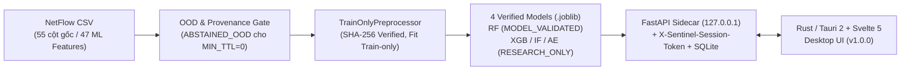

# NetFlow Sentinel v1.0.0 — AI-Based Network Anomaly Detection and Traceability System

**Nghiên cứu phát hiện lưu lượng mạng bất thường từ NetFlow, với bằng chứng dữ liệu, tiền xử lý chống rò rỉ và truy vết SHA-256.**

Đồ án AI cuối kỳ · **Rust / Tauri 2 + Svelte 5** Desktop ↔ **Python FastAPI / PyInstaller Sidecar + SQLite** ↔ **4 Mô hình AI** trên **NF-UNSW-NB15-v3**.

[](https://github.com/doctor-cato/AI-NETWORK-ANOMALY-DETECTION-TRACEABILITY-MAIN/actions/workflows/ci.yml)
[](pyproject.toml)
[](LICENSE)
[](https://doctor-cato.github.io/AI-NETWORK-ANOMALY-DETECTION-TRACEABILITY-MAIN/)

> [!IMPORTANT]
> **Trạng thái phát hành `v1.0.0` hiện tại:**
> - **PR #72 đã hợp nhất vào `main` (`e5a1f89`)** và tag **`v1.0.0`** đã phát hành dưới dạng **Source Release** (mã nguồn đầy đủ cho Desktop Tauri 2 + Svelte 5, PyInstaller Sidecar, Python FastAPI + SQLite và bộ tài liệu).
> - **Bộ cài Windows Standalone (`NetFlow-Sentinel-v1.0.0-windows-x64-setup.exe`):** Đã hoàn thiện và kiểm thử trên máy build cục bộ (tích hợp sidecar + WebView2 Offline + 4 model `.joblib` + preprocessor + demo CSV, **không** cần người dùng cuối cài Python hay Companion Bundle). Tuy nhiên, việc **phát hành công khai tệp `.exe`** và kiểm thử trên **VM Windows 10/11 sạch độc lập** đang ở trạng thái **`DEFERRED / BLOCKED`** theo dõi tại [Issue #73](https://github.com/doctor-cato/AI-NETWORK-ANOMALY-DETECTION-TRACEABILITY-MAIN/issues/73) và [`DISTRIBUTION_AUTHORIZATION.json`](reports/governance/DISTRIBUTION_AUTHORIZATION.json) (`UQ License ID 454104`).

**Điều hướng nhanh:**
- **Người dùng cuối:** [NetFlow Sentinel là gì](#hướng-dẫn-người-dùng-cuối-end-user-guide) · [Cài đặt & Sử dụng Windows](docs/WINDOWS_INSTALLATION.md) · [Ghi chú phát hành v1.0.0](docs/releases/v1.0.0.md)
- **Lập trình viên:** [Kiến trúc hệ thống](docs/ARCHITECTURE.md) · [Cài đặt & Tái lập Dev](#hướng-dẫn-lập-trình-viên-developer-guide) · [API Contract](reports/api/API_CONTRACT.md) · [Testing](docs/TESTING.md) · [Release Process](docs/RELEASE_PROCESS.md)
- **Hội đồng / Bảo vệ Học thuật:** [Bộ hồ sơ Bảo vệ Học thuật (`docs/academic-defense/`)](docs/academic-defense/README.md) · [Từ điển 55 cột](docs/academic-defense/02_COMPLETE_FEATURE_DICTIONARY.md) · [20 Câu hỏi Phản biện](docs/academic-defense/08_TEACHER_QUESTIONS_AND_ANSWERS.md) · [Cổng Nghiên cứu Web](https://doctor-cato.github.io/AI-NETWORK-ANOMALY-DETECTION-TRACEABILITY-MAIN/)

---

## Tổng quan & Mục tiêu Đề tài

Một Network Intrusion Detection System (NIDS) cần phân biệt hoạt động bình thường với lưu lượng đáng nghi, đồng thời truy vết được dự đoán xuất phát từ dữ liệu, bộ tiền xử lý và phiên bản mô hình nào. Dự án xây dựng một nền tảng nghiên cứu có thể kiểm toán cùng ứng dụng desktop Windows chạy cục bộ offline trên **network flow (`NF-UNSW-NB15-v3`)**.

**Ranh giới khoa học:** Đây là **đồ án nghiên cứu học thuật**, **không** phải hệ thống enterprise SOC production hay phần mềm tường lửa tự động bảo vệ mạng. Chế độ phản ứng an ninh (`#27`) chỉ chạy ở chế độ mô phỏng **Dry-Run (`executed = false`)**; tự động hóa tường lửa thật và xoay vòng khóa OS Keyring vẫn ở trạng thái **`DEFERRED`**.

---

## Hướng dẫn Người dùng cuối (End User Guide)

1. **NetFlow Sentinel là gì?** Ứng dụng Windows giúp nhập tệp thống kê lưu lượng mạng dạng CSV (`NF-UNSW-NB15-v3`), phân tích bằng 4 mô hình AI, xem giải thích nhãn `Benign` / `Attack` / `ABSTAINED_OOD`, đối chiếu Confusion Matrix và xuất báo cáo kèm SHA-256.
2. **Không cần Python hay kiến thức lập trình:** Trong kiến trúc đóng gói `v1.0.0` (khi sử dụng bộ cài `NetFlow-Sentinel-v1.0.0-windows-x64-setup.exe`), toàn bộ Python backend sidecar, WebView2 Offline, 4 mô hình thật và dữ liệu demo đã được tích hợp sẵn. Không cần tạo `.venv`, không cần Git và không cần tải Companion Bundle.
3. **Quy trình 4 bước ngay trên màn hình:**
   - **Bước 1 — Nhập CSV:** Bấm **"Mở ngay Dữ liệu Demo Chuẩn (200 flows)"** hoặc kéo-thả / chọn tệp NetFlow CSV từ máy.
   - **Bước 2 — Phân tích với 4 AI:** Chạy riêng **Random Forest** (`MODEL_VALIDATED` — mô hình chuẩn) hoặc so sánh cùng **XGBoost**, **Isolation Forest** và **Autoencoder** (`RESEARCH_ONLY` — phục vụ đối chiếu).
   - **Bước 3 — Đánh giá & Đối chiếu:** Các dòng thiếu dữ liệu quan trọng như `MIN_TTL = 0` hoặc lỗi vật lý bị gắn **`ABSTAINED_OOD`** (chủ động từ chối phán đoán, loại khỏi Confusion Matrix). Có thể nạp `demo_labels.csv` để tính Precision, Recall, F1 và Confusion Matrix.
   - **Bước 4 — Xuất báo cáo:** Xuất CSV kết quả và JSON metadata SHA-256. Xem hướng dẫn đầy đủ, xử lý sự cố và gỡ cài đặt tại [docs/WINDOWS_INSTALLATION.md](docs/WINDOWS_INSTALLATION.md).

---

## Kiến trúc hệ thống & Công nghệ (`v1.0.0`)



| Lớp | Công nghệ thực tế | Vai trò & Trạng thái |
|---|---|---|
| **Desktop Shell** | Rust / Tauri 2 + Svelte 5 | Giao diện 4 bước, native file picker, kéo-thả CSV, quản lý sidecar (`desktop/`), `1.0.0` **IMPLEMENTED / TESTED** |
| **Backend Sidecar** | Python `>=3.11`, FastAPI, Uvicorn, PyInstaller | 18 endpoint REST chỉ bind `127.0.0.1`, token CSPRNG 256-bit, PyInstaller standalone (`build_backend_sidecar.py`) |
| **Lưu trữ cục bộ** | SQLite (single writer) | Lưu incidents, timeline, key audit, dry-run simulations tại `%LOCALAPPDATA%\NetFlowSentinel\` |
| **ML & Tiền xử lý** | `scikit-learn` (`RandomForest`, `IsolationForest`, `MLPRegressor` Autoencoder), `xgboost`, `joblib`, `pandas`, `numpy` | `TrainOnlyPreprocessor` (`scaler=none`, no OHE) và 4 model với kiểm thực SHA-256 fail-closed (`HTTP 503` nếu thiếu binary) |
| **Chất lượng & CI** | pytest, Vitest, `svelte-check`, `cargo clippy/test`, Ruff, Black, GitHub Actions | `ci.yml` & `release.yml` (raw dataset & `.joblib` giữ ngoài Git) |

Chi tiết kiến trúc: [docs/ARCHITECTURE.md](docs/ARCHITECTURE.md) · [docs/ROADMAP_FULL_SYSTEM.md](docs/ROADMAP_FULL_SYSTEM.md) · [reports/api/API_CONTRACT.md](reports/api/API_CONTRACT.md).

---

## Tài liệu Khoa học & Học thuật (`NF-UNSW-NB15-v3` + 4 Mô hình AI)

> **Bộ tài liệu bảo vệ đồ án chuyên sâu (`docs/academic-defense/`):** Giải thích toàn bộ nguồn dữ liệu, **100% (55/55 cột)**, biến đổi tiền xử lý trước/sau, thiết kế chia tập, cơ chế 4 mô hình, dẫn chứng dòng code huấn luyện và 20 câu hỏi phản biện: xem tại [`docs/academic-defense/README.md`](docs/academic-defense/README.md).

### 1. Bộ dữ liệu & Tiền xử lý chống rò rỉ
- **Nguồn:** **NF-UNSW-NB15-v3** (The University of Queensland, DOI [`10.48610/6E0EDA1`](https://doi.org/10.48610/6E0EDA1), Luay et al. [`arXiv:2503.04404`](https://arxiv.org/abs/2503.04404)), điều khoản **Permitted Re-Use with Commercial Use Restriction** (UQ License ID `454104`).
- **Quy mô:** `2.365.424` dòng (`2.237.731` Benign `94,60%` / `127.693` Attack `5,40%` thuộc 9 họ tấn công), `55` cột (`6` trace metadata bị loại + `2` targets `Label`/`Attack` bị loại + `47` ML features `nf-unsw-nb15-v3-baseline-47`).
- **Chia tập (Chronological + 5-min Purge Gap):** Train **`1.655.797`**, Validation **`345.371`**, Test (Held-out) **`345.953`**, Purged gaps **`18.303`** (`9.443` + `8.860`); `0` overlap dòng gốc, `0` overlap flow-group và `0` vượt biên thời gian.
- **Tiền xử lý (`TrainOnlyPreprocessor`):** Fit **chỉ trên Train** (`12d4360a...`). Chuyển `""` / `+Inf` ở 2 cột tốc độ (`122.493` dòng) thành `np.nan` rồi điền bằng **Train median** (`162.0` và `78.2815...`), 10 cột phân loại mã số (`PROTOCOL`, `L7_PROTO`, `TCP_FLAGS`, ...) giữ nguyên dạng mã số (**không One-Hot Encoding**) và điền bằng **Train mode** + `np.round()`, **không scaling (`scaler_type="none"`)**, giữ nguyên dòng `duration=0.0` → đầu ra `(N, 47)` `float64`.

### 2. Kết quả Thực nghiệm Đã Kiểm chứng (Tách biệt theo Tập Đánh giá)

| Mô hình | Nhãn UI / Gate | Tập huấn luyện | Held-out Test (`345.953` dòng) | Giới hạn chính |
|---|---|---|---|---|
| **Random Forest** | `MODEL_VALIDATED` | `1.655.797` (Train) | `F1=0,999853`, `P=0,999771`, `R=0,999935`, `FPR=0,000022` (`TN=315350, FP=7, FN=2, TP=30594`) | Nhạy shortcut `MIN_TTL` (`0,999849` chỉ với 1 biến); Cross-dataset trên `NF-CSE-CIC-IDS2018-v3` rớt `Recall=0,0`, `FPR=0,3802` |
| **XGBoost** | `RESEARCH_ONLY` | `1.655.797` (Train) | `F1=0,999984`, `P=0,999967`, `R=1,000000`, `FPR=0,000003`, `ROC-AUC=1,0` (`TN=315356, FP=1, FN=0, TP=30596`) | Trained từ `7f51390` (`git_dirty=True`); chung rủi ro shortcut & trùng vector `53,21%` |
| **Isolation Forest** | `RESEARCH_ONLY` | `1.590.608` (Benign-only) | `F1=0,5064`, `P=0,3523`, `R=0,8997`, `FPR=0,1605`, `ROC-AUC=0,8937`, Unknown `{Backdoor, Worms}` `R=0,8657` | FPR còn cao (`16,05%`), xuất `raw_anomaly_score` (`attack_probability=null`) |
| **Autoencoder (`MLPRegressor 32-16-32`)** | `RESEARCH_ONLY` | `1.590.608` (Benign-only) | `F1=0,1361`, `P=0,1804`, `R=0,1093`, `FPR=0,0482`, `ROC-AUC=0,6303`, Unknown `R=0,0625` (`Val FPR <= 0,05`) | MSE không scale bị chi phối bởi cột biên độ lớn; Recall thấp dưới ràng buộc `FPR <= 0,05` |

> **Cảnh báo diễn giải:** Các chỉ số Validation (`345.371` dòng), Held-out Test (`345.953` dòng), Cross-Dataset (`100.000` dòng) và Demo CSV (`200` dòng Validation: `198` hợp lệ + `2` `ABSTAINED_OOD`) được giữ tách biệt hoàn toàn. Chi tiết xem [07_MODEL_RESULTS_AND_LIMITATIONS.md](docs/academic-defense/07_MODEL_RESULTS_AND_LIMITATIONS.md) và [docs/TRACEABILITY_MATRIX.md](docs/TRACEABILITY_MATRIX.md).

---

## Hướng dẫn Lập trình viên (Developer Guide)

Yêu cầu: Python `>=3.11` (CI: `3.11`, `3.12`; runtime Windows khớp `requirements-runtime.txt`), Node.js `22+`, Rust stable (`cargo`, `rustfmt`, `clippy`), PowerShell trên Windows. Raw CSV (`577 MB`) và `.joblib` nằm ngoài Git.

```powershell
# 1. Cài đặt môi trường Python phát triển
git clone https://github.com/doctor-cato/AI-NETWORK-ANOMALY-DETECTION-TRACEABILITY-MAIN.git
cd AI-NETWORK-ANOMALY-DETECTION-TRACEABILITY-MAIN
python -m venv .venv
.venv\Scripts\Activate.ps1
python -m pip install -e ".[dev]"

# 2. Kiểm tra nền tảng, OpenAPI contract, version và test suite
python scripts/check_environment.py
python scripts/export_openapi_spec.py --check
python scripts/check_desktop_version.py --check
python -m pytest tests -q
python -m ruff check src scripts tests
python -m black --check src scripts tests
git diff --check
```

Để tải dữ liệu thật, tái lập train/eval 4 model, tạo mẫu demo 200 dòng, chạy API hoặc tự build PyInstaller sidecar + NSIS installer, xem:
- [docs/REPRODUCIBILITY.md](docs/REPRODUCIBILITY.md) · [docs/TESTING.md](docs/TESTING.md)
- [desktop/README.md](desktop/README.md) · [docs/WINDOWS_INSTALLATION.md](docs/WINDOWS_INSTALLATION.md) · [docs/RELEASE_PROCESS.md](docs/RELEASE_PROCESS.md)
- Script đọc thống kê schema & preprocessor (read-only): `python scripts/export_academic_schema_summary.py`

---

## Cấu trúc thư mục

```text
.
├── desktop/               # Desktop App v1.0.0: Rust Tauri 2 (src-tauri) + Svelte 5 UI (src)
├── src/network_anomaly/   # data, eda, preprocessing, models, evaluation, inference, ingestion, api
├── scripts/               # fetch, validate, split, preprocess, train_*, predict, build_backend_sidecar, export_academic_schema_summary
├── tests/                 # unit, contract và integration (API, desktop CSV/E2E, OOD, dry-run, VM controller)
├── docs/                  # End-user, Developer, Protocol, Releases và docs/academic-defense/ (11 tài liệu + EVIDENCE_INDEX)
├── data/                  # manifest & demo/.gitkeep; raw CSV và demo/*.csv bị gitignore
├── reports/               # quality, split, preprocessing, EDA, OpenAPI, governance và model evaluations
├── artifacts/             # .gitkeep; preprocessor/model .joblib lớn bị gitignore
└── .github/workflows/     # ci.yml, lint-audit.yml, release.yml
```

---

## Giấy phép & Ghi nhận nguồn

- **Mã nguồn:** [Apache License 2.0](LICENSE) (giữ nguyên không thay đổi).
- **Dataset & Tài nguyên dẫn xuất:** `NF-UNSW-NB15-v3` (DOI [`10.48610/6E0EDA1`](https://doi.org/10.48610/6E0EDA1), UQ License ID `454104`) áp dụng điều khoản **Permitted Re-Use with Commercial Use Restriction**. Apache-2.0 không thay đổi hay miễn trừ điều khoản phi thương mại của UQ.
- **Kiểm kê giấy phép & Bên thứ ba:** Xem [`NOTICE`](NOTICE), [`THIRD_PARTY_NOTICES.md`](THIRD_PARTY_NOTICES.md) và [`reports/governance/DISTRIBUTION_AUTHORIZATION.json`](reports/governance/DISTRIBUTION_AUTHORIZATION.json).
- **Trích dẫn:** Luay, M., Layeghy, S., Hosseininoorbin, S., Sarhan, M., Moustafa, N., & Portmann, M. (2025). *Temporal Analysis of NetFlow Datasets for Network Intrusion Detection Systems*. [`arXiv:2503.04404`](https://arxiv.org/abs/2503.04404).
