# Kiến trúc hệ thống — NetFlow Sentinel v2 (Desktop Offline & PyInstaller Sidecar)

```mermaid
flowchart LR
    subgraph Desktop["Windows Desktop App (Rust Tauri 2 + Svelte 5)"]
        UI["Svelte 5 UI<br/>(CSV Upload, 4-Model Compare,<br/>Live/Replay, Behavioral, Trace, Crypto, Dry-Run)"]
        TAURI["Rust / Tauri 2 Core<br/>(Native Dialogs, Sidecar Lifecycle,<br/>256-bit Session Token, HTTP -> 127.0.0.1)"]
        UI <--> TAURI
    end

    subgraph Sidecar["Python FastAPI Sidecar (netflow-sentinel-backend.exe / scripts/run_api.py)"]
        API["FastAPI Service (127.0.0.1:<port>)<br/>(/health, /api/v1/models, /api/v1/csv/*,<br/>/api/v1/behavioral/*, /api/v1/trace/*, /api/v1/crypto/*)"]
        GATE["Provenance, Compatibility & OOD Gate<br/>(canonical-flow-v2-18: 18 ML Features +<br/>ABSTAINED_OOD cho dữ liệu lỗi/ngoài biên)"]
        PRE["TrainOnlyPreprocessor<br/>(asinh_robust, SHA-256 Verified, Fit ait_train)"]
        MODELS["4 Verified v2 Models (.joblib)<br/>RandomForest · XGBoost · IsolationForest · Autoencoder<br/>(AI Ready 4/4, zero fallback sang v1)"]
        SQLITE["SQLite Persistence<br/>(%LOCALAPPDATA%\\NetFlowSentinel\\network_anomaly.db)"]
        API --> GATE --> PRE --> MODELS
        API <--> SQLITE
    end

    subgraph DemoPrep["Validation-Only Demo Data (data/demo/)"]
        PREP["scripts/prepare_demo_dataset.py<br/>(AIT-NDS-v2 Validation / russellmitchell)"]
        FLOWS["demo_flows.csv (200 dòng, không target)"]
        LABELS["demo_labels.csv (chỉ dùng đối chiếu UI)"]
        PREP --> FLOWS
        PREP --> LABELS
    end

    TAURI -- "HTTP/JSON + X-Sentinel-Session-Token" --> API
    FLOWS -. "Mở trực tiếp hoặc kéo thả" .-> UI
    LABELS -. "Đối chiếu Confusion Matrix riêng" .-> UI
```

Tài liệu này mô tả kiến trúc hệ thống **NetFlow Sentinel v2**: **Ứng dụng Desktop Windows (`Rust / Tauri 2 + Svelte 5`)** quản lý **Python FastAPI/PyInstaller Sidecar** (`netflow-sentinel-backend.exe`) giao tiếp qua `http://127.0.0.1:<port>` (kèm token phiên `X-Sentinel-Session-Token`), **SQLite** (single writer), **4 Mô hình AI v2 (`canonical-flow-v2-18`)** đã kiểm chứng SHA-256, cùng các module Behavioral Vector, Risk Engine, Trace Engine và AES-256-GCM Adaptive Key Rotation.

## Ranh giới trách nhiệm giữa Rust và Python

1. **Rust / Tauri 2 + Svelte 5 (`desktop/`):**
   - Quản lý sidecar `netflow-sentinel-backend.exe` (standalone) hoặc `scripts/run_api.py` (dev), sinh token CSPRNG 256-bit (`NETWORK_ANOMALY_API_TOKEN`), bind loopback `127.0.0.1:<port>`, dọn tiến trình sạch khi thoát.
   - Không nhân bản `TrainOnlyPreprocessor` hay logic ML bằng Rust; không ghi trực tiếp vào SQLite từ Rust.
2. **Python FastAPI + ML & Security Engines (`src/network_anomaly/`):**
   - **Hợp đồng v2 nghiêm ngặt (`v2_schema.py`):** 18 đặc trưng ML (`canonical-flow-v2-18`), tách biệt tuyệt đối 5 trace metadata (`timestamp_ms`, `source_ip`, `dest_ip`, `source_port`, `dest_port`) và 4 target columns (`label_binary`, `attack_category`, `raw_label`, `label_status`).
   - **Fail-closed ModelRegistry & Preprocessing:** Kiểm tra SHA-256, `feature_contract_version == "canonical-flow-v2-18"`, `dataset_sha256`, `split_manifest_sha256`, `preprocessor_sha256`. Không fallback sang `NF-UNSW-NB15-v3`.
   - **Behavioral, Risk, Trace & Crypto:** Behavioral Vector 16-D, Risk Engine đa tiêu chí `[0..100]`, Trace Engine & Attack Timeline, kho mã hóa AES-256-GCM với Windows DPAPI / POSIX key wrapping và Adaptive Key Rotation.

## Bảng trạng thái các mô-đun v2

| Thành phần | Vị trí / Package | Vai trò trong v2 | Trạng thái |
|---|---|---|---|
| Data, Split & Taxonomy v2 | `src/network_anomaly/data/` | `v2_schema.py`, `taxonomy-v2`, `v2-scenario-group-purged-v1` | **EXPERIMENTALLY VALIDATED** (`AIT-NDS-v2`, `CTU-SME-11`) |
| Preprocessing `asinh_robust` | `src/network_anomaly/preprocessing/` | `TrainOnlyPreprocessor` fit chỉ trên `ait_train` (`2,097,891`) | **EXPERIMENTALLY VALIDATED** |
| 4 ML Models & Inference | `src/network_anomaly/models/`, `inference/` | RF, XGBoost, Isolation Forest, Autoencoder (`AI Ready 4/4`) | **EXPERIMENTALLY VALIDATED** (`AIT-Test` + `CTU-SME-11`) |
| FastAPI, Ingestion, OOD & Dry-Run | `src/network_anomaly/api/`, `ingestion/` | REST endpoints, OpenAPI synced, provenance gate, OOD, Dry-Run | **IMPLEMENTED / TESTED** |
| Behavioral, Risk, Trace & Crypto | `src/network_anomaly/{behavioral,risk,trace,crypto,streaming}/` | Sessionizer, 16-D vector, Timeline, AES-256-GCM, Key Rotation | **IMPLEMENTED / TESTED / BENCHMARKED** |
| Desktop UI & Sidecar | `desktop/` | Rust Tauri 2 + Svelte 5 (18-feature v2 flow workflow) | **IMPLEMENTED / TESTED** |
