# Kiến trúc hệ thống — NetFlow Sentinel v1.0.0 (Desktop Offline & PyInstaller Sidecar)

Tài liệu này mô tả kiến trúc thực tế trên nhánh `main` sau khi hợp nhất **PR #72 (`v1.0.0` Source Release, Issue #71)**: **Ứng dụng Desktop Windows (`Rust / Tauri 2 + Svelte 5`)** quản lý **Python FastAPI/PyInstaller Sidecar** (`netflow-sentinel-backend.exe`) giao tiếp qua `http://127.0.0.1:<port>` (kèm token phiên `X-Sentinel-Session-Token`), **SQLite** (single writer) và **4 Mô hình AI đã kiểm chứng SHA-256**.

> **Lưu ý phát hành hiện tại:** Tag `v1.0.0` trên GitHub đang là **Source Release**. Bộ cài NSIS standalone (`NetFlow-Sentinel-v1.0.0-windows-x64-setup.exe`) đã tích hợp đủ sidecar + 4 model ở mức mã nguồn/build cục bộ, nhưng phân phối binary công khai và kiểm thử VM Windows 10/11 sạch đang ở trạng thái `DEFERRED / BLOCKED` (theo dõi tại Issue #73 và [`DISTRIBUTION_AUTHORIZATION.json`](../reports/governance/DISTRIBUTION_AUTHORIZATION.json)).

```mermaid
flowchart LR
    subgraph Desktop["Windows Desktop App (IMPLEMENTED v1.0.0 — #16, #71)"]
        UI["Svelte 5 UI<br/>(Hướng dẫn 4 bước, Kéo thả CSV,<br/>4-Model Compare, Confusion Matrix,<br/>Security Dry-Run #27, Export)"]
        TAURI["Rust / Tauri 2 Core<br/>(Native Dialogs, Sidecar Lifecycle,<br/>256-bit Session Token, HTTP -> 127.0.0.1)"]
        UI <--> TAURI
    end

    subgraph Sidecar["Python FastAPI Sidecar (netflow-sentinel-backend.exe / scripts/run_api.py)"]
        API["FastAPI Service (127.0.0.1:<port>)<br/>18 REST Endpoints (/health, /api/v1/models,<br/>/api/v1/csv/*, /api/v1/security/*)"]
        GATE["Provenance, Compatibility & OOD Gate<br/>(47 ML Features + Source Trust Anchor +<br/>ABSTAINED_OOD cho MIN_TTL=0 / lỗi vật lý)"]
        PRE["TrainOnlyPreprocessor<br/>(SHA-256 Verified, Fit Train-only)"]
        MODELS["4 Verified Models (.joblib)<br/>RandomForest (MODEL_VALIDATED)<br/>XGBoost, IsolationForest, Autoencoder (RESEARCH_ONLY)"]
        SQLITE["SQLite Persistence<br/>(%LOCALAPPDATA%\\NetFlowSentinel\\network_anomaly.db)"]
        API --> GATE --> PRE --> MODELS
        API <--> SQLITE
    end

    subgraph DemoPrep["Validation-Only Demo Data (data/demo/)"]
        PREP["scripts/prepare_demo_dataset.py<br/>(0 overlap Train/Test)"]
        FLOWS["demo_flows.csv (200 dòng, không Label/Attack)"]
        LABELS["demo_labels.csv (chỉ dùng Evaluate UI)"]
        PREP --> FLOWS
        PREP --> LABELS
    end

    TAURI -- "HTTP/JSON + X-Sentinel-Session-Token" --> API
    FLOWS -. "Mở trực tiếp hoặc kéo thả" .-> UI
    LABELS -. "Đối chiếu Confusion Matrix riêng" .-> UI
```

## Ranh giới trách nhiệm giữa Rust và Python

1. **Rust / Tauri 2 + Svelte 5 (`IMPLEMENTED / TESTED` tại `desktop/`, phiên bản `1.0.0`):**
   - **Chế độ Standalone (`v1.0.0`, `tauri.standalone.conf.json`):** Khởi chạy trực tiếp sidecar `netflow-sentinel-backend.exe` (đóng gói bằng PyInstaller) kèm thư mục tài nguyên nhúng (`staged_bundle` chứa preprocessor, 4 model `.joblib`, manifests, `data/demo/`, `NOTICE`, `THIRD_PARTY_NOTICES.md`, `LICENSE`) và **WebView2 Offline Installer**; không cần người dùng cuối cài Python, `.venv` hay Companion Bundle.
   - **Chế độ Developer (`tauri.conf.json`):** Tự động fallback sang Python cục bộ (`scripts/run_api.py`) khi phát triển từ source checkout.
   - **Bảo mật tiến trình:** Sinh token CSPRNG 256-bit mỗi phiên (`NETWORK_ANOMALY_API_TOKEN`), bind `127.0.0.1:<port>`, quản lý startup health check, restart, graceful shutdown (không để lại orphan process) và cô lập dữ liệu người dùng tại `%LOCALAPPDATA%\NetFlowSentinel\`.
   - **Quy tắc ràng buộc:** Không nhân bản `TrainOnlyPreprocessor` hay logic ML bằng Rust; không ghi trực tiếp vào SQLite từ Rust; không mở API ra ngoài loopback.

2. **Python FastAPI + ML Engine (`IMPLEMENTED / TESTED`, OpenAPI v`0.1.0`):**
   - **Single logical owner của SQLite:** Lưu runs, events, incidents, timeline, key metadata audit và lịch sử mô phỏng Security Dry-Run (`#27`).
   - **Fail-closed Preprocessing & Model Loading (`src/network_anomaly/inference/predict.py`):** Kiểm tra SHA-256 giữa binary, companion manifest và `preprocessor_sha256` trước khi nạp `joblib`; hỗ trợ thống nhất `random_forest`, `xgboost`, `isolation_forest` và `autoencoder` (`MLPRegressor`). Nếu thiếu/sai SHA-256, `/api/v1/models` báo `BLOCKED / NOT READY` và `/api/v1/csv/analyze` từ chối `HTTP 503` (không fallback ngầm).
   - **Xác minh Provenance nguồn CSV & OOD (`src/network_anomaly/api/desktop_csv.py`):**
     - `resolve_csv_source_provenance()` kiểm tra SHA-256 với bộ demo Validation đã nghiệm thu và split manifest trước khi gán `source:nf-v3-canonical`; CSV bên ngoài nhận `source:nf-v3-unverified`.
     - Các dòng vi phạm bất biến vật lý hoặc `MIN_TTL == 0` bị gắn `ABSTAINED_OOD` (`predicted_label = null`, `risk_level = "ABSTAINED_OOD"`) và loại trừ khỏi Confusion Matrix (`abstained_rows`, `evaluated_rows`, `prediction_coverage`).
   - **Phân tầng quản trị khoa học (`src/network_anomaly/ingestion/compatibility.py`):**
     - `Random Forest`: **`MODEL_VALIDATED`** (`PREDICTION_AVAILABLE`).
     - `XGBoost`, `Isolation Forest`, `Autoencoder`: **`RESEARCH_ONLY`** (cho phép suy luận và so sánh trên UI, nhưng bị hạ cấp xuống `INVESTIGATE` / `HOLD_RESEARCH_ONLY_MODEL` trong Security Dry-Run `#27`).
   - **Hợp đồng dữ liệu nghiêm ngặt:** `NF-UNSW-NB15-v3` có 55 cột (`47` ML features `nf-unsw-nb15-v3-baseline-47` + `6` trace metadata + `2` targets `Label`, `Attack`). Metadata và targets bị loại tuyệt đối khỏi ma trận `X`.

## Bảng trạng thái các mô-đun trên `main`

| Thành phần | Vị trí / Package | Vai trò trong `v1.0.0` | Trạng thái |
|---|---|---|---|
| Data, Split & Preprocessing | `src/network_anomaly/data/`, `preprocessing/` | Manifest, chronological 5m-purged split, `TrainOnlyPreprocessor` | **EXPERIMENTALLY VALIDATED** (C1–C2) |
| 4 ML Models & Inference | `src/network_anomaly/models/`, `inference/` | RF (`MODEL_VALIDATED`), XGBoost, IF, AE (`MLPRegressor`) (`RESEARCH_ONLY`) | **EXPERIMENTALLY VALIDATED** (cả 4 model có Held-out Test `345.953` dòng) |
| Demo Dataset Preparation | `scripts/prepare_demo_dataset.py` | Tách `demo_flows.csv` / `demo_labels.csv` / `demo_manifest.json` từ Validation | **IMPLEMENTED / TESTED & REAL-DATA VERIFIED** |
| FastAPI & SQLite | `src/network_anomaly/api/`, `scripts/run_api.py` | 18 REST endpoints, session token, single-writer SQLite | **IMPLEMENTED / TESTED** (`export_openapi_spec.py --check` PASS) |
| Multi-Source Ingestion & OOD | `src/network_anomaly/ingestion/` | `FeatureCompatibilityEvaluator`, `InferenceEligibilityGate`, `OODValidator` | **IMPLEMENTED / TESTED** |
| Security Dry-Run (#27) | `src/network_anomaly/api/response_policy.py` | Policy engine tất định (`NO_ACTION`..`ISOLATE_RECOMMENDED`, `executed=false`) | **IMPLEMENTED / TESTED (Dry-Run)**; live firewall & AES keyring **DEFERRED** |
| Desktop UI & Sidecar Packaging | `desktop/`, `scripts/build_backend_sidecar.py` | Tauri 2 + Svelte 5 + PyInstaller sidecar + NSIS `v1.0.0` | **IMPLEMENTED / TESTED** (Source Release `v1.0.0` merged; Clean VM & Public Binary **DEFERRED / BLOCKED → #73**) |

## Kiến trúc Tiếp nhận & Tài liệu Học thuật Chuyên sâu

- Tầng `src/network_anomaly/ingestion/` chuẩn hóa 4 mức tương thích (`PARSEABLE` → `SCHEMA_COMPATIBLE` → `SEMANTICALLY_COMPATIBLE` → `MODEL_VALIDATED`) và từ chối `ABSTAINED_OOD`. Chi tiết xem [MULTI_SOURCE_INGESTION.md](MULTI_SOURCE_INGESTION.md) và [FEATURE_COMPATIBILITY_MATRIX.md](FEATURE_COMPATIBILITY_MATRIX.md).
- Giải thích toàn bộ 55 cột, biến đổi dữ liệu trước `model.fit()`, cơ chế 4 model và 20 câu hỏi phản biện xem tại [docs/academic-defense/README.md](academic-defense/README.md).
