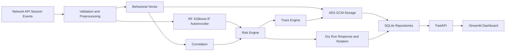

# Kiến trúc hệ thống Phương án B

## Ranh giới mô-đun

| Module | Package dự kiến | Contract chính | Checkpoint |
|---|---|---|---|
| Data/EDA | `data`, `preprocessing`, `features` | provenance, split, fit boundary | C1–C2 |
| Detection/classification | `detection`, `classification`, `models` | score/probability/artifact metadata | C3–C4 |
| Behavioral | `behavioral` | versioned vectors, normalization, similarity | C5 |
| Risk/Trace | `risk`, `trace` | score 0–100, explanation, incident/evidence/timeline | C6 |
| Security/Response | `security`, `response` | AES-GCM envelope, key lifecycle, dry-run policy | C7–C8 |
| Storage/API/UI | `storage`, `api`, `dashboard` | repositories, validated endpoints, thin UI client | C9 |
| Experiments/Delivery | `experiments`, `reports`, `docs` | run manifest, results, report/slides/demo | C10–C11 |

SQLite là implementation mặc định cho lab và CI. Repository abstraction cho PostgreSQL
là optional. Event, session, incident, evidence reference, key metadata và rotation audit
phải persistent. Health/readiness phải phân biệt process sống với model/data/artifact sẵn sàng.

Response mạnh chỉ là dry-run trong lab. Trace/Behavioral Vector không xác định danh tính thật.

Cập nhật: 2026-10-19 (C0)
