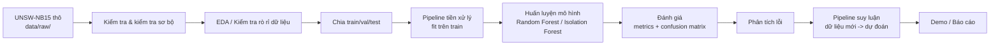

# Kiến trúc — Luồng dữ liệu và các mô-đun

## Mô tả mô-đun

| Mô-đun | Đường dẫn | Vai trò |
|---|---|---|
| Config | `src/network_anomaly/config.py` | Đường dẫn, seed, giá trị mặc định siêu tham số |
| Kiểm tra dữ liệu | `scripts/validate_data.py` | Đọc, kiểm tra schema, tóm tắt |
| Tiền xử lý | `src/network_anomaly/preprocessing/` | Đối tượng pipeline; mã hóa; chuẩn hóa |
| Đặc trưng | `src/network_anomaly/features/` | Quy tắc chọn / xây dựng đặc trưng (đã ghi, không quá phức tạp) |
| Mô hình — Random Forest | `src/network_anomaly/models/random_forest.py` | Phân loại giám sát |
| Mô hình — Isolation Forest | `src/network_anomaly/models/isolation_forest.py` | Phát hiện bất thường không giám sát (nếu triển khai) |
| Đánh giá | `src/network_anomaly/evaluation/` | Metrics, confusion matrix, phân tích lỗi |
| Suy luận | `src/network_anomaly/inference/` | Tải artifact; dự đoán dữ liệu mới |
| Trực quan hóa | `src/network_anomaly/visualization/` | Biểu đồ cho EDA, metrics, phân tích lỗi |

Cập nhật: 2026-10-16
