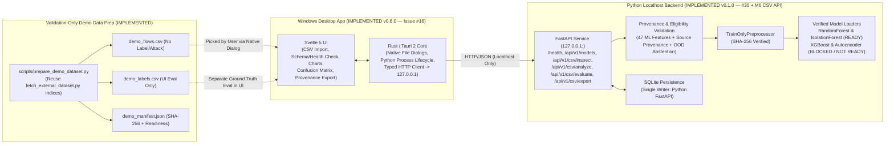

# Kiến trúc hệ thống — Desktop Offline & Python ML Backend (Consolidated MVP)

Tài liệu này mô tả kiến trúc mục tiêu đã được thu hẹp cho sản phẩm đồ án AI cuối kỳ: **Desktop Application chạy cục bộ trên Windows (`Rust / Tauri 2 + Svelte 5`)** giao tiếp qua `http://127.0.0.1:<port>` với **Python FastAPI + SQLite + 4-Model Verified Inference Pipeline**.

## Ranh giới trách nhiệm giữa Rust và Python

1. **Rust / Tauri 2 + Svelte 5 (`IMPLEMENTED / TESTED` tại `desktop/`, phiên bản `0.6.0`):**
   - Hiển thị giao diện người dùng (chọn file CSV, xem trạng thái readiness `READY` vs `BLOCKED / NOT READY`, chọn 1 trong 4 model, xem bảng kết quả `Benign` / `Attack` / `ABSTAINED_OOD` + xác suất/anomaly score, thống kê/biểu đồ, export CSV kèm provenance, và tính/hiển thị Confusion Matrix khi nạp riêng `demo_labels.csv`).
   - Quản lý tiến trình con `uvicorn` / `scripts/run_api.py` (tự cấp cổng trống trên `127.0.0.1`, poll `/health`, tắt gọn cây tiến trình qua `taskkill /T /F` khi thoát app), mở Native File Dialog của Windows.
   - **Giới hạn đóng gói (`v0.6.0`):** Gói cài đặt Windows NSIS (`NetFlow Sentinel M6_0.6.0_x64-setup.exe`) nhúng sẵn giao diện Svelte 5 vào tệp thực thi Rust, nhưng **chưa đóng gói kèm Python runtime hay `.joblib` artifacts bên trong binary** (offline-capable with external prerequisites; xem [WINDOWS_INSTALLATION.md](WINDOWS_INSTALLATION.md) và [RELEASE_PROCESS.md](RELEASE_PROCESS.md)).
   - **Quy tắc ràng buộc:** Không nhân bản `TrainOnlyPreprocessor` hay logic ML inference bằng Rust; **không** mở kết nối ghi trực tiếp vào SQLite để tránh xung đột với Python FastAPI; không mở API ra ngoài `127.0.0.1`.
2. **Python FastAPI + ML Engine (`IMPLEMENTED / TESTED`, hợp đồng API phiên bản `0.1.0`):**
   - **Single logical owner của SQLite:** Lưu runs, events, incidents, timeline và key audit metadata.
   - **Fail-closed Preprocessing & Model Loading (`src/network_anomaly/inference/predict.py`):** Kiểm tra SHA-256 giữa binary, companion manifest và `preprocessor_sha256` trước khi nạp; hỗ trợ thống nhất `RandomForest`, `XGBoost`, `IsolationForest` và `Autoencoder` (`AutoencoderModel`). Khi binary `.joblib`/`.pt` thiếu, `/api/v1/models` báo `BLOCKED / NOT READY` và `/api/v1/csv/analyze` từ chối suy luận fail-closed với `HTTP 503`.
   - **Xác minh Provenance nguồn CSV & Từ chối suy luận OOD (`src/network_anomaly/api/desktop_csv.py`):**
     - `resolve_csv_source_provenance()` kiểm tra neo tin cậy (trust anchor) SHA-256 đối chiếu allowlist bộ demo Validation đã nghiệm thu và `data/NF_UNSW_NB15_V3_SPLIT_MANIFEST.json` trước khi gán `source:nf-v3-canonical` (`MODEL_VALIDATED`); sibling manifest tự khai báo không thể tự nâng cấp tệp CSV tùy ý. Tệp CSV bên ngoài chưa xác minh provenance được gán `source:nf-v3-unverified` (`SEMANTICALLY_COMPATIBLE` / `VALIDATION_NOT_VERIFIED`).
     - Các dòng vi phạm bất biến OOD hoặc `MIN_TTL == 0` được từ chối suy luận lẫn tính điểm rủi ro trước khi gọi `service.analyze_flows()` (`predicted_label = null`, `predicted_class = "ABSTAINED_OOD"`, `risk_level = "ABSTAINED_OOD"`) và được loại trừ khỏi Confusion Matrix (`abstained_rows`, `evaluated_rows`, `prediction_coverage`).
   - **Hợp đồng dữ liệu nghiêm ngặt:** `NF-UNSW-NB15-v3` cung cấp 55 cột (`47` ML features `nf-unsw-nb15-v3-baseline-47` + `6` trace metadata `FLOW_START_MILLISECONDS`, `FLOW_END_MILLISECONDS`, `IPV4_SRC_ADDR`, `L4_SRC_PORT`, `IPV4_DST_ADDR`, `L4_DST_PORT` + `2` target `Label`, `Attack`). `Label`, `Attack` và 6 trường trace metadata **tuyệt đối bị loại khỏi ma trận đặc trưng `X`**.

## Ranh giới mô-đun & Trạng thái củng cố

| Thành phần | Vị trí / Package | Vai trò trong MVP | Trạng thái & Điều chỉnh phạm vi |
|---|---|---|---|
| Data, Split & Preprocessing | `src/network_anomaly/data/`, `preprocessing/` | Manifest, 47-feature split, `TrainOnlyPreprocessor` | **IMPLEMENTED / TESTED / REAL-DATA VERIFIED** (C1–C2) |
| ML Models & Inference | `src/network_anomaly/models/`, `inference/` | RF, XGBoost, Isolation Forest, Autoencoder + `InferencePipeline` | RF & IF **EXPERIMENTALLY VALIDATED**; XGBoost Validation verified; AE **IMPLEMENTED / TESTED** |
| Demo Dataset Preparation | `scripts/prepare_demo_dataset.py` | Tách `demo_flows.csv` / `demo_labels.csv` / `demo_manifest.json` từ Validation | **IMPLEMENTED / TESTED & REAL-DATA VERIFIED** (200 rows, 0 Train/Test overlap) |
| FastAPI & SQLite | `src/network_anomaly/api/`, `scripts/run_api.py` | Localhost REST endpoints (`/api/v1/csv/*`), SQLite persistence | **IMPLEMENTED / TESTED** (#30 CLOSED, #59 CLOSED); OpenAPI contract đồng bộ |
| Multi-Source Ingestion & Gate | `src/network_anomaly/ingestion/` (PR #47) | `SourceRegistry`, `InferenceEligibilityGate`, OOD check, provenance verification | **IMPLEMENTED / TESTED** (`source:nf-v3-canonical` vs `source:nf-v3-unverified`) |
| Desktop UI (Tauri 2 + Svelte 5) | `desktop/src-tauri/`, `desktop/src/` (`v0.6.0`) | Desktop GUI Windows, process lifecycle, NSIS installer, offline-capable demo | **IMPLEMENTED / TESTED** (#16 CORE-DEMO — cần Python & artifacts bên ngoài) |
| Behavioral / Risk / Trace | #28, #32, #24 (`desktop_csv.py`) | Thống kê IP/port NetFlow, ranking từ chối OOD, deterministic timeline | **IMPLEMENTED / TESTED (Scoped M6)** — không FFI/PyO3 |
| Security / Adaptive Response | #26, #27 | Localhost bind, SHA-256 gate, safe CSV path validation | **SCOPED / DEFERRED** — hoãn full AES-256-GCM keyring & firewall automation |

## Kiến trúc Tiếp nhận & Cổng OOD (PR #47 / #46 — Phạm vi thu gọn)

Tầng `src/network_anomaly/ingestion/` từ PR #47 (đã hợp nhất vào `main` tại `e02548b`) chuẩn hóa việc kiểm tra `PARSEABLE` → `SCHEMA_COMPATIBLE` → `SEMANTICALLY_COMPATIBLE` → `MODEL_VALIDATED`, phát hiện giá trị OOD (`MIN_TTL=0` shortcut collapse) và cấu hình `InferenceEligibilityGate` fail-closed trong `InferencePipeline`. Chi tiết xem tại [MULTI_SOURCE_INGESTION.md](MULTI_SOURCE_INGESTION.md) và [FEATURE_COMPATIBILITY_MATRIX.md](FEATURE_COMPATIBILITY_MATRIX.md). Trong phạm vi Demo MVP M6, trọng tâm sử dụng là kiểm tra tương thích CSV NetFlow và trạng thái cảnh báo; các adapter phụ (Zeek, Suricata, AWS VPC, NetFlow v5) được giữ nguyên test nhưng không chặn kịch bản demo chính.
