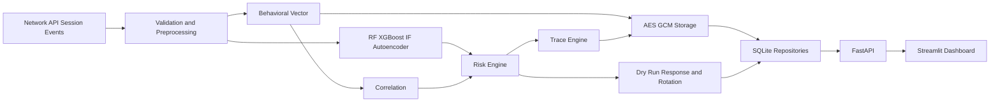

# Kiến trúc hệ thống Phương án B

NF-UNSW-NB15-v3 chỉ cấp network-flow fields. API/auth/session events là nguồn tương lai độc lập,
không được suy diễn từ dataset. Absolute timestamps, IP và hai L4 port được giữ ở trace metadata
boundary; 47 fields còn lại mới thuộc default ML contract. Xem
`docs/NF_UNSW_NB15_V3_SPLIT_PROTOCOL.md`.

## Ranh giới mô-đun

| Module | Package dự kiến | Contract chính | Checkpoint |
|---|---|---|---|
| Data/EDA | `data`, `preprocessing`, `features` | provenance, split, fit boundary | C1–C2 |
| Detection/classification | `detection`, `classification`, `models` | score/probability/artifact metadata | C3–C4 |
| Behavioral | `behavioral` | versioned vectors, normalization, similarity | C5 |
| Risk/Trace | `risk`, `trace` | score 0–100, explanation, incident/evidence/timeline | C6 |
| Security/Response | `security`, `response` | AES-GCM envelope, key lifecycle, dry-run policy | C7–C8 |
| Storage/API/UI | `storage`, `api`, `dashboard` | repositories, validated endpoints, thin UI client | C9 |
| Experiments/Delivery | `experiments`, `reports`, `docs` | run manifest, results, report/slides/demo | C10–C11 |

SQLite là implementation mặc định cho lab và CI. Repository abstraction cho PostgreSQL
là optional. Event, session, incident, evidence reference, key metadata và rotation audit
phải persistent. Health/readiness phải phân biệt process sống với model/data/artifact sẵn sàng.

Response mạnh chỉ là dry-run trong lab. Trace/Behavioral Vector không xác định danh tính thật.

## 3. Kiến trúc Tiếp nhận Đa nguồn & Cổng OOD (Issue #46)

Module `src/network_anomaly/ingestion/` bổ sung tầng tiếp nhận chuẩn hóa độc lập:
- `SourceRegistry`: Danh mục nguồn dữ liệu đa dạng (NetFlow v3, NetFlow v5, IPFIX, Zeek, Suricata, AWS VPC Flow, sFlow).
- `CanonicalNetworkEvent`: Lược đồ sự kiện mạng chuẩn hóa (5-tuple, metrics, micro-telemetry, application context, trace metadata).
- `FeatureCompatibilityEvaluator`: Phân định 4 tầng trạng thái dữ liệu (`PARSEABLE` → `SCHEMA_COMPATIBLE` → `SEMANTICALLY_COMPATIBLE` → `MODEL_VALIDATED`).
- `OODValidator`: Kiểm tra giá trị biên và phát hiện sụp đổ đường tắt phòng lab (`MIN_TTL`).
- `InferenceEligibilityGate`: Kiểm soát fail-closed, từ chối suy luận khi thiếu đặc trưng hoặc sai lệch ngữ nghĩa (chính sách nghiêm cấm điền giá trị giả mạo), định tuyến metadata sang Trace Engine (#24) và Risk Engine (#32).
- Chi tiết xem tại [MULTI_SOURCE_INGESTION.md](MULTI_SOURCE_INGESTION.md) và [FEATURE_COMPATIBILITY_MATRIX.md](FEATURE_COMPATIBILITY_MATRIX.md).

Cập nhật: 2026-11-08 (Issue #46 — Ingestion đa nguồn, Adapter tương thích & Đánh giá Cross-Dataset)
