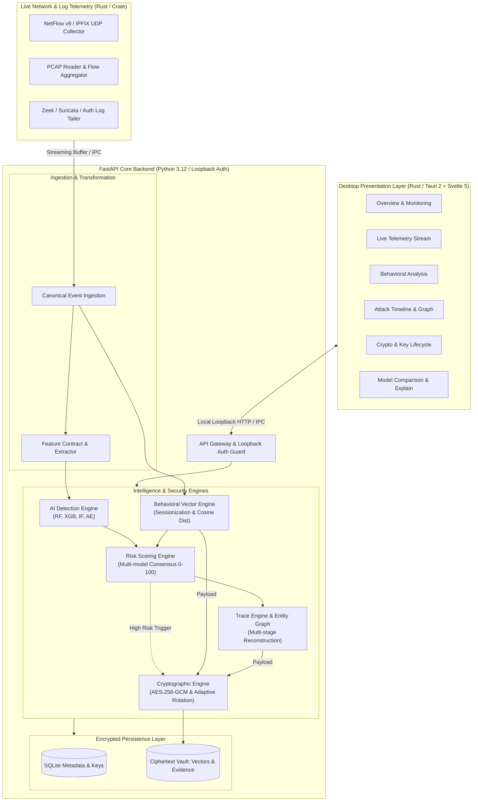
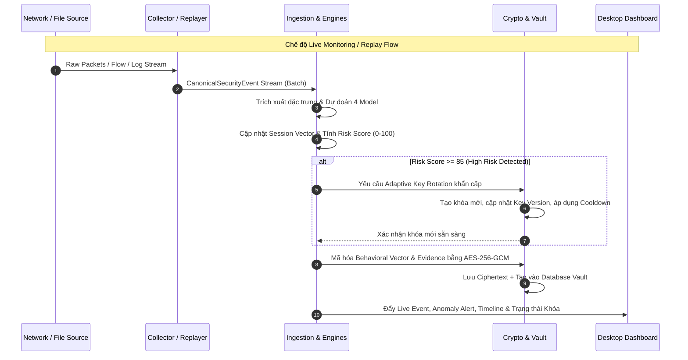

# NetFlow Sentinel v2.0 — Target Architecture Specification

> **Tài liệu kiến trúc hệ thống (Issue #78 — Milestone M6.1)**  
> **Phiên bản:** 2.0.0-architecture  
> **Mục tiêu:** Thiết lập kiến trúc chuẩn tắc cho NetFlow Sentinel v2.0, định nghĩa ranh giới tiến trình, 3 chế độ hoạt động (Offline, Replay, Live), 5 hợp đồng dữ liệu chuẩn liên module và ma trận module ownership.

---

## 1. Kiến trúc Tổng thể & Ranh giới Tiến trình

Hệ thống được thiết kế theo mô hình **Hybrid Desktop-Sidecar Architecture**:
- **Frontend / Client Layer:** Desktop application phát triển bằng **Tauri 2 + Svelte 5 + Tailwind CSS**, giao tiếp bất đồng bộ qua IPC và HTTP loopback.
- **Backend / Sidecar Layer:** **FastAPI + Python 3.12** chạy dưới dạng tiến trình độc lập (loopback authentication qua `X-Sentinel-Session-Token`), tích hợp SQLite bảo mật cho lưu trữ metadata và encrypted at-rest storage.
- **Telemetry Layer:** **Rust Collector** hiệu năng cao xử lý packet / NetFlow v9 / IPFIX và tail logs, đẩy vào streaming pipeline qua kênh nội bộ có backpressure.



---

## 2. Ba Chế độ Hoạt động (Operating Modes)

### 2.1. Chế độ 1: Offline CSV Mode (Bảo toàn v1.0.0)
- **Mục đích:** Phân tích ngoại tuyến các tập tin CSV chuẩn (NF-UNSW-NB15-v3, NF-ToN-IoT-v3) hoặc báo cáo xuất từ firewall/NIDS.
- **Luồng dữ liệu:**  
  `Tệp CSV → Ingestion Adapter → Canonical Security Event → 47-feature Extraction → AI Inference (4 models) → Risk Score → Hiển thị Báo cáo`.
- **Đảm bảo:** Tương thích 100% với kịch bản kiểm thử và nghiệm thu của v1.0.0.

### 2.2. Chế độ 2: Dataset Replay Mode (Mô phỏng Đa nguồn Nghiên cứu)
- **Mục đích:** Tái hiện kịch bản tấn công thực tế từ tập dữ liệu đa nguồn (AIT NetFlow & Log Dataset v2.1) theo đúng dòng thời gian thực tế (time-scaled replay).
- **Luồng dữ liệu:**  
  `Replay Controller → Multi-source Adapters (Flow, DNS, Web, Auth) → Event Timestamp Alignment → Behavioral Vector Sessionization (Time-window) → AI Consensus & Risk Scoring → Attack Timeline Reconstruction → Adaptive Key Rotation Under Attack`.

### 2.3. Chế độ 3: Live Monitoring Mode (Giám sát Lab Được Cấp phép)
- **Mục đích:** Thu thập trực tiếp lưu lượng mạng thực tế trong môi trường lab ủy quyền, phát hiện bất thường tức thời và kích hoạt tự vệ mật mã.
- **Luồng dữ liệu:**  
  `Rust Collector (UDP:2055 / Raw socket) → Bounded Ring Buffer → Missing-feature Validator / Rejection Gate → Streaming Inference → Live Anomaly Alert → Dynamic Key Rotation`.



---

## 3. Năm Hợp đồng Dữ liệu Liên Module (Five Shared Contracts)

Hệ thống định nghĩa 5 hợp đồng dữ liệu chuẩn hóa (Pydantic / TypedDict schemas) để triệt tiêu phụ thuộc lỏng lẻo:

### Contract 1: `CanonicalSecurityEvent` (`contract_id: "sec-event-v2"`)
Đại diện cho sự kiện mạng/bảo mật hợp nhất từ mọi nguồn (Flow, DNS, Web, Auth, System).
```json
{
  "event_id": "uuid-v4",
  "event_timestamp": "2026-11-17T14:30:00.000000Z",
  "source_type": "netflow | dns | web | auth | system",
  "entity_id": "canonical-entity-identifier",
  "source_ip": "192.168.1.10",
  "source_port": 49152,
  "dest_ip": "10.0.0.5",
  "dest_port": 80,
  "protocol": "TCP",
  "metrics": {
    "duration_seconds": 1.25,
    "bytes_in": 1024,
    "bytes_out": 4096,
    "packets_in": 8,
    "packets_out": 12
  },
  "raw_provenance": {
    "source_file": "capture.pcap",
    "line_or_offset": 1042
  }
}
```

### Contract 2: `MLFeatureVector` (`contract_id: "ml-feat-v2"`)
Vector đặc trưng phục vụ suy luận AI, tách biệt tuyệt đối với siêu dữ liệu:
```json
{
  "contract_id": "ml-feat-nf-unsw-v3",
  "version": "2.0.0",
  "features": [0.12, 1024.0, 4096.0, ...], // 47 float features
  "is_complete": true,
  "missing_attributes": []
}
```

### Contract 3: `BehavioralVector` (`contract_id: "beh-vec-v2"`)
Vector thống kê hành vi thực thể theo cửa sổ thời gian (IP-independent):
```json
{
  "entity_id": "device-uuid-or-fingerprint",
  "window_start": "2026-11-17T14:00:00Z",
  "window_end": "2026-11-17T14:15:00Z",
  "vector_version": "2.0",
  "vector_16d": [0.45, 0.12, 0.89, ...],
  "session_count": 14,
  "diversity_score": 0.78
}
```

### Contract 4: `RiskScoreResult` (`contract_id: "risk-res-v2"`)
Kết quả đánh giá rủi ro hợp nhất từ 4 mô hình AI và luật chuyên gia:
```json
{
  "event_id": "uuid-v4",
  "overall_risk_score": 92.5,
  "severity": "CRITICAL",
  "model_predictions": {
    "random_forest": {"is_anomaly": true, "confidence": 0.99},
    "xgboost": {"is_anomaly": true, "confidence": 0.98},
    "isolation_forest": {"is_anomaly": true, "score": -0.65},
    "autoencoder": {"is_anomaly": true, "reconstruction_error": 0.082}
  },
  "trigger_adaptive_rotation": true
}
```

### Contract 5: `KeyLifecycleMetadata` (`contract_id: "key-meta-v2"`)
Thông tin quản lý vòng đời khóa mã hóa AES-256-GCM:
```json
{
  "key_id": "k-20261117-001",
  "algorithm": "AES-256-GCM",
  "status": "ACTIVE | RETIRED | REVOKED",
  "created_at": "2026-11-17T14:00:00Z",
  "expires_at": "2026-11-17T14:30:00Z",
  "rotation_reason": "FIXED_SCHEDULE | ADAPTIVE_RISK_TRIGGER",
  "records_encrypted_count": 1420
}
```

---

## 4. Ma trận Phân quyền Sở hữu Module & File

| Workstream | Thành phần Phụ trách | Phạm vi Mã nguồn Độc quyền | Quy tắc Tích hợp & Kiểm toán |
|---|---|---|---|
| **A (Data)** | Adapters, Ingestion, Quality Validation | `src/network_anomaly/data/`, `src/network_anomaly/canonical/`, `src/network_anomaly/ingestion/` | Tuân thủ Contract 1; không tự ý thêm feature giả định (no implicit imputation). |
| **B (AI & Behavioral)** | 4 Models, Tuning, Behavioral Vector | `src/network_anomaly/models/`, `src/network_anomaly/preprocessing/`, `src/network_anomaly/behavioral/` | Tuân thủ Contract 2 & 3; không chỉnh sửa `train_only` transformer ngoài preprocessor. |
| **C (Risk & Trace)** | Risk Scoring, Trace Graph, Timeline | `src/network_anomaly/risk/`, `src/network_anomaly/trace/`, `src/network_anomaly/investigation/` | Tuân thủ Contract 4; phân định rõ ràng giữa bằng chứng quan sát và suy luận giả thuyết. |
| **D (Crypto)** | AES-GCM, Rotation, Key Vault | `src/network_anomaly/crypto/` | Tuân thủ Contract 5; chỉ lưu ciphertext, nonce và tag; cấm log plaintext hoặc secret key. |
| **E (Live Telemetry)** | Rust Collector, Streaming Pipeline | `telemetry/`, `src/network_anomaly/streaming/` | Có buffer chặn và backpressure; từ chối gói tin dị dạng an toàn. |
| **F (Desktop & Release)** | UI Dashboards, Packaging, NSIS | `desktop/`, `.github/workflows/`, `scripts/build_*` | Đảm bảo hoạt động ngoại tuyến (offline attestation) trên Windows x64. |
| **G (QA & Governance)** | E2E, Research Validation, Docs | `docs/`, `reports/`, `tests/` | Kiểm chứng độc lập trước khi đánh dấu nghiệm thu. |

---

## 5. Quy chuẩn Tương thích Ngược (Backward Compatibility Policy)
- Đường truyền cũ (v1.0.0 Desktop CSV) hoạt động qua Adapter chuyển tiếp `LegacyCSVAdapter` sang `CanonicalSecurityEvent` mà không làm thay đổi kết quả dự đoán của 4 mô hình cơ sở.
- SQLite Database v1.0.0 được tự động nâng cấp (idempotent migration) có sao lưu dự phòng, bảo toàn toàn bộ dữ liệu lịch sử.
