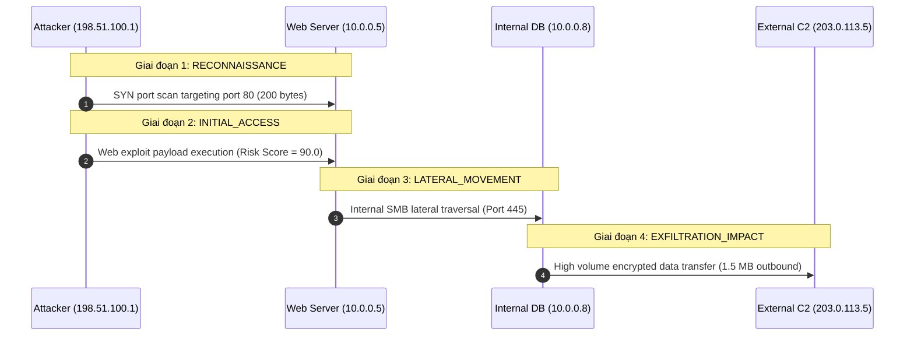

# NetFlow Sentinel v2.0 — Multi-stage Attack Timeline Reconstruction

> **Tài liệu kỹ thuật Attack Timeline (Issue #112 — Milestone M6.4)**  
> **Phiên bản:** 2.0.0-timeline  
> **Module thực thi:** `src/network_anomaly/trace/timeline.py`

---

## 1. Giới thiệu
Attack Timeline Reconstructor sắp xếp và phân giai đoạn các sự kiện bất thường mạng theo tiến trình tấn công chuẩn mực (dựa trên khung MITRE ATT&CK và Cyber Kill Chain).

### 4 Giai đoạn Chuẩn tắc (Attack Phases):
1. **`RECONNAISSANCE` (Thăm dò & Quét mạng):**
   - Hành vi: Quét cổng, quét dịch vụ, thăm dò DNS, gửi gói tin kích thước nhỏ tới hàng loạt cổng.
   - Chỉ báo: Cổng đích đa dạng, số lượng byte phản hồi thấp ($< 500$ bytes).
2. **`INITIAL_ACCESS` (Xâm nhập Ban đầu):**
   - Hành vi: Khai thác lỗ hổng ứng dụng web (Exploits, Injections), brute-force mật khẩu đăng nhập.
   - Chỉ báo: Lưu lượng tới cổng 80/443 hoặc 22/3389 kèm Risk Score cao ($\ge 80.0$).
3. **`LATERAL_MOVEMENT` (Leo thang & Di chuyển Ngang):**
   - Hành vi: Máy chủ đã bị kiểm soát bắt đầu kết nối tới các máy chủ nội bộ khác trong mạng LAN.
   - Chỉ báo: Lưu lượng nội bộ (IP private $10.x.x.x \to 10.x.x.x$) qua các giao thức quản trị `SMB (445)`, `RDP (3389)`, `SSH (22)`.
4. **`EXFILTRATION_IMPACT` (Rút trích Dữ liệu & Phá hoại):**
   - Hành vi: Rút dữ liệu ra máy chủ ngoài (C2/Exfiltration) hoặc tấn công từ chối dịch vụ (DoS/DDoS).
   - Chỉ báo: Lưu lượng truyền ra ngoài với dung lượng đột biến ($> 500.000$ bytes) hoặc tốc độ gói tin bất thường.

---

## 2. Kịch bản Tấn công Đa Giai đoạn Mẫu (Sample Ground Truth Incident)

Kịch bản `APT-Campaign-Omega` được kiểm chứng tự động trong `tests/unit/test_trace_engine.py`:

Timeline xuất ra có đầy đủ mức độ tin cậy của toàn chuỗi (`overall_confidence`), thời gian bắt đầu và kết thúc, danh sách thực thể liên quan và bằng chứng kiểm chứng.
