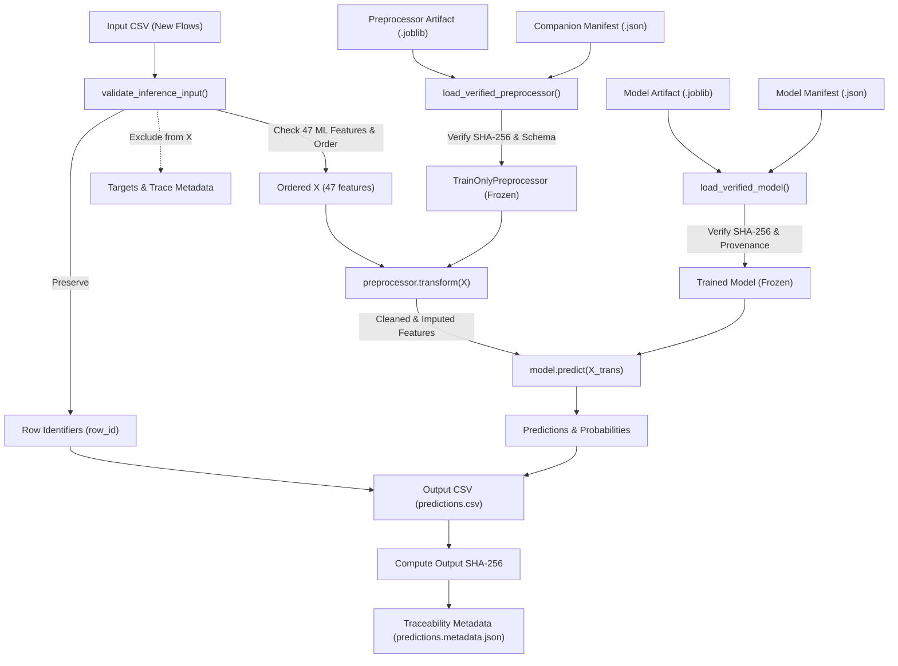

# NF-UNSW-NB15-v3 CSV Inference Pipeline (Issue #15)

## 1. Tổng quan kiến trúc

Pipeline inference phục vụ phát hiện bất thường trên các luồng mạng mới (`NF-UNSW-NB15-v3`) với các nguyên tắc cốt lõi:
- **Zero-leakage / Zero-refit**: Tuyệt đối không fit lại preprocessor hay model trên tập dữ liệu inference; chỉ sử dụng trạng thái đã fit sẵn từ tập Train (Issue #8).
- **Strict Contract Enforcement**: Yêu cầu đầy đủ 47 baseline ML features theo đúng hợp đồng `nf-unsw-nb15-v3-baseline-47`. Tự động sắp xếp lại thứ tự cột về chuẩn canonical. Loại bỏ hoàn toàn nhãn (`Label`, `Attack`) và trace-only metadata (IPs, Ports, Timestamps) khỏi ma trận đầu vào mô hình.
- **Fail-closed Artifact Verification**: Sử dụng `TrainOnlyPreprocessor.load_verified()` để kiểm tra toàn vẹn mã băm SHA-256 của preprocessor và companion manifest trước khi deserialize. Kiểm tra mã băm và hợp đồng của model artifact.
- **Traceability & Provenance**: Mỗi lần chạy inference ghi nhận mối quan hệ `Input Row -> Prediction` và xuất metadata JSON chứa đầy đủ thông tin: run ID, hash input/output, hash model/preprocessor, git commit, môi trường thực thi, số lượng mẫu và trạng thái.



---

## 2. Cấu trúc Input CSV

Input CSV phải chứa tối thiểu 47 trường đặc trưng baseline ML của `NF-UNSW-NB15-v3`. Thứ tự các cột trong CSV có thể tùy ý (pipeline sẽ tự sắp xếp lại theo hợp đồng canonical).

### Danh sách 47 ML Features bắt buộc
```text
PROTOCOL, L7_PROTO, IN_BYTES, IN_PKTS, OUT_BYTES, OUT_PKTS, TCP_FLAGS, CLIENT_TCP_FLAGS,
SERVER_TCP_FLAGS, FLOW_DURATION_MILLISECONDS, DURATION_IN, DURATION_OUT, MIN_TTL, MAX_TTL,
LONGEST_FLOW_PKT, SHORTEST_FLOW_PKT, MIN_IP_PKT_LEN, MAX_IP_PKT_LEN, SRC_TO_DST_SECOND_BYTES,
DST_TO_SRC_SECOND_BYTES, RETRANSMITTED_IN_BYTES, RETRANSMITTED_IN_PKTS, RETRANSMITTED_OUT_BYTES,
RETRANSMITTED_OUT_PKTS, SRC_TO_DST_AVG_THROUGHPUT, DST_TO_SRC_AVG_THROUGHPUT,
NUM_PKTS_UP_TO_128_BYTES, NUM_PKTS_128_TO_256_BYTES, NUM_PKTS_256_TO_512_BYTES,
NUM_PKTS_512_TO_1024_BYTES, NUM_PKTS_1024_TO_1514_BYTES, TCP_WIN_MAX_IN, TCP_WIN_MAX_OUT,
ICMP_TYPE, ICMP_IPV4_TYPE, DNS_QUERY_ID, DNS_QUERY_TYPE, DNS_TTL_ANSWER, FTP_COMMAND_RET_CODE,
SRC_TO_DST_IAT_MIN, SRC_TO_DST_IAT_MAX, SRC_TO_DST_IAT_AVG, SRC_TO_DST_IAT_STDDEV,
DST_TO_SRC_IAT_MIN, DST_TO_SRC_IAT_MAX, DST_TO_SRC_IAT_AVG, DST_TO_SRC_IAT_STDDEV
```

### Các trường tùy chọn (được bảo toàn định danh hoặc loại khỏi X):
- Định danh dòng: `row_id` hoặc `id` (nếu có, được giữ nguyên để map với kết quả dự đoán; nếu không có, pipeline tự đánh số `0, 1, ..., N-1`).
- Trace metadata: `FLOW_START_MILLISECONDS`, `FLOW_END_MILLISECONDS`, `IPV4_SRC_ADDR`, `L4_SRC_PORT`, `IPV4_DST_ADDR`, `L4_DST_PORT` (loại bỏ khỏi X, không tham gia dự đoán).
- Target labels: `Label`, `Attack` (loại bỏ khỏi X).

### Ví dụ Input CSV tối giản:
```csv
row_id,PROTOCOL,L7_PROTO,IN_BYTES,IN_PKTS,OUT_BYTES,OUT_PKTS,TCP_FLAGS,CLIENT_TCP_FLAGS,SERVER_TCP_FLAGS,FLOW_DURATION_MILLISECONDS,DURATION_IN,DURATION_OUT,MIN_TTL,MAX_TTL,LONGEST_FLOW_PKT,SHORTEST_FLOW_PKT,MIN_IP_PKT_LEN,MAX_IP_PKT_LEN,SRC_TO_DST_SECOND_BYTES,DST_TO_SRC_SECOND_BYTES,RETRANSMITTED_IN_BYTES,RETRANSMITTED_IN_PKTS,RETRANSMITTED_OUT_BYTES,RETRANSMITTED_OUT_PKTS,SRC_TO_DST_AVG_THROUGHPUT,DST_TO_SRC_AVG_THROUGHPUT,NUM_PKTS_UP_TO_128_BYTES,NUM_PKTS_128_TO_256_BYTES,NUM_PKTS_256_TO_512_BYTES,NUM_PKTS_512_TO_1024_BYTES,NUM_PKTS_1024_TO_1514_BYTES,TCP_WIN_MAX_IN,TCP_WIN_MAX_OUT,ICMP_TYPE,ICMP_IPV4_TYPE,DNS_QUERY_ID,DNS_QUERY_TYPE,DNS_TTL_ANSWER,FTP_COMMAND_RET_CODE,SRC_TO_DST_IAT_MIN,SRC_TO_DST_IAT_MAX,SRC_TO_DST_IAT_AVG,SRC_TO_DST_IAT_STDDEV,DST_TO_SRC_IAT_MIN,DST_TO_SRC_IAT_MAX,DST_TO_SRC_IAT_AVG,DST_TO_SRC_IAT_STDDEV
flow_001,6,0,1040,10,2400,12,24,24,24,120,60,60,64,64,512,40,40,512,1040,2400,0,0,0,0,69333,160000,4,2,2,2,0,65535,65535,0,0,0,0,0,0,2,20,12.0,5.2,1,18,10.0,4.8
```

---

## 3. Hướng dẫn chạy CLI trên Windows PowerShell

### Cú pháp cơ bản với artifact mặc định:
```powershell
python scripts/predict.py `
    --input data/new_flows.csv `
    --output results/predictions.csv
```

### Chạy với đường dẫn artifact cụ thể:
```powershell
python scripts/predict.py `
    --input data/new_flows.csv `
    --output results/predictions.csv `
    --model-artifact artifacts/models/random_forest/random_forest_baseline.joblib `
    --model-manifest reports/models/random_forest_manifest.json `
    --preprocessor-artifact artifacts/preprocessing/nf_unsw_nb15_v3_preprocessor.joblib `
    --preprocessor-manifest reports/preprocessing/nf_unsw_nb15_v3_preprocessing_manifest.json
```

### Các tham số CLI:
| Tham số | Bắt buộc | Mặc định | Mô tả |
|---|---|---|---|
| `--input`, `-i` | Có | — | Đường dẫn file CSV đầu vào chứa các network flows |
| `--output`, `-o` | Có | — | Đường dẫn xuất kết quả dự đoán CSV |
| `--model`, `-m` | Không | `random_forest` | Chọn loại mô hình (`random_forest`, `isolation_forest`) hoặc đường dẫn file `.joblib` |
| `--model-artifact` | Không | None | Đường dẫn trực tiếp file model `.joblib` |
| `--model-manifest` | Không | None | Đường dẫn trực tiếp file companion manifest `.json` của model |
| `--preprocessor-artifact`, `-p` | Không | `artifacts/preprocessing/nf_unsw_nb15_v3_preprocessor.joblib` | Đường dẫn preprocessor `.joblib` |
| `--preprocessor-manifest` | Không | `reports/preprocessing/nf_unsw_nb15_v3_preprocessing_manifest.json` | Đường dẫn companion manifest của preprocessor |
| `--metadata-output` | Không | `<output_stem>.metadata.json` | Đường dẫn xuất file metadata JSON |
| `--run-id` | Không | Tự động tạo | Định danh phiên inference phục vụ truy vết |

---

## 4. Cấu trúc Output CSV

Output CSV bảo toàn số dòng và thứ tự dòng so với file đầu vào:

```csv
row_id,prediction,model_type,run_id,model_artifact_sha256,preprocessor_artifact_sha256,probability_Benign,probability_Attack
flow_001,0,RandomForestClassifier,inference-20261108-abc123,801afcbb71f04de8f671790d747b45a3bfc98bd3e01fb02b8f37a1c76ec85eea,12d4360a05ef92573763ae1d9c1a5c36ea59081cf2f16112017bec56bbca1b19,0.985,0.015
```

Các trường:
- `row_id`: Định danh dòng từ input (hoặc chỉ số 0..N-1).
- `prediction`: Kết quả dự đoán nhị phân (0 = Benign, 1 = Attack) hoặc nhãn cụ thể từ model.
- `model_type`: Loại mô hình (ví dụ `RandomForestClassifier` hoặc `IsolationForest`).
- `run_id`: Định danh duy nhất của lượt inference.
- `model_artifact_sha256`: Mã băm SHA-256 của file mô hình đã dùng.
- `preprocessor_artifact_sha256`: Mã băm SHA-256 của preprocessor đã dùng.
- `probability_<class>`: Xác suất theo từng lớp nếu mô hình hỗ trợ `predict_proba`.
- `decision_score` / `anomaly_score`: Điểm bất thường nếu sử dụng Isolation Forest.

---

## 5. Traceability Metadata JSON

Mỗi lần inference tạo ra file `<output>.metadata.json`:

```json
{
  "run_id": "inference-20261108145500-1a2b3c4d",
  "timestamp_utc": "2026-11-08T07:55:00.123456+00:00",
  "input_file_path": "data/new_flows.csv",
  "input_file_sha256": "3a7b8c...",
  "input_row_count": 50,
  "output_file_path": "results/predictions.csv",
  "output_file_sha256": "9f8e7d...",
  "model_artifact_path": "artifacts/models/random_forest/random_forest_baseline.joblib",
  "model_artifact_sha256": "801afcbb71f04de8f671790d747b45a3bfc98bd3e01fb02b8f37a1c76ec85eea",
  "model_manifest_path": "reports/models/random_forest_manifest.json",
  "model_manifest_sha256": "5c6d7e...",
  "model_type": "RandomForestClassifier",
  "model_configuration": {
    "n_estimators": 200,
    "max_depth": 16,
    "random_state": 42
  },
  "preprocessor_artifact_path": "artifacts/preprocessing/nf_unsw_nb15_v3_preprocessor.joblib",
  "preprocessor_artifact_sha256": "12d4360a05ef92573763ae1d9c1a5c36ea59081cf2f16112017bec56bbca1b19",
  "preprocessor_manifest_path": "reports/preprocessing/nf_unsw_nb15_v3_preprocessing_manifest.json",
  "preprocessor_manifest_sha256": "af07dc3b6c7cbc9e75426eeb5b96d52dbd191e8a09161699df2fad1bb5555441",
  "feature_contract_version": "nf-unsw-nb15-v3-baseline-47",
  "preprocessing_policy_version": "nf-unsw-nb15-v3-preprocessing-v1",
  "environment": {
    "python": "3.14.6",
    "platform": "win32",
    "pandas": "3.0.6",
    "numpy": "2.5.0",
    "scikit-learn": "1.6.1",
    "joblib": "1.6.0"
  },
  "git_commit": "9da4e50...",
  "prediction_count": 50,
  "error_count": 0,
  "execution_status": "SUCCESS"
}
```

---

## 6. Các lỗi thường gặp và cơ chế Fail-Closed

1. **Thiếu feature bắt buộc**: Báo lỗi `ValueError: Input data is missing X required baseline ML feature(s): [...]`.
2. **Giá trị không hợp lệ**: Chuỗi văn bản không thể ép kiểu sang số (ví dụ `"malicious_packet"`) sẽ báo lỗi kèm vị trí dòng và mẫu giá trị lỗi.
3. **File CSV rỗng**: Báo lỗi `ValueError: Input CSV file is empty (0 bytes)` hoặc `contains 0 data rows`.
4. **Không tìm thấy artifact hoặc companion manifest**: Báo lỗi `FileNotFoundError`. Không tự tạo model giả lập.
5. **Sai lệch mã băm SHA-256**: Báo lỗi `ValueError: Artifact SHA-256 mismatch`. Ngăn chặn hoàn toàn việc nạp artifact bị sửa đổi hoặc suy đồi.
6. **Không tương thích Preprocessor - Model**: Nếu manifest của model ghi nhận được huấn luyện với preprocessor SHA-256 khác với preprocessor đang nạp, pipeline sẽ báo lỗi `ValueError: Model was trained with preprocessor SHA-256 ...`.
7. **Ghi đè file đầu vào**: Báo lỗi nếu `--output` trùng với `--input`.

---

## 7. Điều kiện cần có để chạy inference với model thật

- **Preprocessing Artifact**: Đã sẵn sàng trong repository (`artifacts/preprocessing/nf_unsw_nb15_v3_preprocessor.joblib` và manifest `reports/preprocessing/nf_unsw_nb15_v3_preprocessing_manifest.json`), đã qua xác minh (`PASS`).
- **Trained Model Artifact**:
  - Trạng thái hiện tại: Kiến trúc, giao thức huấn luyện và companion manifest của Random Forest baseline (Issue #10) đã được hoàn thành và tích hợp vào `main` tại PR #43 (`reports/models/random_forest_manifest.json`).
  - Do quy chuẩn repository không lưu trữ file trọng số nhị phân lớn vào Git, file `artifacts/models/random_forest/random_forest_baseline.joblib` được quản lý ngoài Git (qua `.gitignore`).
  - Để chạy inference với mô hình thật: cần có file trọng số `artifacts/models/random_forest/random_forest_baseline.joblib` (tạo cục bộ bằng `python scripts/train_random_forest.py` hoặc cung cấp qua `--model-artifact <path>`). Nếu thiếu file binary cục bộ, CLI sẽ kích hoạt cơ chế fail-closed và dừng lại an toàn với exit code 1.
