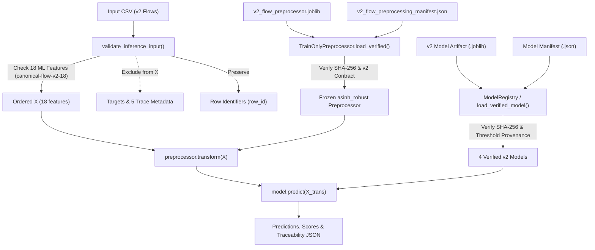

# NetFlow Sentinel v2 CSV & Live Inference Pipeline

## 1. Tổng quan kiến trúc

Pipeline inference thực thi suy luận cho cả 4 họ mô hình (`random_forest`, `xgboost`, `isolation_forest`, `autoencoder`) trên hợp đồng canonical v2 (`canonical-flow-v2-18`) với các bất biến bắt buộc:

- **Zero-leakage / Zero-refit:** Chỉ gọi `preprocessor.transform()` từ artifact đã fit trên `ait_train` (`v2_flow_preprocessor.joblib`, `scaler_type="asinh_robust"`).
- **Strict 18-Feature Contract (`canonical-flow-v2-18`):** Tự động ánh xạ/căn chỉnh đúng 18 cột ML, từ chối im lặng nếu thiếu cột bắt buộc, và loại tuyệt đối `label_binary`, `attack_category`, `raw_label`, `label_status` cùng 5 cột trace metadata khỏi ma trận `X`.
- **Fail-closed Provenance & Checksum Gate:** Kiểm tra `feature_contract_version == "canonical-flow-v2-18"`, `dataset_sha256`, `split_manifest_sha256`, `preprocessor_artifact_sha256`, và `model_artifact_sha256` trước khi nạp `joblib`. Tuyệt đối **không có fallback sang v1 (`nf-unsw-nb15-v3-baseline-47`)**; thiếu hoặc sai hash trả `HTTP 503` / `NOT READY`.
- **OOD Abstention:** Các dòng vi phạm vật lý (ví dụ giá trị âm bất hợp lệ hoặc `NaN`/`Inf` ngoài ngưỡng hợp đồng) được gắn `ABSTAINED_OOD` (`predicted_label = null`) và loại khỏi Confusion Matrix.



---

## 2. Cấu trúc Input CSV (`canonical-flow-v2-18`)

### Danh sách 18 ML Features bắt buộc
```text
duration_ms, bytes_in, bytes_out, pkts_in, pkts_out, protocol_num,
total_bytes, total_pkts, bytes_in_ratio, pkts_in_ratio,
bytes_per_pkt_in, bytes_per_pkt_out, bytes_per_sec_in, bytes_per_sec_out,
pkts_per_sec, has_response, is_tcp, is_udp
```

### Trường tùy chọn & Loại trừ khỏi `X`
- **Định danh dòng:** `row_id` hoặc `id`.
- **Trace metadata (5 cột):** `timestamp_ms`, `source_ip`, `dest_ip`, `source_port`, `dest_port` (dùng cho Trace Engine / Timeline / Behavioral Summary, không đưa vào `X`).
- **Targets (4 cột):** `label_binary`, `attack_category`, `raw_label`, `label_status` (bị loại khỏi `X`; dùng đối chiếu Confusion Matrix nếu người dùng nạp nhãn riêng).
- **Provenance (5 cột):** `source_dataset`, `scenario_or_device`, `flow_id`, `raw_protocol_str`, `probe_source`.

---

## 3. Chạy CLI trên Windows PowerShell

```powershell
.venv\Scripts\python.exe scripts/predict.py `
    --input data/demo/demo_flows.csv `
    --output results/predictions.csv `
    --model random_forest
```

| Tham số | Mặc định | Mô tả |
|---|---|---|
| `--input`, `-i` | *(bắt buộc)* | CSV chứa các network flow chuẩn v2 |
| `--output`, `-o` | *(bắt buộc)* | Đường dẫn CSV kết quả |
| `--model`, `-m` | `random_forest` | `random_forest`, `xgboost`, `isolation_forest`, hoặc `autoencoder` |
| `--preprocessor-artifact`, `-p` | `artifacts/preprocessing/v2_flow_preprocessor.joblib` | Đường dẫn preprocessor v2 |
| `--preprocessor-manifest` | `reports/preprocessing/v2_flow_preprocessing_manifest.json` | Manifest preprocessor v2 |
