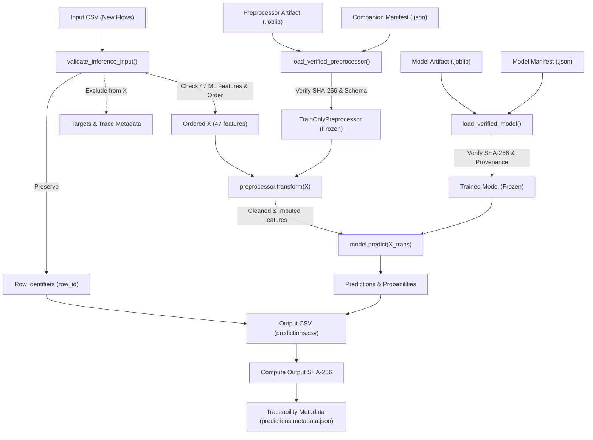

# NF-UNSW-NB15-v3 CSV Inference Pipeline (Issue #15)

## 1. Tổng quan kiến trúc

Pipeline inference phục vụ phát hiện bất thường trên các luồng mạng mới (`NF-UNSW-NB15-v3`) với các nguyên tắc cốt lõi:
- **Zero-leakage / Zero-refit**: Tuyệt đối không fit lại preprocessor hay model trên tập dữ liệu inference; chỉ sử dụng trạng thái đã fit sẵn từ tập Train (Issue #8).
- **Strict Contract Enforcement**: Yêu cầu đầy đủ 47 baseline ML features theo đúng hợp đồng `nf-unsw-nb15-v3-baseline-47`. Tự động sắp xếp lại thứ tự cột về chuẩn canonical. Loại bỏ hoàn toàn nhãn (`Label`, `Attack`) và trace-only metadata (IPs, Ports, Timestamps) khỏi ma trận đầu vào mô hình.
- **Fail-closed Artifact Verification**: Sử dụng `TrainOnlyPreprocessor.load_verified()` để kiểm tra toàn vẹn mã băm SHA-256 của preprocessor và companion manifest trước khi deserialize. Hỗ trợ thống nhất 4 mô hình (`random_forest`, `xgboost`, `isolation_forest`, `autoencoder` qua `AutoencoderModel`); nếu file `.joblib`/`.pt` cục bộ bị thiếu hoặc sai checksum, pipeline dừng ở trạng thái `BLOCKED / NOT READY`, tuyệt đối không sinh model giả.
- **Traceability & Provenance**: Mỗi lần chạy inference ghi nhận mối quan hệ `Input Row -> Prediction` và xuất metadata JSON chứa đầy đủ thông tin: run ID, hash input/output, hash model/preprocessor, git commit, môi trường thực thi, số lượng mẫu và trạng thái.



---

## 2. Cấu trúc Input CSV

Input CSV phải chứa tối thiểu 47 trường đặc trưng baseline ML của `NF-UNSW-NB15-v3`. Thứ tự các cột trong CSV có thể tùy ý (pipeline sẽ tự sắp xếp lại theo hợp đồng canonical).

### Danh sách 47 ML Features bắt buộc
```text
PROTOCOL, L7_PROTO, IN_BYTES, IN_PKTS, OUT_BYTES, OUT_PKTS, TCP_FLAGS, CLIENT_TCP_FLAGS,
SERVER_TCP_FLAGS, FLOW_DURATION_MILLISECONDS, DURATION_IN, DURATION_OUT, MIN_TTL, MAX_TTL,
LONGEST_FLOW_PKT, SHORTEST_FLOW_PKT, MIN_IP_PKT_LEN, MAX_IP_PKT_LEN, SRC_TO_DST_SECOND_BYTES,
DST_TO_SRC_SECOND_BYTES, RETRANSMITTED_IN_BYTES, RETRANSMITTED_IN_PKTS, RETRANSMITTED_OUT_BYTES,
RETRANSMITTED_OUT_PKTS, SRC_TO_DST_AVG_THROUGHPUT, DST_TO_SRC_AVG_THROUGHPUT,
NUM_PKTS_UP_TO_128_BYTES, NUM_PKTS_128_TO_256_BYTES, NUM_PKTS_256_TO_512_BYTES,
NUM_PKTS_512_TO_1024_BYTES, NUM_PKTS_1024_TO_1514_BYTES, TCP_WIN_MAX_IN, TCP_WIN_MAX_OUT,
ICMP_TYPE, ICMP_IPV4_TYPE, DNS_QUERY_ID, DNS_QUERY_TYPE, DNS_TTL_ANSWER, FTP_COMMAND_RET_CODE,
SRC_TO_DST_IAT_MIN, SRC_TO_DST_IAT_MAX, SRC_TO_DST_IAT_AVG, SRC_TO_DST_IAT_STDDEV,
DST_TO_SRC_IAT_MIN, DST_TO_SRC_IAT_MAX, DST_TO_SRC_IAT_AVG, DST_TO_SRC_IAT_STDDEV
```

### Các trường tùy chọn (được bảo toàn định danh hoặc loại khỏi X):
- Định danh dòng: `row_id` hoặc `id` (nếu có, được giữ nguyên để map với kết quả dự đoán; nếu không có, pipeline tự đánh số `0, 1, ..., N-1`).
- Trace metadata: `FLOW_START_MILLISECONDS`, `FLOW_END_MILLISECONDS`, `IPV4_SRC_ADDR`, `L4_SRC_PORT`, `IPV4_DST_ADDR`, `L4_DST_PORT` (loại bỏ khỏi X, không tham gia dự đoán).
- Target labels: `Label`, `Attack` (loại bỏ khỏi X).

### Ví dụ Input CSV tối giản:
```csv
row_id,PROTOCOL,L7_PROTO,IN_BYTES,IN_PKTS,OUT_BYTES,OUT_PKTS,TCP_FLAGS,CLIENT_TCP_FLAGS,SERVER_TCP_FLAGS,FLOW_DURATION_MILLISECONDS,DURATION_IN,DURATION_OUT,MIN_TTL,MAX_TTL,LONGEST_FLOW_PKT,SHORTEST_FLOW_PKT,MIN_IP_PKT_LEN,MAX_IP_PKT_LEN,SRC_TO_DST_SECOND_BYTES,DST_TO_SRC_SECOND_BYTES,RETRANSMITTED_IN_BYTES,RETRANSMITTED_IN_PKTS,RETRANSMITTED_OUT_BYTES,RETRANSMITTED_OUT_PKTS,SRC_TO_DST_AVG_THROUGHPUT,DST_TO_SRC_AVG_THROUGHPUT,NUM_PKTS_UP_TO_128_BYTES,NUM_PKTS_128_TO_256_BYTES,NUM_PKTS_256_TO_512_BYTES,NUM_PKTS_512_TO_1024_BYTES,NUM_PKTS_1024_TO_1514_BYTES,TCP_WIN_MAX_IN,TCP_WIN_MAX_OUT,ICMP_TYPE,ICMP_IPV4_TYPE,DNS_QUERY_ID,DNS_QUERY_TYPE,DNS_TTL_ANSWER,FTP_COMMAND_RET_CODE,SRC_TO_DST_IAT_MIN,SRC_TO_DST_IAT_MAX,SRC_TO_DST_IAT_AVG,SRC_TO_DST_IAT_STDDEV,DST_TO_SRC_IAT_MIN,DST_TO_SRC_IAT_MAX,DST_TO_SRC_IAT_AVG,DST_TO_SRC_IAT_STDDEV
flow_001,6,0,1040,10,2400,12,24,24,24,120,60,60,64,64,512,40,40,512,1040,2400,0,0,0,0,69333,160000,4,2,2,2,0,65535,65535,0,0,0,0,0,0,2,20,12.0,5.2,1,18,10.0,4.8
```

---

## 3. Hướng dẫn chạy CLI trên Windows PowerShell

### Cú pháp cơ bản với artifact mặc định:
```powershell
python scripts/predict.py `
    --input data/new_flows.csv `
    --output results/predictions.csv
```

### Chạy với đường dẫn artifact cụ thể:
```powershell
python scripts/predict.py `
    --input data/new_flows.csv `
    --output results/predictions.csv `
    --model-artifact artifacts/models/random_forest/random_forest_baseline.joblib `
    --model-manifest reports/models/random_forest_manifest.json `
    --preprocessor-artifact artifacts/preprocessing/nf_unsw_nb15_v3_preprocessor.joblib `
    --preprocessor-manifest reports/preprocessing/nf_unsw_nb15_v3_preprocessing_manifest.json
```

### Các tham số CLI:
| Tham số | Bắt buộc | Mặc định | Mô tả |
|---|---|---|---|
| `--input`, `-i` | Có | — | Đường dẫn file CSV đầu vào chứa các network flows |
| `--output`, `-o` | Có | — | Đường dẫn xuất kết quả dự đoán CSV |
| `--model`, `-m` | Không | `random_forest` | Chọn loại mô hình (`random_forest`, `xgboost`, `isolation_forest`, `autoencoder`) hoặc đường dẫn file artifact |
| `--model-artifact` | Không | None | Đường dẫn trực tiếp file model `.joblib` |
| `--model-manifest` | Không | None | Đường dẫn trực tiếp file companion manifest `.json` của model |
| `--preprocessor-artifact`, `-p` | Không | `artifacts/preprocessing/nf_unsw_nb15_v3_preprocessor.joblib` | Đường dẫn preprocessor `.joblib` |
| `--preprocessor-manifest` | Không | `reports/preprocessing/nf_unsw_nb15_v3_preprocessing_manifest.json` | Đường dẫn companion manifest của preprocessor |
| `--metadata-output` | Không | `<output_stem>.metadata.json` | Đường dẫn xuất file metadata JSON |
| `--run-id` | Không | Tự động tạo | Định danh phiên inference phục vụ truy vết |

---

## 4. Cấu trúc Output CSV

Output CSV bảo toàn số dòng và thứ tự dòng so với file đầu vào:

```csv
row_id,prediction,model_type,run_id,model_artifact_sha256,preprocessor_artifact_sha256,probability_Benign,probability_Attack
flow_001,0,RandomForestClassifier,inference-20261108-abc123,801afcbb71f04de8f671790d747b45a3bfc98bd3e01fb02b8f37a1c76ec85eea,12d4360a05ef92573763ae1d9c1a5c36ea59081cf2f16112017bec56bbca1b19,0.985,0.015
```

Các trường:
- `row_id`: Định danh dòng từ input (giữ nguyên thứ tự và chỉ số `0..N-1` hoặc `row_id` nguồn).
- `prediction`: Kết quả dự đoán nhị phân (`0` = Benign, `1` = Attack) dựa trực tiếp trên mô hình hoặc threshold đã đóng băng của mô hình (không dựa trên display score).
- `model_type`: Loại mô hình thuộc strict allowlist 4 mô hình (`RandomForestClassifier`, `XGBClassifier`, `IsolationForest`, `AutoencoderModel`, chuẩn hóa sang `random_forest`, `xgboost`, `isolation_forest`, `autoencoder`). Giá trị selector ngoài allowlist bị từ chối (HTTP `422` trên API hoặc fail-closed trên CLI), không có silent fallback.
- `run_id`: Định danh duy nhất của lượt inference.
- `model_artifact_sha256`: Mã băm SHA-256 của file mô hình đã dùng.
- `preprocessor_artifact_sha256`: Mã băm SHA-256 của preprocessor đã dùng.
- `probability_<class>` / `attack_probability`: Xác suất theo từng lớp (`[0, 1]`) **chỉ** khi mô hình hỗ trợ xác suất có giám sát (`random_forest`, `xgboost`). Với mô hình không giám sát (`isolation_forest`, `autoencoder`), API trả `attack_probability = null` và `probabilities = null` (không suy diễn sigmoid/pseudo-probability từ anomaly score).
- `decision_score` / `anomaly_score` / `raw_anomaly_score`: Điểm bất thường thô không kẹp về `[0, 1]` (`higher_is_more_anomalous` đối với `isolation_forest` và `autoencoder`, bao gồm cả giá trị âm hoặc `> 1.0`). API bổ sung `normalized_anomaly_score` (`[0, 1]` khi manifest có `score_normalization` hợp lệ từ Train/Validation, ngược lại là `null`) và `decision_threshold`.

---

## 5. Traceability Metadata JSON

Mỗi lần inference tạo ra file `<output>.metadata.json`:

```json
{
  "run_id": "inference-20261108145500-1a2b3c4d",
  "timestamp_utc": "2026-11-08T07:55:00.123456+00:00",
  "input_file_path": "data/new_flows.csv",
  "input_file_sha256": "3a7b8c...",
  "input_row_count": 50,
  "output_file_path": "results/predictions.csv",
  "output_file_sha256": "9f8e7d...",
  "model_artifact_path": "artifacts/models/random_forest/random_forest_baseline.joblib",
  "model_artifact_sha256": "801afcbb71f04de8f671790d747b45a3bfc98bd3e01fb02b8f37a1c76ec85eea",
  "model_manifest_path": "reports/models/random_forest_manifest.json",
  "model_manifest_sha256": "5c6d7e...",
  "model_type": "RandomForestClassifier",
  "model_configuration": {
    "n_estimators": 200,
    "max_depth": 16,
    "random_state": 42
  },
  "preprocessor_artifact_path": "artifacts/preprocessing/nf_unsw_nb15_v3_preprocessor.joblib",
  "preprocessor_artifact_sha256": "12d4360a05ef92573763ae1d9c1a5c36ea59081cf2f16112017bec56bbca1b19",
  "preprocessor_manifest_path": "reports/preprocessing/nf_unsw_nb15_v3_preprocessing_manifest.json",
  "preprocessor_manifest_sha256": "af07dc3b6c7cbc9e75426eeb5b96d52dbd191e8a09161699df2fad1bb5555441",
  "feature_contract_version": "nf-unsw-nb15-v3-baseline-47",
  "preprocessing_policy_version": "nf-unsw-nb15-v3-preprocessing-v1",
  "environment": {
    "python": "3.14.6",
    "platform": "win32",
    "pandas": "3.0.6",
    "numpy": "2.5.0",
    "scikit-learn": "1.6.1",
    "joblib": "1.6.0"
  },
  "git_commit": "9da4e50...",
  "prediction_count": 50,
  "error_count": 0,
  "execution_status": "SUCCESS"
}
```

---

## 6. Các lỗi thường gặp và cơ chế Fail-Closed

1. **Thiếu feature bắt buộc**: Báo lỗi `ValueError: Input data is missing X required baseline ML feature(s): [...]`.
2. **Giá trị không hợp lệ hoặc score không hữu hạn**: Chuỗi văn bản không thể ép kiểu sang số (ví dụ `"malicious_packet"`) hoặc điểm `NaN`/`Inf` sẽ bị từ chối fail-closed thay vì thay thế im lặng.
3. **File CSV rỗng**: Báo lỗi `ValueError: Input CSV file is empty (0 bytes)` hoặc `contains 0 data rows`.
4. **Model selector không hợp lệ**: Selector không thuộc 4 mô hình canonical (`random_forest`, `xgboost`, `isolation_forest`, `autoencoder` và alias hợp lệ) bị từ chối (`HTTP 422` trên API, exit error trên CLI); không silent fallback sang model khác.
5. **Không tìm thấy artifact, companion manifest hoặc sidecar bắt buộc**: Báo lỗi `FileNotFoundError`. Riêng Autoencoder bắt buộc đầy đủ canonical manifest + `model_config.json` + `threshold.json` (`threshold_frozen=True`, đồng bộ kiến trúc `47 -> 47` `MLPRegressor` và `hyperparameters`), kiểm tra SHA-256 trước khi deserialize `joblib`. Không refit/recalibrate trong inference.
6. **Sai lệch mã băm SHA-256**: Báo lỗi `ValueError: Artifact SHA-256 mismatch`. Ngăn chặn hoàn toàn việc nạp artifact/sidecar bị sửa đổi hoặc suy đồi.
7. **Không tương thích Preprocessor - Model hoặc sai model family**: Nếu manifest ghi nhận được huấn luyện với `preprocessor_sha256` khác với preprocessor đang nạp hoặc khác loại model được yêu cầu, pipeline sẽ từ chối fail-closed.
8. **Ghi đè file đầu vào**: Báo lỗi nếu `--output` trùng với `--input`.

---

## 7. Điều kiện cần có để chạy inference với model thật

- **Preprocessing Artifact**: `artifacts/preprocessing/nf_unsw_nb15_v3_preprocessor.joblib` (`12d4360a05ef92573763ae1d9c1a5c36ea59081cf2f16112017bec56bbca1b19`) và manifest `reports/preprocessing/nf_unsw_nb15_v3_preprocessing_manifest.json`. Endpoint `/api/v1/health` tách biệt `preprocessor_ready` khỏi `model_ready`: hệ thống chỉ đạt `status = "healthy"` khi cả `preprocessor_ready` và selected `model_ready` đều `True` (ngược lại báo `status = "degraded"`).
- **Trained Model Artifacts (4 mô hình mục tiêu):**
  - File trọng số nhị phân lớn không track trực tiếp trong Git (`.gitignore`). Trên môi trường đã chạy thực nghiệm M3, cả **Random Forest** (`artifacts/models/random_forest/random_forest_baseline.joblib`, SHA-256 `801afcbb...`, run `rf-baseline-1794068628`) và **Isolation Forest** (`artifacts/models/isolation_forest/isolation_forest.joblib`, SHA-256 `c2ff6e7c...`, run `if-c4-20261115T053123Z`, manifest `reports/models/isolation_forest_manifest.json` kèm `score_normalization` chuẩn hóa từ Validation) đều đạt trạng thái **`READY`** cho `InferencePipeline`, CLI (`--model random_forest` / `--model isolation_forest`) và FastAPI (`/api/v1/health`, `/api/v1/analyze`).
  - Đối với `xgboost` hoặc `autoencoder` (hoặc trên máy chưa huấn luyện/khôi phục `.joblib` cục bộ), hệ thống báo **`BLOCKED / NOT READY`** (`model_ready = False`) theo cơ chế fail-closed và không sử dụng dự đoán giả.

---

## 8. Chuẩn bị Dữ liệu Demo CSV từ Validation & Tích hợp FastAPI

Để chạy demo offline mà **không** rò rỉ dữ liệu Train hay vi phạm Test Lock:

```powershell
# Tách 200 dòng cân bằng (100 Benign / 100 Attack) chỉ từ Validation partition
$env:PYTHONPATH = "src"
python scripts/prepare_demo_dataset.py --output-dir data/demo --sample-rows 200 --seed 42
```

- Xuất `data/demo/demo_flows.csv` (tuyệt đối không có `Label`/`Attack`, bảo toàn `row_id`), `data/demo/demo_labels.csv` (dùng đánh giá riêng Confusion Matrix/Metrics), và `data/demo/demo_manifest.json` (SHA-256, kiểm chứng `0` Train/Test overlap, khuyến cáo không đại diện phân bố thực tế và trạng thái `READY` / `BLOCKED / NOT READY` từng model).
- Chạy thử CLI trên mẫu demo:

```powershell
python scripts/predict.py --input data/demo/demo_flows.csv --model random_forest --output data/demo/demo_predictions.csv --metadata-output data/demo/demo_predictions_meta.json
```

- Hoặc khởi động FastAPI local-only (`127.0.0.1:8000`) cho **Desktop App Rust / Tauri 2 + Svelte 5** (#16):

```powershell
python scripts/run_api.py --host 127.0.0.1 --port 8000
```

Các endpoint chính xem tại `reports/api/API_CONTRACT.md` và `reports/api/openapi.json` (`GET /api/v1/health`, `POST /api/v1/analyze`, `POST /api/v1/ingest`, `GET /api/v1/incidents`, `GET /api/v1/timeline`).
