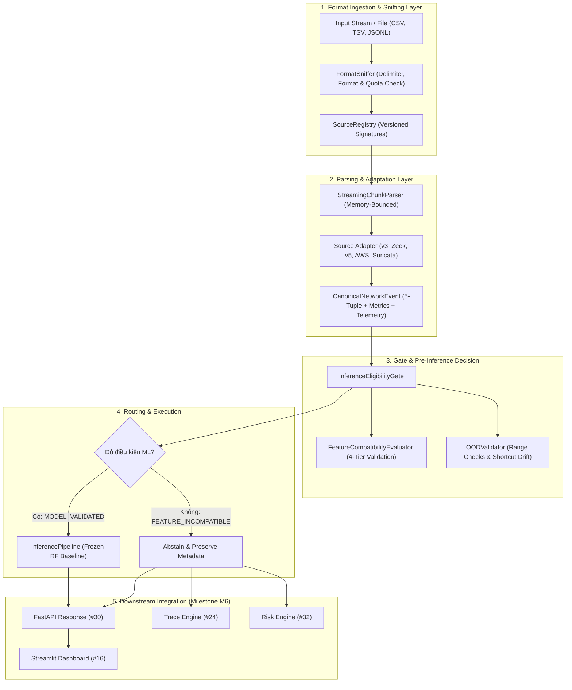

# Multi-Source Ingestion, Adapters & Cross-Dataset Generalization (Issue #46)

Tài liệu thiết kế kiến trúc tiếp nhận đa nguồn dữ liệu mạng, bộ chuyển đổi tương thích, cổng kiểm soát phân phối OOD và đánh giá tổng quát hóa Cross-Dataset cho hệ thống AI Network Anomaly Detection.

---

## 1. Tổng quan Kiến trúc (Architecture Overview)

Kiến trúc tiếp nhận và xử lý đa nguồn dữ liệu mạng (Multi-Source Ingestion Pipeline) được thiết kế theo mô hình tách rời (Decoupled Pipeline), phân định rõ ràng giữa tầng đọc định dạng vật lý, chuẩn hóa sự kiện và kiểm tra điều kiện suy luận:



---

## 2. Hệ thống 4 Tầng Trạng thái Dữ liệu (4-Tier Data Taxonomy)

Mọi tệp hoặc luồng dữ liệu mạng nạp vào hệ thống đều được đánh giá và báo cáo minh bạch theo 4 tầng trạng thái độc lập:

1. **`PARSEABLE`:**
   - Định dạng vật lý được đọc thành công (không bị lỗi giải mã CSV, JSON cú pháp hỏng, hay tệp rỗng).
2. **`SCHEMA_COMPATIBLE`:**
   - Cấu trúc cột và kiểu dữ liệu đáp ứng lược đồ nguồn đã đăng ký trong `SourceRegistry`.
   - Dữ liệu được chuẩn hóa thành công sang `CanonicalNetworkEvent`.
3. **`SEMANTICALLY_COMPATIBLE`:**
   - Các đặc trưng mạng có cùng bản chất ngữ nghĩa, đơn vị đo (milliseconds, bytes, throughput), hướng luồng (hai chiều), và phương pháp trích xuất với mô hình ML.
   - Nguồn dữ liệu phải cung cấp đầy đủ 47 đặc trưng ML chuẩn hóa (`nf-unsw-nb15-v3-baseline-47`).
4. **`MODEL_VALIDATED`:**
   - Cặp (mô hình, nguồn dữ liệu) cụ thể đã được đánh giá định lượng độc lập, có báo cáo thực nghiệm ghi nhận F1, FPR và phân tích lỗi.

---

## 3. Danh mục Bộ chuyển đổi Nguồn (Source Adapters)

Module `src/network_anomaly/ingestion/adapters/` triển khai các bộ chuyển đổi chuẩn hóa:

| Adapter Class | Source ID | Đầu vào Hỗ trợ | Đặc trưng ML | Trạng thái Mặc định | Chức năng Chính |
|---|---|---|:---:|---|---|
| `NetFlowV3Adapter` | `source:nf-v3-canonical`, `source:nf-v3-external` | NetFlow v3 nProbe CSV (55 cột) | 47/47 | `MODEL_VALIDATED` (Nội bộ) / `BENCHMARK_FAILED` (Ngoại vi AWS) | Tiếp nhận tập dữ liệu chuẩn hóa, kiểm tra toàn vẹn từng dòng. Nguồn ngoại vi có Recall=0 bị khóa suy luận fail-closed. |
| `ZeekConnAdapter` | `source:zeek-conn` | Zeek `conn.log` (TSV / JSON) | 0/47 | `FEATURE_INCOMPATIBLE` | Trích xuất `uid`, 5-tuple, timestamp, duration làm chứng cứ đồ thị liên kết cho Trace Engine (#24). |
| `NetFlowV5Adapter` | `source:netflow-v5` | Cisco NetFlow v5 (CSV / TSV) | 0/47 | `FEATURE_INCOMPATIBLE` | Trích xuất 5-tuple và volume counters đơn chiều cho Trace Engine (#24). |
| `AWSVPCFlowAdapter` | `source:aws-vpc-flow` | AWS VPC Flow Logs v2 (TSV / Space) | 0/47 | `FEATURE_INCOMPATIBLE` | Tiếp nhận bản ghi mạng đám mây, lọc bỏ suy luận ML do tổng hợp cửa sổ thời gian. |
| `SuricataEveAdapter` | `source:suricata-eve` | Suricata `eve.json` (JSONL) | 0/47 | `FEATURE_INCOMPATIBLE` | Trích xuất signature alert và flow metadata cho Risk Engine (#32). |
| `UnsupportedSourceAdapter`| `source:sflow`, `source:unknown` | sFlow, định dạng lạ | 0/47 | `SEMANTIC_MISMATCH` | Từ chối an toàn các nguồn lấy mẫu thống kê không duy trì trạng thái luồng. |

---

## 4. Chính sách Từ chối Suy luận & Cổng OOD (Abstention & OOD Gate)

### 4.1. Chính sách Nghiêm cấm Điền Giá trị Giả mạo (Anti-Imputation Policy)
- **Quy tắc tuyệt đối:** Không tự ý điền số 0, giá trị trung bình (`mean`), hay trung vị (`median`) vào các đặc trưng bị khuyết để ép mô hình suy luận.
- Mọi nguồn thiếu dù chỉ 1 trong 47 đặc trưng ML đều bị gắn cờ `FEATURE_INCOMPATIBLE` và từ chối suy luận (`Abstain`). Toàn bộ metadata hợp lệ được định tuyến sang Trace/Risk Engine.

### 4.2. Cổng Kiểm soát OOD & Lệch Đường tắt (Shortcut Collapse Detection)
- Phân biệt rõ hai cấp độ kiểm soát:
  1. **Hard Protocol Invariants (Vi phạm vật lý/kỹ thuật):**
     - Thời lượng luồng không âm (`FLOW_DURATION_MILLISECONDS >= 0`).
     - TTL hợp lệ (`MIN_TTL <= MAX_TTL`).
     - Chiều dài gói tin hợp lệ (`SHORTEST_FLOW_PKT <= LONGEST_FLOW_PKT`).
     - Port trong dải $[0, 65535]$, counter không âm.
     - $\rightarrow$ **Kích hoạt fail-closed ngay lập tức** (`can_proceed_to_ml = False`, `ABSTAINED`).
  2. **Statistical & Shortcut Drift (Trôi dạt thống kê & phím tắt phòng lab):**
     - Mô hình Random Forest ban đầu phụ thuộc vào shortcut `MIN_TTL ∈ {31, 62, 254, 255}` sinh bởi máy phát lưu lượng IXIA trong lab.
     - Khi tỷ lệ bản ghi có TTL lệch miền $\ge 50\%$ (như `MIN_TTL=0` trên AWS chiếm tới 60.7% toàn mẫu và 100% tấn công FTP-BruteForce), `InferenceEligibilityGate` tự động kích hoạt **Cơ chế Từ chối Dự đoán (Prediction Abstention Fail-Closed)** để ngăn ngừa bão cảnh báo giả và nhận diện sai.
     - Phân tích ngữ nghĩa: `MIN_TTL=0` phản ánh unobserved telemetry từ card mạng ảo AWS tap/veth, không phải giá trị TTL thông thường trên dây mạng vật lý.

---

## 5. Đánh giá Tổng quát hóa Cross-Dataset Thực nghiệm (Benchmark Results)

### 5.1. Thiết lập Thí nghiệm
- **Mô hình đánh giá:** Canonical Random Forest (`rf-baseline-canonical-v1`, Issue #10), 200 trees, `max_depth=16`.
- **Tập dữ liệu huấn luyện gốc:** `NF-UNSW-NB15-v3` (Phòng lab UNSW Canberra, DOI: `10.48610/6E0EDA1`).
- **Tập dữ liệu kiểm định độc lập:** `NF-CSE-CIC-IDS2018-v3` (Hạ tầng AWS Canada, UQRDM DOI: `10.48610/ece9b83`).
- **Quy mô mẫu kiểm định:** 100.000 dòng liên tục (70.020 Benign, 29.980 FTP-BruteForce).
- **Ràng buộc khoa học:** Zero retraining, zero hyperparameter tuning, zero threshold adaptation.

### 5.2. Bảng Đối chiếu Kết quả

| Chỉ số (Metric) | Nội bộ `NF-UNSW-NB15-v3` (Validation) | Ngoại vi `NF-CSE-CIC-IDS2018-v3` (Benchmark) | Chênh lệch ($\Delta$) | Phân tích Nguyên nhân |
|---|:---:|:---:|:---:|---|
| **Accuracy** | `0.999977` | `0.433990` | `-0.565987` | Sụt giảm do phân phối lưu lượng môi trường AWS khác biệt. |
| **Precision** | `0.999836` | `0.000000` | `-0.999836` | Không có tấn công nào được phát hiện đúng. |
| **Recall** | `0.999902` | `0.000000` | `-0.999902` | Bỏ lọt 29.980 tấn công FTP-BruteForce do shortcut `MIN_TTL` biến mất. |
| **F1-Score** | `0.999869` | `0.000000` | `-0.999869` | Thể hiện sự thất bại tổng quát hóa khi dựa vào đặc trưng phòng lab. |
| **False Positive Rate (FPR)** | `0.000016` | `0.380191` | `+0.380175` | 38.0% lưu lượng Benign bị báo động giả. |

### 5.3. Kết luận Khoa học
Kết quả benchmark thực nghiệm đã chứng minh trực tiếp luận điểm cốt lõi của đề tài:
1. Hiệu năng >99.9% trong phòng lab là kết quả của việc học đường tắt (shortcut learning) từ máy phát lưu lượng IXIA.
2. Khi triển khai sang mạng ngoại vi thật, mô hình mất khả năng nhận diện nếu không có cơ chế thích nghi phân phối hoặc mô hình đa tầng.
3. Sự hiện diện của **Cổng OOD & Chính sách Từ chối Suy luận** là điều kiện tiên quyết để bảo vệ hệ thống khỏi các quyết định sai lầm trong thực tế.

---

## 6. Hướng dẫn Tái lập Thực nghiệm (Reproduction Commands)

### Tải mẫu dữ liệu ngoại vi:
```bash
python scripts/fetch_external_dataset.py --dataset NF-CSE-CIC-IDS2018-v3 --sample-rows 100000
```

### Chạy đánh giá tổng quát hóa:
```bash
python scripts/evaluate_cross_dataset.py
```

### Chạy toàn bộ bộ kiểm thử Ingestion & M6 Contracts:
```bash
python -m pytest tests/unit/test_ingestion_registry.py tests/unit/test_ingestion_adapters.py tests/unit/test_compatibility_evaluator.py tests/unit/test_ood_gate.py tests/contract/test_canonical_event.py tests/contract/test_m6_integration_contracts.py tests/integration/test_multi_source_inference.py tests/integration/test_cross_dataset_evaluation.py -v
```
