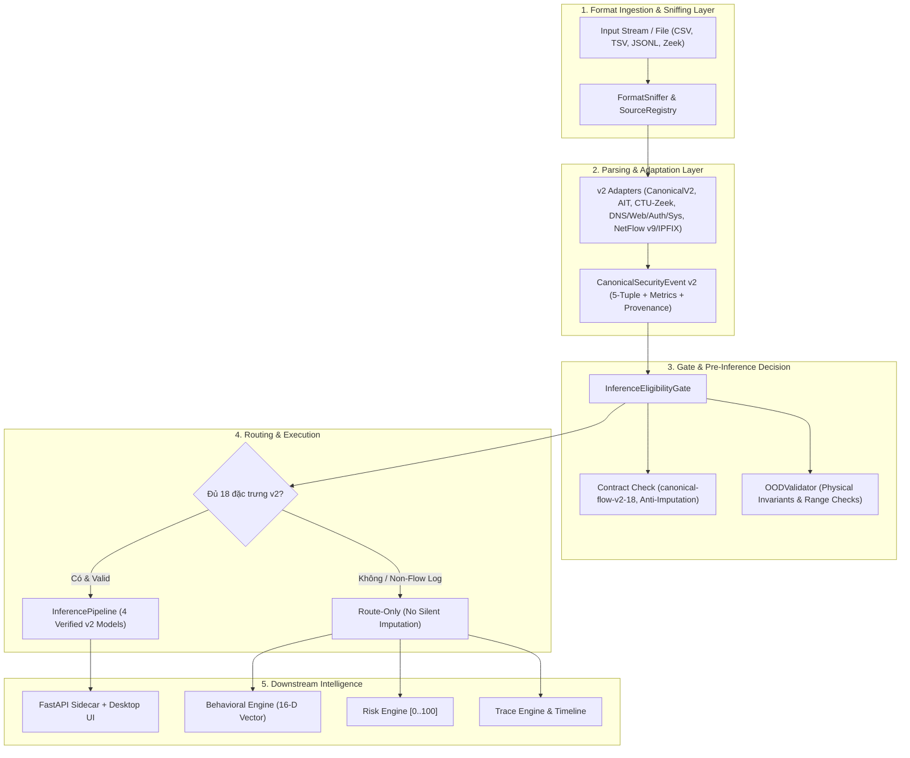

# Multi-Source Ingestion, Adapters & Cross-Source Generalization — NetFlow Sentinel v2

Tài liệu thiết kế kiến trúc tiếp nhận đa nguồn dữ liệu mạng, bộ chuyển đổi tương thích (`canonical-flow-v2-18`), cổng kiểm soát phân phối OOD và đánh giá tổng quát hóa **synthetic-to-real** trên NetFlow Sentinel v2.

> Tài liệu cũ gắn với `NF-UNSW-NB15-v3` (47 features) đã chuyển vào [`docs/historical/nf_unsw_nb15_v3/`](historical/nf_unsw_nb15_v3/).

---

## 1. Tổng quan Kiến trúc (Architecture Overview)



---

## 2. Danh mục Bộ chuyển đổi Nguồn (`src/network_anomaly/ingestion/adapters/`)

| Adapter / Module | Đầu vào Hỗ trợ | Đặc trưng ML v2 | Hướng Xử lý |
|---|---|---:|---|
| `canonical_v2.py` / `v2_adapter.py` | CSV `canonical-flow-v2-18`, `AIT-NDS-v2` (Tstat), `CTU-SME-11` (Zeek `conn.log.labeled`) | **18/18** | Kiểm tra đầy đủ 18 trường và bất biến vật lý; từ chối fail-closed nếu thiếu hoặc sai schema. |
| `zeek.py` / `suricata.py` | Zeek `conn.log`, Suricata `eve.json` | Chỉ chạy ML nếu đủ 6 base flow metrics hai chiều | Trích xuất metadata, alert & 5-tuple cho Behavioral/Risk/Trace; không zero-fill trường thiếu. |
| `netflow_v5.py` / `aws_vpc.py` | NetFlow v5, AWS VPC Flow | Thiếu luồng hai chiều (`FEATURE_INCOMPATIBLE`) | Route-only sang Behavioral/Risk/Trace; từ chối chạy mô hình 18 đặc trưng. |
| Application & System Adapters | DNS, Web/HTTP, Auth/VPN, Audit/Sysmon (`AIT-LDS-v2.1`) | **0/18** (`is_ml_complete=False`) | `route_only=True`; không bao giờ điền 0/median để ép suy luận AI flow. |
| `unsupported.py` | sFlow, định dạng không xác định, hoặc schema v1 47-feature đã nghỉ hưu | **REJECTED** | Từ chối an toàn, không fallback sang v1. |

---

## 3. Đánh giá Tổng quát hóa Synthetic-to-Real (`AIT-NDS-v2` $\to$ `CTU-SME-11`)

Thay vì benchmark v1 cũ trên `NF-CSE-CIC-IDS2018-v3`, NetFlow Sentinel v2 thực hiện đánh giá chéo trực tiếp từ tập tổng hợp `AIT-NDS-v2` sang traffic thu thập trên thiết bị thật **`CTU-SME-11`** (`scripts/run_ctu_cross_source_eval.py`, báo cáo đầy đủ tại [`docs/experiments/CTU_CROSS_SOURCE_EVAL.md`](experiments/CTU_CROSS_SOURCE_EVAL.md)):

| Mô hình (Huấn luyện trên `AIT-Train`) | `AIT-Test` (N=988,805) | `CTU-Echo` Zero-Shot (N=76,073) | `CTU-Win7AD` Zero-Shot (N=175,146) |
|---|---:|---:|---:|
| **Random Forest** | `F1 = 0.9950` (`R = 0.9911`, `FPR = 0.0002`) | `F1 = 0.0474` (`R = 0.0264`, `FPR = 0.0811`) | `F1 = 0.0712` (`R = 0.5412`, `FPR = 0.1608`) |
| **XGBoost** | `F1 = 0.9013` (`R = 0.8211`, `FPR = 0.0002`) | `F1 = 0.1436` (`R = 0.0832`, `FPR = 0.0700`) | `F1 = 0.0738` (`R = 0.5623`, `FPR = 0.1611`) |
| **Isolation Forest** | `F1 = 0.5842` (`R = 0.4678`, `FPR = 0.0290`) | **`F1 = 0.8853`** (`R = 0.9908`, `FPR = 0.2292`) | `F1 = 0.0464` (`R = 0.9760`, `FPR = 0.4722`) |
| **Autoencoder** | `F1 = 0.5877` (`R = 0.4693`, `FPR = 0.0276`) | **`F1 = 0.7325`** (`R = 0.9990`, `FPR = 0.6746`) | `F1 = 0.0326` (`R = 0.9921`, `FPR = 0.6925`) |

- **Kết luận thực nghiệm:** Ngay cả khi đã loại bỏ hoàn toàn shortcut `MIN_TTL`, các mô hình cây supervised (`RF`, `XGB`) vẫn bị sụp đổ zero-shot khi chuyển sang thiết bị thật do dịch chuyển phân phối `duration_ms`, `bytes_in`, `bytes_out` (xem trung vị tại `reports/experiments/ml/ctu_cross_source_eval.json`). Ngược lại, `Isolation Forest` giữ được khả năng phát hiện port scan trên `CTU-Echo`. Nguồn ISP `UGR'16` hiện giữ trạng thái **`BLOCKED`** (`HTTP 403`).

---

## 4. Lệnh Kiểm chứng Tái lập v2

```powershell
# Kiểm tra manifest & checksum đa nguồn
.venv\Scripts\python.exe scripts/fetch_multi_source_dataset.py --verify-only

# Đánh giá chéo CTU-SME-11 (yêu cầu dữ liệu processed v2 cục bộ)
.venv\Scripts\python.exe scripts/run_ctu_cross_source_eval.py

# Kiểm thử unit & integration cho ingestion/adapters/v2 guards
.venv\Scripts\python.exe -m pytest tests/unit/test_v2_adapters.py tests/unit/test_v2_migration_guards.py tests/unit/test_anti_imputation_and_label_integrity.py tests/integration/test_multi_source_pipeline.py -v
```
