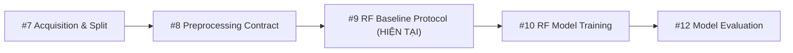

# NF-UNSW-NB15-v3 Random Forest Baseline Protocol

**Issue:** #9 — Xác định protocol baseline Random Forest và tiêu chí so sánh  
**Status:** Protocol & Configuration: `IMPLEMENTED / TESTED`; Model Training: `PLANNED` (Issue #10); Model Evaluation: `PLANNED` (Issue #12); Real Split: `PLANNED / NOT VERIFIED` (Issue #7); Preprocessing Artifact: `PLANNED / NOT VERIFIED` (Issue #8).  
**Protocol Identifier:** `rf-baseline-nf-unsw-nb15-v3-v1`  
**Feature Contract Version:** `nf-unsw-nb15-v3-baseline-47`  
**Split Protocol Reference:** `nf-unsw-nb15-v3-temporal-group-v1`  
**Preprocessing Contract Reference:** `nf-unsw-nb15-v3-preproc-v1`  

---

## 1. Mục tiêu và Phạm vi

Issue #9 thiết lập và khóa protocol chuẩn cho baseline Random Forest có giám sát trên tập dữ liệu
mới nhất **NF-UNSW-NB15-v3**. Protocol này đóng vai trò mốc so sánh chuẩn (grounding benchmark)
cho các nghiên cứu mô hình tiếp theo (Issue #10: training, Issue #11: Isolation Forest, Issue #12:
evaluation, Issue #31: XGBoost).

> [!IMPORTANT]
> Issue #9 là task xây dựng **protocol và configuration**.
> - KHÔNG thực hiện huấn luyện mô hình (`.fit()`).
> - KHÔNG tạo metrics giả, prediction giả hay confusion matrix giả.
> - KHÔNG sử dụng synthetic, mock hay virtual data để mô phỏng kết quả benchmark.
> - Mọi thử nghiệm ML thực tế sẽ chỉ được thực hiện trên dữ liệu thật NF-UNSW-NB15-v3 ở Issue #10 và #12 sau khi các gate về split và preprocessing ở Issue #7 và #8 được mở.

---

## 2. Dataset Contract

- **Tên tập dữ liệu:** `NF-UNSW-NB15-v3`
- **Nguồn chính thức:** The University of Queensland (UQRDM), DOI: `10.48610/6E0EDA1`.
- **Tổng số bản ghi:** 2.365.424 flows.
- **SHA-256 CSV chính thức:** `4ebb97bd74412d566137d95a6fc3ffd8f374f1cf8cfe204d007848e7a668f9b5`.
- **SHA-256 Archive ZIP:** `6d51554df43e324ba8d68fc31a02a83d860ba0a3a93d63320a4a6fc314c9cdfd`.
- **Bài toán:** Phân loại nhị phân phát hiện xâm nhập mạng (Binary Anomaly/Intrusion Detection).
- **Target chính:** `Label`
  - `0`: Benign (Lưu lượng bình thường, 2.237.731 bản ghi ~ 94,60%).
  - `1`: Attack (Lưu lượng tấn công / bất thường, 127.693 bản ghi ~ 5,40%).
- **Lớp dương tính (Positive Class):** `Attack` (Label = 1).
- **Lớp âm tính (Negative Class):** `Benign` (Label = 0).
- **Phân loại phụ / Error Analysis:** Cột `Attack` gồm 10 loại:
  `Benign` (2.237.731), `Exploits` (42.748), `Fuzzers` (33.816), `Generic` (19.651),
  `Reconnaissance` (17.074), `DoS` (5.980), `Backdoor` (4.659), `Shellcode` (2.381),
  `Analysis` (1.226), `Worms` (158).
- `Attack` **tuyệt đối KHÔNG được đưa vào ma trận đặc trưng X** mà chỉ dùng cho phân tích lỗi
  (error analysis) và báo cáo phát hiện theo từng họ tấn công ở Issue #12.

---

## 3. Feature Policy (Quy chuẩn 47 đặc trưng)

Tuân thủ nghiêm ngặt feature contract hiện hành được định nghĩa tại
`src/network_anomaly/data/nf_unsw_nb15_v3.py`:

- **Ma trận đầu vào X:** Đúng **47 đặc trưng NetFlow v3** theo thứ tự chuẩn:
  1. `PROTOCOL`
  2. `L7_PROTO`
  3. `IN_BYTES`
  4. `IN_PKTS`
  5. `OUT_BYTES`
  6. `OUT_PKTS`
  7. `TCP_FLAGS`
  8. `CLIENT_TCP_FLAGS`
  9. `SERVER_TCP_FLAGS`
  10. `FLOW_DURATION_MILLISECONDS`
  11. `DURATION_IN`
  12. `DURATION_OUT`
  13. `MIN_TTL`
  14. `MAX_TTL`
  15. `LONGEST_FLOW_PKT`
  16. `SHORTEST_FLOW_PKT`
  17. `MIN_IP_PKT_LEN`
  18. `MAX_IP_PKT_LEN`
  19. `SRC_TO_DST_SECOND_BYTES`
  20. `DST_TO_SRC_SECOND_BYTES`
  21. `RETRANSMITTED_IN_BYTES`
  22. `RETRANSMITTED_IN_PKTS`
  23. `RETRANSMITTED_OUT_BYTES`
  24. `RETRANSMITTED_OUT_PKTS`
  25. `SRC_TO_DST_AVG_THROUGHPUT`
  26. `DST_TO_SRC_AVG_THROUGHPUT`
  27. `NUM_PKTS_UP_TO_128_BYTES`
  28. `NUM_PKTS_128_TO_256_BYTES`
  29. `NUM_PKTS_256_TO_512_BYTES`
  30. `NUM_PKTS_512_TO_1024_BYTES`
  31. `NUM_PKTS_1024_TO_1514_BYTES`
  32. `TCP_WIN_MAX_IN`
  33. `TCP_WIN_MAX_OUT`
  34. `ICMP_TYPE`
  35. `ICMP_IPV4_TYPE`
  36. `DNS_QUERY_ID`
  37. `DNS_QUERY_TYPE`
  38. `DNS_TTL_ANSWER`
  39. `FTP_COMMAND_RET_CODE`
  40. `SRC_TO_DST_IAT_MIN`
  41. `SRC_TO_DST_IAT_MAX`
  42. `SRC_TO_DST_IAT_AVG`
  43. `SRC_TO_DST_IAT_STDDEV`
  44. `DST_TO_SRC_IAT_MIN`
  45. `DST_TO_SRC_IAT_MAX`
  46. `DST_TO_SRC_IAT_AVG`
  47. `DST_TO_SRC_IAT_STDDEV`

- **Trace Metadata bị loại trừ khỏi X (6 cột):**
  `FLOW_START_MILLISECONDS`, `FLOW_END_MILLISECONDS`, `IPV4_SRC_ADDR`, `IPV4_DST_ADDR`,
  `L4_SRC_PORT`, `L4_DST_PORT`.
  Các cột này được lưu giữ riêng cho Trace Engine, flow grouping và timeline reconstruction,
  không bao giờ tham gia fit hay inference mô hình ML.
- **Targets bị loại trừ khỏi X (2 cột):** `Label`, `Attack`.
- **Ghi nhận khác biệt (Discrepancy Note):** Một số tài liệu khảo sát trước đây từng đề cập cấu
  hình 49 đặc trưng (bổ sung 2 cổng L4). Tuy nhiên, theo quyết định kiến trúc tại
  `docs/NF_UNSW_NB15_V3_SPLIT_PROTOCOL.md`, baseline chính thức của project là **47 đặc trưng**.
  Cấu hình 49 đặc trưng chỉ được lưu như phương án thử nghiệm kiểm soát tương lai.

---

## 4. Split Policy & Phụ thuộc Issue #7

- Protocol tham chiếu giao thức chia tập có kiểm soát `nf-unsw-nb15-v3-temporal-group-v1`:
  - Phân chia: `train` (~70%), `validation` (~15%), `test` (~15%).
  - Nhóm luồng: 5-tuple hai chiều kết hợp time-bucket 5 phút để hạn chế flow leakage.
  - Khóa trùng lặp: cấm trùng lặp exact-row, source-feature và ml-feature giữa các tập.
- **Hiện trạng:** Dữ liệu thật hiện có trạng thái chất lượng `RAW_QUALITY: FINDINGS_RECORDED`
  (chứa giá trị vô hạn và khuyết thiếu ở trường throughput), do đó `ML_READY: BLOCKED`.
  Real split thật sự đang ở trạng thái `PLANNED / NOT VERIFIED`.
- Protocol Issue #9 tham chiếu split mà **không giả lập dữ liệu mock** hay tự ý gọi
  `train_test_split()` ngẫu nhiên.

---

## 5. Preprocessing Policy & Phụ thuộc Issue #8

- Protocol tham chiếu contract tiền xử lý `nf-unsw-nb15-v3-preproc-v1`:
  - **Ranh giới fit:** `train_only`.
  - Imputer (median), scaler, encoder hoặc indicator parameters chỉ được tính toán trên tập `train`.
  - Frozen transform được áp dụng bất biến cho `validation` và `test`.
- **Hiện trạng:** Fitted artifact chưa được sinh vì Issue #8 chưa thực thi trên real split.
  Protocol ghi nhận phụ thuộc mà không tự tạo preprocessing artifact giả.

---

## 6. Cấu hình Baseline Random Forest

Mô hình: `RandomForestClassifier` (Scikit-Learn).  
Cấu hình baseline được khóa cố định nhằm đảm bảo tính tái lập tuyệt đối (reproducibility):

| Tham số | Giá trị khóa | Ý nghĩa / Ghi chú |
| :--- | :--- | :--- |
| `n_estimators` | `200` | Số lượng cây quyết định trong ensemble |
| `max_depth` | `16` | Giới hạn độ sâu để kiểm soát overfitting |
| `min_samples_split` | `2` | Số mẫu tối thiểu để phân nhánh |
| `min_samples_leaf` | `1` | Số mẫu tối thiểu ở nút lá |
| `criterion` | `"gini"` | Tiêu chí tính toán impurity |
| `max_features` | `"sqrt"` | Số đặc trưng ngẫu nhiên mỗi split |
| `class_weight` | `None` | Giữ nguyên tỷ lệ gốc cho baseline (tùy chọn `"balanced"` trong tuning) |
| `random_state` | `42` | Seed cố định đồng bộ toàn repository (`RANDOM_SEED`) |
| `n_jobs` | `-1` | Tối đa hóa khả năng xử lý song song trên phần cứng |
| `bootstrap` | `True` | Lấy mẫu có hoàn lại khi xây dựng cây |

---

## 7. Tuning Policy

Khi thực hiện hyperparameter tuning (tùy chọn trong Issue #10):
- **Phân vùng cho phép:** Chỉ sử dụng tập `train` và `validation` (hoặc K-fold Cross-Validation
  bên trong `train`).
- **TEST LOCK:** Tập `test` **tuyệt đối bị cấm** tham gia vào quá trình tuning, chọn mô hình,
  chọn ngưỡng (threshold) hay chọn đặc trưng.
- **Search Space (`rf-tuning-search-v1`):**
  - `n_estimators`: `[100, 200, 300]`
  - `max_depth`: `[12, 16, 24, None]`
  - `min_samples_split`: `[2, 5, 10]`
  - `min_samples_leaf`: `[1, 2, 4]`
  - `max_features`: `["sqrt", "log2"]`
- **Tuning Budget:** `max_evals`: 20, `cv_folds`: 3, `time_budget_seconds`: 3600.
- **Scoring Metric:** `macro_f1` (hoặc `f1`).
- **Random Seed:** Cố định `42`.

---

## 8. Test Lock Policy

Tập dữ liệu kiểm thử độc lập (`test`) được bảo vệ nghiêm ngặt:

```text
TRAIN:
  - Huấn luyện mô hình (.fit)
  - Fit các phép biến đổi preprocessing
  - Cross-validation nội bộ

VALIDATION:
  - Tinh chỉnh siêu tham số (hyperparameter tuning)
  - Lựa chọn mô hình tối ưu
  - Căn chỉnh ngưỡng phân loại (threshold calibration)

TEST:
  - Đánh giá cuối cùng DUY NHẤT MỘT LẦN (one-shot final evaluation)
```

**Các hành vi bị nghiêm cấm trên tập TEST:**
1. Cấm lựa chọn đặc trưng (`feature_selection`).
2. Cấm tinh chỉnh siêu tham số (`hyperparameter_tuning`).
3. Cấm căn chỉnh ngưỡng phát hiện (`threshold_selection`).
4. Cấm fit tham số tiền xử lý (`preprocessing_fitting`).
5. Cấm lựa chọn thuật toán/mô hình (`model_selection`).
6. Cấm lặp cải tiến mô hình dựa trên điểm test (`model_iteration`).

---

## 9. Tiêu chuẩn Đánh giá & Metrics (Metric Protocol)

Mô hình baseline sau khi huấn luyện (Issue #10) sẽ được đánh giá (Issue #12) với các chỉ số:

1. **Precision:** $\frac{TP}{TP + FP}$ (độ chính xác phát hiện tấn công, `average="binary"`).
2. **Recall:** $\frac{TP}{TP + FN}$ (tỷ lệ bắt trúng lưu lượng tấn công).
3. **F1-Score:** $\frac{2 \cdot Precision \cdot Recall}{Precision + Recall}$ (cân bằng giữa Precision và Recall).
4. **Macro-F1:** Trung bình F1 giữa lớp Benign và Attack (đánh giá công bằng khi mất cân bằng lớp).
5. **False Positive Rate (FPR):** $\frac{FP}{FP + TN}$ (tỷ lệ cảnh báo sai trên tổng lưu lượng bình thường).
6. **Confusion Matrix:** Định dạng chuẩn ma trận 2x2 với thứ tự nhãn rõ ràng:
   `[0, 1]` tương ứng `[Benign, Attack]`.
7. **Error Analysis theo Attack Category:** Phân rã số ca False Negatives (tấn công bị bỏ lọt)
   trên 9 loại tấn công cụ thể (`Exploits`, `Fuzzers`, `Generic`, `Reconnaissance`, `DoS`,
   `Backdoor`, `Shellcode`, `Analysis`, `Worms`).

---

## 10. Giao diện Lập trình (API) & Lưu trữ (Serialization)

Protocol được triển khai bằng các lớp Python strongly-typed, kiểm tra invariant nghiêm ngặt tại
`src/network_anomaly/models/random_forest_protocol.py` và có thể truy cập qua
`src/network_anomaly/models/`:

- `create_rf_baseline_protocol(split_id, random_seed, ...)`: Hàm khởi tạo protocol chuẩn.
- `protocol.validate()`: Kiểm tra toàn bộ các điều kiện an toàn, rò rỉ và kiểu dữ liệu.
- `protocol.to_dict()` / `protocol.to_json()`: Chuyển đổi protocol sang từ điển và định dạng JSON.
- `RandomForestBaselineProtocol.from_dict()` / `from_json()`: Phục hồi protocol từ dữ liệu đã lưu.
- `protocol.save(path)` / `RandomForestBaselineProtocol.load(path)`: Lưu/đọc protocol từ file.
- `build_model(config)`: Tích hợp trực tiếp với model constructor của repository.

---

## 11. Chuỗi Truy vết (Traceability & Dependency)



- **Issue #7:** `SOURCE_INTEGRITY: PASS`, `RAW_QUALITY: FINDINGS_RECORDED`, real split `NOT VERIFIED`.
- **Issue #8:** Preprocessing handling contract `TESTED`, fitted artifact `NOT VERIFIED`.
- **Issue #9:** Protocol & configuration `IMPLEMENTED / TESTED`, 20 tests `PASS`.
- **Issue #10:** Training Random Forest `PLANNED`.
- **Issue #12:** Đánh giá và báo cáo benchmark `PLANNED`.

---

Cập nhật: 2026-10-22 (Issue #9 implementation)
