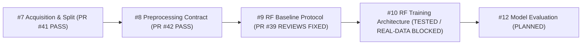

# NF-UNSW-NB15-v3 Random Forest Baseline Protocol

**Issue:** #9 — Xác định protocol baseline Random Forest và tiêu chí so sánh<br>
**Status:** Protocol & Configuration: `IMPLEMENTED / TESTED`; Model Architecture & Entrypoint: `IMPLEMENTED / TESTED` (Issue #10); Real-Data Training: `BLOCKED` (raw CSV & preprocessor `.joblib` absent locally); Model Evaluation: `PLANNED` (Issue #12); Real Split: `PASS (PR #41)`; Preprocessing Artifact: `PASS (PR #42)`.<br>
**Protocol Identifier:** `rf-baseline-nf-unsw-nb15-v3-v1`<br>
**Feature Contract Version:** `nf-unsw-nb15-v3-baseline-47`<br>
**Split Protocol Reference:** `nf-unsw-nb15-v3-chronological-group-purged-v1` (PR #41)<br>
**Preprocessing Contract Reference:** `nf-unsw-nb15-v3-preproc-v1` (PR #42)

---

## 1. Mục tiêu và Phạm vi

Issue #9 thiết lập và khóa protocol chuẩn cho baseline Random Forest có giám sát trên tập dữ liệu
mới nhất **NF-UNSW-NB15-v3**. Protocol này đóng vai trò mốc so sánh chuẩn (grounding benchmark)
cho các nghiên cứu mô hình tiếp theo (Issue #10: training, Issue #11: Isolation Forest, Issue #12:
evaluation, Issue #31: XGBoost).

> [!IMPORTANT]
> Issue #9 là task xây dựng **protocol và configuration**.
> - KHÔNG thực hiện huấn luyện mô hình (`.fit()`).
> - KHÔNG tạo metrics giả, prediction giả hay confusion matrix giả.
> - KHÔNG sử dụng synthetic, mock hay virtual data để mô phỏng kết quả benchmark.
> - Mọi thử nghiệm ML thực tế sẽ chỉ được thực hiện trên dữ liệu thật NF-UNSW-NB15-v3 ở Issue #10 và #12 sau khi các gate về split và preprocessing ở Issue #7 và #8 được mở.

---

## 2. Dataset Contract

- **Tên tập dữ liệu:** `NF-UNSW-NB15-v3`
- **Nguồn chính thức:** The University of Queensland (UQRDM), DOI: `10.48610/6E0EDA1`.
- **Tổng số bản ghi:** 2.365.424 flows.
- **SHA-256 CSV chính thức:** `4ebb97bd74412d566137d95a6fc3ffd8f374f1cf8cfe204d007848e7a668f9b5`.
- **SHA-256 Archive ZIP:** `6d51554df43e324ba8d68fc31a02a83d860ba0a3a93d63320a4a6fc314c9cdfd`.
- **Bài toán:** Phân loại nhị phân phát hiện xâm nhập mạng (Binary Anomaly/Intrusion Detection).
- **Target chính:** `Label`
  - `0`: Benign (Lưu lượng bình thường, 2.237.731 bản ghi ~ 94,60%).
  - `1`: Attack (Lưu lượng tấn công / bất thường, 127.693 bản ghi ~ 5,40%).
- **Lớp dương tính (Positive Class):** `Attack` (Label = 1).
- **Lớp âm tính (Negative Class):** `Benign` (Label = 0).
- **Phân loại phụ / Error Analysis:** Cột `Attack` gồm 10 loại:
  `Benign` (2.237.731), `Exploits` (42.748), `Fuzzers` (33.816), `Generic` (19.651),
  `Reconnaissance` (17.074), `DoS` (5.980), `Backdoor` (4.659), `Shellcode` (2.381),
  `Analysis` (1.226), `Worms` (158).
- `Attack` **tuyệt đối KHÔNG được đưa vào ma trận đặc trưng X** mà chỉ dùng cho phân tích lỗi
  (error analysis) và báo cáo phát hiện theo từng họ tấn công ở Issue #12.

---

## 3. Feature Policy (Quy chuẩn 47 đặc trưng)

Tuân thủ nghiêm ngặt feature contract hiện hành được định nghĩa tại
`src/network_anomaly/data/nf_unsw_nb15_v3.py`:

- **Ma trận đầu vào X:** Đúng **47 đặc trưng NetFlow v3** theo thứ tự chuẩn:
  1. `PROTOCOL`
  2. `L7_PROTO`
  3. `IN_BYTES`
  4. `IN_PKTS`
  5. `OUT_BYTES`
  6. `OUT_PKTS`
  7. `TCP_FLAGS`
  8. `CLIENT_TCP_FLAGS`
  9. `SERVER_TCP_FLAGS`
  10. `FLOW_DURATION_MILLISECONDS`
  11. `DURATION_IN`
  12. `DURATION_OUT`
  13. `MIN_TTL`
  14. `MAX_TTL`
  15. `LONGEST_FLOW_PKT`
  16. `SHORTEST_FLOW_PKT`
  17. `MIN_IP_PKT_LEN`
  18. `MAX_IP_PKT_LEN`
  19. `SRC_TO_DST_SECOND_BYTES`
  20. `DST_TO_SRC_SECOND_BYTES`
  21. `RETRANSMITTED_IN_BYTES`
  22. `RETRANSMITTED_IN_PKTS`
  23. `RETRANSMITTED_OUT_BYTES`
  24. `RETRANSMITTED_OUT_PKTS`
  25. `SRC_TO_DST_AVG_THROUGHPUT`
  26. `DST_TO_SRC_AVG_THROUGHPUT`
  27. `NUM_PKTS_UP_TO_128_BYTES`
  28. `NUM_PKTS_128_TO_256_BYTES`
  29. `NUM_PKTS_256_TO_512_BYTES`
  30. `NUM_PKTS_512_TO_1024_BYTES`
  31. `NUM_PKTS_1024_TO_1514_BYTES`
  32. `TCP_WIN_MAX_IN`
  33. `TCP_WIN_MAX_OUT`
  34. `ICMP_TYPE`
  35. `ICMP_IPV4_TYPE`
  36. `DNS_QUERY_ID`
  37. `DNS_QUERY_TYPE`
  38. `DNS_TTL_ANSWER`
  39. `FTP_COMMAND_RET_CODE`
  40. `SRC_TO_DST_IAT_MIN`
  41. `SRC_TO_DST_IAT_MAX`
  42. `SRC_TO_DST_IAT_AVG`
  43. `SRC_TO_DST_IAT_STDDEV`
  44. `DST_TO_SRC_IAT_MIN`
  45. `DST_TO_SRC_IAT_MAX`
  46. `DST_TO_SRC_IAT_AVG`
  47. `DST_TO_SRC_IAT_STDDEV`

- **Trace Metadata bị loại trừ khỏi X (6 cột):**
  `FLOW_START_MILLISECONDS`, `FLOW_END_MILLISECONDS`, `IPV4_SRC_ADDR`, `IPV4_DST_ADDR`,
  `L4_SRC_PORT`, `L4_DST_PORT`.
  Các cột này được lưu giữ riêng cho Trace Engine, flow grouping và timeline reconstruction,
  không bao giờ tham gia fit hay inference mô hình ML.
- **Targets bị loại trừ khỏi X (2 cột):** `Label`, `Attack`.
- **Ghi nhận khác biệt (Discrepancy Note):** Một số tài liệu khảo sát trước đây từng đề cập cấu
  hình 49 đặc trưng (bổ sung 2 cổng L4). Tuy nhiên, theo quyết định kiến trúc tại
  `docs/NF_UNSW_NB15_V3_SPLIT_PROTOCOL.md`, baseline chính thức của project là **47 đặc trưng**.
  Cấu hình 49 đặc trưng chỉ được lưu như phương án thử nghiệm kiểm soát tương lai.

---

## 4. Split Policy & Phụ thuộc Issue #7

- Protocol tham chiếu giao thức chia tập có kiểm soát `nf-unsw-nb15-v3-chronological-group-purged-v1` (PR #41):
  - Phân chia: `train` (1.655.797 dòng ~ 70,00%), `validation` (345.371 dòng ~ 14,60%), `test` (345.953 dòng ~ 14,63%), purged gaps (18.303 dòng: `purged_train_val_gap` 9.443 dòng và `purged_val_test_gap` 8.860 dòng).
  - Nhóm luồng và cách ly biên thời gian: Sử dụng proxy heuristic 5-tuple hai chiều kết hợp time-bucket 5 phút và khoảng ngắt `purge_gap = 300.000 ms` (5 phút) giữa các phân vùng.
  - **Các chỉ số kiểm toán bằng 0 (`status: PASS`):**
    - `exact_full_row_overlap`: `0` (không trùng lặp dòng dữ liệu đầy đủ giữa các phân vùng).
    - `source_feature_overlap`: `0` (không trùng lặp fingerprint nguồn khi tính cả metadata định danh/thời gian).
    - `canonical_flow_group_overlap`: `0` (không có canonical flow-group nào vắt ngang hai phân vùng).
    - `temporal_boundary_violations`: `0` (`flow_end_crossings`: `0` luồng từ `train` tràn sang `validation` với biên `236.165 ms`; `0` luồng từ `validation` tràn sang `test` với biên `252.058 ms`).
  - **Hiện trạng `ml_feature_overlap` (`status: REVIEWED_AND_JUSTIFIED`, `binary_label_conflicts: 0`):**
    - Sau khi loại bỏ 6 cột `TRACE_METADATA_COLUMNS` (IP, port, timestamps), sự trùng lặp mẫu vector 47 đặc trưng ML giữa các phân vùng có tồn tại và đã được kiểm toán định lượng trong split manifest:
      - `train_vs_validation`: `61.007` distinct ML-feature fingerprints (`551.167` dòng `train` ~ `33,29%`; `172.621` dòng `validation` ~ `49,98%`; `binary_label_conflicts: 0`; `attack_category_variations: 580`).
      - `train_vs_test`: `59.966` distinct ML-feature fingerprints (`548.253` dòng `train` ~ `33,11%`; `184.067` dòng `test` ~ `53,21%`; `binary_label_conflicts: 0`; `attack_category_variations: 889`).
      - `validation_vs_test`: `24.143` distinct ML-feature fingerprints (`105.218` dòng `validation` ~ `30,47%`; `114.622` dòng `test` ~ `33,13%`; `binary_label_conflicts: 0`; `attack_category_variations: 586`).
    - **Ý nghĩa và giới hạn phương pháp luận:**
      1. Các mẫu `ml_feature_overlap` đại diện cho các cấu hình lưu lượng giao thức phổ biến lặp lại theo thời gian (ví dụ: mẫu TCP handshake hoặc DNS query chuẩn) giữa các cặp endpoint khác nhau ở các thời điểm khác nhau; không được đồng nhất các fingerprint giống nhau này với cùng một phiên kết nối vật lý (session) thật, nhưng cũng **không được tuyên bố mọi dạng rò rỉ đều đã bị loại bỏ hoàn toàn**.
      2. Định nghĩa canonical flow-group (5-tuple + bucket 5 phút) chỉ là heuristic proxy do dữ liệu NetFlow v3 không có PCAP session ID gốc; `canonical_flow_group_overlap = 0` đảm bảo cô lập theo định nghĩa này nhưng không chứng minh triệt tiêu hoàn toàn các phiên ứng dụng đa kết nối hoặc kéo dài qua nhiều bucket.
      3. Việc `53,21%` dòng `test` và `49,98%` dòng `validation` chia sẻ vector 47 đặc trưng với `train` (dù `binary_label_conflicts = 0`) đồng nghĩa các mẫu đánh giá không hoàn toàn độc lập trong không gian đặc trưng ML; không được tự ý xóa dữ liệu hay sửa split policy chỉ để đạt số 0, mà phải ghi nhận rõ giới hạn này khi phân tích kết quả ở Issue #12 và không suy diễn khả năng tổng quát hóa sang lưu lượng mạng hiện đại hay phát hiện zero-day.
- **Hiện trạng:** Real split đã hoàn thành và được kiểm chứng qua PR #41 (`reports/splits/nf_unsw_nb15_v3_split_manifest.json`, SHA-256: `bb84c1e0595fe3c6e76c75ac7f233426f939b518a1b966b922b7fb35b634dd88`).
- Protocol Issue #9 tái sử dụng split chính thức mà **không giả lập dữ liệu mock** hay tự ý gọi
  `train_test_split()` ngẫu nhiên.

---

## 5. Preprocessing Policy & Phụ thuộc Issue #8

- Protocol tham chiếu contract tiền xử lý `nf-unsw-nb15-v3-preproc-v1` (PR #42):
  - **Ranh giới fit:** `train_only` (fit duy nhất trên 1.655.797 dòng của tập train).
  - Imputer (median), scaler, encoder hoặc indicator parameters chỉ được tính toán trên tập `train`.
  - Frozen transform được áp dụng bất biến cho `validation` và `test`.
- **Hiện trạng:** Fitted artifact đã được hoàn thành và kiểm chứng qua PR #42 (`artifacts/preprocessing/nf_unsw_nb15_v3_preprocessor.joblib`, SHA-256: `12d4360a05ef92573763ae1d9c1a5c36ea59081cf2f16112017bec56bbca1b19`, manifest SHA-256: `af07dc3b6c7cbc9e75426eeb5b96d52dbd191e8a09161699df2fad1bb5555441`).
- Khi chạy training tại runtime cục bộ, nếu tệp CSV thô hoặc artifact chưa hiện diện, entrypoint sẽ dừng fail-closed với mã lỗi 1 mà không tạo preprocessing artifact giả.

---

## 6. Cấu hình Baseline Random Forest

Mô hình: `RandomForestClassifier` (Scikit-Learn).  
Cấu hình baseline được khóa cố định nhằm đảm bảo tính tái lập tuyệt đối (reproducibility):

| Tham số | Giá trị khóa | Ý nghĩa / Ghi chú |
| :--- | :--- | :--- |
| `n_estimators` | `200` | Số lượng cây quyết định trong ensemble |
| `max_depth` | `16` | Giới hạn độ sâu để kiểm soát overfitting |
| `min_samples_split` | `2` | Số mẫu tối thiểu để phân nhánh |
| `min_samples_leaf` | `1` | Số mẫu tối thiểu ở nút lá |
| `criterion` | `"gini"` | Tiêu chí tính toán impurity |
| `max_features` | `"sqrt"` | Số đặc trưng ngẫu nhiên mỗi split |
| `class_weight` | `None` | Giữ nguyên tỷ lệ gốc cho baseline (tùy chọn `"balanced"` trong tuning) |
| `random_state` | `42` | Seed cố định đồng bộ toàn repository (`RANDOM_SEED`) |
| `n_jobs` | `-1` | Khóa trong `CANONICAL_BASELINE_PARAMS`: tối đa hóa khả năng xử lý song song |
| `bootstrap` | `True` | Lấy mẫu có hoàn lại khi xây dựng cây |
| `configuration_id` | `"rf-baseline-canonical-v1"` | Định danh cấu hình canonical baseline được khóa |
| `is_canonical_baseline` | `True` | Cờ bảo vệ: từ chối các thay đổi siêu tham số tự ý nhận danh baseline |

> [!NOTE]
> **Baseline Configuration Locking (P1-01, P1-03):** Cấu hình `RandomForestBaselineConfig` khóa cứng toàn bộ các giá trị trong `CANONICAL_BASELINE_PARAMS` (bao gồm cả `n_jobs=-1`). Nếu một thử nghiệm điều chỉnh bất kỳ tham số nào (kể cả `n_jobs=1`, `n_jobs=2` hoặc `n_jobs=None`), nó bắt buộc phải đặt `is_canonical_baseline=False` và gán một `configuration_id` riêng biệt của thử nghiệm (ví dụ `rf-tuning-exp-100`). Mọi cấu hình có tham số khác biệt mà cố tình nhận `is_canonical_baseline=True` hoặc dùng ID canonical `"rf-baseline-canonical-v1"` sẽ bị từ chối fail-closed qua `validate()`. Các giá trị `n_jobs` không hợp lệ (`0`, `< -1`, `bool`, kiểu không phải `int`/`None`) đều bị từ chối ngay khi khởi tạo/validate.

---

## 7. Tuning Policy

Khi thực hiện hyperparameter tuning (tùy chọn trong Issue #10):
- **Phân vùng cho phép:** Chỉ sử dụng tập `train` và `validation` (hoặc K-fold Cross-Validation
  bên trong `train`).
- **TEST LOCK:** Tập `test` **tuyệt đối bị cấm** tham gia vào quá trình tuning, chọn mô hình,
  chọn ngưỡng (threshold) hay chọn đặc trưng.
- **Search Space (`rf-tuning-search-v1`):**
  - `n_estimators`: `[100, 200, 300]`
  - `max_depth`: `[12, 16, 24, None]`
  - `min_samples_split`: `[2, 5, 10]`
  - `min_samples_leaf`: `[1, 2, 4]`
  - `max_features`: `["sqrt", "log2"]`
- **Tuning Budget:** `max_evals`: 20, `cv_folds`: 3, `time_budget_seconds`: 3600.
- **Scoring Metric:** `macro_f1` (hoặc `f1`).
- **Random Seed:** Cố định `42`.

---

## 8. Test Lock Policy, Memory Architecture & Verification (P0-04, P1-03, P1-04)

### 8.1. Test Isolation Contracts (Contract A & Contract B)

Tập dữ liệu kiểm thử độc lập (`test`) được bảo vệ nghiêm ngặt bằng hai hợp đồng an ninh rành mạch:

- **Contract A (Huấn luyện và Đánh giá):**
  - Tuyệt đối không dùng dữ liệu Test cho: huấn luyện (`.fit()`), fit biến đổi tiền xử lý, căn chỉnh siêu tham số (`tuning`), lựa chọn ngưỡng (`threshold calibration`), chọn lọc đặc trưng (`feature selection`), hoặc đánh giá trung gian.
  - Test chỉ dùng duy nhất 1 lần cho đánh giá cuối cùng độc lập (one-shot final evaluation) ở Issue #12.

- **Contract B (Cách ly Tải Dữ liệu tại Runtime):**
  - Zero dòng của tập Test được hiện thực hóa (materialized) thành các bản ghi DataFrame trong quá trình huấn luyện.
  - Dữ liệu CSV thô được phân tách ở ranh giới dòng văn bản thô (raw line stream boundary). Các dòng Test bị loại bỏ trực tiếp trước khi khởi tạo DataFrame. Tracker `test_rows_loaded` ghi nhận đúng `0`.

```text
TRAIN:
  - Huấn luyện mô hình (.fit)
  - Fit các phép biến đổi preprocessing
  - Cross-validation nội bộ

VALIDATION:
  - Tinh chỉnh siêu tham số (hyperparameter tuning)
  - Lựa chọn mô hình tối ưu
  - Căn chỉnh ngưỡng phân loại (threshold calibration)

TEST:
  - Đánh giá cuối cùng DUY NHẤT MỘT LẦN (one-shot final evaluation)
```

**Các hành vi bị nghiêm cấm trên tập TEST:**
1. Cấm lựa chọn đặc trưng (`feature_selection`).
2. Cấm tinh chỉnh siêu tham số (`hyperparameter_tuning`).
3. Cấm căn chỉnh ngưỡng phát hiện (`threshold_selection`).
4. Cấm fit tham số tiền xử lý (`preprocessing_fitting`).
5. Cấm lựa chọn thuật toán/mô hình (`model_selection`).
6. Cấm lặp cải tiến mô hình dựa trên điểm test (`model_iteration`).

### 8.2. Kiến trúc Bộ nhớ & Streaming Contract (P1-03 — Option B)

- **Cơ chế đọc theo batch (Chunking):** Tham số `chunksize` (mặc định 100.000 dòng) kiểm soát kích thước bộ đệm dòng văn bản thô khi đọc CSV. Cơ chế này tránh việc nạp toàn bộ tệp CSV thô hàng gigabyte vào bộ nhớ dưới dạng chuỗi văn bản.
- **Ranh giới hiện thực hóa DataFrame (Materialization):** Thuật toán `RandomForestClassifier` của scikit-learn yêu cầu toàn bộ mảng dữ liệu trong bộ nhớ (in-memory arrays) để xây dựng các cây quyết định độc lập. Do đó:
  - Các khối dòng của tập Train (1.655.797 dòng) và Validation (345.371 dòng) được giải mã thành DataFrame theo batch và tích lũy để nối (`pd.concat`) thành ma trận đầy đủ trong RAM.
  - Bộ nhớ đỉnh (Peak Memory) đạt cực đại tại thời điểm nối DataFrame và fit rừng cây (~4–8 GB RAM khuyến nghị cho tập dữ liệu đầy đủ). `chunksize` giới hạn bộ đệm phân tích cú pháp CSV nhưng không giới hạn tổng RAM toàn cục tại bước fit.
  - Zero dòng Test nào bị nạp vào bộ nhớ trong suốt chu trình này (Contract B).

### 8.3. Kiểm tra Nhất quán Reload & Ngưỡng Sai số (P1-04)

Sau khi mô hình được lưu ra artifact `.joblib`, entrypoint huấn luyện thực hiện nạp lại và kiểm định:
- **Kiểm tra shape & tính hữu hạn:** Ma trận xác suất dự đoán phải có cùng shape và toàn bộ giá trị phải hữu hạn (`np.all(np.isfinite(...))`, không có `NaN` hay `Inf`).
- **Dự đoán nhãn nhị phân:** Dự đoán nhãn trước và sau khi lưu/nạp phải trùng khớp tuyệt đối 100% (`np.array_equal(orig_preds, reloaded_preds)`).
- **Phân phối xác suất:** Độ sai lệch xác suất giữa mô hình gốc và mô hình nạp lại phải nằm trong ngưỡng tuyệt đối:
  $$\text{allclose}(\text{orig\_probs}, \text{reloaded\_probs}, \text{atol}=10^{-7}, \text{rtol}=0)$$
  Việc khóa `rtol=0` bắt buộc mọi phần tử phải có sai số tuyệt đối không vượt quá $10^{-7}$, loại bỏ hoàn toàn khả năng sai số lớn hơn bị bỏ qua do dung sai tương đối mặc định của NumPy.
- **Bất biến cấu trúc:** Tên đặc trưng (`feature_names`), thứ tự đặc trưng và thứ tự lớp (`classes_`) được kiểm tra đồng nhất tuyệt đối.

### 8.4. Fail-Closed Artifact Verification (P0-01, P0-02, P1-01, P1-02)

- **P0-01 (Prerequisite Verification Status):** `check_prerequisites()` bắt buộc kiểm tra `prep_audit["status"] == "PASS"`. Nếu verifier trả về `FAIL`, thiếu trường `status`, hoặc trạng thái không hợp lệ, toàn bộ quá trình audit báo `BLOCKED` và lệnh CLI `--verify-only` thoát với mã lỗi 1.
- **P0-02 (Elimination of Fail-Open in load_verified):** Khi caller truyền `expected_preprocessor_artifact_sha256`, manifest bắt buộc phải chứa trường `preprocessor_artifact_sha256` hợp lệ. Thiếu trường, sai định dạng hex 64 ký tự, hoặc sai lệch hash đều bị từ chối fail-closed. Đồng thời, đối chiếu chéo bắt buộc giữa top-level manifest và `preprocessing_provenance` (nếu khác nhau sẽ reject ngay lập tức).
- **P1-01 (Canonical Preprocessor Manifest Field):** Companion manifest của tiền xử lý được chuẩn hóa theo schema chính thức `TrainOnlyPreprocessor.save()` với tên trường canonical là `artifact_sha256`.
- **P1-02 (Fail-Closed Protocol Deserialization):** Phương thức `RandomForestModel.load()` yêu cầu giải mã protocol thành công nếu payload có chứa trường protocol; mọi lỗi cú pháp hoặc schema protocol đều kích hoạt ngoại lệ `ValueError`. Phương thức `RandomForestModel.load_verified()` kiên quyết từ chối các model thiếu protocol provenance.

---

## 9. Tiêu chuẩn Đánh giá & Metrics (Metric Protocol)

Mô hình baseline sau khi huấn luyện (Issue #10) sẽ được đánh giá (Issue #12) với các chỉ số:

1. **Precision:** $\frac{TP}{TP + FP}$ (độ chính xác phát hiện tấn công, `average="binary"`).
2. **Recall:** $\frac{TP}{TP + FN}$ (tỷ lệ bắt trúng lưu lượng tấn công).
3. **F1-Score:** $\frac{2 \cdot Precision \cdot Recall}{Precision + Recall}$ (cân bằng giữa Precision và Recall).
4. **Macro-F1:** Trung bình F1 giữa lớp Benign và Attack (đánh giá công bằng khi mất cân bằng lớp).
5. **False Positive Rate (FPR):** $\frac{FP}{FP + TN}$ (tỷ lệ cảnh báo sai trên tổng lưu lượng bình thường).
6. **Confusion Matrix:** Định dạng chuẩn ma trận 2x2 với thứ tự nhãn rõ ràng:
   `[0, 1]` tương ứng `[Benign, Attack]`.
7. **Error Analysis theo Attack Category:** Phân rã số ca False Negatives (tấn công bị bỏ lọt)
   trên 9 loại tấn công cụ thể (`Exploits`, `Fuzzers`, `Generic`, `Reconnaissance`, `DoS`,
   `Backdoor`, `Shellcode`, `Analysis`, `Worms`).

---

## 10. Giao diện Lập trình (API) & Lưu trữ (Serialization)

Protocol được triển khai bằng các lớp Python strongly-typed, kiểm tra invariant nghiêm ngặt tại
`src/network_anomaly/models/random_forest_protocol.py` và có thể truy cập qua
`src/network_anomaly/models/`:

- `create_rf_baseline_protocol(split_id, random_seed, ...)`: Hàm khởi tạo protocol chuẩn.
- `protocol.validate()`: Kiểm tra toàn bộ các điều kiện an toàn, rò rỉ và kiểu dữ liệu.
- `protocol.to_dict()` / `protocol.to_json()`: Chuyển đổi protocol sang từ điển và định dạng JSON.
- `RandomForestBaselineProtocol.from_dict()` / `from_json()`: Phục hồi protocol từ dữ liệu đã lưu.
- `protocol.save(path)` / `RandomForestBaselineProtocol.load(path)`: Lưu/đọc protocol từ file.
- `build_model(config)`: Tích hợp trực tiếp với model constructor của repository.

---

## 11. Chuỗi Truy vết (Traceability & Dependency)



- **Issue #7:** `SOURCE_INTEGRITY: PASS`, `RAW_QUALITY: FINDINGS_RECORDED`, real split `PASS (PR #41)`, split manifest SHA-256 `bb84c1e0595fe3c6e76c75ac7f233426f939b518a1b966b922b7fb35b634dd88`.
- **Issue #8:** Preprocessing handling contract `PASS (PR #42)`, preprocessor manifest SHA-256 `af07dc3b6c7cbc9e75426eeb5b96d52dbd191e8a09161699df2fad1bb5555441`.
- **Issue #9:** Protocol & configuration `IMPLEMENTED / TESTED`, PR #39 và PR #43 reviewer findings fixed (canonical baseline locking kể cả `n_jobs=-1`, đồng bộ contract split manifest `REVIEWED_AND_JUSTIFIED`, validation reload consistency, attack category detection logic), 36 unit tests `PASS` trong `tests/unit/test_rf_baseline_protocol.py` và 7 unit tests `PASS` trong `tests/unit/test_rf_model_structure.py`.
- **Issue #10:** Training architecture, model serialization, verified reload consistency (atol=1e-7, rtol=0), strict test isolation Contract A & B, fail-closed prerequisite audit và `scripts/run_experiments.py` integration `IMPLEMENTED / TESTED` (`scripts/train_random_forest.py`, 32 unit tests `PASS` / 1 test `SKIPPED / NOT VERIFIED` do thiếu CSV thô trong `tests/unit/test_rf_training.py`, 15 unit tests `PASS` trong `tests/unit/test_run_experiments.py`). Huấn luyện thực nghiệm trên 1.655.797 dòng của tập train: `BLOCKED / NOT VERIFIED` do tệp CSV thô và preprocessor `.joblib` chưa được mount vào workspace cục bộ. Tuyệt đối không dùng dữ liệu synthetic/mock để xác nhận hoàn thành Issue #10; Issue #10 giữ trạng thái OPEN cho đến khi thực hiện xong real-data run.
- **Issue #12:** Đánh giá và báo cáo benchmark `PLANNED`.

---

Cập nhật: 2026-11-07 (PR #43 review fixes: canonical `n_jobs=-1` lock P1-01, split manifest `ml_feature_overlap` contract alignment P1-02, `run_experiments.py` docstring & CLI help P2-01, fail-closed verification & provenance hardening)
