# NetFlow Sentinel v2.0.0 — Bản đồ Phụ thuộc, Critical Path và Kế hoạch Triển khai Song song

> **Tài liệu điều phối chuẩn tắc (Issue #155 - Milestone M6.1)**  
> **Phiên bản:** 2.0.0-governance  
> **Trạng thái:** ACTIVE / BASELINE APPROVED  
> **Mục tiêu:** Cung cấp nguồn chuẩn duy nhất về DAG, Critical Path, phân chia Wave song song, ma trận module ownership và checkpoint tích hợp cho toàn bộ 80 Issue (#76–#155) và 8 Issue kế thừa (#18, #19, #20, #25, #48, #60, #71, #73).

---

## 1. Nguyên tắc Điều phối và Khắc phục Vướng mắc Dependency

### 1.1. Chuẩn hóa Phân loại Dependency
Để tránh việc khóa chết (deadlock) tiến độ mà vẫn đảm bảo tính nghiêm ngặt khoa học, toàn bộ quan hệ phụ thuộc được phân định thành ba loại:
1. **DESIGN DEPENDENCY:** Cần thống nhất thiết kế hoặc Data Contract trước khi bắt đầu code module liên quan.
2. **IMPLEMENTATION DEPENDENCY:** Cần module logic/API hoạt động trước khi module phụ thuộc có thể gọi hoặc kế thừa.
3. **ACCEPTANCE DEPENDENCY:** Cần đầy đủ bằng chứng kiểm chứng, test pass hoặc benchmark trước khi nghiệm thu đóng Issue (không cản trở việc triển khai song song module).

### 1.2. Khắc phục các Điểm nghẽn Đã phát hiện
1. **Issue #155 (Governance DAG):** Khai báo phụ thuộc #76–154 trong Issue tracker được xác định là **phạm vi tham chiếu quản trị**, không phải điều kiện chờ hoàn thành toàn bộ 79 Issue trước khi #155 được nghiệm thu. #155 hoàn thành ngay trong Wave 0 để làm kim chỉ nam.
2. **Issue #137 (Nghiệm thu Lab End-to-End):** Phân tách thành 3 mốc:
   - *Backend-ready:* Pipeline trích xuất telemetry và suy luận AI hoạt động (phụ thuộc #127–#136).
   - *UI-ready:* Giao diện Live Monitoring Dashboard (#140) sẵn sàng hiển thị luồng dữ liệu.
   - *Full E2E Acceptance:* Hoàn tất nghiệm thu trên mạng lab được cấp phép với đầy đủ UI và Backend.
   Việc phân tách này giúp #138 (Full system integration) và #139 (Tauri/Svelte UI) triển khai mà không bị chặn tuần hoàn bởi #137.
3. **Hiệu đính Tham chiếu #149 (Upgrade Path v1.0.0 → v2.0):** Hiệu đính tham chiếu G11 thành **Issue #148** (Windows Installer v2.0), thay vì tham chiếu nhầm sang #145 (Research Validation).
4. **Nâng mức Ưu tiên Hiệu dụng (Effective Priority):** Toàn bộ 15 Issue P1 nằm trên chuỗi phụ thuộc trực tiếp của các Issue P0 được nâng quyền ưu tiên thực thi lên **P0-Elevated**:
   - `#80`, `#81`, `#96`, `#103`, `#122`, `#129`, `#130`, `#135`, `#142`, `#143`, `#144`, `#147`, `#149`, `#151`, `#152`.
   - *Quy tắc:* Không được bỏ qua hoặc trì hoãn (defer) bất kỳ Issue P1 nào vì chúng bảo đảm tính toàn vẹn của sản phẩm cuối cùng.
5. **Issue #145 (Research Validation):** Bắt buộc bao phủ đầy đủ 6 Research Questions (RQ1–RQ6) bao gồm thực nghiệm mất cân bằng dữ liệu và tấn công hiếm ở #96.
6. **Issue #154 (Release Readiness Audit):** Bao phủ toàn bộ deliverables bàn giao học thuật và tài liệu (#151–#153).
7. **Đồng bộ Kế thừa (#18, #19, #20, #25, #48, #60, #71, #73):** Giữ nguyên giá trị baseline của v1.0.0, đồng thời tích hợp các tiêu chí chấp nhận còn hiệu lực vào v2.0.

---

## 2. Bảng Ma trận 80 Issue v2.0 & Issue Kế thừa

| Issue ID | Milestone | Tên Issue | Phân loại | Priority Gốc | Effective Priority | Dependency Thực tế | Owner Workstream |
|---|---|---|---|---|---|---|---|
| **#76** | M6.1 | Gap analysis v1.0.0 so với đề cương gốc Đề tài 22 | Research | P0 | **P0** | *Khởi đầu* | Agent 0 (Orchestrator) |
| **#77** | M6.1 | Khôi phục 6 Research Questions, hypothesis và ma trận ánh xạ | Research | P0 | **P0** | #76 | Agent 8 (QA/Research) |
| **#78** | M6.1 | Target architecture v2.0, dependency graph và module ownership | Architecture | P0 | **P0** | #77 | Agent 0 (Orchestrator) |
| **#79** | M6.1 | Canonical Security Event v2 và feature contract đa nguồn | Contract | P0 | **P0** | #78 | Agent 1 (Data) |
| **#80** | M6.1 | Versioning, backward compatibility và đường migration v1.0.0 → v2.0 | Migration | P1 | **P0-Elevated** | #79 | Agent 7 (Release) |
| **#81** | M6.1 | Threat model và security requirements cho NetFlow Sentinel v2.0 | Security | P1 | **P0-Elevated** | #78 | Agent 5 (Security) |
| **#155** | M6.1 | Bản đồ phụ thuộc, critical path và kế hoạch triển khai song song | Governance | P0 | **P0** | #76 | Agent 0 (Orchestrator) |
| **#82** | M6.2 | Audit nguồn, license, provenance và khả năng tải các dataset P0/P1/P2 | Dataset | P0 | **P0** | *Độc lập* | Agent 1 (Data) |
| **#83** | M6.2 | Dataset downloader, checksum verification và manifest cho nguồn mới | Data | P0 | **P0** | #82 | Agent 1 (Data) |
| **#84** | M6.2 | Profiling AIT NetFlow Dataset và AIT Log Dataset v2.1 | Data | P0 | **P0** | #83 | Agent 1 (Data) |
| **#85** | M6.2 | Kiểm chứng khả năng liên kết AIT NetFlow ↔ AIT Log v2.1 | Data | P0 | **P0** | #84 | Agent 1 (Data) |
| **#86** | M6.2 | Chuẩn hóa timestamp và entity identifiers đa nguồn | Data | P0 | **P0** | #79 | Agent 1 (Data) |
| **#87** | M6.2 | Label harmonization và attack taxonomy thống nhất đa nguồn | Data | P0 | **P0** | #79 | Agent 1 (Data) |
| **#88** | M6.2 | Network Flow adapter thống nhất cho NF-UNSW-NB15-v3 và AIT | Adapter | P0 | **P0** | #86 | Agent 1 (Data) |
| **#89** | M6.2 | Adapter log lớp ứng dụng: DNS và Web/API | Adapter | P0 | **P0** | #86, #87 | Agent 1 (Data) |
| **#90** | M6.2 | Adapter log danh tính và hệ thống: Auth/VPN và System/Audit | Adapter | P0 | **P0** | #86, #87 | Agent 1 (Data) |
| **#91** | M6.2 | Data quality validation và rejection gate cho multi-source | Data | P0 | **P0** | #86, #87 | Agent 1 (Data) |
| **#92** | M6.2 | Leakage-resistant train/validation/test split cho dữ liệu đa nguồn | Data | P0 | **P0** | #91 | Agent 1 (Data) |
| **#93** | M6.2 | Cross-source event alignment và multi-source pipeline end-to-end | Integration | P0 | **P0** | #85, #88, #89, #90, #91, #92 | Agent 1 (Data) |
| **#94** | M6.3 | Audit và tái lập kết quả 4 model, kiểm tra leakage và shortcut TTL | ML | P0 | **P0** | *Baseline v1* | Agent 2 (AI Research) |
| **#95** | M6.3 | Đánh giá tương thích dataset mới và retrain khi feature space thay đổi | ML | P0 | **P0** | #94 | Agent 2 (AI Research) |
| **#96** | M6.3 | Class imbalance và rare-attack evaluation protocol | ML | P1 | **P0-Elevated** | #95 | Agent 2 (AI Research) |
| **#97** | M6.3 | Cross-dataset generalization và ablation TTL (kế thừa #25, #48, PR #49) | ML | P1 | **P1** | #95 | Agent 2 (AI Research) |
| **#98** | M6.3 | Unknown attack holdout experiment chuẩn hóa (RQ4) | ML | P0 | **P0** | #94, #95 | Agent 2 (AI Research) |
| **#99** | M6.3 | OOD detection và inference rejection cho dữ liệu mới | ML | P0 | **P0** | #95, #98 | Agent 2 (AI Research) |
| **#100** | M6.3 | Threshold calibration trên validation, chống tuning trên test | ML | P0 | **P0** | #94, #98 | Agent 2 (AI Research) |
| **#101** | M6.3 | Behavioral feature extraction và sessionization/time-window aggregation | Behavioral | P0 | **P0** | #86, #90, #93 | Agent 3 (Behavioral) |
| **#102** | M6.3 | Behavioral Vector construction và versioning | Behavioral | P0 | **P0** | #101 | Agent 3 (Behavioral) |
| **#103** | M6.3 | User/device behavioral profiling và similarity metrics | Behavioral | P1 | **P0-Elevated** | #102 | Agent 3 (Behavioral) |
| **#104** | M6.3 | IP-independent session correlation và Experiment 5 (RQ3) | Behavioral | P0 | **P0** | #103 | Agent 3 (Behavioral) |
| **#105** | M6.3 | Model explainability và báo cáo so sánh 4 model | ML | P1 | **P1** | #94, #100 | Agent 2 (AI Research) |
| **#106** | M6.3 | Tích hợp AI Engine và Behavioral Engine vào inference pipeline | Integration | P0 | **P0** | #99, #100, #102 | Agent 2 & Agent 3 |
| **#107** | M6.4 | Unified Security Event v2 và persistence schema | Event | P0 | **P0** | #79, #106 | Agent 4 (Risk/Trace) |
| **#108** | M6.4 | Risk scoring methodology 0–100 và hiệu chỉnh severity | Risk | P0 | **P0** | #107 | Agent 4 (Risk/Trace) |
| **#109** | M6.4 | Multi-model decision aggregation có kiểm chứng | Risk | P1 | **P1** | #108 | Agent 4 (Risk/Trace) |
| **#110** | M6.4 | Cross-source event correlation, entity relationship graph và dedup | Trace | P0 | **P0** | #85, #90, #104, #107 | Agent 4 (Risk/Trace) |
| **#111** | M6.4 | Trace Engine v2: truy vết sự kiện và quan hệ có bằng chứng | Trace | P0 | **P0** | #110 | Agent 4 (Risk/Trace) |
| **#112** | M6.4 | Tái dựng tấn công nhiều giai đoạn và Attack Timeline | Trace | P0 | **P0** | #111 | Agent 4 (Risk/Trace) |
| **#113** | M6.4 | Evidence provenance và investigation report | Trace | P0 | **P0** | #112 | Agent 4 (Risk/Trace) |
| **#114** | M6.4 | Đánh giá correlation và traceability với ground truth | Evaluation | P0 | **P0** | #111, #112 | Agent 4 & Agent 8 |
| **#115** | M6.4 | Trace và evidence REST API cho timeline/investigation trên desktop | API | P0 | **P0** | #111, #113 | Agent 4 (Risk/Trace) |
| **#116** | M6.5 | Cryptographic architecture: key hierarchy, nonce policy và key separation | Security | P0 | **P0** | #80, #81 | Agent 5 (Security) |
| **#117** | M6.5 | Module AES-256-GCM authenticated encryption và secure storage | Crypto | P0 | **P0** | #116 | Agent 5 (Security) |
| **#118** | M6.5 | Mã hóa Behavioral Vector và dữ liệu evidence | Crypto | P0 | **P0** | #117 | Agent 5 (Security) |
| **#119** | M6.5 | Key generation, secure key storage, lifecycle và versioning | Crypto | P0 | **P0** | #116, #117 | Agent 5 (Security) |
| **#120** | M6.5 | Fixed key rotation 30 phút | Crypto | P0 | **P0** | #119 | Agent 5 (Security) |
| **#121** | M6.5 | Risk-based Adaptive Key Rotation | Crypto | P0 | **P0** | #120 | Agent 5 (Security) |
| **#122** | M6.5 | Rotation cooldown, rate limiting và failure handling | Crypto | P1 | **P0-Elevated** | #121 | Agent 5 (Security) |
| **#123** | M6.5 | Historical data decryption và key recovery | Crypto | P0 | **P0** | #118, #120 | Agent 5 (Security) |
| **#124** | M6.5 | Cryptographic integrity testing: tamper, nonce reuse, key isolation | Testing | P0 | **P0** | #117, #118, #119 | Agent 5 (Security) |
| **#125** | M6.5 | Thực nghiệm Fixed vs Adaptive Key Rotation (RQ5) | Experiment | P0 | **P0** | #121, #122, #123 | Agent 5 & Agent 2 |
| **#126** | M6.5 | Benchmark CPU, RAM, latency và throughput của mã hóa (RQ6) | Benchmark | P0 | **P0** | #117, #118, #120 | Agent 5 (Security) |
| **#127** | M6.6 | Live telemetry architecture và phạm vi lab được cấp phép | Telemetry | P0 | **P0** | #78, #79, #93 | Agent 6 (Live) |
| **#128** | M6.6 | NetFlow/IPFIX collector (Rust) với template decoding | Telemetry | P0 | **P0** | #127 | Agent 6 (Live) |
| **#129** | M6.6 | Local PCAP ingestion và PCAP-to-flow | Telemetry | P1 | **P0-Elevated** | #79, #127 | Agent 6 (Live) |
| **#130** | M6.6 | Tích hợp live Zeek/Suricata (log tail) | Telemetry | P1 | **P0-Elevated** | #89, #90, #127 | Agent 6 (Live) |
| **#131** | M6.6 | Streaming event pipeline với buffering, batching và backpressure | Streaming | P0 | **P0** | #128, #130 | Agent 6 (Live) |
| **#132** | M6.6 | Real-time feature extraction và missing-feature rejection | Streaming | P0 | **P0** | #131 | Agent 6 (Live) |
| **#133** | M6.6 | Real-time AI inference cho 4 model | Streaming | P0 | **P0** | #132 | Agent 6 (Live) |
| **#134** | M6.6 | Real-time Risk Engine và live alert management | Streaming | P0 | **P0** | #133 | Agent 6 (Live) |
| **#135** | M6.6 | Tích hợp Behavioral Engine và Trace Engine vào luồng live | Integration | P1 | **P0-Elevated** | #104, #111, #118, #134 | Agent 6 (Live) |
| **#136** | M6.6 | Offline/Replay/Live monitoring modes và replay kịch bản nghiên cứu | Modes | P0 | **P0** | #131, #133 | Agent 6 (Live) |
| **#137** | M6.6 | Tích hợp mạng lab được cấp phép và nghiệm thu end-to-end | Lab | P0 | **P0** | #127–#136 | Agent 6 & Agent 8 |
| **#138** | M6.7 | Full system integration và end-to-end integration tests | Integration | P0 | **P0** | #106, #115, #118, #136 | Agent 0 & Agent 8 |
| **#139** | M6.7 | Hoàn thiện Rust/Tauri 2 + Svelte 5 UI cho v2.0 | Desktop | P0 | **P0** | #138 | Agent 7 (Desktop) |
| **#140** | M6.7 | Live monitoring dashboard | Desktop | P0 | **P0** | #139 | Agent 7 (Desktop) |
| **#141** | M6.7 | Behavioral Analysis dashboard | Desktop | P0 | **P0** | #139 | Agent 7 (Desktop) |
| **#142** | M6.7 | Attack Timeline và Investigation dashboard | Desktop | P1 | **P0-Elevated** | #139 | Agent 7 (Desktop) |
| **#143** | M6.7 | Cryptography và Key Rotation dashboard | Desktop | P1 | **P0-Elevated** | #139 | Agent 7 (Desktop) |
| **#144** | M6.7 | Model comparison dashboard | Desktop | P1 | **P0-Elevated** | #139 | Agent 7 (Desktop) |
| **#145** | M6.7 | Independent research validation cho 6 Research Questions | Validation | P0 | **P0** | #77, #94, #96, #98, #104, #114, #125, #126 | Agent 8 (QA/Research) |
| **#146** | M6.7 | Security audit v2.0 | Security | P0 | **P0** | #81, #117, #124, #127 | Agent 8 (QA/Research) |
| **#147** | M6.7 | Performance benchmark toàn hệ thống v2.0 | Performance | P1 | **P0-Elevated** | #126, #133, #134, #138 | Agent 8 (QA/Research) |
| **#148** | M6.7 | Windows installer v2.0 và clean installation test | Release | P0 | **P0** | #71, #73, #138, #139 | Agent 7 (Desktop/Release) |
| **#149** | M6.7 | Upgrade path v1.0.0 → v2.0 và migration verification | Release | P1 | **P0-Elevated** | #148 | Agent 7 (Desktop/Release) |
| **#150** | M6.7 | Reproducible demonstration scenarios cho Offline, Replay và Live | Demo | P0 | **P0** | #136, #137, #140, #141, #142, #143 | Agent 7 & Agent 8 |
| **#151** | M6.7 | Tài liệu kỹ thuật v2.0: architecture, dataset, AI model | Docs | P1 | **P0-Elevated** | #18, #78, #79, #93, #118, #137 | Agent 8 (QA/Research) |
| **#152** | M6.7 | User guide, deployment guide và website site-source v2.0 | Docs | P1 | **P0-Elevated** | #18, #148, #150 | Agent 8 (QA/Research) |
| **#153** | M6.7 | Research report, methodology, slide bảo vệ và Q&A v2.0 | Docs | P0 | **P0** | #19, #144, #145, #147 | Agent 8 (QA/Research) |
| **#154** | M6.7 | Release readiness audit và chuẩn bị NetFlow Sentinel v2.0.0 | Release | P0 | **P0** | #20, #138, #145–#153 | Agent 0 (Orchestrator) |

---

## 3. Phân tích Topological Sort và Critical Path

### 3.1. Kết quả Kiểm chứng Chu trình (Cycle Check)
- **Tổng số Node:** 80 Issue (M6.1–M6.7) + 8 Issue kế thừa.
- **Số Node duyệt qua Topological Sort:** 80/80 (100%).
- **Trạng thái:** **SUCCESS — Đồ thị không có chu trình (DAG hoàn toàn hợp lệ)**.

### 3.2. Đường găng Trọng yếu (Longest Critical Path — 23 Bước)
Đường găng chi phối tổng thời gian hoàn thành dự án được tính toán tự động qua giải thuật đường dài nhất trên DAG:

### 3.3. Nhánh Cận Đường găng (Near-Critical Paths)
1. **Nhánh Telemetry & Streaming Live:**
   `#78, #79, #93 → #127 → #128 → #131 → #132 → #133 → #134 → #137 → #138` (9 bước).
2. **Nhánh Cryptography & Adaptive Rotation:**
   `#78 → #81 → #116 → #117 → #119 → #120 → #121 → #122 → #125 → #145` (10 bước).
3. **Nhánh AI Calibration & Unknown Attack:**
   `#94 → #95 → #98 → #99 → #106 → #107 → #108` (7 bước).

---

## 4. Kế hoạch Triển khai Song song theo Wave

```mermaid
flowchart TD
    subgraph Wave0 ["Wave 0: Foundation (Bắt buộc Tuần tự)"]
        W0_1["#76 Gap Analysis"]
        W0_2["#77 6 Research Questions"]
        W0_3["#78 Architecture v2"]
        W0_4["#79 Canonical Security Event"]
        W0_5["#155 Dependency Map & Scheduler"]
        W0_6["#80 Migration & #81 Threat Model"]
    end

    subgraph Wave1 ["Wave 1: Triển khai 4 Nhánh Song song"]
        W1_A["Nhánh A: #82–#87 Data Profiling & Adapters"]
        W1_B["Nhánh B: #94–#95 AI Model Baseline & Features"]
        W1_D["Nhánh D: #116–#117, #119 Crypto AES-GCM & Keys"]
        W1_E["Nhánh E: #127 Telemetry Architecture"]
    end

    subgraph Wave2 ["Wave 2: Multi-source Adapter & Behavioral Core"]
        W2_A["Nhánh A: #88–#93 Adapters & Pipeline Split"]
        W2_B["Nhánh B: #96–#100 Imbalance, Calibration, OOD"]
        W2_C["Nhánh C: #101–#103 Sessionization & Behavioral Vector"]
        W2_D["Nhánh D: #118, #120–#121 Encryption & Adaptive Rotation"]
    end

    subgraph Wave3 ["Wave 3: Engines & Live Telemetry Stream"]
        W3_B["Nhánh B: #104–#106 Session Correlation & AI Pipeline"]
        W3_C["Nhánh C: #107–#113 Risk Scoring & Trace Engine"]
        W3_D["Nhánh D: #122–#126 Cooldown, Recovery, RQ5/RQ6"]
        W3_E["Nhánh E: #128–#134 Rust Collector & Stream Inference"]
    end

    subgraph Wave4 ["Wave 4: Tích hợp Toàn diện & Lab Acceptance"]
        W4_C["Nhánh C: #114–#115 Trace Evaluation & API"]
        W4_E["Nhánh E: #135–#137 Live Modes & Lab Integration"]
        W4_F["Nhánh F: #138 Full System Integration"]
        W4_G["Nhánh G: #139–#144 Tauri 2 + Svelte 5 Dashboards"]
    end

    subgraph Wave5 ["Wave 5: Validation, Windows Packaging & Docs"]
        W5_A["Nhánh A: #145 Independent Research Validation"]
        W5_B["Nhánh B: #146–#147 Security & Benchmark Audits"]
        W5_C["Nhánh C: #148–#149 Windows Installer & Upgrade"]
        W5_D["Nhánh D: #150–#153 Demo Scenarios & Academic Deliverables"]
    end

    subgraph Wave6 ["Wave 6: Final Release Readiness Gate"]
        W6_1["#154 NetFlow Sentinel v2.0.0 Readiness Audit"]
    end

    Wave0 --> Wave1
    Wave1 --> Wave2
    Wave2 --> Wave3
    Wave3 --> Wave4
    Wave4 --> Wave5
    Wave5 --> Wave6
```

---

## 5. Ma trận Phân quyền Sở hữu File & Thư mục (Ownership Matrix)

Nhằm đảm bảo **Maximum Safe Parallelism** và triệt tiêu xung đột mã nguồn khi nhiều agent làm việc đồng thời:

| Workstream | Owner | Thư mục & File Phụ trách Độc quyền | File Dùng chung (Chỉ Orchestrator duyệt) |
|---|---|---|---|
| **Workstream A (Data)** | Agent 1 | `src/network_anomaly/data/`, `src/network_anomaly/canonical/`, `src/network_anomaly/ingestion/`, `scripts/fetch_*`, `data/manifests/` | `api/schemas.py`, `pyproject.toml` |
| **Workstream B (AI & Behavioral)** | Agent 2 & Agent 3 | `src/network_anomaly/preprocessing/`, `src/network_anomaly/models/`, `src/network_anomaly/evaluation/`, `src/network_anomaly/behavioral/` | `src/network_anomaly/inference/`, `api/schemas.py` |
| **Workstream C (Risk & Trace)** | Agent 4 | `src/network_anomaly/risk/`, `src/network_anomaly/trace/`, `src/network_anomaly/investigation/` | `api/main.py`, `api/repositories.py` |
| **Workstream D (Cryptography)** | Agent 5 | `src/network_anomaly/crypto/`, `tests/crypto/` | `api/db.py`, `api/repositories.py`, `pyproject.toml` |
| **Workstream E (Live Telemetry)** | Agent 6 | `telemetry/` (Rust crate), `src/network_anomaly/streaming/`, `src/network_anomaly/pipeline/` | `api/main.py` |
| **Workstream F (Desktop & Release)** | Agent 7 | `desktop/src/`, `desktop/src-tauri/`, `.github/workflows/`, `scripts/build_*` | `README.md`, `desktop/package.json` |
| **Workstream G (QA & Deliverables)** | Agent 8 | `docs/`, `reports/`, `tests/integration/`, `tests/system/` | Tất cả tài liệu học thuật |

---

## 6. Mốc Kiểm chứng Tích hợp (Integration Checkpoints)

- **CP1 (Sau Wave 0 — M6.1):** v1.0.0 vẫn hoạt động nguyên trạng (`test_basic.py`, `test_pipeline.py` PASS). Canonical Security Event v2 merge thành công.
- **CP2 (Sau Wave 1 & 2 — M6.2):** Pipeline đa nguồn nạp thành công cả NF-UNSW-NB15-v3 và AIT subsets mà không rò rỉ dữ liệu (zero leakage split test PASS).
- **CP3 (Sau Wave 3 — M6.3, M6.4, M6.5):** 4 model AI, Behavioral Vector, Risk Scoring và AES-256-GCM hoạt động ăn khớp trên dữ liệu mẫu qua test suite tự động.
- **CP4 (Sau Wave 4 — M6.6):** Pipeline Replay và Live Telemetry xử lý trơn tru với backpressure; kết nối thành công với Risk & Trace Engine.
- **CP5 (Sau Wave 5 — M6.7):** Desktop Tauri 2 + Svelte 5 khởi động và giao tiếp thông suốt với FastAPI sidecar thật; installer NSIS build thành công và vượt qua kiểm thử offline.
- **CP6 (Trước khi Đóng Release — #154):** 100% Acceptance Criteria của 80 Issue và 8 Issue kế thừa được đối chiếu bằng chứng; không còn blocker nghiêm trọng.

---

## 7. Kết luận & Phê duyệt Điều phối
Bản đồ phụ thuộc và DAG đã được kiểm chứng bằng toán học và công cụ phân tích tự động:
- **Zero Cycle:** Khẳng định không có vòng lặp phụ thuộc.
- **Zero Omission:** Đầy đủ 80 Issue v2.0 và 8 Issue kế thừa được định tuyến chính xác.
- **Execution Ready:** Lệnh thực thi được kích hoạt ngay lập tức bắt đầu từ Wave 0 và mở rộng sang các Wave kế tiếp theo đúng cơ chế Ready Queue.
