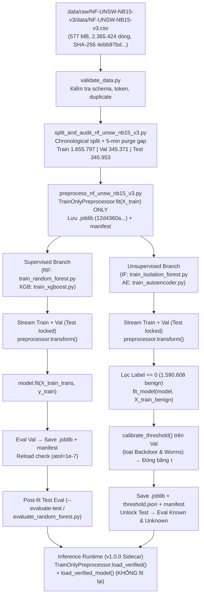

# 06 — Dẫn đường Code Huấn luyện & Suy luận (`TRAINING_CODE_WALKTHROUGH.md`)

> Tài liệu này chỉ chính xác **tệp nào, hàm nào, dòng nào** thực hiện từng bước từ đọc CSV đến `model.fit()`, tính metrics, lưu artifact và chạy demo trong `NetFlow Sentinel v1.0.0`.

---

## 1. Bảng bản đồ Code Huấn luyện & Suy luận

| Câu hỏi của giảng viên | Đường dẫn file | Function / Class (vị trí) |
|---|---|---|
| **Hợp đồng 55 cột / 47 feature ở đâu?** | `src/network_anomaly/data/nf_unsw_nb15_v3.py` | `ALL_COLUMNS`, `TRACE_METADATA_COLUMNS`, `TARGET_COLUMNS`, `ML_FEATURE_COLUMNS`, `CATEGORICAL_CODED_COLUMNS`, `QUANTITATIVE_ML_COLUMNS`, `validate_feature_selection()` |
| **Chia Train / Val / Test ở đâu?** | `scripts/split_and_audit_nf_unsw_nb15_v3.py` & `src/network_anomaly/data/split.py` | `load_partition_indices()`, `verify_split_artifacts()` |
| **Preprocessor fit & transform ở đâu?** | `src/network_anomaly/preprocessing/pipeline.py` & `scripts/preprocess_nf_unsw_nb15_v3.py` | `audit_column_tokens()` (L108), `TrainOnlyPreprocessor.fit()` (L282), `TrainOnlyPreprocessor.transform()` (L401), `TrainOnlyPreprocessor.load_verified()` (L719) |
| **Train Random Forest ở đâu?** | `scripts/train_random_forest.py` & `src/network_anomaly/models/random_forest.py` | `execute_training()` (L660), `RandomForestModel.fit()` (L283) → gọi tại `train_random_forest.py:802` |
| **Đánh giá Held-out Test RF ở đâu?** | `scripts/evaluate_random_forest.py` & `src/network_anomaly/evaluation/test_evaluation.py` | `main()` |
| **Train & Test XGBoost ở đâu?** | `scripts/train_xgboost.py` & `src/network_anomaly/models/xgboost_model.py` | `execute_training()` (L410), `XGBoostModel.fit()` (L231) → gọi tại `train_xgboost.py:544`; `_evaluate_xgb_test_partition()` (L947) |
| **Train & Test Isolation Forest ở đâu?** | `scripts/train_isolation_forest.py` & `src/network_anomaly/models/isolation_forest.py` | `run_pipeline()` (`train_isolation_forest.py:1571`), `fit_model()` (`isolation_forest.py:314` → gọi tại `train_isolation_forest.py:1813` trên `X_train_benign`), `calibrate_threshold()` (`train_isolation_forest.py:633`) |
| **Train & Test Autoencoder ở đâu?** | `scripts/train_autoencoder.py` & `src/network_anomaly/models/autoencoder.py` | `run_pipeline()` (`train_autoencoder.py:1661`), `fit_model()` (`autoencoder.py:302` → gọi tại `train_autoencoder.py:1797` trên `X_train_benign`), `calibrate_threshold()` (`train_autoencoder.py:764`) |
| **Tính metrics chung ở đâu?** | `src/network_anomaly/evaluation/metrics.py` | `compute_metrics()`, `compute_attack_category_breakdown()` (RF/XGB dùng chung; IF/AE có hàm `compute_full_metrics` / `compute_metrics` kèm known-vs-unknown holdout) |
| **Inference CLI & Backend ở đâu?** | `scripts/predict.py`, `src/network_anomaly/inference/predict.py`, `src/network_anomaly/api/service.py`, `src/network_anomaly/api/desktop_csv.py` | `InferencePipeline.from_artifacts()` (L534), `InferencePipeline.predict()` (L582), `ApiService.analyze_flows()` (L482), `analyze_csv_file()` (L1222) |
| **Tạo dữ liệu Demo 200 dòng ở đâu?** | `scripts/prepare_demo_dataset.py` | Lấy mẫu từ `validation_indices.csv.gz` (0 overlap Train/Test) |

---

## 2. Luồng thực thi chuẩn (End-to-End Pipeline Flow)



---

## 3. Chi tiết từng bước trong code huấn luyện

### 3.1. Bước đọc dữ liệu & khóa Test (`Test Lock`)
- Trong `train_random_forest.py:701` và `train_xgboost.py:456`, CSV chỉ được đọc theo streaming chunks với `usecols = list(ML_FEATURE_COLUMNS) + ["Label", "Attack"]`, tức **6 cột trace metadata không được nạp vào DataFrame huấn luyện**.
- Hàm `stream_partition_data()` chỉ giữ các dòng có index nằm trong `train_indices` hoặc `val_indices`; các dòng thuộc Test bị bỏ qua ngay tại ranh giới đọc chunk.
- Ở `train_xgboost.py`, `train_isolation_forest.py` và `train_autoencoder.py`, phân vùng Test **chỉ được mở khóa sau khi model đã `fit()`, đã `save()`, đã kiểm tra `reload_verification` và ngưỡng đã đóng băng** nếu người chạy truyền cờ `--evaluate-test`. Ở `train_random_forest.py`, Test không bao giờ được mở trong script train mà tách hẳn sang `scripts/evaluate_random_forest.py`.

### 3.2. Bước gọi `TrainOnlyPreprocessor` và `model.fit()`
- Tất cả 4 script train đều gọi `TrainOnlyPreprocessor.load_verified(...)` để nạp preprocessor đã fit sẵn từ Issue #8 (không fit lại).
- Sau `preprocessor.transform(...)`, `X_train` có shape `(1655797, 47)` cho RF/XGB; đối với IF (`train_isolation_forest.py:1785-1786`) và AE (`train_autoencoder.py:1769-1770`), mã nguồn lọc `benign_mask = (y_train == 0)` để lấy `X_train_benign` shape `(1590608, 47)` rồi mới gọi `fit_model(model, X_train_benign)`.

### 3.3. Tạo artifact & kiểm tra nạp lại (`Reload Verification`)
- Sau khi lưu tệp `.joblib`, các script tính SHA-256 (`_sha256_file`), ghi `reports/models/*_manifest.json`, và chạy lại dự đoán trên mẫu đã nạp lại từ đĩa để xác nhận sai khác xác suất/điểm `<= 1e-7`.

---

## 4. Khi chạy Demo trên Desktop App có huấn luyện lại không?

**TRẢ LỜI DỨT KHOÁT: KHÔNG.**

Chứng minh trực tiếp từ code thực thi khi người dùng bấm **Phân tích** trên NetFlow Sentinel Desktop:
1. Svelte UI gọi `analyzeCsv` → Rust Tauri command → HTTP `POST /api/v1/csv/analyze` (`src/network_anomaly/api/main.py:379–384`) → `analyze_csv_file()` (`src/network_anomaly/api/desktop_csv.py:1222`).
2. `analyze_csv_file()` kiểm tra OOD trước inference (`_audit_desktop_ood`), gắn `ABSTAINED_OOD` cho dòng `MIN_TTL == 0` hoặc lỗi vật lý.
3. Với các dòng hợp lệ, `service._load_inference_pipeline(canonical_model)` (`src/network_anomaly/api/service.py:387`) gọi `InferencePipeline.from_artifacts()`, bên trong chỉ gọi:
   - `load_verified_preprocessor()` → `TrainOnlyPreprocessor.load_verified()`
   - `load_verified_model()` (kiểm tra SHA-256 & `preprocessor_sha256` fail-closed trước khi nạp `.joblib`)
4. `ApiService._analyze_with_verified_pipeline()` (`service.py:651`) chỉ gọi `pipeline.preprocessor.transform(...)` và `model.predict(...)` / `predict_proba(...)` / `anomaly_scores(...)`.
5. Trong toàn bộ package `src/network_anomaly/api/` và `src/network_anomaly/inference/`, **không có bất kỳ lời gọi `.fit()` nào** tới preprocessor hay bất kỳ model nào.

---

## 5. Lệnh tái lập quá trình huấn luyện (Developer / Môi trường có raw CSV)

```powershell
# 1. Thiết lập môi trường
python -m venv .venv
.venv\Scripts\Activate.ps1
python -m pip install -e ".[dev]"

# 2. Tải, kiểm tra chất lượng, chia tập & fit preprocessor (Train-only)
python scripts/fetch_nf_unsw_nb15_v3.py
python scripts/validate_data.py
python scripts/split_and_audit_nf_unsw_nb15_v3.py
python scripts/preprocess_nf_unsw_nb15_v3.py

# 3. Huấn luyện & đánh giá Held-out Test cho 4 mô hình
python scripts/train_random_forest.py
python scripts/evaluate_random_forest.py
python scripts/train_xgboost.py --evaluate-test
python scripts/train_isolation_forest.py --evaluate-test
python scripts/train_autoencoder.py --calibration-method fpr_constrained --target-fpr 0.05 --evaluate-test
```

> **Ghi chú về tái lập byte-for-byte:** Các script chạy lại với cùng seed (`42`), dữ liệu và cấu hình sẽ cho kết quả logic nhất quán; tuy nhiên timestamp trong JSON manifest hoặc phiên bản thư viện/nền tảng (`pyproject.toml` dùng minimum bounds, `requirements-runtime.txt` khóa dải phiên bản Windows x64) có thể khiến SHA-256 của file `.joblib` sinh mới khác với hash lưu trong manifest lịch sử.
