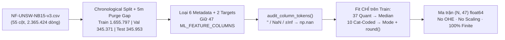
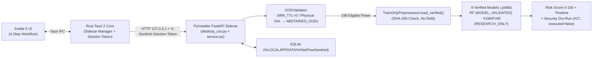

# 09 — Kịch bản Trình bày & Bảo vệ Đồ án (10–15 Phút)

> Kịch bản này giúp nhóm thuyết trình **mạch lạc trong 10–15 phút** và **mở ngay đúng file code / manifest / màn hình Desktop** khi giảng viên đặt câu hỏi phản biện.

---

## 1. Cấu trúc bài trình bày (12 phút)

| Thời lượng | Phần trình bày | Nội dung cốt lõi cần nói | Tài liệu / Màn hình hỗ trợ |
|---:|---|---|---|
| **1,0 phút** | **1. Bài toán nghiên cứu** | Phát hiện lưu lượng bất thường trên **NetFlow** (`Benign` vs `Attack`), nhấn mạnh yêu cầu **chống rò rỉ dữ liệu**, **truy vết SHA-256** và đóng gói ứng dụng Desktop cục bộ **NetFlow Sentinel v1.0.0**. Khẳng định trung thực: đây là prototype nghiên cứu học thuật, **không** phải production IDS. | Slide 1–2, [README.md](../../README.md) |
| **1,5 phút** | **2. Nguồn & Bản chất dữ liệu** | Giới thiệu `NF-UNSW-NB15-v3` (The University of Queensland, DOI `10.48610/6E0EDA1`, 2025, `arXiv:2503.04404`), điều khoản phi thương mại UQ `454104`. Giải thích 1 dòng = 1 flow tổng hợp (không có payload PCAP hay Auth log), `2.365.424` dòng (`94,60%` Benign / `5,40%` Attack, 9 họ tấn công). `Label=1` là luồng thuộc kịch bản tấn công, không tự đồng nghĩa host đã bị chiếm quyền. | [01_DATASET_ORIGIN_AND_STRUCTURE.md](01_DATASET_ORIGIN_AND_STRUCTURE.md), `data/NF_UNSW_NB15_V3_MANIFEST.json` |
| **1,5 phút** | **3. Data Schema (55 → 47) & Nhãn** | Trình bày ranh giới **55 cột**: loại 6 trace metadata (2 IP, 2 Port, 2 Timestamp) và 2 targets (`Label`, `Attack`), chỉ giữ **47 ML features** (`10` categorical-coded + `37` quantitative). Giải thích rõ `PROTOCOL`, `TCP_FLAGS`, `L7_PROTO` vốn đã mã hóa số trong NetFlow v3. | [02_COMPLETE_FEATURE_DICTIONARY.md](02_COMPLETE_FEATURE_DICTIONARY.md), `src/network_anomaly/data/nf_unsw_nb15_v3.py` |
| **2,0 phút** | **4. Tiền xử lý & Ví dụ Trước/Sau** | Nhấn mạnh: **fit chỉ trên Train** (`1.655.797` dòng). Chỉ ra `TrainOnlyPreprocessor`: không OHE (tránh bùng nổ 63.003 cột `DNS_QUERY_ID`), không scale (`scaler_type="none"`), biến `""`/`+Inf` ở 2 cột tốc độ (`122.493` dòng) thành Train median (`162.0` và `78.28`), giữ nguyên dòng `duration=0.0`. Chiếu ví dụ `row_id=92156` từ `demo_flows.csv`. | [03_DATA_PREPROCESSING_PIPELINE.md](03_DATA_PREPROCESSING_PIPELINE.md), `src/network_anomaly/preprocessing/pipeline.py` |
| **1,5 phút** | **5. Thiết kế Train / Validation / Test** | Chronological split + **Purge Gap 5 phút (`300.000 ms`)** → Train `1.655.797`, Val `345.371`, Test `345.953`, Purged `18.303`. Nêu `0` flow-group/full-row overlap, đồng thời công bố thẳng thắn: `49,98%–53,21%` lặp vector ML và shortcut `MIN_TTL`. | [04_TRAIN_VALIDATION_TEST_DESIGN.md](04_TRAIN_VALIDATION_TEST_DESIGN.md), `reports/splits/nf_unsw_nb15_v3_split_manifest.json` |
| **2,0 phút** | **6. Bốn Mô hình AI** | Tóm tắt 2 supervised (**Random Forest** `MODEL_VALIDATED`, **XGBoost** `RESEARCH_ONLY`) và 2 unsupervised học trên `1.590.608` Benign-only (**Isolation Forest**, **Autoencoder `MLPRegressor 32-16-32`** `RESEARCH_ONLY`) với ngưỡng đóng băng trên Validation (loại `{Backdoor, Worms}`). | [05_FOUR_MODELS_EXPLAINED.md](05_FOUR_MODELS_EXPLAINED.md), `src/network_anomaly/models/` |
| **1,5 phút** | **7. Kết quả Đánh giá (Tách từng tập)** | So sánh bảng Held-out Test (`345.953` dòng): RF `F1=0,999853`, XGB `F1=0,999984`, IF `F1=0,5064` (Unknown `0,8657`, `FPR=0,1605`), AE `F1=0,1361` (`Recall=0,1093`, `FPR=0,0482`). Đối chiếu Cross-dataset trên `NF-CSE-CIC-IDS2018-v3` (`Recall=0,0`, `FPR=0,3802`) để giải thích vì sao điểm trong miền cao chưa đủ chứng minh cho mạng thật. | [07_MODEL_RESULTS_AND_LIMITATIONS.md](07_MODEL_RESULTS_AND_LIMITATIONS.md) |
| **2,0 phút** | **8. Demo NetFlow Sentinel v1.0.0** | Mở ứng dụng Desktop **Rust/Tauri 2 + Svelte 5** ↔ **PyInstaller Sidecar FastAPI**: (1) Nạp `demo_flows.csv` (200 dòng Validation), (2) Chạy so sánh 4 model (`READY`), (3) Chỉ ra `198` dòng dự đoán + `2` dòng `ABSTAINED_OOD` (`MIN_TTL=0`), (4) Nạp `demo_labels.csv` xem Confusion Matrix, (5) Mở Tab 4 Security Dry-Run (`executed=false`, `RESEARCH_ONLY` bị giữ ở `INVESTIGATE`), (6) Xuất CSV + metadata SHA-256. | Desktop App `v1.0.0`, `desktop/src/App.svelte` |
| **1,0 phút** | **9. Giới hạn & Hướng phát triển** | Nhắc lại 4 giới hạn: testbed 2015 & TTL shortcut, phân phối công khai `.joblib` đang `BLOCKED` (UQ `454104`), nghiệm thu Windows VM sạch theo dõi ở `#73`, và định hướng scale/domain adaptation trong tương lai. | [v1.0.0.md](../releases/v1.0.0.md), Issue `#73` |

---

## 2. Sơ đồ End-to-End Kiến trúc & Dữ liệu (Dùng khi bảo vệ)

### 2.1. Sơ đồ Data & Preprocessing Pipeline

### 2.2. Sơ đồ Inference & Desktop Security Boundary (`v1.0.0`)

---

## 3. Bản đồ "Thầy hỏi → Mở ngay file nào?"

| Nếu giảng viên hỏi... | Mở ngay file / vị trí sau |
|---|---|
| *"55 cột là những cột nào? Cột nào bỏ?"* | [02_COMPLETE_FEATURE_DICTIONARY.md](02_COMPLETE_FEATURE_DICTIONARY.md) hoặc `src/network_anomaly/data/nf_unsw_nb15_v3.py` (L10–98), hoặc chạy `python scripts/export_academic_schema_summary.py` |
| *"Code tiền xử lý viết ở đâu? Có scale hay One-Hot không?"* | `src/network_anomaly/preprocessing/pipeline.py` (`TrainOnlyPreprocessor.fit` L282, `transform` L401) + `reports/preprocessing/nf_unsw_nb15_v3_preprocessing_manifest.json` (L161–167) |
| *"Chứng minh không rò rỉ dữ liệu Train/Val/Test?"* | `reports/splits/nf_unsw_nb15_v3_split_manifest.json` + `reports/models/rf_baseline_validation_audit.json` |
| *"Hàm `model.fit()` gọi ở đâu cho 4 model?"* | `scripts/train_random_forest.py:802`, `scripts/train_xgboost.py:544`, `scripts/train_isolation_forest.py:1813`, `scripts/train_autoencoder.py:1797` |
| *"Autoencoder kiến trúc gì? Ngưỡng bao nhiêu?"* | `src/network_anomaly/models/autoencoder.py` (`MLPRegressor (32,16,32)`) + `reports/models/autoencoder_manifest.json` (L11–52) |
| *"Kết quả Held-out Test từng họ tấn công ở đâu?"* | `reports/evaluation/rf-heldout-ea330b9/metrics.json`, `reports/evaluation/xgboost/metrics.json`, `reports/experiments/isolation_forest/evaluation_report.md`, `reports/evaluation/autoencoder/metrics.json` |
| *"Vì sao RF bị gọi là shortcut learning?"* | `reports/models/rf_baseline_validation_audit.json` (L47–50) + `reports/evaluation/cross_dataset_evaluation_results.json` |
| *"Demo có train lại model không? OOD xử lý sao?"* | `src/network_anomaly/api/desktop_csv.py` (`analyze_csv_file` L1222–1440) + `src/network_anomaly/ingestion/ood.py` |
| *"Security response có block firewall thật không?"* | `src/network_anomaly/api/response_policy.py` + Tab 4 trên UI (`executed=false`) |
| *"Bản quyền và trạng thái phát hành `v1.0.0`?"* | [NOTICE](../../NOTICE), [THIRD_PARTY_NOTICES.md](../../THIRD_PARTY_NOTICES.md), [DISTRIBUTION_AUTHORIZATION.json](../../reports/governance/DISTRIBUTION_AUTHORIZATION.json), [v1.0.0.md](../releases/v1.0.0.md) |
