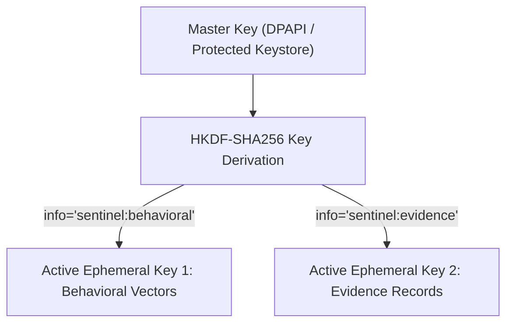

# ADR: Cryptographic Architecture for NetFlow Sentinel v2.0

> **Architecture Decision Record (Issue #116 — Milestone M6.5)**  
> **Status:** ACCEPTED  
> **Date:** 2026-11-17

---

## 1. Context and Problem Statement
Đề tài 22 yêu cầu: "kết hợp mã hóa vector hành vi và xoay vòng khóa thích ứng".
Trong v1.0.0, tầng mật mã mới chỉ lưu trữ metadata của khóa trong SQLite (`key_metadata`), xoay khóa ở mức mô phỏng (dry-run).
Cần thiết lập kiến trúc mật mã thực sự (authenticated encryption at rest), phân cấp khóa (key hierarchy), chính sách nonce (nonce policy) và tách biệt miền khóa (key separation) cho v2.0.

---

## 2. Decision Drivers
1. **Authenticated Encryption (AEAD):** Bảo vệ cả tính bí mật (confidentiality) và tính toàn vẹn (integrity), chống sửa đổi (tampering) trên đĩa.
2. **Standardization:** Sử dụng thuật toán tiêu chuẩn đã được thẩm định quốc tế (NIST SP 800-38D); nghiêm cấm tự sáng tạo thuật toán mật mã (no custom crypto).
3. **No Ciphertext Homomorphism Misconceptions:** Không tuyên bố sai lệch rằng có thể tính khoảng cách Cosine trực tiếp trên ciphertext AES-GCM. Phép so khớp tương đồng (similarity) thực hiện sau khi giải mã trong môi trường bộ nhớ an toàn.
4. **Key Isolation & Separation:** Tách biệt khóa mã hóa vector hành vi (`domain:behavioral_vector`) và khóa mã hóa chứng cứ (`domain:evidence_payload`).
5. **Nonce Policy:** Sử dụng 96-bit CSPRNG nonce duy nhất cho mỗi phép mã hóa. Nghiêm cấm tái sử dụng nonce với cùng một khóa.
6. **Key Storage:** Khóa gốc/khóa phiên được lưu trữ ngoài Git, bảo vệ bằng file permissions cục bộ hoặc DPAPI trên Windows, không ghi log bí mật (`zero-credential logging`).

---

## 3. Decision: AES-256-GCM with Envelope Encryption

### 3.1. Thuật toán
- **Mã hóa:** **AES-256-GCM** (Galois/Counter Mode).
- **Độ dài khóa:** 256 bits (32 bytes).
- **Độ dài Nonce:** 96 bits (12 bytes) sinh từ CSPRNG (`os.urandom(12)`).
- **Độ dài Authentication Tag:** 128 bits (16 bytes).
- **Thư viện chuẩn:** `cryptography` (pyca/cryptography).

### 3.2. Cấu trúc Ciphertext Envelope
Mỗi gói mã hóa được đóng gói theo định dạng chuẩn tắc JSON hoặc Binary Envelope:
```json
{
  "version": "aes-256-gcm-v1",
  "key_id": "k-20261117-001",
  "nonce_b64": "...",
  "ciphertext_b64": "...",
  "tag_b64": "...",
  "aad_b64": "...",
  "created_at": "2026-11-17T14:40:00Z"
}
```

### 3.3. Phân cấp Khóa (Key Hierarchy)


### 3.4. Chính sách Xoay vòng Khóa (Key Rotation Policy)
1. **Fixed Schedule:** Xoay khóa định kỳ mỗi 30 phút. Khóa cũ chuyển sang trạng thái `RETIRED` và vẫn phục vụ giải mã dữ liệu lịch sử.
2. **Adaptive Rotation:** Khi Risk Score vượt ngưỡng cảnh báo ($\ge 85$), hệ thống tự động sinh khóa mới tức thời nhằm cô lập và thu hẹp cửa sổ phơi nhiễm dữ liệu.
3. **Guardrails:** Áp dụng Cooldown tối thiểu 60 giây và Rate Limit tối đa 10 lần xoay khóa trong 1 giờ để chống DoS.

---

## 4. Consequences
- **Positive:** Đảm bảo an toàn dữ liệu at-rest theo chuẩn công nghiệp; ngăn chặn lộ lọt thông tin; truy vết đầy đủ lịch sử xoay khóa.
- **Negative:** Phát sinh chi phí tính toán CPU và độ trễ mã hóa nhỏ (được chứng minh $\le 0.5$ ms trong RQ6).
