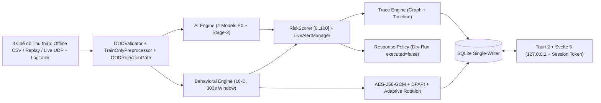

# Bộ Slide Bảo vệ Đồ án Tốt nghiệp — NetFlow Sentinel v2.0 (14 Slides)

> **Cấu trúc Thời lượng Bảo vệ (30 phút):** Trình bày `14` slides trong **`18–20 phút`** + Hỏi đáp Hội đồng (*Q&A*) **`10 phút`**.
>
> **Quy ước Bằng chứng:** `VERIFIED` (đo trên dữ liệu/mã nguồn/test thật) · `SYNTHETIC` (mô phỏng/loopback) · `NEGATIVE_RESULT` (giả thuyết không đạt, báo cáo trung thực) · `BLOCKED` / `DEFERRED`.

---

## Slide 1 — Tiêu đề, Bối cảnh & Mục tiêu Nghiên cứu (01:00)

- **Đề tài 22:** *Xây dựng Hệ thống Phát hiện Bất thường Mạng Bằng AI Kết hợp Hồ sơ Hành vi và Bảo mật Mật mã Thích ứng (**NetFlow Sentinel v2.0**)*
- **Bối cảnh Kỹ thuật:**
  - Lưu lượng mạng doanh nghiệp hiện đại phần lớn được mã hóa (`TLS 1.3 / HTTPS / QUIC`) → DPI truyền thống suy giảm hiệu quả, tốn CPU và rủi ro riêng tư.
  - Siêu dữ liệu luồng L3/L4 (`NetFlow v9 / IPFIX / Tstat / Zeek`) giữ được khả năng quan sát ở quy mô lớn.
- **3 Khoảng trống của NIDS Học thuật Hiện hành:**
  1. Đạt `F1 ~ 0.99` nhờ *shortcut* phòng lab hoặc rò rỉ theo kịch bản, sụp đổ khi chuyển mạng thật (*Domain Shift*).
  2. Phân loại đơn-flow rời rạc thiếu ngữ cảnh chuỗi hành vi (khi kẻ tấn công đổi IP) và thiếu đồ thị truy vết.
  3. Thiếu bảo vệ bằng chứng điều tra lưu trữ tại chỗ (*at-rest*) bằng mã hóa xác thực và xoay khóa thích ứng.
- **Mục tiêu `NetFlow Sentinel v2.0`:** Nguyên mẫu học thuật & thử nghiệm lab có kiểm soát (`Academic & Controlled Lab Pilot`) tích hợp trọn vẹn **7 trụ cột** trên ứng dụng Desktop **Tauri 2 + Svelte 5 + FastAPI Sidecar + SQLite**.

> **Speaker Notes:** Kính thưa Hội đồng, em xin trình bày Đề tài 22: NetFlow Sentinel v2.0. Ngay từ đầu, em xin xác định rõ ranh giới khoa học của đồ án: đây là một nguyên mẫu nghiên cứu và thử nghiệm lab có kiểm soát, tập trung vào tính trung thực khoa học và kiểm toán chống rò rỉ dữ liệu, không tuyên bố là sản phẩm SOAR thương mại hay tự động chặn lưu lượng doanh nghiệp.

---

## Slide 2 — Kiểm toán Lịch sử v1 (`NF-UNSW-NB15-v3`) & Hard Cutover sang v2 (01:30)

- **3 Khuyết tật Nền tảng của Pipeline v1 (`55` cột / `47` ML features):**
  1. **Shortcut Learning (`MIN_TTL` / `MAX_TTL`):** Trên `NF-UNSW-NB15-v3`, `RF` đạt `F1 = 0.999886` (`MIN_TTL importance = 0.240573`), `XGB` đạt `F1 = 0.999984` (`MIN_TTL importance = 0.829272`) nhờ đặc trưng *testbed* IXIA. Bỏ `MIN_TTL` còn `46` cột vẫn đạt `0.999804 / 0.999984` do `MAX_TTL` rò rỉ.
  2. **Sụp đổ OOD hoàn toàn:** `RF` v1 đánh giá *zero-shot* trên `NF-CSE-CIC-IDS2018-v3` (`100,000` mẫu) rơi xuống **`Recall = 0.0`**, `F1 = 0.0`, `FPR = 0.3802` (`TP=0, FN=29,980, FP=26,621`).
  3. **Bất tương thích Schema & Pháp lý:** 47 trường `nProbe v3` không tồn tại đồng nhất trên `Tstat`/`Zeek`; vướng **UQ License ID `454104`** cấm thương mại và hạn chế tái phân phối.
- **Quyết định Kiến trúc (`ADR-dataset-hard-cutover-v2.md` — `ACCEPTED`):**
  - Chuyển toàn bộ 160 tệp v1 sang kho chỉ đọc `*/historical/nf_unsw_nb15_v3/`.
  - **Cấm fallback v1:** API, Registry và Desktop UI từ chối *fail-closed* mọi CSV 55 cột / trọng số v1.

> **Speaker Notes:** Khi kiểm toán lại phiên bản v1, nhóm phát hiện hiệu năng 99.99% thực chất đến từ việc mô hình học lén giá trị TTL của máy phát IXIA và sụp đổ về 0% Recall trên tập dữ liệu khác. Thay vì vá tạm, nhóm quyết định Hard Cutover sang hợp đồng `canonical-flow-v2-18` trên các nguồn `CC BY 4.0`.

---

## Slide 3 — Kiến trúc Tổng thể 7 Module & Ranh giới An toàn (01:30)

- **Hybrid Desktop-Sidecar:** Tauri 2 (`v2.0.0`) + Svelte 5 giao tiếp FastAPI (`0.1.0`) qua loopback `127.0.0.1`, bắt buộc header `X-Sentinel-Session-Token` (`hmac.compare_digest`).
- **Live Telemetry:** `Python UDPFlowCollector` + `StreamingEventPipeline` (`capacity = 10,000`, micro-batch `64`, `max_batch_latency_ms = 50.0`) song song với pure-Rust Collector (`#128`, `telemetry/netflow-rs/`, `11/11` Rust tests + Python `CanonicalSecurityEvent` contract test + CI).
- **5 Hợp đồng Dữ liệu:** `sec-event-v2`, `canonical-flow-v2-18`, `beh-vec-v2`, `risk-res-v2`, `key-meta-v2`.
- **Giải trình 6 Độ vênh Đề cương:** Thay `Web/PostgreSQL/Docker` bằng `Tauri 2/Svelte 5/SQLite` (offline-first); `PyTorch AE` → `sklearn MLPRegressor (16,8,16)`; `SHAP` → `tree_feature_importances` / `validation_permutation_importance`; `Multiclass` tách riêng; `Response` khóa *dry-run*.

> **Speaker Notes:** Hệ thống tích hợp đủ 7 trụ cột của Đề tài 22. Nhóm trình bày minh bạch 6 điểm điều chỉnh thiết kế so với đề cương gốc, như dùng Tauri + SQLite để đóng gói đơn lẻ không cần Docker/PostgreSQL, và dùng `sklearn MLPRegressor` để giữ sidecar gọn nhẹ, tái lập tất định.

---

## Slide 4 — Dữ liệu Đa nguồn, Chống Leakage & Hiện trạng `UGR'16` / `#85` (01:30)

| Bộ dữ liệu | Vai trò & Giấy phép | Quy mô & Phân chia (`v2-scenario-group-purged-v1`) | Trạng thái |
|---|---|---|---|
| **`AIT-NDS-v2`** | Chính (`CC BY 4.0`, Tstat) | `3,464,400` labeled (`+942` unmapped `shaw`): Train `2,097,891` (5 kịch bản), Val `377,704` (`russellmitchell`), Test `988,805` (`shaw, wheeler`) — **0 overlap** | `VERIFIED` |
| **`CTU-SME-11`** | Cross-source (`CC BY 4.0`, Zeek) | `251,219` labeled (`CTU-Echo` `76,073` + `CTU-Win7AD` `175,146`, `+9,394` unmapped) | `VERIFIED` |
| **`UWF-ZeekData24`** | `evaluation_only = true` | `95,871` labeled (`93,000` strict complete); `6,417` SYN-only probes khớp L4 | `VERIFIED` |
| **`AIT-LDS-v2.1`** | Kiểm toán log (`CC BY-NC-SA 4.0`) | Chỉ tải `fox` & `russellmitchell` vào `.gitignored`; **0% trong ML/demo CSV** | `ISOLATED` |
| **`UGR'16`** | ISP Benchmark ngoài | Portal NESG trả `HTTP 403`; khảo sát 9 ứng viên (`LITNET-2020`, `LUFlow`, `CTU-13`) | `BLOCKED` |

- **Sửa 3 Lỗi Dữ liệu Phase 0:** `DATA-A01` khôi phục `233,185` dòng rơi chunk; `DATA-A02` đổi `udp_complete` từ giây sang ms (`* 1000.0`); `DATA-A03` căn chỉnh L4 payload Zeek/Tstat.
- **Kiểm toán Liên kết AIT (`#85`):** `DIRECT_UID_LINK = False` giữa Tstat CSV và log Suricata/host → chỉ hỗ trợ heuristic `(entity, time)`, thực nghiệm liên kết AIT giữ **`BLOCKED`**.

> **Speaker Notes:** Toàn bộ dữ liệu được chia theo kịch bản (`scenario-group-purged`), đảm bảo 0 giao thoa kịch bản và 0 giao thoa `(scenario, 5-tuple, timestamp)`. Đồng thời, dữ liệu `CC BY-NC-SA 4.0` được cách ly 100% khỏi mô hình để không vi phạm bản quyền.

---

## Slide 5 — Hợp đồng `canonical-flow-v2-18`, Anti-Shortcut & OOD Fail-Closed (01:15)

- **18 Đặc trưng ML (`src/network_anomaly/data/v2_schema.py`):**
  - **6 Base Observed:** `duration_ms`, `bytes_in`, `bytes_out`, `pkts_in`, `pkts_out`, `protocol_num`.
  - **12 Deterministic Derived:** `total_bytes`, `total_pkts`, `bytes_in_ratio`, `pkts_in_ratio`, `bytes_per_pkt_in/out`, `bytes_per_sec_in/out`, `pkts_per_sec`, `has_response`, `is_tcp`, `is_udp`.
  - **Anti-Shortcut & Anti-Imputation:** Cấm `MIN_TTL`, `MAX_TTL`, `role_*`, `uid`; `shortcut_audit` trên `AIT-Val` xác nhận max `abs_auc = 0.965448 < 0.98`. Nguồn thiếu trường bị gắn `FEATURE_INCOMPATIBLE` (không điền `0`).
- **Tiền xử lý & OOD Gate Fail-Closed:**
  - `TrainOnlyPreprocessor` (`asinh_robust`, `SHA-256: 0866dec7...`) có `MIN_BOUNDED_SCALE_FLOOR = 0.25` chống suy biến IQR `pkts_in_ratio`.
  - **`OODValidator`** (bất biến vật lý) + **`OODRejectionGate`** (`8a52bfe5...`, `std_margin=4.0`, `statistical_threshold=5.0`).
  - Toàn bộ entry point sản phẩm mặc định **`runtime_mode = "deployment"`**: bắt buộc `NETFLOW_OOD_GATE_SHA256` ngoài thư mục `artifacts/`, khóa **`inference_mode = "UNAVAILABLE"`** nếu thiếu SHA hoặc OOD `ERROR`.

> **Speaker Notes:** Điểm cốt lõi của hợp đồng 18 chiều là tính nhất quán L4 trên mọi bộ thu thập. Ở tầng vận hành, chế độ `deployment` mặc định khóa fail-closed nếu thiếu mã băm tin cậy `NETFLOW_OOD_GATE_SHA256`, tuyệt đối không tự hạ cấp ngầm.

---

## Slide 6 — Kết quả `RQ1` (`AIT-Test`), Cross-Source (`CTU`) & 4 Cổng `RESEARCH_ONLY` (01:30)

| Mô hình (`E0` Đóng băng) | `AIT-Test` (`N=988,805`) `P / R / F1 / FPR / ROC-AUC` | `CTU-Echo` (`N=76,073`) | `CTU-Win7AD` (`N=175,146`) | 4 Cổng (`ModelRegistry`) |
|---|---|---|---|---|
| **Random Forest** (`th=0.5`) | `0.9989 / 0.9911 /` **`0.9950`** `/ 0.000246 / 0.9994` | `F1=0.0474` (`R=0.0264`) | `F1=0.0712` (`FPR=0.1608`) | `artifact=T, in_dom=T,` **`cross_src=F`** → **`RESEARCH_ONLY`** |
| **XGBoost** (`th=0.5`) | `0.9989 / 0.8211 /` **`0.9013`** `/ 0.000198 / 0.9884` | `F1=0.1436` (`R=0.0832`) | `F1=0.0738` (`FPR=0.1611`) | `artifact=T, in_dom=T,` **`cross_src=F`** → **`RESEARCH_ONLY`** |
| **Autoencoder** (`th=0.000467`) | `0.7860 / 0.4693 /` **`0.5877`** `/ 0.027637 / 0.5544` | `F1=0.7325` (`FPR=0.6746`) | `F1=0.0326` (`FPR=0.6925`) | `artifact=T, in_dom=T,` **`cross_src=F`** → **`RESEARCH_ONLY`** |
| **Isolation Forest** (`th=0.031268`) | `0.7775 / 0.4678 /` **`0.5842`** `/ 0.028952 / 0.8330` | **`F1=0.8853`** (`R=0.9908`) | `F1=0.0464` (`FPR=0.4722`) | `artifact=T, in_dom=T,` **`cross_src=F`** → **`RESEARCH_ONLY`** |

- **Parity & Bảo lưu `E0`:** API `/api/v1/csv/analyze` khớp CLI `<= 1e-7` trên `demo_flows.csv`. Thử nghiệm kiểm soát `WP3 (E0–E5)` xác nhận **`RETAIN_E0_BASELINE_ARTIFACTS`**.
- **Tại sao `production_ready = False`?** Cổng `cross_source_validated` yêu cầu `Recall >= 0.70` và `FPR <= 0.10` trên **cả** `CTU-Echo` và `CTU-Win7AD` — không mô hình `E0` nào đạt khi chạy *zero-shot*.

> **Speaker Notes:** Đây là minh chứng cho tính trung thực của hệ thống: dù Random Forest đạt F1 0.9950 trên AIT-Test, khi đưa sang dữ liệu thật CTU-SME-11, cả 4 mô hình đều không qua được cổng `cross_source_validated`, nên `ModelRegistry` tự động khóa ở cấp `RESEARCH_ONLY`.

---

## Slide 7 — Tối ưu hóa AI: `Stage-2` 6-Class, Đa miền `E1`, `AE E3b` & Calibration (01:30)

- **`Stage2MulticlassClassifier` (6 lớp, `e0_artifacts_untouched = true`):**
  - `random_forest_multiclass`: `Val Macro-F1 = 0.8282` → **`Test Macro-F1 = 0.7347`** (`Weighted-F1 = 0.9778`).
  - `xgboost_multiclass`: `Test Macro-F1 = 0.6378` (`Reconnaissance F1 = 0.9971`, `Data_Exfiltration F1 = 0.7608`, nhưng `Credential_Attack F1 = 0.0455`).
- **Thực nghiệm Đa miền `E1` (`N_train = 442,960`: `AIT=200,001 + CTU=175,852 + UWF=67,107`):**

| Tập Kiểm thử | Mô hình (`E0` Zero-Shot vs `E1 / E3b`) | F1 (`E0` → `E1/E3b`) | FPR (`E0` → `E1/E3b`) | ROC-AUC |
|---|---|---:|---:|---:|
| **`AIT_Test`** | `RandomForest_Binary` | `0.9935` → **`0.9200`** | `0.0002` → `0.0026` | `0.9974` |
| **`CTU_Test`** | `RandomForest_Binary` | `0.0612` → **`0.9564`** | `0.1432` → **`0.0047`** | `0.9977` |
| **`CTU_Test`** | `XGBoost_Binary` | `0.2051` → **`0.9552`** | `0.1425` → **`0.0008`** | `0.9973` |
| **`CTU_Win7AD_Test`** | `RandomForest_Binary` | `0.0371` → **`0.3359`** | `0.1450` → **`0.0048`** | **`0.9883`** |
| **`CTU_Win7AD_Test`** | `XGBoost_Binary` | `0.0462` → **`0.2560`** | `0.1430` → **`0.0008`** | **`0.9849`** |
| **`UWF_Test`** *(in-domain với E1)* | `RandomForest_Binary` | `0.0942` → **`0.9992`** | `0.0429` → **`0.0017`** | `1.0000` |
| **`CTU_Win7AD_Test`** | `Autoencoder_E3b_VarianceNormalized` | `0.0302` → **`0.1388`** | **`72.14%`** → **`13.79%`** | `0.9706` *(UWF `0.3102`)* |

- **`LocalBenignCalibrator` & `OOD_AWARE_ENSEMBLE`:** Chẩn đoán hiệu chuẩn ngưỡng trên `UWF-ZeekData24` nâng `RF F1` từ `0.0924 @ 0.50` lên `0.6596 @ AIT-Val Youden J` và `0.9756 @ Target-Benign-P95`.

> **Speaker Notes:** Để giải quyết bài toán domain shift mà không chạm vào 4 baseline E0, nhóm thực nghiệm huấn luyện đa miền E1 (`N_train = 442,960`) và chuẩn hóa phương sai Autoencoder E3b. Kết quả cho thấy khi có mẫu đa miền, CTU_Test RF F1 tăng từ 0.0612 lên 0.9564, CTU_Win7AD_Test ROC-AUC đạt 0.9883 (RF) và 0.9849 (XGB), UWF_Test (in-domain đối với E1) đạt 0.9992, và FPR của Autoencoder trên Win7AD giảm mạnh từ 72.14% xuống 13.79% (ROC-AUC 0.9706).

---

## Slide 8 — Tấn công Hiếm (`RQ2`, `Exp 3`) & Họ Tấn công Holdout (`RQ4`) (01:15)

- **Thực nghiệm `RQ2` (`EXP-RQ2-IMBALANCE-001`, tỉ lệ `6.7121:1` + `Exp 3` Train-Only Oversampling `15,000`):**
  - `RF_CostSensitive` nâng overall `AIT-Test F1` từ `0.8000` lên `0.9947`.
  - **Kết quả 3 lớp hiếm (`< 0.5%` tại `AIT-Test`):**
    - `Exploitation_And_C2` (`N = 5`): Recall = **`1.0000` (`5/5`)** *(mẫu quá nhỏ, không kết luận tổng quát)*.
    - `Post_Exploitation_Discovery` (`N = 39`): Recall = **`0.8974` (`35/39`)** ở RF/XGB/IF (`0.1026` ở AE).
    - **`Credential_Attack` (`N = 78`):** Toàn bộ `RF`, `XGB`, `TrainOnlyOversampled` và `IF` dừng ở **`0.1410` (`11/78`)**, `AE` đạt **`0.0641` (`5/78`)**.
  - **Phán quyết H2 (`NEGATIVE_RESULT`):** **`h2_full_confirmed = false`** — `67/78` luồng `online_cracking` chồng lấn hoàn toàn với HTTP/SSH hợp lệ ở cấp độ đơn-flow 18-D.
- **Thực nghiệm `RQ4` (`EXP-RQ4-UNKNOWN-001`, `44` flows Holdout, `zero_leakage_verified = true`):**
  - Unknown Recall: `Isolation Forest` = **`0.9091` (`40/44`)**, `RF` = **`0.9091`**, `XGB` = **`0.7500`**, **`Autoencoder = 0.2045` (`9/44`)**.
  - **Phán quyết H4 (`NEGATIVE_RESULT`):** **`unsupervised_ge_0_75_both = false`** (chỉ IF đạt `>= 0.75`).

> **Speaker Notes:** Kết quả âm tính ở `Credential_Attack` (14.10%) là bằng chứng khoa học trực tiếp giải thích vì sao hệ thống cần tầng Behavioral Vector và log xác thực thay vì chỉ dựa vào phân loại đơn-flow.

---

## Slide 9 — Động cơ Hành vi 16-D Độc lập IP (`BehavioralVector`) & `RQ3` (01:15)

- **Thiết kế `canonical-behavioral-v2-16` (`src/network_anomaly/behavioral/vector.py`):**
  - `EventSessionizer` gom nhóm theo thực thể trong cửa sổ **`300 giây`**, loại bỏ hoàn toàn IP khỏi 16 đặc trưng chuẩn hóa L2 (`BehavioralVectorBuilder.FEATURE_NAMES`):
    - *Thời lượng, Dung lượng & Tỷ lệ (7):* `log_duration`, `log_bytes_in`, `log_bytes_out`, `bytes_ratio_clipped`, `log_pkts_in`, `log_pkts_out`, `pkts_ratio_clipped`.
    - *Đa dạng & Cờ TCP (4):* `unique_ports_norm`, `unique_protocols_norm`, `syn_flag_ratio`, `rst_flag_ratio`.
    - *App, Identity & IAT (5):* `dns_intensity`, `http_intensity`, `auth_failure_ratio`, `log_mean_iat`, `log_std_iat` (khi thiếu sự kiện `DNS`/`WEB`/`AUTH`, giữ `0.0` và ghi tường minh `missing_feature_count`, `missing_feature_names`).
  - `EntityBaselineProfiler` (`vector.py:178-224`): Cửa sổ trượt `deque(maxlen=50)` + centroid chuẩn hóa L2 + độ lệch cosine `deviation_score = 1 - cos_sim`.
- **Kết quả `RQ3` (`IPSpoofingSessionCorrelator`):**
  - *Simulation L2 Cosine (`20` phiên / `190` cặp):* IP Exact `F1 = 0.0000` vs L2 `cos >= 0.95` `F1 = 0.5556` (`Recall = 1.0`, `FalseLink = 0.30`) → **`simulation_hypothesis_met = false`** (`< 0.85`).
  - *Nâng cấp Feature-Standardized 16-D Cosine:* Mô phỏng đạt `F1 = 1.0000`; thực nghiệm **`UWF-ZeekData24`** (`56` phiên / `8` tactic) đạt **`F1 = 0.7192`** (`FalseLink = 0.0449`) vượt IP Exact (`F1 = 0.6919`, `FalseLink = 0.1653`). Track AIT giữ **`BLOCKED`** (`#85`).

> **Speaker Notes:** Khi chuẩn hóa L2 thuần túy, các chiến dịch khác nhau có tỷ lệ giống nhau dễ bị gộp nhầm dẫn đến Precision thấp. Khi chuyển sang chuẩn hóa theo từng đặc trưng (Feature-Standardized Cosine), độ chính xác liên kết trên tập thật UWF-ZeekData24 đã vượt phương pháp khớp IP truyền thống.

---

## Slide 10 — Risk Engine `[0..100]`, Trace Engine & Chính sách Dry-Run (01:15)

- **`RiskScorer` (`src/network_anomaly/risk/scoring.py`):**
  - Công thức xác định `[0..100]`: `AI Confidence (0–50)` + `Behavioral Deviation (0–25)` + `Sensitive Port (0–15)` + `Auth Failures (0–10)`.
  - Ngưỡng: `LOW (<30)`, `MEDIUM (30–69.9)`, `HIGH (>=70)`, `CRITICAL (>=85 -> trigger_adaptive_rotation)`.
  - **Fail-Closed Guard:** Luồng `is_ood = True` hoặc `NaN`/`Inf` bị kẹp **`<= 65.0`** và khóa `trigger_adaptive_rotation = False`.
- **`LiveAlertManager` & Trace Engine:**
  - Gộp trùng cảnh báo `>= 70.0` theo `entity_id` trong **`60.0s`** (`live_alerts` SQLite).
  - `EntityRelationshipGraph` + `AttackTimelineReconstructor` + `InvestigationReport`: đạt **`Stage Attribution Accuracy = 90.0%`** (lỗi `1/10` tại `ev-7` WinRM `5985`) và **`Path Completeness = 100.0%`** trên kịch bản synthetic `10` sự kiện (vs `30.0% / 40.0%` của log grep).
- **Chính sách Phản ứng Dry-Run (`response_policy.py`):**
  - Khóa cứng `executed = false`, `os_firewall_touched = false`. Cổng kép chặn `ABSTAINED_OOD` và mô hình `RESEARCH_ONLY` (`HOLD_RESEARCH_ONLY_MODEL`).

> **Speaker Notes:** Thiết kế phòng thủ chiều sâu đảm bảo một luồng ngoài phân phối (OOD) hoặc giá trị NaN không bao giờ kích hoạt xoay khóa giả hay khuyến nghị cô lập.

---

## Slide 11 — Bảo mật Mật mã `AES-256-GCM`, `DPAPI` & Key Rotation (`RQ5`, `RQ6`) (01:15)

- **Kiến trúc Mã hóa At-Rest (`src/network_anomaly/crypto/`):**
  - `AES-256-GCM` (nonce `96-bit` từ `NonceRegistry`, tag `128-bit`, AAD theo ngữ cảnh `entity/window`), cột `vector_json` lưu `NULL`.
  - Trên Windows, `master.key` bọc bằng **Windows DPAPI** (*fail-closed*), DEK bọc bằng `NETFLOW_WRAPPED_DEK_V2`, chống *path traversal*, ghi atomic qua `os.replace`.
  - `KeyRotationPolicy`: Lịch cố định `30 phút` (`1,800s`), khẩn cấp khi `risk_score >= 85.0`, kèm `cooldown >= 60s` và `rate_limit <= 10/giờ` lưu trong SQLite `rotation_audit`.
- **Kết quả `RQ5` (Mô phỏng 60 phút, `120` events) & `RQ6` (Microbenchmark CPU):**
  - `RQ5`: Max exposure giảm **`87.5%`** (`1,200.0s -> 150.01s`); *blast radius* giảm **`85.0%`** (`40 -> 6` bản ghi tấn công/khóa).
  - `RQ6`: `AES-256-GCM` 256 B = **`72,177.2 ops/s`** (median `8.8 us`, P95 = **`13.3 us`**); 1 KB P95 = **`11.4 us`** (`74,807.5 ops/s`); 4 KB P95 = **`38.4 us`** (`36,351.0 ops/s`) — đạt mục tiêu `<= 500 us`, `>= 5,000 ops/s`. A/B Exp 7: bật mã hóa giảm throughput từ `181.2` xuống `121.7 flow/s` (`CPU +53.56%`).

> **Speaker Notes:** Chi phí mã hóa một vector hành vi chỉ mất khoảng 13 micro-giây ở phân vị 95%, rất nhỏ so với chi phí suy luận AI (~61 ms), nhưng giúp giảm 87.5% thời gian phơi nhiễm khóa khi xảy ra sự cố.

---

## Slide 12 — Hiệu năng Hệ thống, Nghiệm thu Live UDP & Kiểm thử CI (01:30)

- **Benchmark Hệ thống (`deployment` + `4/4 REAL_MODELS` + Explicit OOD SHA, `--repeats 3`):**

| Chế độ Thực thi | Thông lượng (`Mean ± Std`) | Độ trễ Median | Ghi chú |
|---|---:|---:|---|
| **End-to-End Orchestrator (Single-Event)** | **`16.75 ± 0.11 flow/s`** (`CV=0.68%`) | `60,873.45 us` (`60.87 ms`) | `multi_model_ai_inference` chiếm `62.2 ms` |
| **Vectorized Micro-Batch (`process_batch(32)`)** | **`386.37 ± 12.88 flow/s`** (`CV=3.33%`) | `2,369.28 us/event` (amortized) | **Tăng tốc `>23x`** (`23.07x`) |
| **Dataset Replay Mode** | **`399.44 ± 15.47 flow/s`** (`CV=3.87%`) | — | `Ring Buffer peak 10.0%`, `dropped = 0` |

- **Nghiệm thu Telemetry Loopback (`#137`):**
  - *Synthetic UDP Loopback (`127.0.0.1:51817`):* `13/13` stages `PASS`, `6/6` flows, `1` alert `HIGH (84.035)` trên GUI Svelte (`live_gui_alert_synthetic_loopback.png`).
  - *Real-Dataset UDP Replay:* `65/65` flows `ait_test.csv.gz` ở chế độ `deployment`, `1` chiến dịch đa giai đoạn (`real_hardware_switch = false`).
- **Kiểm thử & CI:** **`670+` pytest**, **`41/41` Vitest**, **`11/11` Rust tests (`cargo test --lib`)**, CI Run `44544489397` (`93416ed`) đạt **`7/7 SUCCESS`**.

> **Speaker Notes:** Bằng việc gom nhóm xử lý vi lô `process_batch(32)`, thông lượng trên CPU tăng hơn 23 lần lên gần 390 flow/s với độ ổn định cao (CV 3.33%), đồng thời hệ thống vượt qua toàn bộ 7 job CI và kịch bản nghiệm thu UDP loopback.

---

## Slide 13 — Kịch bản Demo Trực tiếp 4 Bước (01:30)

1. **Bước 1 — Offline CSV & Fail-Closed OOD (`00:30`):**
   - Nạp `data/demo/demo_flows.csv` (`200` flows `AIT-Val`) trên `ModelComparisonPanel` / CSV Analyze → hiển thị `4/4 VALIDATED (RESEARCH_ONLY)`, parity `<= 1e-7`, điểm `RiskScorer` và `ABSTAINED_OOD` khi đưa mẫu lỗi.
2. **Bước 2 — Dataset Replay (`00:30`):**
   - Chạy `Dataset Replay` trên `LiveMonitoringPanel` (`~399 flow/s`), quan sát `StreamingEventPipeline` (`dropped = 0`) và biểu đồ phân phối rủi ro.
3. **Bước 3 — Live UDP Loopback & Trace Graph (`00:30`):**
   - Phát luồng NetFlow v9/IPFIX qua `127.0.0.1:51817` (`scripts/run_live_lab_acceptance.py`) → quan sát cảnh báo `HIGH (84.035)` gộp trùng theo `60s`, mở `AttackTimelinePanel` xem đồ thị thực thể `8` nodes / `6` edges và `SecurityDryRunPanel` (`executed = false`).
4. **Bước 4 — Crypto Vault & Key Rotation Audit (`00:20`):**
   - Mở `CryptographyDashboardPanel` → chứng minh `vector_json = NULL` (chỉ lưu ciphertext `AES-256-GCM`), kiểm tra nhật ký `rotation_audit` và chạy CLI `verify_companion_artifacts.py --verify-distribution-permission research-only --target-channel local_offline`.

> **Speaker Notes:** Phần demo trực tiếp đi qua đủ 4 lớp: từ phân tích tĩnh chống OOD, phát lại tốc độ cao, bắt gói UDP loopback dựng đồ thị truy vết cho đến kiểm chứng dữ liệu mã hóa tại chỗ.

---

## Slide 14 — Giới hạn Trung thực, Ma trận `BLOCKED`/`DEFERRED` & Hướng Phát triển (01:15)

- **Ma trận Hạng mục `BLOCKED` & `DEFERRED` (Minh bạch 100%):**

| Hạng mục | Issue | Trạng thái | Nguyên nhân |
|---|---|---|---|
| **External ISP `UGR'16`** | `#82`, `#97` | **`BLOCKED`** | Portal NESG trả `HTTP 403`; đã khảo sát `LITNET-2020`, `LUFlow`, `CTU-13`. |
| **AIT Flow ↔ Log UID Linkage** | `#85` | **`COMPLETED (3/3 AC, Tier 1 FALSE)`** | `DIRECT_UID_LINK = False`; thực nghiệm `(ip, ±3s)` trên `fox` (`73.73%` khớp, `85.29%` mơ hồ) & `russellmitchell` (`59.53%` khớp, `78.49%` mơ hồ) xác nhận chỉ hỗ trợ Tier-2 heuristic. |
| **Physical Switch/Router Lab** | `#137` | **`BLOCKED`** | Mới nghiệm thu trên Synthetic UDP Loopback (`real_device_tested = false`). |
| **Clean Windows VM & Public Release** | `#73`, `#148`, `#154` | **`DEFERRED / BLOCKED`** | Chưa test NSIS trên VM sạch; `DISTRIBUTION_AUTHORIZATION.json` giữ `approved = false`; `git_dirty = true` (`79ebb678`). |
| **OS Firewall Enforcement** | `#27` | **`DEFERRED`** | Chủ động khóa chế độ Dry-Run (`executed = false`) để đảm bảo an toàn. |
| **Rust Collector / Website v2.0** | `#128`, `#152` | **`COMPLETED (4/4 AC)`** | `#128` pure-Rust `telemetry/netflow-rs/` (`11/11` Rust tests + CI); `#152` website v2.0 đã merge qua PR `#157` và deploy live trên GitHub Pages. |

- **Hướng Phát triển:** (1) Đặc trưng cửa sổ nhân quả cho `Credential_Attack`; (2) Tích hợp `LITNET-2020`/`LUFlow`/`CTU-13` & `UGR'16`; (3) Tối ưu `ONNX` suy luận đa mô hình; (4) Đóng băng commit sạch, nghiệm thu Clean VM `#148` & ký duyệt `#154`.

> **Speaker Notes:** Em xin kết thúc bài trình bày. Giá trị cốt lõi của NetFlow Sentinel v2.0 không chỉ là con số F1 0.9950 trên tập kiểm thử, mà là hệ thống kiểm toán trung thực, kiến trúc fail-closed và sự minh bạch tuyệt đối về các giới hạn còn mở. Em xin trân trọng lắng nghe câu hỏi của Hội đồng.
