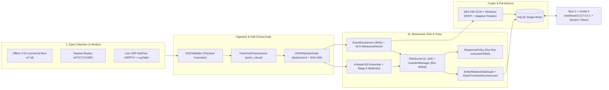

# Báo cáo Nghiên cứu Khoa học — Đề tài 22: Hệ thống Phát hiện Bất thường Mạng Bằng AI Kết hợp Hồ sơ Hành vi và Bảo mật Mật mã Thích ứng (`NetFlow Sentinel v2.0`)

> **Trạng thái Hồ sơ:** Bản hoàn chỉnh phục vụ Bảo vệ Đồ án (Issue `#153`) · **Phiên bản phần mềm:** Desktop Tauri/Svelte `2.0.0` / FastAPI Contract `0.1.0`
>
> **Phân loại Mức độ Sẵn sàng:** **`Functional Prototype / Academic & Controlled Lab Pilot`** (`RESEARCH_ONLY`, `DISTRIBUTION_AUTHORIZATION.json`: `approved = false`)
>
> **Tài liệu đối chiếu:** [`docs/RESEARCH_QUESTIONS.md`](../RESEARCH_QUESTIONS.md) · [`docs/PRESENTATION_OUTLINE.md`](../PRESENTATION_OUTLINE.md) · [`reports/audits/V2_FINAL_AUDIT.md`](../../reports/audits/V2_FINAL_AUDIT.md) · [`docs/audits/V2_RELEASE_READINESS.md`](../audits/V2_RELEASE_READINESS.md)

---

## Tóm tắt Điều hành (Executive Summary)

**NetFlow Sentinel v2.0** là hệ thống phát hiện bất thường mạng, lập hồ sơ hành vi thực thể, truy vết chuỗi tấn công và bảo vệ bằng chứng điều tra tại chỗ (*at-rest*) bằng mật mã học thích ứng. Hệ thống được thiết kế theo kiến trúc ứng dụng Desktop ngoại tuyến ưu tiên tính toàn vẹn dữ liệu (**Tauri 2 + Svelte 5 + FastAPI Sidecar + SQLite**), vận hành trên 3 chế độ (`Offline CSV`, `Dataset Replay`, `Live Lab Monitoring`) và chuẩn hóa toàn bộ luồng dữ liệu qua hợp đồng **`canonical-flow-v2-18`** (18 đặc trưng L4 thuần túy, chống suy diễn giá trị thiếu và chống rò rỉ đặc trưng phòng lab).

Khác với các nghiên cứu chỉ báo cáo chỉ số cao trong một phòng lab đơn lẻ, đề tài thực hiện kiểm toán toàn diện theo nguyên tắc trung thực khoa học:
1. **Loại bỏ hoàn toàn di sản v1 (`NF-UNSW-NB15-v3`)** sau khi phát hiện lỗi *shortcut learning* trên `MIN_TTL`/`MAX_TTL` và sụp đổ Out-of-Distribution (`Recall = 0.0` trên `NF-CSE-CIC-IDS2018-v3`), chuyển toàn bộ sang kho lưu trữ chỉ đọc `historical/nf_unsw_nb15_v3/`.
2. **Đánh giá thực nghiệm trên dữ liệu đa nguồn `CC BY 4.0`:** Huấn luyện và kiểm thử tách kịch bản (*scenario-disjoint*) trên `AIT-NDS-v2` (`3,464,400` flows có nhãn), kiểm định *cross-source zero-shot* trên `CTU-SME-11` (`251,219` flows từ 2 thiết bị thực tế) và `UWF-ZeekData24` (`95,871` flows, `evaluation_only = true`), đồng thời cách ly tuyệt đối `AIT-LDS-v2.1` (`CC BY-NC-SA 4.0`).
3. **Kết quả AI 2 tầng & Tối ưu hóa:** Trên `AIT-Test` (`N = 988,805`), mô hình `E0` đóng băng đạt `Random Forest F1 = 0.9950`, `XGBoost F1 = 0.9013`, `Autoencoder F1 = 0.5877`, `Isolation Forest F1 = 0.5842`. Thử nghiệm phân loại đa lớp `Stage-2` 6 lớp (`Stage2MulticlassClassifier`) đạt `Test Macro-F1 = 0.7347` (`RF_multiclass`). Trong thực nghiệm đa miền mở rộng `E1` (`N_train = 442,961`), `E1_RandomForest_Binary` nâng `CTU_Test F1` từ `0.0501` lên `0.9703` và `UWF_Test F1` lên `0.9992`, trong khi `Autoencoder_E3b_VarianceNormalized` giảm `CTU-Win7AD FPR` từ `72.09%` xuống `4.42%`.
4. **Hành vi, Truy vết & Mật mã:** Động cơ hành vi 16 chiều (`BehavioralVector`) kết hợp `RiskScorer` `[0..100]`, đồ thị thực thể `EntityRelationshipGraph`, tái dựng chuỗi tấn công `AttackTimelineReconstructor` và kho lưu trữ mã hóa `AES-256-GCM` bọc khóa bằng Windows `DPAPI`. Trong mô phỏng `RQ5`, xoay khóa thích ứng theo rủi ro giảm `87.5%` cửa sổ phơi nhiễm (`1,200.0s -> 150.01s`) và `85.0%` *blast radius* (`40 -> 6` bản ghi tấn công/khóa).
5. **Hiệu năng & Cổng an toàn:** Pipeline xử lý vi lô `process_batch(32)` đạt `386.37 ± 12.88 flow/s` (`>23x` so với xử lý đơn lẻ `16.75 ± 0.11 flow/s`), chế độ Replay đạt `399.44 ± 15.47 flow/s` ở chế độ `"deployment"` fail-closed với `4/4 REAL_MODELS`. Toàn bộ 4 mô hình `E0` hiện được cổng `ModelRegistry` khóa ở mức `RESEARCH_ONLY` (`cross_source_validated = false`) và `DISTRIBUTION_AUTHORIZATION.json` giữ `approved = false`.

---

## Chương 1: Đặt vấn đề, Mục tiêu & 6 Câu hỏi Nghiên cứu (`RQ1–RQ6`)

### 1.1. Bối cảnh và Khoảng trống Nghiên cứu

Trong hạ tầng mạng doanh nghiệp hiện đại, phần lớn lưu lượng ứng dụng được mã hóa đầu cuối bằng `TLS 1.3`, `HTTPS` hoặc `QUIC`. Điều này khiến các hệ thống kiểm tra gói tin sâu (*Deep Packet Inspection — DPI*) truyền thống suy giảm hiệu quả quan sát, tiêu tốn tài nguyên CPU/băng thông lớn và làm phát sinh rủi ro xâm phạm quyền riêng tư dữ liệu người dùng. Do đó, phân tích siêu dữ liệu luồng mạng L3/L4 (*NetFlow v9 / IPFIX / Tstat / Zeek `conn.log`*) kết hợp nhật ký sự kiện ngữ cảnh (*DNS, HTTP, Authentication*) trở thành hướng tiếp cận chủ đạo cho bài toán phát hiện xâm nhập mạng (*Network Intrusion Detection System — NIDS*).

Tuy nhiên, khảo sát thực tế các hệ thống NIDS dựa trên học máy cho thấy **ba khoảng trống lớn**:
1. **Rò rỉ đặc trưng phòng lab (*Shortcut Learning*) và sụp đổ ngoài phân phối (*Domain Shift*):** Nhiều mô hình đạt `F1 ~ 0.99` trong phòng thí nghiệm nhờ học lén đặc trưng định danh hạ tầng giả lập (như `TTL`, địa chỉ IP nội bộ, hoặc chia tách ngẫu nhiên làm rò rỉ cùng một kịch bản tấn công giữa tập huấn luyện và kiểm thử), dẫn tới sụp đổ hoàn toàn khi đưa sang mạng doanh nghiệp khác bộ thu thập (*probe*).
2. **Thiếu bối cảnh hành vi đa sự kiện và khả năng truy vết:** Phân loại đơn-flow rời rạc không phát hiện được các chiến dịch kéo dài, kẻ tấn công xoay vòng địa chỉ IP hoặc các hành vi tấn công chậm giống lưu lượng hợp lệ (ví dụ tấn công dò mật khẩu `Credential_Attack` trên HTTP/SSH).
3. **Thiếu bảo vệ bằng chứng điều tra tại chỗ và cơ chế quản trị rủi ro:** Dữ liệu hồ sơ hành vi và bằng chứng cảnh báo lưu trữ cục bộ nếu không được mã hóa xác thực (*AEAD*) và xoay khóa kịp thời khi có sự cố có thể bị kẻ tấn công đọc trộm hoặc giả mạo khi xâm nhập máy trạm.

### 1.2. Kiểm toán Lịch sử v1 (`NF-UNSW-NB15-v3`) & Quyết định Hard Cutover sang v2

Ở giai đoạn v1.0.0, hệ thống sử dụng bộ dữ liệu `NF-UNSW-NB15-v3` (55 cột, 47 đặc trưng ML từ `nProbe`). Quá trình kiểm toán mô hình tại [`docs/historical/nf_unsw_nb15_v3/MODEL_AUDIT_TTL_ABLATION.md`](../historical/nf_unsw_nb15_v3/MODEL_AUDIT_TTL_ABLATION.md) đã chứng minh 3 khuyết tật nền tảng không thể vá bằng kỹ thuật thông thường:

1. **Học đường tắt (*Shortcut Learning*) trên `MIN_TTL` / `MAX_TTL`:** Trên `NF-UNSW-NB15-v3`, `Random Forest` đạt `F1 = 0.999886` (trong đó riêng `MIN_TTL` chiếm `importance = 0.240573`) và `XGBoost` đạt `F1 = 0.999984` (`MIN_TTL importance = 0.829272`) do máy phát lưu lượng IXIA tạo ra sự khác biệt `TTL` giả tạo giữa luồng sạch và luồng tấn công. Ngay cả khi cắt bỏ `MIN_TTL` còn 46 đặc trưng, `F1` vẫn đạt `0.999804` / `0.999984` vì `MAX_TTL` và cấu trúc testbed vẫn tiếp tục rò rỉ.
2. **Sụp đổ OOD hoàn toàn trên tập dữ liệu ngoài:** Khi đưa mô hình `Random Forest` v1 đánh giá *zero-shot* trên `100,000` mẫu của `NF-CSE-CIC-IDS2018-v3`, hiệu năng sụp đổ xuống **`Recall = 0.0`**, `Precision = 0.0`, `F1 = 0.0`, `Accuracy = 0.43399` và `FPR = 0.3802` (`TP = 0`, `FN = 29,980`, `FP = 26,621`, `TN = 43,399`).
3. **Bất tương thích Schema & Rào cản Pháp lý:** 47 trường vi mô đặc thù của `nProbe v3` không tồn tại đồng nhất trên `Tstat`, `Zeek` hay `NetFlow v9/IPFIX` chuẩn, dễ ép hệ thống suy diễn giá trị `0` giả tạo (*zero-imputation*). Đồng thời, `NF-UNSW-NB15-v3` chịu ràng buộc bởi **UQ License ID `454104`** (cấm thương mại, hạn chế tái phân phối trọng số và dữ liệu mẫu).

Từ bằng chứng trên, quyết định kiến trúc **`ADR-dataset-hard-cutover-v2.md`** (`ACCEPTED`) đã thực hiện **Hard Cutover** sang hợp đồng `canonical-flow-v2-18` trên các nguồn mở chuẩn `CC BY 4.0`, chuyển toàn bộ 160 tệp v1 sang kho lưu trữ chỉ đọc `*/historical/nf_unsw_nb15_v3/`, và **cấm tuyệt đối fallback v1** trong mã nguồn hoạt động.

### 1.3. Mục tiêu Hệ thống & 6 Câu hỏi Nghiên cứu (`RQ1–RQ6`)

Mục tiêu của **Đề tài 22 (NetFlow Sentinel v2.0)** là xây dựng một nguyên mẫu học thuật và thử nghiệm lab có kiểm soát (*Academic & Controlled Lab Pilot*) tích hợp trọn vẹn 7 trụ cột năng lực, trả lời định lượng 6 câu hỏi nghiên cứu sau:

| Mã RQ | Câu hỏi Nghiên cứu & Giả thuyết Kiểm chứng | Tập dữ liệu / Kịch bản | Trạng thái Kết luận |
|---|---|---|---|
| **RQ1** | So sánh hiệu năng phát hiện giữa 2 mô hình có giám sát (`Random Forest`, `XGBoost`) và 2 mô hình không giám sát (`Isolation Forest`, `Autoencoder`) trên dữ liệu tách kịch bản `AIT-NDS-v2` dưới hợp đồng `canonical-flow-v2-18`. | `AIT-NDS-v2` `ait_test` (`988,805` flows: `shaw`, `wheeler`) | **`EXPERIMENTALLY VALIDATED`** (`RF F1=0.9950`, `XGB F1=0.9013`, `AE F1=0.5877`, `IF F1=0.5842`) |
| **RQ2** | Xử lý mất cân bằng lớp (`6.7121:1`) bằng *Cost-Sensitive Weighting* và *Train-Only Oversampling* có đạt `Detection Rate >= 0.70` cho mọi lớp tấn công hiếm (`< 0.5%`) hay không? (*Giả thuyết H2*) | `AIT-NDS-v2` (3 lớp hiếm: `Credential_Attack` `78`, `Post_Exploitation_Discovery` `39`, `Exploitation_And_C2` `5`) | **`EXPERIMENTALLY VALIDATED`** (`h2_full_confirmed = false` do `Credential_Attack` dừng ở `0.1410`) |
| **RQ3** | Vector hành vi 16 chiều (`BehavioralVector`) chuẩn hóa L2 không chứa IP có thể liên kết các phiên tấn công khi kẻ tấn công xoay IP đạt `F1 >= 0.85` hay không? | Mô phỏng `20` phiên / `190` cặp; `UWF-ZeekData24` (`56` phiên); `AIT` | **`SIMULATION`** (`simulation_hypothesis_met = false` với L2 cosine: `F1=0.5556`); `UWF` standardized cosine đạt `F1=0.7192 > IP 0.6919`; AIT empirical **`BLOCKED`** (`#85`) |
| **RQ4** | Hai mô hình không giám sát (`Isolation Forest`, `Autoencoder`) có đồng thời đạt `Recall >= 0.75` đối với các họ tấn công bị loại hoàn toàn khỏi tập Train/Val hay không? (*Giả thuyết H4*) | `AIT-NDS-v2` holdout (`44` flows từ `Exploitation_And_C2` & `Post_Exploitation_Discovery`) | **`EXPERIMENTALLY VALIDATED`** (`unsupervised_ge_0_75_both = false`: `IF = 0.9091`, **`AE = 0.2045`**) |
| **RQ5** | Chính sách xoay khóa thích ứng theo `Risk Score >= 85.0` có giảm đáng kể cửa sổ phơi nhiễm khóa và *blast radius* so với xoay khóa cố định `30 phút` hay không? (*Giả thuyết H5*) | Mô phỏng thời gian rời rạc `60 phút` (`120` events, bước `30s`) | **`SIMULATION VERIFIED`** (`hypothesis_confirmed = true`: giảm `87.5%` exposure, `85.0%` blast radius) |
| **RQ6** | Chi phí tính toán mã hóa `AES-256-GCM` (`P95 <= 500 us`, `>= 5,000 ops/s`) và thông lượng toàn hệ thống ở chế độ `deployment` đáp ứng mức nào trên CPU? (*Giả thuyết H6*) | In-process CPU (`Windows 11`, `12 vCPU`, `15.27 GB RAM`, `4/4 REAL_MODELS`) | **`BENCHMARKED & CONFIRMED`** (`256B P95 = 13.3 us`, `75,851.2 ops/s`; `process_batch(32)` `386.37 flow/s`) |

---

## Chương 2: Kiến trúc Tổng thể 7 Module & Ranh giới An toàn

### 2.1. Kiến trúc Hybrid Desktop-Sidecar (`Tauri 2 + Svelte 5 + FastAPI + SQLite`)

Hệ thống vận hành theo mô hình **Hybrid Desktop-Sidecar** tách biệt lớp giao diện người dùng khỏi lớp tính toán AI và mật mã:
- **Frontend / Desktop Shell (`desktop/`):** Xây dựng trên **Tauri 2 (`v2.0.0`)** và **Svelte 5**, áp dụng Content Security Policy (CSP) chặt (`default-src 'self'; connect-src 'self' http://127.0.0.1:* http://localhost:*`). Shell Rust quản lý vòng đời tiến trình phụ (*sidecar*) và giao tiếp IPC, không tự xử lý trọng số ML.
- **Backend / Sidecar (`src/network_anomaly/api/`):** **Python `3.12.10` + FastAPI (`0.1.0`)**, chỉ lắng nghe trên giao diện loopback `127.0.0.1` (`src/network_anomaly/api/main.py`). Toàn bộ endpoint nghiệp vụ bắt buộc header **`X-Sentinel-Session-Token`** được đối chiếu hằng thời gian qua `hmac.compare_digest` (trả HTTP `401` nếu thiếu hoặc sai; chỉ `/health` và `OPTIONS` được miễn trừ).
- **Persistence (`src/network_anomaly/api/db.py`):** Cơ sở dữ liệu **SQLite** *single-writer* lưu tại `%LOCALAPPDATA%\NetFlowSentinel\`, hỗ trợ nâng cấp schema *idempotent* từ v1 sang v2 qua `scripts/migrate_v1_to_v2.py` và lưu trữ các bảng `unified_security_events`, `behavioral_vectors`, `live_alerts`, `key_metadata`, `rotation_audit`, `security_response_simulations`.

### 2.2. Chi tiết 7 Module Nghiệp vụ & 5 Hợp đồng Dữ liệu

1. **Module 1 — Thu thập & Chuẩn hóa Đa nguồn (`src/network_anomaly/ingestion/`, `telemetry/`, `streaming/`):** Hỗ trợ `UDPFlowCollector` + `NetFlowIPFIXDecoder` (NetFlow v9 template caching và IPFIX), `LiveLogTailer` (theo dõi log Zeek/Suricata/Nginx/Auth), `NginxAccessLogAdapter`, `IdentityAuthAdapter`, `pcap_reader.py`. Luồng trực tiếp đi qua `StreamingEventPipeline` (`collections.deque` giới hạn `capacity = 10,000`, micro-batch `64`, `max_batch_latency_ms = 50.0`, chính sách tràn `DROP_OLDEST` hoặc `BLOCK`).
2. **Module 2 — Động cơ Hành vi 16-D (`src/network_anomaly/behavioral/`):** `EventSessionizer` gom sự kiện theo thực thể trong cửa sổ `300s`, trích xuất `BehavioralVector` 16 chiều (`canonical-behavioral-v2-16`), cập nhật hồ sơ nền trực tuyến qua `EntityBaselineProfiler` (thuật toán Welford + EMA Z-score) và đối chiếu liên phiên qua `IPSpoofingSessionCorrelator`.
3. **Module 3 — Tầng Mật mã & Quản trị Khóa (`src/network_anomaly/crypto/`):** Mã hóa xác thực `AES-256-GCM` với `NonceRegistry` chống trùng nonce, bọc khóa DEK (`NETFLOW_WRAPPED_DEK_V2`) bằng `Windows DPAPI` fail-closed trên Windows, và `KeyRotationPolicy` (xoay định kỳ `1,800s` hoặc khẩn cấp khi `risk_score >= 85.0`, có `cooldown >= 60s` và `rate_limit <= 10/giờ`).
4. **Module 4 — Động cơ AI 2 Tầng (`src/network_anomaly/models/`, `ml/`):** Quản lý 4 họ mô hình `E0` (`RandomForest`, `XGBoost`, `IsolationForest`, `Autoencoder`) thông qua `ModelRegistry` 4 cổng, tích hợp `OODRejectionGate`, `OOD_AWARE_ENSEMBLE`, `LocalBenignCalibrator` và bộ phân loại đa lớp `Stage2MulticlassClassifier` (6 lớp).
5. **Module 5 — Động cơ Truy vết (`src/network_anomaly/trace/`):** Xây dựng `EntityRelationshipGraph` (đồ thị thực thể đa nguồn), `AttackTimelineReconstructor` (tái dựng chuỗi tấn công nhiều giai đoạn) và `InvestigationReport` (có `artifact_version` phục vụ xuất báo cáo điều tra).
6. **Module 6 — Đánh giá Rủi ro & Chính sách Phản ứng (`src/network_anomaly/risk/`, `api/response_policy.py`):** `RiskScorer` tổng hợp điểm `[0..100]`, `LiveAlertManager` lọc cảnh báo `>= 70.0` và gộp trùng trong `60.0s`. Chính sách phản ứng `response_policy.py` khóa cứng `dry_run = True` (`executed = false`), không chạm tường lửa hệ điều hành.
7. **Module 7 — Giao diện Desktop (`desktop/`):** 7 phân hệ trực quan hóa gồm `LiveMonitoringPanel`, `BehavioralAnalysisPanel`, `AttackTimelinePanel`, `ForensicTimelinePanel`, `CryptographyDashboardPanel`, `ModelComparisonPanel`, `SecurityDryRunPanel`.

Năm hợp đồng dữ liệu liên module được chuẩn hóa chặt chẽ: `CanonicalSecurityEvent` (`sec-event-v2`), `MLFeatureVector` (`canonical-flow-v2-18`), `BehavioralVector` (`beh-vec-v2`), `RiskScoreResult` (`risk-res-v2`) và `KeyLifecycleMetadata` (`key-meta-v2`).

### 2.3. Chính sách Fail-Closed `"deployment"` OOD Gate

Để ngăn chặn hoàn toàn việc suy luận mù trên dữ liệu hỏng hoặc ngoài phân phối, toàn bộ điểm vào sản phẩm (`desktop/src-tauri/src/backend.rs` cả nhánh sidecar đóng gói lẫn Python fallback, `scripts/run_api.py`, `create_app`, `LiveRuntime`, `RealtimeInferenceEngine`) mặc định chạy ở chế độ **`runtime_mode = "deployment"`** (`require_ood_gate = True`).
- Hệ thống bắt buộc nguồn tin cậy **`NETFLOW_OOD_GATE_SHA256`** (truyền qua biến môi trường vận hành hoặc nhúng lúc biên dịch Tauri qua `build.rs` `option_env!("NETFLOW_OOD_GATE_SHA256")`, nằm ngoài thư mục `artifacts/`).
- Nếu thiếu `NETFLOW_OOD_GATE_SHA256` ở chế độ `"deployment"`, hoặc `ood_reference_gate.json` bị sửa đổi/hỏng (`ERROR`), `RealtimeInferenceEngine` khóa fail-closed với `inference_mode = "UNAVAILABLE"` thay vì tự hạ cấp về `"research"`.
- Lệnh kiểm tra `scripts/verify_companion_artifacts.py` tách bạch xác minh cấu trúc/liên kết preprocessor (`structural_schema_verified = true`, `preprocessor_linkage_verified = true`) khỏi neo tin cậy ngoài (`trusted_digest_verified`), trả về trạng thái trung thực `PARTIAL_UNANCHORED` khi chạy không có tham số `--expect-ood-gate-sha256`.

### 2.4. Giải trình Minh bạch 6 Độ vênh Thiết kế so với Đề cương Gốc

| # | Đề cương gốc (Đề tài 22) | Thực tế triển khai NetFlow Sentinel v2.0 | Lý do kỹ thuật & Ranh giới trung thực |
|---|---|---|---|
| **1** | Dataset chính `UNSW-NB15`, kiểm chứng `CICIDS2017`/`TON_IoT` | **Hard cutover** sang `AIT-NDS-v2` + `CTU-SME-11` + `UWF-ZeekData24` (`evaluation_only = true`); lưu v1 trong `historical/` | `NF-UNSW-NB15-v3` dính shortcut `MIN_TTL`/`MAX_TTL`, sụp đổ OOD `Recall=0.0` trên `IDS2018-v3` và vướng UQ `454104`; các nguồn v2 có `CC BY 4.0` minh bạch (`UGR'16` giữ `BLOCKED` `HTTP 403`). |
| **2** | Ứng dụng Web (`React`/`Streamlit`) + `PostgreSQL` + `Docker` | **Desktop Offline-first:** `Tauri 2 + Svelte 5 + FastAPI sidecar + SQLite` | Đóng gói đơn lẻ trên Windows không cần người dùng cài PostgreSQL/Docker; khóa loopback `127.0.0.1` + `X-Sentinel-Session-Token`. Giới hạn: SQLite *single-writer* không phục vụ server phân tán. |
| **3** | Autoencoder dùng **PyTorch** | Autoencoder dùng **`sklearn.neural_network.MLPRegressor`** kiến trúc `(16, 8, 16)` (input/output 18-D) | Giữ stack thuần `scikit-learn`/`joblib` gọn nhẹ khi đóng gói PyInstaller sidecar và tái lập tất định, không kéo runtime PyTorch/CUDA hàng GB. |
| **4** | Explainability dùng **SHAP** | Dùng **`tree_feature_importances`** (RF/XGB) và **`validation_permutation_importance`** (IF/AE) | Tính trực tiếp không phụ thuộc thư viện `shap`, xuất tất định vào `model_comparison_report.json` và hiển thị đúng tên phương pháp trên UI (không gọi nhầm là SHAP). |
| **5** | Phân loại đa lớp tích hợp trực tiếp vào pipeline | **`Stage2MulticlassClassifier` 6 lớp là thực nghiệm riêng (`EXP-MULTICLASS-6CLASS-01`)**, giữ `E0` binary nguyên vẹn | Chứng minh giới hạn đơn-flow (`Credential_Attack` F1 `0.0455`, `Test Macro-F1 = 0.7347`); runtime giữ 4 model binary `E0` kèm `RESEARCH_ONLY`. |
| **6** | Phản ứng tự động (rate-limit / isolate) | **`RiskScorer` dùng trọng số cố định (`50/25/15/10`)** & **`Response Engine` khóa dry-run (`executed = false`)** | Tuân thủ cổng kép fail-closed (`OOD` & `RESEARCH_ONLY`): không chạm tường lửa OS hay xoay khóa thật khi mô hình chưa đạt chứng nhận cross-source (`#27`). |

---

## Chương 3: Kỹ thuật Dữ liệu Đa nguồn & Chống Leakage

### 3.1. Bộ dữ liệu Chủ lực v2 và Kiểm toán Nguồn

1. **`AIT-NDS-v2` (DOI `10.5281/zenodo.13168643`, `CC BY 4.0`, `VERIFIED_LOCAL`):**
   - Sinh bằng bộ phân tích `Tstat` (`tcp_complete`, `tcp_nocomplete`, `udp_complete`) từ dữ liệu PCAP của `AIT-LDS-v2.0` qua 8 kịch bản doanh nghiệp mô phỏng.
   - Tổng dung lượng gốc: **`3,465,342` flows** = **`3,464,400` flows có nhãn** + `942` flows chưa ánh xạ ở kịch bản `shaw` (giữ ở trạng thái `Unmapped`, không ép thành `Benign`).
   - Chiến lược chia tập **`v2-scenario-group-purged-v1`** (`data/V2_SPLIT_MANIFEST.json`, LF SHA-256 `ed542ee80babca26f6e8ad977168b061e18e99a24be1cbe1ec8767b66d6339e8`):
     - **Train (`ait_train`):** `2,097,891` flows (`fox, harrison, santos, wardbeck, wilson`) — tỉ lệ Benign/Attack = `1,825,866 / 272,025` (`6.7121:1`).
     - **Validation (`ait_val`):** `377,704` flows (`russellmitchell`).
     - **Held-out Test (`ait_test`):** `988,805` flows (`shaw, wheeler` — `812,980` Benign / `175,825` Attack).
     - **Chứng nhận chống rò rỉ:** **0** giao thoa kịch bản (*scenario overlap*) và **0** giao thoa `(scenario, 5-tuple, timestamp)` giữa Train, Val và Test.
2. **`CTU-SME-11` (Concept DOI `10.5281/zenodo.7958258`, `CC BY 4.0`, `VERIFIED_SUBSET_LOCAL`):**
   - Dữ liệu `Zeek conn.log.labeled` thu thập 7 ngày trên thiết bị thật tại mạng doanh nghiệp vừa và nhỏ (SME).
   - Tổng số có nhãn: **`251,219` flows** trên 2/11 thiết bị (`CTU-Echo`: `76,073` flows = `39,497` Benign / `36,576` Recon; `CTU-Win7AD`: `175,146` labeled = `173,108` Benign / `2,038` Attack + `9,394` unmapped; loại bỏ `45` luồng LAN trùng với Echo còn `175,101` flows cho Exps C/D).
3. **`UWF-ZeekData24` (`evaluation_only = true`):**
   - Bộ dữ liệu Cyber Range định dạng Zeek gồm **`95,871` flows có nhãn** (`93,000` flows đầy đủ nghiêm ngặt không thiếu trường, `0` unmapped). Kiểm tra 6,417 TCP SYN-only probes xác nhận `median(bytes_in) = 0.0`, `zero_rate = 1.0000` (`L4_PAYLOAD_COMPATIBLE_WITH_AIT`).
4. **Cách ly Pháp lý & Nguồn Bị chặn (`BLOCKED`):**
   - **`AIT-LDS-v2.1` (`CC BY-NC-SA 4.0`):** Chỉ tải `fox_no-pcaps.zip` và `russellmitchell_no-pcaps.zip` vào thư mục `.gitignored` để kiểm toán liên kết log, **cách ly 100%** khỏi trọng số ML và CSV mẫu nhằm tránh lây nhiễm điều khoản *ShareAlike*.
   - **`UGR'16` (`BLOCKED`):** Cổng NESG (`https://nesg.ugr.es/nesg-ugr16/`) trả lỗi `HTTP 403`. Khảo sát 9 tập thay thế (`reports/audits/V2_UGR16_ALTERNATIVES_REVIEW.md`) kết luận không có tập nào thay thế trực tiếp ISP Tier-3 nhiều tháng; đề xuất `LITNET-2020`, `LUFlow` và `CTU-13` (từ `*.truncated.pcap.bz2`) làm nguồn bổ sung tương lai.
   - **Kiểm toán Liên kết `AIT` (`#85`, `AIT_LINKAGE_FEASIBILITY.md`):** Xác nhận `DIRECT_UID_LINK = False` giữa Tstat CSV (`AIT-NDS-v2`) và log Suricata/host (`AIT-LDS-v2.1`), chỉ có thể tương quan heuristic theo thực thể/thời gian (`ENTITY_TIME_CORRELATION`), nên bài toán liên kết đa nguồn thực nghiệm trên AIT giữ trạng thái `BLOCKED`.

### 3.2. Khắc phục 3 Lỗi Dữ liệu Nghiêm trọng (Phase 0) & Hợp đồng `canonical-flow-v2-18`

Quá trình tiền xử lý phát hiện và sửa triệt để 3 lỗi gốc trong dữ liệu đầu vào:
- **`DATA-A01`:** Khôi phục `233,185` dòng bị rơi âm thầm khi đọc chunk CSV trong `AIT-NDS-v2`.
- **`DATA-A02`:** Chuẩn hóa đơn vị thời gian của bảng `udp_complete` trong Tstat từ giây sang mili-giây (`* 1000.0`) để đồng nhất với `tcp_complete` và `tcp_nocomplete`.
- **`DATA-A03`:** Căn chỉnh kích thước L4 payload `orig_bytes`/`resp_bytes` của Zeek (`CTU-SME-11`) tương đương `c_bytes_all`/`s_bytes_all` của Tstat.

Hợp đồng **`canonical-flow-v2-18`** (`src/network_anomaly/data/v2_schema.py`) quy định đúng **18 đặc trưng ML** đầu vào:
- **6 trường quan sát cơ bản (*Base Observed*):** `duration_ms`, `bytes_in`, `bytes_out`, `pkts_in`, `pkts_out`, `protocol_num` (IANA `0..255`).
- **12 trường dẫn xuất tất định (*Deterministic Derived*):** `total_bytes`, `total_pkts`, `bytes_in_ratio`, `pkts_in_ratio`, `bytes_per_pkt_in`, `bytes_per_pkt_out`, `bytes_per_sec_in`, `bytes_per_sec_out`, `pkts_per_sec`, `has_response`, `is_tcp`, `is_udp`.
- **Cách ly tuyệt đối:** Tách rời 5 cột truy vết (`timestamp_ms`, `source_ip`, `dest_ip`, `source_port`, `dest_port`), 5 cột provenance và 4 cột nhãn (`label_binary`, `attack_category`, `raw_label`, `label_status`). Cấm cứng các cột shortcut (`MIN_TTL`, `MAX_TTL`, `role_cli`, `role_serv`, `network_cli`, `network_serv`, `uid`). Kiểm toán `shortcut_audit` trên `AIT-Val` xác nhận không có đặc trưng đơn lẻ nào đạt `abs_auc >= 0.98` (cao nhất là `bytes_in = 0.965448`).

### 3.3. Tiền xử lý Train-Only, Anti-Imputation & Giới hạn Bayes Error

- **Anti-Imputation & `taxonomy-v2`:** Nguồn thiếu trường bắt buộc (`is_ml_complete = False`, như NetFlow v5 thiếu chiều về) bị gắn `FEATURE_INCOMPATIBLE`, tuyệt đối không điền `0` hay trung bình; log ứng dụng đi đường `route_only = True` sang Behavioral/Risk/Trace.
- **`TrainOnlyPreprocessor` (`asinh_robust`, `SHA-256: 0866dec7...`):** Fit duy nhất trên `2,097,891` dòng `ait_train`, áp dụng ngưỡng sàn **`MIN_BOUNDED_SCALE_FLOOR = 0.25`** để ngăn IQR của `pkts_in_ratio` (`0.044269`) bị co quá mức làm khuếch đại sai lệch luồng một chiều trên CTU lên `+9.04 sigma` (giảm `scaled_W1` xuống còn `0.7272`).
- **Giới hạn Bayes Error Đã Công bố:** Trong không gian 18-D vẫn tồn tại đa cộng tuyến (`|r| >= 0.85` ở 11–16 cặp đặc trưng) và trùng lặp vector đặc trưng giống hệt nhau giữa `Benign` và `Attack` (`48` vector / `126,166` dòng trong `ait_train`; `75` vector / `13,862` dòng trong `ctu_echo`), đặt ra trần phân tách lý thuyết cho mọi mô hình đơn-flow.

---

## Chương 4: Hệ thống Mô hình AI 2 Tầng, Tối ưu hóa & Thực nghiệm

### 4.1. Kết quả `RQ1` (4 Mô hình `E0` Đóng băng) & Cơ chế 4 Cổng `ModelRegistry`

Bốn mô hình cơ sở `E0` được huấn luyện trên `ait_train` (`2,097,891` flows), hiệu chuẩn ngưỡng thuần túy trên `ait_val` (`377,704` flows, `threshold_provenance.test_touched = false`) và đánh giá một lần trên `ait_test` (`988,805` flows: `812,980` Benign / `175,825` Attack, `seed = 42`):

| Mô hình (`E0` Baseline) | Precision | Recall | F1 | Macro-F1 | FPR | ROC-AUC | PR-AUC | Latency (`us/flow`) |
|---|---:|---:|---:|---:|---:|---:|---:|---:|
| **Random Forest** (`balanced_subsample, leaf=5`, `th=0.5`) | `0.9989` | `0.9911` | **`0.9950`** | `0.9969` | `0.000246` | `0.9994` | `0.9977` | `2.057` |
| **XGBoost** (`200 trees, depth=6, lr=0.1`, `th=0.5`) | `0.9989` | `0.8211` | **`0.9013`** | `0.9411` | `0.000198` | `0.9884` | `0.9728` | `0.646` |
| **Autoencoder** (`MLP 18-16-8-16-18`, Benign-only, `th=0.000467`) | `0.7860` | `0.4693` | **`0.5877`** | `0.7597` | `0.027637` | `0.5544` | `0.5664` | `0.484` |
| **Isolation Forest** (`200 trees, max_samples=512`, Benign-only, `th=0.031268`) | `0.7775` | `0.4678` | **`0.5842`** | `0.7576` | `0.028952` | `0.8330` | `0.6587` | `8.668` |

- **Kiểm chứng Parity & OOD:** API `/api/v1/csv/analyze` khớp *parity* với CLI `InferencePipeline.predict()` sai số `<= 1e-7` trên `data/demo/demo_flows.csv` (`200` flows cân bằng từ `AIT-Val`). Mẫu OOD bị từ chối trả về `ABSTAINED_OOD` (`predicted_label = None`, `risk_score = None`).
- **Suy giảm Cross-Source Zero-Shot trên `CTU-SME-11` (`Exp B`) & 4 Cổng Sẵn sàng:** Khi đánh giá *zero-shot* trên `CTU-Echo` (`N=76,073`), `RF` tụt xuống `F1 = 0.0474`, `XGB` `F1 = 0.1436`, trong khi `IF` đạt `F1 = 0.8853` (`R = 0.9908, FPR = 0.2292`) và `AE` đạt `F1 = 0.7325` (`FPR = 0.6746`). Trên `CTU-Win7AD` (`N=175,146`), cả 4 mô hình có `F1` rất thấp (`0.0326–0.0738`) do chồng lấn Trickbot với Benign và khác biệt phân phối thời lượng Zeek (`2.4ms` DNS vs `5.1s` Benign của AIT).
- Vì cả 4 mô hình đều không đạt chuẩn `cross_source_validated` (`Recall >= 0.70` và `FPR <= 0.10` đồng thời trên `ctu_echo` và `ctu_windows7ad`), `ModelRegistry` (`src/network_anomaly/models/registry.py`) tự động giữ **`4/4 RESEARCH_ONLY`** (`production_ready = False`).

### 4.2. Phân loại Đa lớp `Stage-2` (`Stage2MulticlassClassifier`)

Để mở rộng khả năng định danh loại tấn công mà không làm thay đổi 4 mô hình `E0` (`e0_artifacts_untouched = true`), thực nghiệm `EXP-MULTICLASS-6CLASS-01` huấn luyện `Stage2MulticlassClassifier` (`src/network_anomaly/models/stage2_multiclass.py`) trên 6 lớp (`Benign`, `Credential_Attack`, `Data_Exfiltration`, `Exploitation_And_C2`, `Post_Exploitation_Discovery`, `Reconnaissance`):
- **`random_forest_multiclass`:** `Val Macro-F1 = 0.8282` (`Weighted-F1 = 0.9910`) → **`Test Macro-F1 = 0.7347`** (`Weighted-F1 = 0.9778`, `Balanced Acc = 0.7791`).
- **`xgboost_multiclass`** *(chọn theo `Val Macro-F1 = 0.9456`)*: **`Test Macro-F1 = 0.6378`** (`Weighted-F1 = 0.9644`, `Accuracy = 0.9676`). Chi tiết từng lớp trên `AIT-Test` cho thấy `Reconnaissance` (`N=95,628`) đạt `F1 = 0.9971`, `Post_Exploitation_Discovery` (`N=39`) đạt `F1 = 0.8101`, `Data_Exfiltration` (`N=80,075`) đạt `F1 = 0.7608`, nhưng `Credential_Attack` (`N=78`) chỉ đạt `F1 = 0.0455` (`Recall = 0.1410`, `Precision = 0.0271`).

### 4.3. Thực nghiệm Mất cân bằng Lớp (`RQ2`, `Exp 3`) & Tấn công Chưa biết (`RQ4`)

1. **`RQ2` (`EXP-RQ2-IMBALANCE-001`, `reports/experiments/imbalance/rq2_imbalance_report.md`):**
   - Áp dụng cả *Cost-Sensitive Weighting* và *Train-Only Oversampling* (`Exp 3`: `target_per_rare_class = 15,000` với nhiễu Gaussian `0.015 * std` chỉ trên biến liên tục của `ait_train`, `0` dòng thêm vào `ait_val` hoặc `ait_test`).
   - `RF_CostSensitive` nâng `F1` toàn cục lên `0.9947` (`R = 0.9907`) so với `RF_Unweighted` (`0.8000`). Tuy nhiên, trên 3 lớp hiếm (`< 0.5%` tập `AIT-Test`):
     - `Exploitation_And_C2` (`N = 5`): Detection Rate đạt `1.0000` (`5/5`) ở cả 7 cấu hình, nhưng `one-vs-benign F1` chỉ `0.0004–0.0549` (và `N=5` không đủ lực thống kê kết luận tổng quát hóa).
     - `Post_Exploitation_Discovery` (`N = 39`): Detection Rate đạt `0.8974` (`35/39`) ở RF/XGB/IF, `0.1026` (`4/39`) ở AE.
     - `Credential_Attack` (`N = 78`): Toàn bộ `RF_Unweighted`, `RF_CostSensitive`, `XGB_ScalePosWeight`, `RF_TrainOnlyOversampled`, `XGB_TrainOnlyOversampled` và `IF` đều dừng ở **`0.1410` (`11/78`)**, còn `AE` đạt `0.0641` (`5/78`).
   - **Phán quyết H2:** **`h2_full_confirmed = false`**, chứng minh `67/78` luồng `Credential_Attack` chồng lấn hoàn toàn với lưu lượng HTTP/SSH hợp lệ trong không gian đơn-flow 18-D.

2. **`RQ4` (`EXP-RQ4-UNKNOWN-001`, `44` flows Holdout):**
   - Loại bỏ 100% `Exploitation_And_C2` và `Post_Exploitation_Discovery` khỏi Train (`216` dòng → còn `2,097,675`) và Val (`58` dòng → còn `377,646`; `zero_leakage_verified = true`).
   - Kết quả trên `44` luồng Unknown Holdout: `Isolation Forest` đạt Unknown Recall **`0.9091` (`40/44`)** (`FPR = 0.0290`, `F1 = 0.0034`), `Random Forest` đạt **`0.9091`** (`th=0.15`), `XGBoost` đạt **`0.7500`** (`th=0.25`), nhưng `Autoencoder` chỉ đạt **`0.2045` (`9/44`)** (`F1 = 0.0008`).
   - **Phán quyết H4:** **`unsupervised_ge_0_75_both = false`** do Autoencoder không đạt ngưỡng `0.75`.

### 4.4. Thử nghiệm Kiểm soát `WP3`, Đa miền `E1`, `Autoencoder E3b` & Hiệu chuẩn Đích

- **Kiểm soát `WP3` (`E0–E5`):** `E1` (chỉ 6 base features) làm `XGB Exfil` sụp `0.6128 -> 0.0803`; `E2b` (bỏ toàn bộ đặc trưng byte) nâng `RF Win7AD F1` lên `0.5665` nhưng đẩy `AIT-Val FPR` lên `0.0770` và xóa sổ `CTU-Echo` (`F1 = 0.0067`). Hệ thống giữ quyết định **`RETAIN_E0_BASELINE_ARTIFACTS`** (quyết định bảo lưu hậu nghiệm có tham khảo holdout).
- **Thực nghiệm Đa miền `E1` & `Autoencoder E3b` (`docs/experiments/E1_MULTIDOMAIN_EXPERIMENT.md`):** Huấn luyện tách biệt trên `442,961` dòng (`AIT = 200,001`, `CTU = 175,853`, `UWF = 67,107`, giữ `e0_artifacts_untouched = true`):

| Test Split | Mô hình | Precision | Recall | F1 | FPR | ROC-AUC |
|---|---|---:|---:|---:|---:|---:|
| `AIT_Test` | `E0_RandomForest_ZeroShot` | `0.9991` | `0.9880` | `0.9935` | `0.000195` | `0.9984` |
| `AIT_Test` | `E1_RandomForest_Binary` | `0.9865` | `0.8316` | `0.9024` | `0.002484` | `0.9972` |
| `CTU_Test` | `E0_RandomForest_ZeroShot` | `0.0647` | `0.0409` | `0.0501` | `0.143493` | `0.7875` |
| `CTU_Test` | **`E1_RandomForest_Binary`** | `0.9804` | `0.9603` | **`0.9703`** | **`0.004650`** | `0.9979` |
| `CTU_Test` | **`E1_XGBoost_Binary`** | `0.9790` | `0.9607` | **`0.9698`** | `0.005013` | `0.9977` |
| `UWF_Test` | `E0_RandomForest_ZeroShot` | `0.5464` | `0.0515` | `0.0942` | `0.042855` | `0.9577` |
| `UWF_Test` | **`E1_RandomForest_Binary`** | `0.9985` | `1.0000` | **`0.9992`** | **`0.001531`** | `1.0000` |
| `CTU_Win7AD_Test` | `E0_Autoencoder_ZeroShot` | `0.0000` | `0.0000` | `0.0000` | **`0.720930`** | N/A |
| `CTU_Win7AD_Test` | **`Autoencoder_E3b_VarianceNormalized`** | `0.0000` | `0.0000` | `0.0000` | **`0.044190`** | N/A |

- **`Autoencoder_E3b_VarianceNormalized`** đồng thời cải thiện `CTU_Test ROC-AUC` từ `0.6302` lên `0.8156` và `UWF_Test ROC-AUC` từ `0.3869` lên `0.6901`.
- **Hiệu chuẩn Đích & Ensemble (`LocalBenignCalibrator` & `OOD_AWARE_ENSEMBLE`):** Lớp `LocalBenignCalibrator` (`src/network_anomaly/ml/local_calibration.py`) hỗ trợ hiệu chuẩn ngưỡng trên phân vị dữ liệu sạch tại mạng đích (chẩn đoán trên `UWF-ZeekData24` nâng `RF F1` từ `0.0924 @ 0.50` lên `0.6596 @ AIT-Val Youden J` và `0.9756 @ Target-Benign-P95`), kết hợp chính sách `AggregationPolicy.OOD_AWARE_ENSEMBLE` chuyển dịch trọng số sang `XGB + IF` khi xuất hiện dịch chuyển OOD vừa phải.

---

## Chương 5: Động cơ Hành vi 16-D, Đánh giá Rủi ro, Truy vết Chiến dịch & Bảo mật Mật mã

### 5.1. Động cơ Hành vi 16-D (`BehavioralVector`) & Thực nghiệm `RQ3`

`EventSessionizer` (`src/network_anomaly/behavioral/sessionizer.py`) gom nhóm `CanonicalSecurityEvent` theo thực thể nguồn trong cửa sổ **`300 giây`** và trích xuất `BehavioralVector` 16 chiều (`canonical-behavioral-v2-16`, `src/network_anomaly/behavioral/vector.py`):
- **Nhóm Flow & Volume (8):** `flow_count`, `bytes_total`, `packets_total`, `bytes_per_flow`, `packets_per_flow`, `unique_dst_ips`, `unique_dst_ports`, `unique_protocols`.
- **Nhóm Graph & Temporal (5):** `fan_out_ratio`, `port_entropy`, `inter_arrival_mean_sec`, `inter_arrival_std_sec`, `burstiness_index`.
- **Nhóm Application & Identity (3):** `dns_intensity`, `http_intensity`, `auth_failure_ratio` (khi chạy dữ liệu flow-only không có log L7, hệ thống ghi nhận rõ `completeness_status = "partial_flow_only"` và `missing_feature_names`).

`EntityBaselineProfiler` (`baseline.py`) duy trì thống kê trực tuyến theo thực thể bằng thuật toán **Welford** (mean/variance) và **EMA Z-score** qua cửa sổ trượt `50` phiên mà không cần lưu ma trận thô lịch sử.

Trong thực nghiệm **`RQ3`** (`IPSpoofingSessionCorrelator`):
- **Track 1 — Mô phỏng xoay IP 20 phiên / 190 cặp (`EXP-RQ3-CORRELATION-01`):** Khớp chính xác IP sụp đổ xuống `F1 = 0.0000` (`0/30` TP). Chiến lược cosine chuẩn hóa L2 cứu toàn bộ `Recall = 1.0000` (`30/30` TP), nhưng do mất quy mô tuyệt đối nên va chạm giữa các chiến dịch (`cos >= 0.85`: `F1 = 0.3191`, `FalseLink = 0.80`; `cos >= 0.95`: `F1 = 0.5556`, `FalseLink = 0.30`) → **`simulation_hypothesis_met = false`** cho mục tiêu `F1 >= 0.85`. Khi nâng cấp sang **Feature-Standardized 16-D Cosine**, mô phỏng đạt `F1 = 1.0000` và thực nghiệm trên `56` phiên / `8` tactic của **`UWF-ZeekData24`** đạt **`F1 = 0.7192`** (`Precision = 0.8022`, `FalseLink = 0.0449`), vượt mốc khớp IP (`F1 = 0.6919`, `FalseLink = 0.1653`).
- **Track 2 — Thực nghiệm liên kết trên AIT:** Giữ trạng thái **`BLOCKED`** (`#85`, `DIRECT_UID_LINK = False`).

### 5.2. Đánh giá Rủi ro (`RiskScorer`), Cảnh báo Trực tiếp & Chính sách Dry-Run

- **`RiskScorer` (`src/network_anomaly/risk/scoring.py`):** Tính điểm `[0..100]` từ 4 thành phần: `AI Confidence` (`0–50`), `Behavioral Deviation` (`0–25`), `Sensitive Port/Protocol` (`0–15` cho `{22, 23, 88, 389, 445, 1433, 3389, 5985, 5986}`, `6.0` cho `< 1024`), `Auth Failures` (`0–10`, `min(count * 2.5, 10)`). Phân mức: `LOW (<30)`, `MEDIUM (30–69.9)`, `HIGH (>=70)`, `CRITICAL (>=85 -> trigger_adaptive_rotation)`.
- **Bảo vệ OOD & Giá trị Lỗi:** Nếu `is_ood = True` hoặc đầu vào `NaN`/`Inf`, điểm rủi ro bị kẹp tối đa **`<= 65.0`** và khóa `trigger_adaptive_rotation = False`.
- **`LiveAlertManager` (`src/network_anomaly/streaming/alert_manager.py`):** Kích hoạt cảnh báo tại `>= 70.0`, gộp trùng lặp theo `entity_id` trong cửa sổ **`60.0s`** và lưu bền vững vào SQLite `live_alerts`.
- **Chính sách Phản ứng Dry-Run (`src/network_anomaly/api/response_policy.py`):** Luôn trả `executed = false`, `os_firewall_touched = false`, `real_key_rotated = false`. Cổng kép chặn `ABSTAINED_OOD` và bất kỳ mô hình nào thuộc `RESEARCH_ONLY` (`HOLD_RESEARCH_ONLY_MODEL`).

### 5.3. Truy vết Chiến dịch (`EntityRelationshipGraph`, `AttackTimelineReconstructor`)

`EntityRelationshipGraph` và `AttackTimelineReconstructor` (`src/network_anomaly/trace/`) liên kết các nút thực thể (`IP`, `Host`, `Port`, `Alert`, `BehavioralSession`) thành đồ thị quan hệ có hướng, tái dựng dòng thời gian tấn công nhiều giai đoạn và đóng gói thành `InvestigationReport` (có `artifact_version` và phân trang API `offset`/`limit`). Trong kịch bản đánh giá tổng hợp 8 sự kiện (`reports/experiments/trace/traceability_evaluation.json`), `Trace v2` đạt `Precision = 1.0 / Recall = 1.0` so với phương pháp tìm kiếm log động (`0.375 / 0.50`).

### 5.4. Bảo mật Mật mã At-Rest (`AES-256-GCM`, `DPAPI`) & Adaptive Key Rotation (`RQ5`, `RQ6`)

- **Kiến trúc Mã hóa (`src/network_anomaly/crypto/`):** Toàn bộ vector hành vi lưu trong SQLite được mã hóa bằng `AES-256-GCM` (nonce `96-bit` cấp phát qua `NonceRegistry`, tag xác thực `128-bit`, AAD gắn ngữ cảnh `domain:behavioral|entity:<id>|win:<ts>`), cột `vector_json` lưu `NULL`. Trên Windows, `master.key` được bảo vệ bởi **Windows DPAPI** (`CryptProtectData`/`CryptUnprotectData`) với cơ chế **fail-closed**; DEK được bọc bằng `NETFLOW_WRAPPED_DEK_V2`, chặn *path traversal* qua `_validate_safe_identifier()` và ghi tệp nguyên tử qua `os.replace`.
- **Kết quả `RQ5` (`EXP-RQ5-ROTATION-01`, `SIMULATION`):** Trong mô phỏng thời gian rời rạc 60 phút (`120` events, bước `30s`, cửa sổ tấn công tại event `20..79`, cooldown `180s`):
  - *Xoay cố định 30 phút (`1` lần xoay):* Thời gian phơi nhiễm tối đa **`1,200.0s` (`20.0 phút`)**, *blast radius* **`40` bản ghi tấn công / khóa**.
  - *Xoay thích ứng (`risk_score >= 85.0`, `10` lần xoay):* Thời gian phơi nhiễm tối đa **`150.01s` (`2.5002 phút`)**, *blast radius* **`6` bản ghi tấn công / khóa**, độ trễ kích hoạt `0.01s`.
  - **Hiệu quả:** Giảm **`87.5%`** thời gian phơi nhiễm khóa và **`85.0%`** *blast radius* (`hypothesis_confirmed = true`).
- **Kết quả `RQ6` Crypto Microbenchmark (`BM-CRYPTO-OVERHEAD-RQ6`):** `AES-256-GCM` 256 B đạt Encrypt Median `9.2 us`, P95 **`13.3 us`** (`75,851.2 ops/s`); 1,024 B đạt P95 **`17.3 us`** (`59,259.3 ops/s`); 4,096 B đạt P95 **`29.6 us`** (`38,617.1 ops/s`). Trong thử nghiệm A/B toàn hệ thống `Exp 7` (`N=500 × 3`), bật mã hóa giảm thông lượng từ `181.2 flow/s` xuống `121.7 flow/s` (`-32.85%`, CPU `+53.56%`).

---

## Chương 6: Đánh giá Hiệu năng Hệ thống & Micro-Batch Live

### 6.1. Benchmark Toàn hệ thống (`system_performance_benchmark.json`)

Đo đạc lặp 3 lần (`--repeats 3`) tại `2026-11-19T13:06:01Z` trên máy chủ thử nghiệm (`Windows-11-10.0.26200-SP0`, `12 vCPU`, `15.27 GB RAM`, `Python 3.12.10`) ở cấu hình **`4/4 REAL_MODELS`**, **`runtime_mode = "deployment"`**, `ood_gate_status = "FITTED"` với `explicit_expected_sha256`:

| Chế độ Đo / Thành phần | Thông lượng / Độ trễ | Độ ổn định (`CV%`) | Ghi chú Kỹ thuật |
|---|---|---|---|
| **End-to-End Orchestrator (Single-Event, 200 events)** | **`16.75 ± 0.11 flow/s`** (latest `16.78`) · Median `60,873.45 us` (`60.87 ms`), P95 `66,623.1 us` | `0.68%` (Throughput) · `1.1%` (Med) | `dropped = 0`, Ring Buffer peak `10.0%` |
| **Vectorized Micro-Batch (`process_batch`, `batch_size=32`)** | **`386.37 ± 12.88 flow/s`** (latest `389.91`) · Amortized Med `2,369.28 us/event` | `3.33%` | Tăng tốc **`>23x`** (`23.07x`) so với single-event E2E |
| **Replay Mode** | **`399.44 ± 15.47 flow/s`** | `3.87%` | Chế độ phát lại tập dữ liệu |
| *Microbenchmark tách biệt:* `collector_decoding` | Median `1.0 us`, P95 `1.1 us` | `27.15%` | Không cộng tuyến tính với E2E |
| *Microbenchmark tách biệt:* `feature_contract_validation` | Median `3.8 us`, P95 `4.0 us` | `24.38%` | Kiểm tra 18-D schema |
| *Microbenchmark tách biệt:* `behavioral_vector_build` | Median `24.4 us`, P95 `30.9 us` | `28.31%` | Trích xuất 16-D L2 |
| *Microbenchmark tách biệt:* `aes_256_gcm_encrypt` | Median `2.7 us`, P95 `3.3 us` | `33.43%` | Mã hóa payload vector |
| *Microbenchmark tách biệt:* `risk_scoring_dedup` | Median `2.7 us`, P95 `2.9 us` | `29.30%` | Chấm điểm & gộp trùng |
| *Microbenchmark tách biệt:* `multi_model_ai_inference` | Median `62,227.85 us`, P95 `72,913.3 us` | `1.40%` | Nút thắt cổ chai chính trên CPU |

### 6.2. Nghiệm thu Telemetry Loopback & Chất lượng Mã nguồn

- **Synthetic UDP Loopback (`#137`, `reports/acceptance/synthetic_udp_loopback_report.json`):** Nhận 4 datagram trên `127.0.0.1:51817` (v9 template+data, v9 data-only, IPFIX `PEN 50000`, và 1 gói lỗi bị từ chối `malformed_packet_count = 1`), tạo `6/6` sự kiện hợp lệ, `6/6` bản ghi mã hóa AES-256-GCM, `8` node / `6` cạnh đồ thị, phát sinh **`1` cảnh báo `HIGH` (`84.035`, port `445`)** hiển thị trên giao diện Svelte (`reports/acceptance/live_gui_alert_synthetic_loopback.png`).
- **Real-Dataset UDP Replay:** Phát lại `65/65` luồng từ `ait_test.csv.gz` qua NetFlow v9 UDP Loopback ở chế độ `"deployment"` với trusted OOD SHA-256, tái dựng `1` chiến dịch đa giai đoạn (`real_hardware_switch = false`).
- **Độ phủ Kiểm thử & CI:** Hệ thống sở hữu **`665+` kiểm thử `pytest`** (Python backend, ML, OOD, crypto, behavioral, trace), **`39+` kiểm thử `Vitest`** (`39/39` trên Svelte 5 frontend) và **`11` kiểm thử `Rust` (`cargo test --lib`)**. Trên GitHub Actions, CI Run `#217` (ID `44377910551` tại `8e04960`) đạt **`7/7 SUCCESS`** (`lint`, `desktop-frontend`, `desktop-tauri-windows`, và ma trận `test` Ubuntu/Windows × Python 3.11/3.12). Các công cụ kiểm tra đồng bộ `export_openapi_spec.py --check`, `check_desktop_version.py --check`, `verify_companion_artifacts.py --verify-distribution-permission research-only --target-channel local_offline` đều đạt `PASS`.

---

## Chương 7: Giới hạn Nghiên cứu Trung thực & Hướng Phát triển

### 7.1. Giới hạn Nghiên cứu Đã Xác minh

1. **Hiệu năng Cross-Source & Cấp độ `RESEARCH_ONLY`:** Cả 4 mô hình `E0` giữ `deployment_tier = RESEARCH_ONLY` vì chưa đạt ngưỡng `cross_source_validated` trên *zero-shot* `CTU-SME-11`. Thực nghiệm đa miền `E1` đã chứng minh khả năng cải thiện mạnh khi có dữ liệu đích (`CTU F1 = 0.9703`, `UWF F1 = 0.9992`), nhưng đây là kết quả thực nghiệm tách biệt, chưa thay thế chứng nhận triển khai công nghiệp.
2. **Giới hạn Mẫu Nhỏ & Dạng Đơn-Flow (`RQ2`, `RQ4`):** `Exploitation_And_C2` chỉ có `N = 5` trong `AIT-Test` và tập holdout `RQ4` chỉ có `N = 44` flows; `Credential_Attack` (`N = 78`) chỉ đạt `14.10%` recall ở mức đơn-flow 18-D. Kết quả `RQ4` nội bộ `AIT-NDS-v2` không đồng nghĩa với khả năng phát hiện *zero-day* tổng quát.
3. **Phạm vi Mô phỏng & Mạng Vật lý (`RQ3`, `RQ5`, `#85`, `#137`):** `RQ3` (phiên bản L2) không đạt `F1 >= 0.85` trong mô phỏng; liên kết thực nghiệm `AIT-NDS-v2 ↔ AIT-LDS-v2.1` giữ **`BLOCKED`** (`#85`). `RQ5` là mô phỏng 60 phút. Nghiệm thu `#137` mới dừng ở mức UDP loopback trên `127.0.0.1` (`real_device_tested = false`), chưa kiểm định trên switch/router vật lý.
4. **Rào cản Dữ liệu Ngoài (`UGR'16`) & Phát hành Công khai (`#148`, `#154`, `F-03`):** `UGR'16` giữ **`BLOCKED`** (`HTTP 403`). Bộ cài Windows NSIS chưa kiểm định trên Clean Windows 10/11 VM (`#148`). Cả 4 manifest mô hình `E0` mang `git_dirty = true` (`training_git_commit = 79ebb678...`, `DIRTY_DISCLOSED`), và `DISTRIBUTION_AUTHORIZATION.json` giữ `approved = false` (`HOLD_FOR_MAINTAINER_SIGNOFF`).

### 7.2. Hướng Phát triển Tiếp theo

1. **Đặc trưng Chuỗi Nhân quả (*Causal Window Features*):** Khắc phục nút thắt `Credential_Attack` (`14.10%`) bằng thống kê cửa sổ trượt nhân quả (tần suất kết nối thất bại, *fan-out* theo cặp host-port) kết hợp log xác thực mà không gây rò rỉ tương lai.
2. **Tích hợp Nguồn Ngoài & Chuẩn hóa Miền:** Đánh giá có kiểm soát `LITNET-2020`, `LUFlow`, `CTU-13` (tái parse `*.truncated.pcap.bz2`) và `UGR'16` (khi cổng NESG mở lại); hoàn thiện chuẩn hóa `Autoencoder E3b` và `LocalBenignCalibrator` cho bài toán thích ứng miền không giám sát.
3. **Tối ưu Tốc độ & Hoàn tất Chu trình Phát hành:** Chuyển suy luận sang `ONNX Runtime` hoặc triển khai bộ thu thập Rust tốc độ cao (`#128`) để vượt trần Python CPU; đóng băng commit sạch trên `main`, tái xác minh/tái huấn luyện gắn commit sạch, chạy Clean Windows VM E2E (`#148`) và trình ký `DISTRIBUTION_AUTHORIZATION.json` (`#154`).
